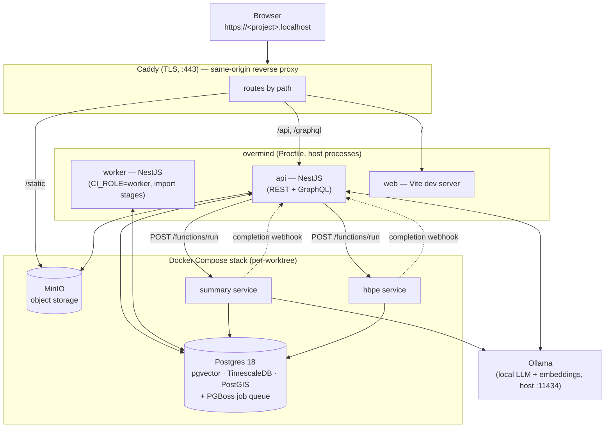
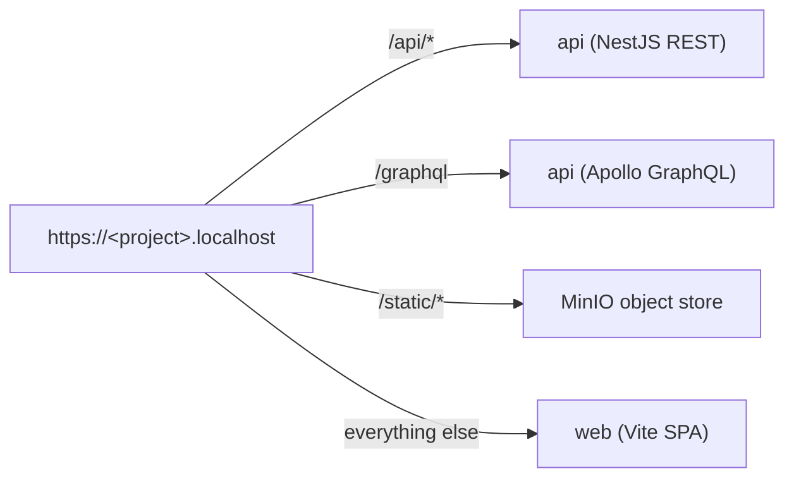

<p align="center">
    
</p>


# Companion Memory
### Personal Database for Companion Intelligence

### [INSTALL FROM STORE](https://hub.ci.computer/store?category=companion-intelligence)


Companion Memory uses the [PolyForm Noncommercial License 1.0.0](LICENSE.md). For common questions, see the [License FAQ](docs/License-FAQ.md).

Required Notice: Copyright LifeScope INC, DBA Companion Intelligence (https://ci.computer)

Front + Back End API + Web Monorepo

This repository serves as the web interface to the Companion Intelligence server.

## Docs

Full index: [`docs/README.md`](docs/README.md)

- **API reference:** [`docs/api/`](docs/api/README.md) — the three surfaces (GraphQL, REST, MCP), auth & conventions, and the bulk-ingest contract, all file:line-cited. The [GraphiQL IDE + codegen workflow](docs/graphql-api.md) is documented separately.
- **Architecture:** [`docs/architecture/architecture.md`](docs/architecture/architecture.md) (platform, services, data flows) and [`docs/architecture/Database.md`](docs/architecture/Database.md) (schemas, idempotency design, indexing, hypertables, migration workflow).
- **Backend developer guide:** [`backend/apps/api/README.md`](backend/apps/api/README.md) — domain/module layout, common infrastructure, the event bus, config system, DB workflow.
- **Runbooks:** [bulk load](backend/apps/api/db/postgres/BULK_LOAD_RUNBOOK.md) · [ingest reset](backend/apps/api/db/postgres/INGEST_RESET_RUNBOOK.md).
- **Import & ETL:** [`docs/import/etl-agent-guide.md`](docs/import/etl-agent-guide.md) (how a personal archive becomes rows in `ci.*`, and how to fix an import bug) and [`docs/cli/ci.md`](docs/cli/ci.md) (the `ci` command line, its own workspace at `backend/apps/cli`). Import is a domain inside this repo — `backend/apps/api/src/domains/import/` — not a separate service.
- **Features:** [`docs/saved-search-sharing.md`](docs/saved-search-sharing.md) (sharing + filter capture + read-only viewer) · [`docs/peer-federation.md`](docs/peer-federation.md) (asking questions across two Companion memories — Portal discovery, the three ask archetypes, free/busy without leaking a calendar).
- **The consent path (`/asks`):** [`docs/asks-system-guide.md`](docs/asks-system-guide.md) is the reference document — **read it before changing anything on the consent path**: grants, the disclosure ladder and its four ceilings, the capture-at-consent-time rule, the ask lifecycle local and federated, how to run the `/asks` page and the two-box federation harness, and the current gap list. Its companion [`docs/asks-threat-model.md`](docs/asks-threat-model.md) states what the feature does *not* defend against. Neither was linked from here before 2026-08-23.
- **Screenshots & the nav map:** [`docs/screenshots.md`](docs/screenshots.md) — the Power Rail, the Memory and Self hubs, every route that is now a redirect, and how the committed shots were captured and compressed.
- **User-facing:** the [Companion Memory page on docs.ci.computer](https://docs.ci.computer/docs/apps-available/first-party-apps/companion-memory-server) (in [CI-Docs](https://github.com/companionintelligence/CI-Docs)) covers the Explorer, search & filters, saved searches, and sharing — with screenshots.

This is a Yarn workspace monorepo, with a uv-managed Python workspace alongside it
(one `uv.lock` at the root covering `backend/apps/{hbpe,summary}` and
`backend/packages/*`). The structure:

```
├── backend/apps/
│   ├── api/                    # Main backend API service (NestJS)
│   ├── cli/                    # The `ci` command line (bundled HTTP client — no NestJS)
│   ├── hbpe/                   # HBPE behavioral-prediction sidecar (Python/FastAPI, ONNX)
│   └── summary/                # Summarization + document-parser sidecar (Python/FastAPI)
├── backend/packages/
│   ├── telemetry/              # Shared Python library: Sentry error reporting for the sidecars
│   └── tool-core/              # `@ci/tool-core` — the tool/intent vocabulary, execution policy and registry, with no NestJS in it, so MCP, the LLM dispatcher and the CLI can share one implementation of "may this caller run this intent?"
├── frontend/apps/
│   ├── web/                    # Main web application (React + Vite)
│   ├── ios/                    # Capacitor iOS shell around the web app (not a Yarn workspace)
│   ├── android/                # Capacitor Android shell around the web app (not a Yarn workspace)
│   ├── desktop/                # Tauri desktop app (not a Yarn workspace) — local orchestrator: runs this repo's own Compose stack, unlike ios/android which point at a remote appliance
│   └── mobile/                 # Pointer README left by the iOS/Android split
└── frontend/packages/
    ├── capacitor-local-hub/    # Capacitor plugin: on-device hub bridge (iOS + Android)
    ├── capacitor-local-llm/    # Capacitor plugin: on-device LLM (Android only — iOS vendors its own Swift implementation)
    ├── capacitor-speech/       # Capacitor plugin: speech (iOS + Android)
    ├── capture/                # Camera capture components
    ├── common/                 # Shared utilities and components
    ├── editor/                 # Rich-text editor package
    ├── shadcn/                 # ShadCN components (these typically shouldn't be modified directly, they're just local copies of our component library)
    └── template/               # A starter package to copy and paste when you need to create a new package in frontend/packages/
```

## Architecture at a glance

CI-Server is a multi-service stack: a NestJS API and a React/Vite SPA in front of
a Postgres 18 data tier (pgvector + TimescaleDB + PostGIS), with Python sidecars
(HBPE prediction, Summary) dispatched over the in-Postgres PGBoss job queue,
MinIO for object storage, and Ollama for local LLM/embeddings. The diagrams below are rendered by GitHub; for
the full design (domains, data model, data flows) see
[docs/architecture/architecture.md](docs/architecture/architecture.md).

### Local dev stack (`make dev`)

`make dev` brings up the whole stack per worktree and fronts it with a single
Caddy origin at `https://<project>.localhost`:



A startup supervisor (`scripts/dev-stack/`) allocates ports, brings up the Compose
services, runs migrations (dbmate), registers the Caddy route, and runs the whole
`Procfile` (`api`, `worker`, `web`) via overmind. Conventional host ports are used
when free, with ephemeral fallbacks so multiple worktrees never collide.

The `worker` process is not the only job consumer. Queues and crons declare a
`role`, and both default to `web`, so the `api` process consumes everything that
does not opt out — including the Python-function dispatch queues that call the
summary and hbpe sidecars. Only the import-stage queues and their crons in
`backend/apps/api/src/domains/import/` currently declare `role: 'worker'`, which
is what moves them off the request-serving event loop.

Three of those arrows cross from Docker to the host, and a host firewall sees
each of them as an inbound connection from the bridge network: the sidecars'
calls to Ollama or Lemonade (`:11434` / `:13305`), and their completion
webhooks back to the `api` process (`:3030`). CI-Hub prompts for the engine
ports on its own installs, but the webhook port is a `make dev`-only crossing
(a compose install reaches the api as `http://api:3030` inside one network),
so nothing prompts for it. The symptom is silent: sidecar runs complete, the
`py-fn-*` jobs sit `active` until they time out, and the sidecar log says
`function_run_callback_undeliverable` with a firewall hint. On a ufw host:

```bash
sudo ufw allow from 172.16.0.0/12 to any port 3030 proto tcp comment 'ci-server sidecar callbacks'
```

PowerSync is **not** part of the local stack: the `powersync` Compose service
declares `profiles: ["staging","production"]`, so `make dev` never starts it, and
`GET /api/powersync/token` returns 503 until both `POWERSYNC_URL` and
`POWERSYNC_JWT_SECRET` are configured.

### Caddy request routing

Because everything is served from one origin, the app is same-origin with no
CORS:



## TL;DR - Hermes

### STANDALONE SETUP

```
hermes memory setup
```
### Point to running Companion Memory Server URL


Automatic Setup


Select Memory provider


## Getting started

### Install pre-requisites

#### Homebrew

If you're on MacOS, install Homebrew with the instructions found [here](https://brew.sh/).

#### Docker

Install Docker on your machine to run containerized versions of our dependencies during development.
The easiest method here is downloading and installing the Docker Desktop app from [here](https://www.docker.com/products/docker-desktop/).
The CLI tools should be automatically installed alongside the app.

After it's installed, boot Docker Desktop and verify that it's running and accessible from the command line.

```bash
docker --version
```

#### NodeJS

##### Option 1 - asdf

[asdf](https://asdf-vm.com) can be used to manage multiple runtimes, including the NodeJS version. See:

* [getting started](https://asdf-vm.com/guide/getting-started.html)
* [asdf-nodejs](https://github.com/asdf-vm/asdf-nodejs))

Install with:

```sh
brew install asdf
asdf plugin add nodejs https://github.com/asdf-vm/asdf-nodejs.git
asdf install
node --version
```

Note that `asdf` uses the `.tool-versions` file to define the versions of the various runtimes it manages.

To keep compatibility with `nvm`, also add the following to `$HOME/.asdfrc`:

```txt
legacy_version_file = yes
```

##### Option 2 - nvm

We also maintain parallel compatibility with [nvm](https://github.com/nvm-sh/nvm)

```sh
brew install nvm
nvm install
node --version
```

Note that `nvm` uses the `.nvmrc` file to define the version of NodeJS to use.

#### uv (Python)

The HBPE and Summary sidecars are Python, managed as a [uv](https://docs.astral.sh/uv/)
workspace: one `uv.lock` at the repo root covers every member. `make health` fails
without `uv` on your `PATH`, and `make install`, `make lint` and `make test` all run
their Python half through it. The version is pinned exactly by `required-version` in
the root `pyproject.toml`; the interpreter is pinned by `.python-version` and uv
downloads it on demand, so Python itself is not in `.tool-versions`.

```bash
brew install uv
```

#### tmux

```bash
brew install tmux
```

#### Overmind

[Overmind](https://github.com/DarthSim/overmind) is a process manager that reads the repo's `Procfile` and runs each declared process (the `api` and `web` dev servers) inside a single `tmux` session. `make dev` requires it on your `PATH` and will fail fast if it's missing.

## MacOS
```bash
brew install overmind
```

## Linux

Install with Go:
```bash
go install github.com/DarthSim/overmind/v2@latest
```

Make sure to add the Go bin directory to your `PATH` if it's not already and start a new terminal:

```bash
export PATH="$PATH:$(go env GOPATH)/bin"
```

Because Overmind multiplexes through `tmux`, the `tmux` prerequisite above must be installed first.

#### Caddy

[Caddy](https://caddyserver.com) is the local reverse proxy. `make dev` configures it dynamically per worktree via its admin API — it terminates TLS for `*.localhost` and routes `/api`, `/graphql`, `/static`, and `/` to the right process.

## MacOS
```bash
brew install caddy
```

## Linux
Follow the instructions [here](https://caddyserver.com/docs/install#linux) to install Caddy on Linux. The recommended method is via the official APT repository:

```bash
sudo apt install -y debian-keyring debian-archive-keyring apt-transport-https
curl -1sLf 'https://dl.cloudsmith.io/public/caddy/stable/gpg.key' | sudo gpg --dearmor -o /usr/share/keyrings/caddy-stable-archive-keyring.gpg
curl -1sLf 'https://dl.cloudsmith.io/public/caddy/stable/debian.deb.txt' | sudo tee /etc/apt/sources.list.d/caddy-stable.list
sudo chmod o+r /usr/share/keyrings/caddy-stable-archive-keyring.gpg
sudo chmod o+r /etc/apt/sources.list.d/caddy-stable.list
sudo apt update
sudo apt install caddy
```

You may need to disable the caddy service and enable caddy-api:

```bash
sudo systemctl disable caddy
sudo systemctl enable caddy-api
```

Run it as a background service so its admin API is always on `:2019` and it owns `:443`:

```bash
brew services start caddy
```

Caddy's global config at `/opt/homebrew/etc/Caddyfile` only needs to pin the admin port — per-worktree routes are added at runtime by `make dev`, never written to this file:

```caddyfile
{
	admin localhost:2019
}
```

**Trust the local CA.** Caddy serves `*.localhost` over HTTPS with its own CA, which depends on the `HOME` Caddy runs under. The brew service runs with `HOME=/opt/homebrew/var/lib`, so trust that CA explicitly (prompts for your password):

```bash
HOME=/opt/homebrew/var/lib XDG_DATA_HOME=/opt/homebrew/var/lib caddy trust
```

#### Ollama

Ollama is an open-source tool that enables users to run large language models (LLMs) like Llama, Mistral, and Gemma directly on their local machines.
The easiest method to install Ollama is by following the download instructions [here](https://ollama.com/download).

Note that if you're on MacOS and you've already installed Homebrew you can instead run:

```bash
brew install ollama
```

The `ollama` binary can serve LLM responses from a variety of models that can be each be downloaded from [here](https://ollama.com/search).

The `ollama` binary can be daemonized if using Homebrew with:

```bash
brew services start ollama
```

Test that Ollama is running using:

```bash
ollama pull gemma4:e4b
ollama run gemma4:e4b "say hello"

ollama pull nomic-embed-text
ollama run nomic-embed-text "embed this"
```

#### poppler-utils (optional)

The Hulu importer reads the "Personal Information Report" PDF with `pdftotext`, which ships in `poppler-utils`. The API image installs it; on a dev machine it is only needed to import or recognize a Hulu report (the Hulu PDF tests skip without it).

```bash
brew install poppler        # macOS
sudo apt install poppler-utils   # Debian / Ubuntu
```

## Initialize development environment

Everything below is orchestrated by a single command:

```bash
make dev
```

`make dev` brings up a complete, **per-worktree isolated** dev stack and is the entry point for local development. It:

1. checks prerequisites (Node version, Yarn version, `uv`, overmind, Caddy + its admin API on `:2019`, Ollama + required models — pulling any that are missing);
2. runs `make init`, then builds the local service images — but only when one is missing or `REBUILD=1` is set; a warm spin-up reuses them;
3. brings up this worktree's Docker stack — **PostgreSQL** (primary DB + PGBoss job queue), **Minio** (S3 object storage), and the **summary** / **hbpe** services — preferring the conventional host ports when free and falling back to ephemeral ports otherwise, so multiple worktrees never collide;
4. runs database migrations;
5. registers a **Caddy** route at `https://<project>.localhost` and runs the `Procfile` — `api`, `worker` (`CI_ROLE=worker`, which consumes only the queues and crons marked `role: 'worker'` — today the import stages) and `web` — via overmind, in the foreground. Every other queue and cron defaults to `role: 'web'`, so the `api` process consumes it.

`<project>` is the git-derived name — `ci-server` in the main checkout, `ci-server-<worktree>` in a linked worktree — the same identity used for the Docker Compose project and the overmind session. Caddy terminates TLS and routes by path (`/api` → api, `/graphql` → api, `/static` → object store, everything else → vite), so the app is same-origin with no CORS.

`Ctrl-C` tears the Caddy route down and stops the stack. If a crashed run leaves a stale route behind, clear it with:

```bash
make dev-down
```

To run the api/web individually instead, see their READMEs ([api](backend/apps/api/README.md), [web](frontend/apps/web/README.md)).

#### libvips (required)

Image previews, image dimensions and the renditions sent to the vision model are produced by the `vips` command-line tools (`libvips-tools`). The API shells out to them, so the machine running the API needs them — `make health` checks. This replaced the `sharp` npm package because sharp's prebuilt libvips has no HEVC decoder, the codec inside every iPhone HEIC.

```bash
brew install vips                                        # macOS
sudo apt install libvips-tools                           # Debian (HEVC decoder is built into libheif)
sudo apt install libvips-tools libheif-plugin-libde265   # Ubuntu 24.04 / Mint 22 (HEVC decoder is a separate plugin)
```

On Ubuntu 24.04 the plugin is not optional: its `libheif1` used to depend on `libheif-plugin-libde265` and the current security update (1.17.6-1ubuntu4.8) demoted that to a suggestion, so a fresh or upgraded machine opens a HEIC and then fails every tile with `heif: Unsupported feature: Unsupported codec`. `make health` decodes a HEIC fixture to catch this; the Docker image is Debian and is unaffected.

### Reaching the right database

Each worktree's stack publishes PostgreSQL on **its own host port**, but `.env`
pins `DATABASE_PORT=5432`. Anything that resolves the port from `.env` therefore
lands on whichever stack currently holds 5432 — often a different worktree.
Applying one branch's migrations to another branch's stack leaves that database
on a schema no branch describes, and dbmate cannot undo it: the versions are
recorded, so the next `migrate` is a silent no-op and the app queries tables
that were never created.

**Run DB commands through `make`** (`make migrate`, `make seed`, `make dbshell`,
`make dburl`, `make dbclear`). Those targets read the real port off this
project's running `database` container, and error out if the stack is not up
rather than falling back to 5432. A bare `yarn workspace @ci/be-api migrate`
does not.

Two guards back this up:

- `make dev` stamps the owning compose project onto the database (the
  `ci.stack_key` setting). `yarn migrate` refuses to write to a database another
  stack owns.
- The api refuses to boot when `schema_migrations` does not match the migration
  files on disk, naming the drift in both directions instead of failing later
  with an unrelated-looking missing relation. Set `CI_SKIP_SCHEMA_CHECK=1` to
  boot anyway.

A database that is *ahead* of the branch cannot be migrated back — recreate the
volume:

```bash
make dbdestroy && make migrate
```

### OAuth in a worktree

Most local development needs no OAuth. The provider always redirects back to one fixed, registered host (the host of `OAUTH_CALLBACK_URL` in `.env`, `memory.local.companionintelligence.com`), never the per-worktree `<project>.localhost`. Only one stack can answer that host at a time. With your stack running, claim it for the current worktree:

```bash
make oauth
```

This makes the static OAuth host 307-redirect to this worktree's stack (`https://<project>.localhost`), preserving the path and query, so the callback lands on your stack. It also pins Caddy's internal (locally-trusted) CA for that host, so the non-public domain gets a working cert with no public ACME, trusted through the same `caddy trust` you already ran. The claim is released automatically when the stack tears down, or explicitly with `make oauth-down`.

The OAuth host must resolve to loopback on your machine so the browser reaches Caddy, so add it to `/etc/hosts`:

```
127.0.0.1 memory.local.companionintelligence.com
```

### Seed and log in

With the stack up, seed development data in another shell:

```bash
make seed
```

Then open `https://<project>.localhost` (e.g. **https://ci-server.localhost**) and log in:

```
Username: jsmith@example.com
Password: replace-me-pw-000000
```

With the stack up and seeded, this is also the state from which to capture UI
screenshots for the docs — see the [screenshot capture guide](docs/screenshots.md)
for the screen list, naming, and conventions.

If something is wedged, reset the environment (stops the stack and removes this project's volumes/networks):

```bash
make reset
```

## Available Commands

Run `make` from the project root to see all available commands with descriptions.

Four of those targets — `build`, `dev`, `test` and `test-db` — are
one-line delegations to a TypeScript program at [`scripts/xtask/`](scripts/xtask),
run through `tsx` (`yarn tsx scripts/xtask/index.ts <command> ...`). The `make`
targets stay the documented entry point and still take the variables they always
did — `ENV`, `GPU`, `REBUILD`, and overrides like `AMDGPU_TARGETS` or
`FLASH_ATTN_WHEEL_IMAGE=`, which a `make build VAR=value` still hands through as
environment even though the Makefile no longer declares most of them. The program
is where the logic those recipes used to carry as shell now lives — the image set
and its build order, the GPU/wheel-image tag derivation, the `ci.source-tree`
staleness stamp `dev` reads before deciding to rebuild — and every subcommand
takes `--help`. `make health` is deliberately *not* one of them: a prerequisite
checker must not require the prerequisites, so it stays pure shell in the
Makefile and `xtask dev` shells back out to `make health` before anything else.
Every other `make` target is unchanged.

### Setup & Initialization

| Command | Description |
|---------|-------------|
| `make init` | Initialize repository after checkout (corepack/yarn activation, installs both dependency stacks, sets up VS Code SDKs, prepares git hooks, and copies `.env.default` → `.env` if absent) |
| `make install` | Install project dependencies only — `yarn install` (with the GitHub Packages token) **and** `uv sync --all-packages` |
| `make health` | Check prerequisites (Node.js version, Yarn version, `uv`) and report per-stack data volumes |

`frontend/` consumes `@companionintelligence/*` packages from GitHub Packages, which requires a
`NODE_AUTH_TOKEN` with `read:packages` (see `.yarnrc.yml`). A normal `gh auth login` does not
grant that scope, so a bare `yarn install` 403s on `@companionintelligence/*` until you refresh
it. From the repo root:

```bash
gh auth login
gh auth refresh -s read:packages
export NODE_AUTH_TOKEN=$(gh auth token)
yarn install
```

`make init` and `make install` do the refresh and export for you via
[`scripts/gh-packages-auth.sh`](scripts/gh-packages-auth.sh). To export the token into the
current shell without installing, `source scripts/gh-packages-auth.sh`.

### Development

| Command | Description |
|---------|-------------|
| `make dev` | Bring up the full per-worktree dev stack (Docker services + migrations + Caddy route at `<project>.localhost` + `api`/`worker`/`web` via overmind). Foreground; Ctrl-C tears down. |
| `make dev-down` | Deregister this worktree's Caddy route (clears a stale route from a crashed run) |
| `make oauth` | Point the canonical OAuth host at this worktree's running stack (replaces any prior claim) |
| `make oauth-down` | Release the canonical OAuth host claim |
| `make url` | Print this worktree's stack URL (`https://<project>.localhost`) |
| `make urls` | Show the URLs this worktree's running stack serves (read live from Caddy) |
| `make tunnel` | Expose this running stack at `https://dev.companionintelligence.com` via Cloudflare Tunnel (see [`infrastructure/cloudflare/README.md`](infrastructure/cloudflare/README.md)) |
| `make graphql` | Generate GraphQL schema and frontend types |
| `make tooling` | Run development tooling services |
| `make stop` | Stop all running services (containers stay, data preserved) |
| `make reset` | Reset the local development environment (stops the stack, removes this project's volumes/networks) |

### Database

| Command | Description |
|---------|-------------|
| `make dbclear` | Clear the data stored in the PostgreSQL database |
| `make dbdestroy` | Drop all PostgreSQL data including tables |
| `make dbshell` | Open a psql shell to the PostgreSQL database |
| `make dburl` | Print this worktree's PostgreSQL connection URL (for DataGrip, psql, etc.) |
| `make migrate` | Run database migrations |
| `make seed` | Seed database with John Smith user and demo data |

### Build & Deploy

| Command | Description |
|---------|-------------|
| `make build` | Build images (`ENV=local\|staging\|production`, default `local`; `GPU=cpu\|cuda\|rocm`, auto-detected from this host's GPU if not passed — see `scripts/detect-gpu.sh`; `IMAGE=<name>` builds a single image; `DRY_RUN=1` prints the plan instead of building) |
| `make smoke-api` | Verify the built API image can run `migrate` with production-only dependencies (a devDependency in either half fails the container at startup). Runs as part of `make publish` |
| `make staging` | Run the staging deployment |
| `make production` | Run the production deployment |
| `make publish` | Publish CI-Server images and metadata to the CI-Portal store (runs `publish-build`, then pushes) |
| `make publish-build` | Everything `publish` does before the push: `init`, `build ENV=production`, `smoke-api` and `smoke-stack`. `publish.yml`'s build job runs this with a read-only token and pushes from a separate job |
| `make publish-quiet` | Publish to the CI-Portal store in quiet mode (skips the build/smoke steps) |
| `make seed-production` | Seed the production database via an ephemeral proxy |

#### Building one image, and seeing what a build would do

With no `IMAGE`, `make build` builds the `ENV`-appropriate set, in this order:

```
local        setup-database database object-store summary hbpe
staging      api gateway setup-database database object-store summary hbpe
production   api gateway setup-database database object-store setup-secrets summary hbpe
```

```bash
make build IMAGE=hbpe    # just this one — api, gateway, setup-database, database,
                         #   object-store, setup-secrets, summary or hbpe
make build DRY_RUN=1     # print the exact docker build commands — every --build-arg
                         #   and, on a cuda/rocm host, the wheel-image tags — and build nothing
```

`IMAGE=` bypasses the `ENV` set rather than filtering it, so any of the eight can
be built from any `ENV`. `DRY_RUN=1` touches no Docker daemon and skips the
`uv lock --check` freshness gate, so it also answers what a wheel-pin bump would
compose from a host that cannot build that variant — `make build DRY_RUN=1 GPU=cuda`
prints the CUDA wheel-image tags with no NVIDIA hardware in sight.

#### GPU acceleration (HBPE)

`GPU` picks which HBPE image is built. It is auto-detected, so passing it is
only needed to override the detection:

```bash
make build GPU=rocm                        # AMD, gfx target auto-detected
make build GPU=rocm AMDGPU_TARGETS=gfx1030 # …or named explicitly
make build GPU=cpu                         # no GPU
```

On AMD, `AMDGPU_TARGETS` is the gfx architecture llama.cpp's HIP backend
compiles for — `gfx1100` for an RX 7900, `gfx1030` for a 6800/6900.
`scripts/detect-gpu.sh --amdgpu-arch` reports this host's. Override it on a
machine with both an APU and a discrete card, where detection takes whichever
`rocminfo` lists first.

Building the image is only half of it: the container also needs the GPU passed
in at runtime, which `docker-compose.rocm.yml` does. `make dev` layers that
file in automatically when `/dev/kfd` and `/dev/dri` exist. For staging or
production, add it explicitly:

```bash
docker compose -f docker-compose.yml -f docker-compose.production.yml \
               -f docker-compose.rocm.yml --profile production up -d
```

Without it the service still starts and still answers — it just finds no HSA
agent and runs on the CPU, silently. If you are unsure which you have, ask the
container rather than assuming:

```bash
docker compose exec hbpe-service python -c \
  "import torch; print(torch.cuda.is_available(), torch.cuda.get_device_name(0))"
```

### Releasing & image tags

`.github/workflows/publish.yml` builds every `companion/*` image natively per architecture, merges
the legs into a multi-arch manifest list, and registers the result with CI-Portal.

**Image publish is not triggered by pushing a tag — and, as of 2026-09-17,
nothing else is either.** Every workflow in this repo, including the *check*
workflows `ci.yml`, `e2e.yml`, `desktop-e2e.yml`,
`migration-integrity-check.yml`, `style-canon-lint.yml`, `consent-path-gate.yml`
and `codeql.yml`, is `workflow_dispatch`-only, so an absent or green check
means nobody dispatched it, not that anything passed. (`codeql.yml` used to run
on push/PR plus a weekly cron and was **red on every run by baseline**; it was
gated to dispatch for exactly that reason, so it no longer reports at all.)
`pr-gate.yml` — the one workflow that ran on every PR — was deleted to cut the
GitHub Actions bill; `benchmark-unit.yml`, `mobile-release.yml` and
`desktop-release.yml`, the other three that used to run on their own, were
gated to dispatch-only the same day.

**Pushing a client-release tag no longer ships anything by itself.**
`mobile-release.yml` (`ios-v*` / `android-v*` / `mobile-release-v*`) and
`desktop-release.yml` (`desktop-v*`) used to submit to TestFlight/Play, or
build the signed desktop lanes, the moment a matching tag was pushed — that
auto-submit is gone along with every other automatic trigger. Tag, then
dispatch the workflow on that tag; see `docs/CI.md` for the exact commands
(mobile's dispatch defaults `dry_run: true`, so a real release needs
`-f dry_run=false`).

**[`docs/CI.md`](docs/CI.md) carries the maintained per-workflow trigger table,
and is the only place it is maintained** — the full list is deliberately not
repeated here, because the same counts were restated in four files and went
stale in three of them. It also ships the `grep` that re-derives the table from
the `on:` blocks, so check there rather than trusting this paragraph's summary.

**No check gates a merge**, whether it ran or not: `main` carries no
`required_status_checks` and `required_approving_review_count: 0` (verify with
`gh api repos/companionintelligence/CI-Server/branches/main/protection --jq 'keys'`).
Cut a container release by
tagging and then dispatching **on that tag**, since `VERSION` is parsed from the ref
(on a branch ref it resolves to the literal `refs/heads/main`, which is not a legal
image tag — publish.yml's `Refuse to publish a non-release ref` guard rejects a
`--ref main` dispatch in seconds, before either 150-minute build leg starts, but
the run still ends red and publishes nothing):

```bash
git tag v2026.7.27 && git push origin v2026.7.27
gh workflow run publish.yml --ref v2026.7.27
```

See [`docs/CI.md`](docs/CI.md) for the full gated-CI story and how to run each check locally.

| Tag | Meaning |
|---------|-------------|
| `v<YYYY>.<M>.<D>` | A release. Use `v<YYYY>.<M>.<D>.<N>` for a second release the same day. |
| `<version>` (no `v`) | What the images are tagged with — the leading `v` is stripped by both the workflow and `make publish`, so `v2026.7.27` publishes `companion/*:2026.7.27`. This is the form CI-Marketplace pins. |
| `latest` | The **newest release tag only**. Repointed by the publish workflow when, and only when, the tag being built is release-shaped *and* sorts newest. A back-tagged or re-cut older release leaves it alone. |
| `dev-<short-sha>` | What an untagged local `make publish` produces. Never `latest` — see below. |

`:latest` must never be minted by hand. It was a stale, single-arch, three-month-old orphan for exactly
that reason: `scripts/publish/publish.sh` used to fall back to `VERSION=latest` for untagged commits, so
any `REGISTRY=ghcr.io/... make publish` from an untagged checkout overwrote it with a local dev build
pointing at no release at all.

### HBPE

| Command | Description |
|---------|-------------|
| `make predict` | Run the HBPE prediction pipeline against the local container |
| `make predict-production` | Run the HBPE prediction pipeline against the production container |

### Admin Scripts

| Command | Description |
|---------|-------------|
| `make chatreset` | Reset John Smith's demo threads |
| `make filereset` | Clear all files from the system |
| `make gentoken` | Generates a stable access token for use during development |
| `make signup` | Generates a set of signup codes for user registration |
| `make testuser` | Create a local user and print a fresh API key for it |
| `make userpw` | Change a user's password |

### Lint, format & test

The `make` targets cover **both stacks** — the TypeScript one and the Python one:

| Command | Description |
|---------|-------------|
| `make lint` | `yarn lint` + `yarn format:check`, then `ruff check`, `ruff format --check`, `mypy`, `uv lock --check` (catches a stale lockfile) and the `ci.*` namespace guard |
| `make format` | `prettier --write` across the JS/TS sources, then `ruff format` and `ruff check --fix` |
| `make test` | `yarn workspace <name> run test` for every workspace that declares one, then the desktop `node --test` pass, `uv run pytest` and the two `sh` suites. Every step runs even if an earlier one fails, and a summary table says which did not pass |
| `make test-db` | The database-backed `be-api` jest suites, against a throwaway Postgres container (Docker only; never your `.env` database). Fails on any unexplained skip or any database crash. `ARGS=` selects jest paths/flags, `KEEP=1` leaves the container up (`KEEP_FOR=12h` sets how long later runs leave it alone; default 24h), `NO_RETRY=1` skips the serial re-run of failed files — see [`docs/CI.md`](docs/CI.md#running-the-database-backed-suites-locally-make-test-db) |

The repo root now declares `test` and `typecheck` scripts of its own: `yarn test`
runs the xtask unit suite (`tsx --test "scripts/xtask/**/*.test.ts"`), and
`yarn typecheck` runs `tsc --noEmit` over what the root `tsconfig.json` includes —
`scripts/**`, `tests/**` and the Playwright config, which nothing ran before.
Neither needs naming anywhere else: `foreach --all` stopped excluding the root
workspace the moment those scripts existed, so `make test` runs the suite and
`make typecheck` (`yarn workspaces foreach --all run typecheck`) runs the
type-check — locally only now; the CI lane that used to run this on every PR
(`pr-gate.yml`'s `Type check packages`) was deleted along with the rest of
that file, and it had no twin in `ci.yml`.

The underlying Yarn scripts are still there if you only want the JS half:

```bash
yarn lint      # oxlint + ESLint across the entire monorepo
yarn lint:fix  # Auto-fix linting issues
```

### Backend API Commands (`backend/apps/api`)

```bash
yarn dev                    # Start development server with nodemon
yarn migrate:make <name>    # Create a new migration file
yarn migrate:down           # Roll back the last migration
yarn depcheck               # Check import boundaries / cycles (dependency-cruiser)
yarn test                   # Run the backend Jest suite
yarn typecheck              # Type-check without emitting
yarn lint                   # Lint backend code
yarn lint:fix               # Auto-fix backend linting issues
```

### CLI Commands (`backend/apps/cli`)

The `ci` command line — its own workspace, one dependency, no NestJS. Full
reference: [`docs/cli/ci.md`](docs/cli/ci.md).

```bash
yarn dev <cmd>              # Run from source via tsx (datasources, recognize, import,
                            #   inbox, runs, push, stats, doctor, backfill, peers,
                            #   grants, asks). From the root:
                            #   yarn workspace @ci/cli dev <cmd>
yarn build                  # Bundle to a single file at dist/ci.cjs
yarn test                   # Run the Vitest suite
yarn typecheck              # Type-check without emitting
```

### Frontend SPA Commands (`frontend/apps/web`)

```bash
yarn dev                    # Start Vite development server
yarn storybook              # Start Storybook for component development
yarn test                   # Run the Vitest suites (node + jsdom projects)
yarn typecheck              # Type-check without emitting
yarn lint                   # Lint frontend code
yarn lint:fix               # Auto-fix frontend linting issues
```
