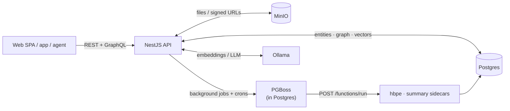

# Companion Intelligence — Backend API (`@ci/be-api`)

The NestJS 11 service that is the memory brain of the appliance: personal database,
GraphQL/REST/MCP API, RAG/search indexing, and the enrichment/maintenance pipelines.
It listens on `0.0.0.0:3030` and is fronted same-origin by a proxy that strips the
browser's `/api` prefix (Caddy under `make dev`).

**Start here:**

- **API reference** (endpoints, auth, conventions): [`docs/api/`](../../../docs/api/README.md)
- **Database architecture** (schemas, idempotency, indexing, hypertables): [`docs/architecture/Database.md`](../../../docs/architecture/Database.md)
- **Platform architecture**: [`docs/architecture/architecture.md`](../../../docs/architecture/architecture.md)
- **Runbooks**: [bulk load](db/postgres/BULK_LOAD_RUNBOOK.md) · [ingest reset](db/postgres/INGEST_RESET_RUNBOOK.md)

## Getting started

See the [repo README](../../../README.md) for prerequisites and `make dev`, which brings up
the whole per-worktree stack (Postgres, MinIO, hbpe/summary services, Caddy route,
api + web dev servers). To run just this service against an already-running stack:

```bash
yarn dev          # nodemon + ts-node; watches src/, config/, and the repo-root .env
```

> In normal local development you don't run this directly — `make dev` from the
> repo root starts `api`, `worker`, and `web` via overmind behind Caddy (see the
> [Procfile](../../../Procfile)). Run `yarn dev` on its own only when you want
> the API server in isolation.

## How a request flows

The API is a NestJS app exposing REST (`/api`) and Apollo GraphQL (`/graphql`),
backed by Postgres 18 (pgvector + TimescaleDB + PostGIS). Async work is handed to
PGBoss, the in-Postgres job queue, which also dispatches the Python sidecars.
Embeddings and LLM calls go to Ollama.



For the full domain breakdown and data model, see
[docs/architecture/architecture.md](../../../docs/architecture/architecture.md).

Everyday commands (run from `backend/apps/api`):

```bash
yarn test               # jest (598 spec files; colocated __tests__/ + *.spec.ts)
yarn typecheck          # tsc --noEmit
yarn lint / lint:fix    # oxlint + eslint
yarn depcheck           # dependency-cruiser import rules (see below)
yarn graphql:generate   # resolvers → src/domains/graphql/__generated__/schema.graphql
```

## Source layout

```
src/
├── domains/     # one NestJS module per domain (controllers/, services/, entities/, listeners/)
├── common/      # cross-cutting infrastructure shared by all domains
├── main.ts      # bootstrap (bodyParser off — see body limits below)
└── configuration.ts
```

### Domains (`src/domains/`)

| Domain | Purpose |
|---|---|
| `memory` | Core timeline records + graph-facing services: `EventService`, `CommunicationService`, `ContentService`, `ItemService`, `PersonService`, `PlaceService`, `ConceptService`, `FileService` |
| `graph` | Graph primitives: nodes/relationships, `entity_identifiers`, `item_relationships`, bulk graph ingest |
| `graphql` | Apollo schema assembly: resolvers (39), DataLoaders (27), complexity plugin, GraphiQL page |
| `search-ingress` | The search **write** path: per-entity `*SearchIndexListener`s consuming the `search-index` queue → `ci_search.embeddings` / `ci_search.vectors`; skip markers; the shared search-text recipes in `searchTexts.ts` (also used by the pipeline's `index.*` stages) |
| `search-next` | The search **read** path (the `search` GraphQL query): candidate-set + post-filter retrieval, tags |
| `pipeline` | The durable, versioned enrichment ledger (`ci.pipeline_state`) + one generic worker: 37 registered stages across `index.*` / `enrich.*` / `clean.*` / `promote.*`, a control tick, dead letters and replay. Re-processing is triggered by bumping a stage's integer in `versions.ts`. See [`src/domains/pipeline/README.md`](src/domains/pipeline/README.md) |
| `import` | The archive importer (Google Takeout, Twitter, iCloud, browser history…), ported from the now-retired CI-Import-Tools. `unpack → parse → media → push` (`media` uploads the archive's photos, videos, voicemails and MMS parts to the object store and stamps the resulting file id onto the staged rows), each a PGBoss job with its own queue and a row in `ci_import.import_stages`; `/api/import/*` backs the `/sources/import` wizard and the `ci` CLI, which is its own workspace at `backend/apps/cli` |
| `ingest` | The REST bulk-ingest plane (`/v1/*`) for external machine clients: NDJSON or `{ records: [] }` envelopes per kind, plus `POST /v1/ingest/finish` + `GET /v1/ingest/status` |
| `maintenance` | Post-ingest enrichment + operations: geocoding, location estimation, people/graph linking backfills, search-index backfill/cleanup, index deferral, ingest reset, the `orchestrate` chain (`/api/maintenance/*`). Superseded by `pipeline` for most legs, but not yet removed |
| `intelligence` | Questions/answers/actions — the "ask my memory" surface. (The web UI now calls this **Reflections**; the tables, services and GraphQL types are still `question*`.) |
| `conversations` | Chat threads/messages |
| `llm` | Ollama / OpenAI-compatible chat + vision + embeddings, durable queued chat generation and its stream/cancel routes, the persisted endpoint setting |
| `smart-rotation` | Scheduled answer inference and entity promotion — split out of `llm` to break an `llm ↔ personalization` import cycle |
| `personalization` / `persona` | Context prompts, "about you", and persona × task compose |
| `daily-metrics` | `ci_derived.daily_metrics` feature store + the correlation / anomaly / suggestion engines over it |
| `python-functions` | The pg-boss replacement for Temporal: crons fan out per-user jobs, a dispatch listener POSTs them to `/functions/run` in the summary and HBPE sidecars, and an authenticated callback webhook completes them |
| `connections` / `etl` | OAuth connector catalog + instances; per-provider sync services and sync-job bookkeeping |
| `auth` / `user` / `onboarding` | Sessions (JWT), API keys, OIDC (CI-Portal), the CI-Hub app-connect flow (`/api/connect/*`), signup codes, profiles |
| `files` | Uploads, previews, MinIO-backed storage, saved searches |
| `parsing` | Document text extraction and chunking into `ci_search`-indexable file chunks (MarkItDown extractor + chunker) |
| `events` | **The in-process event bus** (PGBoss) — not calendar events; see below. Also hosts the Jobs API (`/api/jobs*`) and the job taxonomy |
| `agent` / `mcp` / `tools` | Agent memory (`/memory/*`), the MCP server (`POST /mcp`), the shared ToolRegistry + intent catalog served at `/api/agent/intents` (`/api/intents` still serves as the legacy prefix) |
| `asks` / `peers` | The interpersonal **Ask** primitive — ask lifecycle, standing consent grants, per-ask audit — and peer federation between two boxes |
| `portability` / `solid` | Account export/import archives; the Solid Protocol read facade (behind the `solid.protocol` flag) |
| `planning` | Task list CRUD (`ci.tasks`), defer/reopen, tenancy isolation |
| `schedule` | Schedule surface: `event_candidates` live in their own table (not `ci.events`) so HBPE never trains on hypotheticals; accept mints a real event, decline/snooze/return-to-slate manage the possible layer. `ci.rhythms` is P2 fit-solver scaffolding (schema only). |
| `activity`, `notes`, `devices`, `position`, `browser-activity`, `geocode`, `entity-resolution`, `summaries`, `predictions`, `powersync`, `user-snapshots`, `audit` | What they say on the tin — `predictions` proxies HBPE histogram/week/due forecasts, `activity` rolls per-domain hourly counts up on a 15-minute cron, `powersync` mints the sync token at `GET /api/powersync/token` |
| `identity` | Canonical URLs, natural keys and the identity ladder. Dependency-free by design so it can be lifted into a package — **and nothing consumes it yet**; wiring it into the ingest write paths is still planned work |

### Common infrastructure (`src/common/`)

| Piece | What it does |
|---|---|
| `guards/` | `JwtOrApiKeyAuthGuard` (Bearer JWT ∥ api key, as `x-api-key` or Bearer ∥ Portal OIDC) and friends. No global guard: a route with no guard is public. See [auth-and-conventions.md](../../../docs/api/auth-and-conventions.md). |
| `context/` | AsyncLocalStorage request context — auth strategies set `{ userId }`, services read it via `toServiceContext()`, which throws if unauthenticated |
| `pipes/` | zod-based `ValidationPipe` (the codebase validates with zod, not class-validator) |
| `middleware/` | `BodyParserMiddleware` — `main.ts` boots with `bodyParser: false` and this applies per-route limits (default 100 KB; `/graphql` gets 10 MB for bulk mutations) |
| `persistence/` | **`bulkInsertIdempotent`** (`bulkUpsert.ts`) — the set-based `INSERT … ON CONFLICT` engine behind every bulk-ingest path: one transaction, provenance-triple arbiter, optional self-heal columns (`ingestRefreshColumns.ts`), hypertable time-bounding, and **internal chunking** via `computeChunkSize` (bind-param-budget-sized sub-batches, so callers never hit the 65535-parameter cliff — chunking is not the caller's job) |
| `embeddings/` | `EmbeddingGenerationService` — batched `nomic-embed-text` (768-dim) via Ollama; config block `embedding` |
| `feature/` | Feature flags (`config features` block + `/_internal/features/global`) |
| `crypto/`, `logging/`, `filters/`, `schedule/`, `rpc/` | Token encryption, pino logging, exception filters, cron plumbing |

### The event bus (`src/domains/events/`)

A typed, persistent pub/sub layer over **PGBoss** (jobs live in the `pgboss` schema of the
main database):

- **`EventService.send()` / `sendMany()`** publish events; `sendMany` is the bulk form used
  by backfills (per-row awaited `send()` at ~1M scale was a throughput killer).
- **`@OnEvent`** subscribes a service method to an event on a specific queue; the registry
  (`event-registry.ts`) types every event payload.
- **Routing:** a send is delivered only to the queues that have a registered listener for
  that event (`EventListenerRegistry.getQueuesFor`, shared by the PGBoss and local
  implementations). This replaced the old fan-out-to-every-queue behaviour, where each
  worker no-opped on events it did not handle. An event with **no** listener anywhere
  resolves to zero queues and is a **silent drop** — boot logs a warning for these.
- **Priority tiers:** `INTERACTIVE_JOB_PRIORITY` (10), `DEFAULT_JOB_PRIORITY` (0),
  `BACKFILL_JOB_PRIORITY` (-10) — PGBoss fetches highest priority first.
- The big consumer family is `search-ingress/listeners/*SearchIndexListener.ts` on the
  `search-index` queue; other listeners cover previews, geocoding, LLM enrichment, ETL
  orchestration, import stages, and maintenance backfills.
- Queue worker concurrency comes from the `queues` config block
  (`concurrency`/`fetchBatchSize`) — for large index drains this, not Ollama, is usually the
  bottleneck.

### Ingest: interactive vs. bulk (deferred indexing)

Two write modes, one invariant (provenance-triple idempotency —
[Database.md](../../../docs/architecture/Database.md#idempotency--dedup-design)):

- **Interactive** single-row creates emit a per-row `*CreatedEvent` → the search index
  updates live.
- **Bulk** (the GraphQL list mutations `createEvents`, `createCommunications`, … and the
  `/v1/*` REST lanes, for external clients; the in-repo import domain calls the same
  services directly from `PushStage`) pass `emitCreated:false` — no per-row fan-out. Rows
  are persisted and idempotent but **not searchable** until a sweep indexes them. A push
  emits `SearchIndexBackfillRequestEvent`, which the **pipeline** domain's
  `SearchIndexSweepRequestListener` turns into a ledger-backed sweep of the matching
  `index.embed*` / `index.vector*` stages; `POST /api/maintenance/search-index/backfill`
  remains as the manual, embedding-exists version. The full post-import chain is
  `POST /api/maintenance/orchestrate`; see
  [rest.md — what the importer drives](../../../docs/api/rest.md#what-the-importer-drives-during-a-run)
  and the [bulk load runbook](db/postgres/BULK_LOAD_RUNBOOK.md).

## Configuration

[node-config](https://github.com/node-config/node-config) JSON layers in `config/`:

- `default.json` → `development.json` / `production.json` / `test.json` (by `NODE_ENV`) →
  **`custom-environment-variables.json`** (maps env vars onto config paths — an env var
  wins over every file).
- Secrets/env come from the **repo-root `.env`** (every script sets
  `DOTENV_CONFIG_PATH=../../../.env`); deployed containers load `/run/secrets/.env.secrets`
  via `entrypoint.sh`.
- Notable blocks: `db` (also consumed by the dbmate wrapper), `auth` (JWT, portal OIDC),
  `graphql.maxQueryComplexity` (150), `embedding` (model/batching), `queues`
  (worker concurrency), `features` (flags, e.g. `hbpe`, `shared.search`), `services`
  (Ollama/MinIO endpoints), `geocoding`.

## GraphQL

Code-first Apollo: the schema is assembled from resolver decorators and emitted to
`src/domains/graphql/__generated__/schema.graphql` (generated — do not edit). After
changing resolvers/types:

```bash
make graphql              # from the repo root: backend schema + frontend typed documents
yarn graphql:generate     # just the backend half (no DB needed)
```

- **Full API reference:** [`docs/api/graphql.md`](../../../docs/api/graphql.md) — query and
  mutation catalog, the bulk-ingest contract, types, errors.
- **GraphiQL IDE + codegen workflow:** [`docs/graphql-api.md`](../../../docs/graphql-api.md)
  — the in-app IDE at `/api/graphiql`, API-key auth flow, theming, troubleshooting.

## Database workflow

Hand-written SQL migrations (dbmate format) in `db/postgres/migrations/` are the schema's
source of truth; update the TypeORM entities to match. Details, schema map, and indexing
strategy: [`docs/architecture/Database.md`](../../../docs/architecture/Database.md).

```bash
yarn migrate:make <name>    # new migration (offline)
yarn migrate                # version check + dbmate up
yarn migrate:down           # rollback last
yarn dbshell                # psql shell
```

## Dependency violations

We use dependency-cruiser to validate imports (`yarn depcheck`). If the import check fails
you should generally fix the violations — accepting new ones is an explicit increase in
technical debt. To accept (and flag it in your PR for the reviewer):

```bash
yarn depcheck:accept
```
