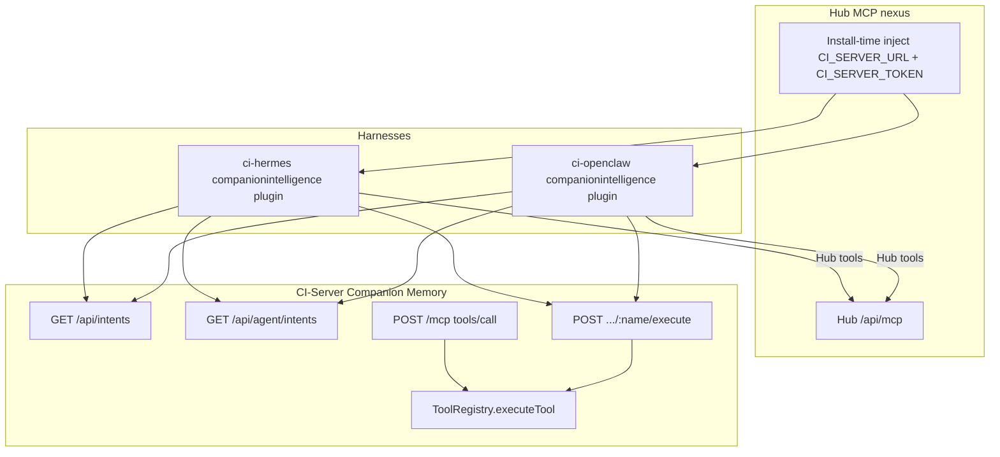

# Agent harness (#59) + cold-start gates (#63)

> **Private & Confidential — Property of Lifescope Inc. Do not distribute.**
>
> Status: **implemented and merged to `main`** (2026-08-17; `places.next` arrived
> with [#2045](https://github.com/companionintelligence/CI-Server/pull/2045)).
> Re-verified against `main` on 2026-08-19: `IntentsController` mounts
> `['api/intents', 'api/agent/intents']` with `POST :name/execute`, `PlacesNextTool`
> registers `places.next`, and `grounded.prompts` / `derivation.engines` both ship
> `true` in `config/default.json`.
> Tracker: leftovers from [CI-Engineering #59](https://github.com/companionintelligence/CI-Engineering/issues/59)
> and [#63](https://github.com/companionintelligence/CI-Engineering/issues/63)
> · epic [#49](https://github.com/companionintelligence/CI-Engineering/issues/49)
>
> Sibling: [correlation-anomaly-suggestions.md](correlation-anomaly-suggestions.md)
> (engines + registered tools). HBPE kernel / HMM / baseline gate:
> [hbpe-landing.md](hbpe-landing.md).

Derivation tools were registered and Memory MCP already executed them. Hermes
and OpenClaw advertise the catalog then 404 on REST execute. Grounded prompts
and Brief enqueue were default-off so a three-day series could not say
"most days." This work closes the REST door, adds `places.next`, raises the
copy floors, and turns the flags on.

## Channels (do not mix)

| Plane | Who | What |
|---|---|---|
| Hub MCP | Hermes / OpenClaw → Hub `/api/mcp` | App list, inference, `hub_call_app_tool` |
| Memory REST | Same agents → CI-Server | Catalog GET + intent execute (this PR) |
| Memory MCP | MCP clients / in-app | `POST /mcp` → the same `ToolRegistry` |

Hub injects `CI_SERVER_URL` + `CI_SERVER_TOKEN`. Agents call CI-Server
directly. There is no Hub execute proxy. No Hermes / OpenClaw / Hub /
marketplace PRs in this workstream.

## Execute contract

`IntentsController` mounts on **both** `/api/intents` and `/api/agent/intents`.

| Method | Path | Notes |
|---|---|---|
| GET | `/api/{intents,agent/intents}` | Same catalog as before |
| GET | `.../domains`, `.../entities`, `.../:name` | Unchanged |
| POST | `.../:name/execute` | Raw JSON body = tool input |

- Auth: `JwtOrApiKeyAuthGuard` + `intents` scope. GETs require capability
  `read`. POST uses `apiKeyCapabilityOf(req)` inside `ToolRegistry.executeTool`
  so `suggestions.feedback` (write, non-destructive) is not blocked by a
  class-level read guard.
- Name: dotted (`insights.explain`, OpenClaw) or underscored (`insights_explain`,
  Hermes). Normalized with `intentToolName` before the registry.
- Unknown intent: **HTTP 404** so harnesses fall through to the other prefix.
- Known intent: **HTTP 200 `ToolResult`**, including `success: false`.

`places.next` (domain `places`, next to `places.find`) wraps
`PlaceForecastService.predictNext`. Privacy: read, non-destructive,
non-external so Hermes/OpenClaw auto-register it. Ticket name
`predictions.nextPlaces` maps here — no thirteenth catalog domain.

## Cold-start floors

| Gate | Floor | Below-floor behavior |
|---|---|---|
| Grounded "most days / usually" | 14 coverage-gated days (`coverage ≥ 0.5`), same as `MIN_PAIR_N` / `SUGGESTION_MIN_BASELINE_N` | No surprise; still-learning copy |
| `places.next` | No clusters / `NO_HISTORY` | Still-learning; never "you usually go to…" |
| Brief enqueue | 3 `ci.actions` per user local day with `source IN ('anomaly','suggestion')` | Refuse `ActionService.create` |

Context prompts **do not** share that Brief cap. They already turn-take (skip
if the last prompt was `daily_metric`) and refuse below the 14-day floor.

Forecast "accuracy" copy is **self-consistency vs pipeline labels**, not
ground-truth accuracy.

## Flags

`grounded.prompts` and `derivation.engines` default **on**
(`ENABLE_GROUNDED_PROMPTS` / `ENABLE_DERIVATION_ENGINES` still override).
Compute+persist already ran with the flags off; on means Brief/feed enqueue
and number-grounded context prompts. Body/Mind suggestion arms stay off in
code.

## What #63 still owns

Mute / snooze UX, OpenClaw heartbeat `drift_flag`, the full proactivity budget
across push/heartbeat, hiding `source='legacy'` from `brief.list`.
