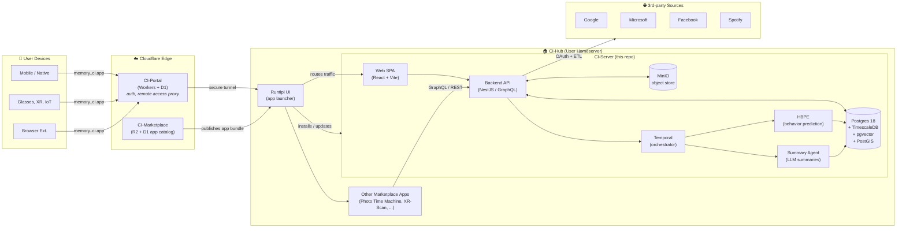
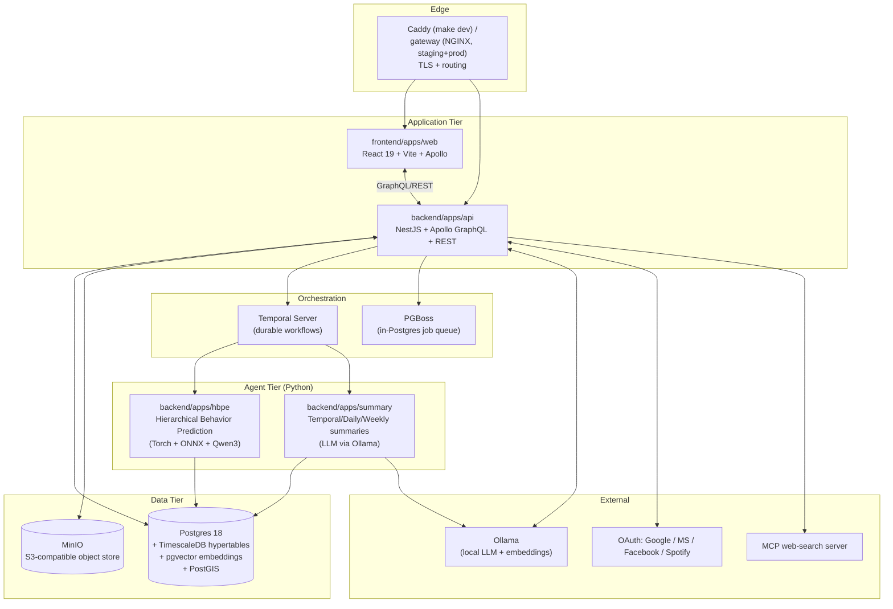
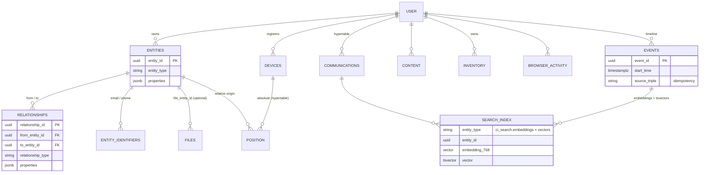
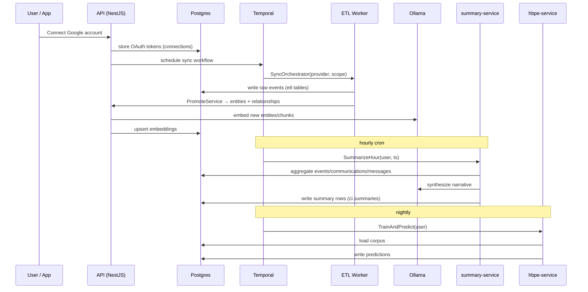
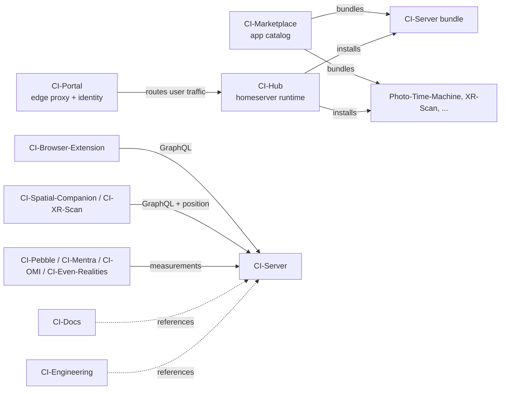
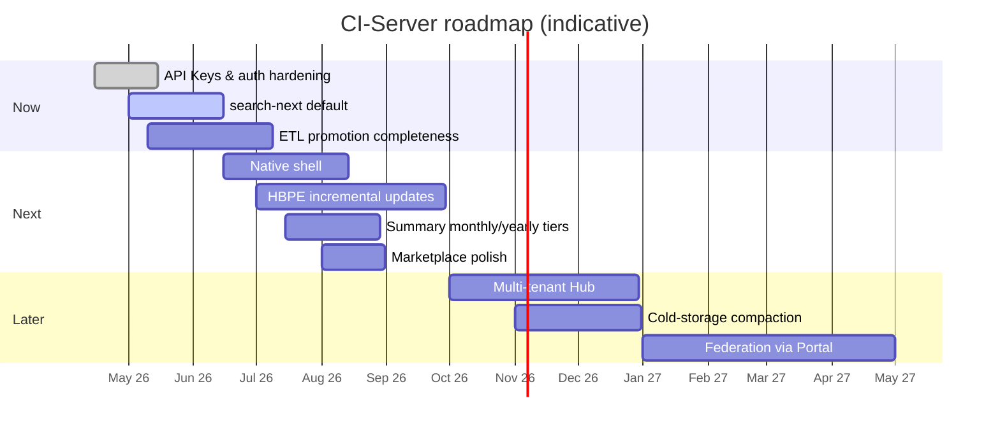

# CI-Server Architecture

> **Status:** Living document &nbsp;•&nbsp; **Last updated:** 2026-07-06
>
> CI-Server is the personal digital-memory appliance at the heart of Companion Intelligence. It owns the user's graph of entities, relationships, files, timeline records, summaries and predictions, and exposes them to apps via REST/GraphQL/MCP.
>
> Companion docs: [API reference](../api/README.md) · [Database architecture](Database.md) · [backend developer guide](../../backend/apps/api/README.md) · [docs index](../README.md)

---

## 1. Executive Summary

CI-Server is a **self-hostable, multi-service personal data platform**. It ingests data from a user's connected accounts and devices, normalizes it into a graph-of-entities knowledge model (with embeddings, hypertable measurements, and behavior models), and serves it to apps, agents, and front-ends.

It is deployed as a Docker Compose stack and is the **primary backend** that other Companion Intelligence (CI) systems target:

| System | Role | Relationship to CI-Server |
|---|---|---|
| [CI-Server](https://github.com/companionintelligence/CI-Server) (this repo) | The "memory" appliance — graph DB, ETL, summarization, prediction, API | The source of truth for personal data |
| [CI-Hub](https://github.com/companionintelligence/CI-Hub) | App runtime / homeserver (Runtipi-based) that hosts CI-Server + 3rd-party apps | Hosts CI-Server as one of many installable apps |
| [CI-Marketplace](https://github.com/companionintelligence/CI-Marketplace) | App catalog: `config.json` + `docker-compose.json` per app, deployed to R2/D1 | Defines and distributes the CI-Server bundle (and sibling apps) to Hubs |
| [CI-Portal](https://github.com/companionintelligence/CI-Portal) | Cloudflare-hosted proxy & control plane: auth, tenancy, remote access to a user's Hub | Brokers external traffic and identity into the user's CI-Server (public ingress via the Portal Cloudflare tunnel) |

> **CI-Gateway is retired** (repo deleted from the org). Its routing role split: local
> TLS/routing is the Hub-managed **Traefik** stack (and, for CI-Server development, the
> host **Caddy** that `make dev` configures — see the [root README](../../README.md));
> public ingress is the **Portal Cloudflare tunnel**.

---

## 2. The CI Ecosystem

**How a request flows end-to-end**

1. A user (or an app, or a device) hits `https://memory.<user>.ci.app`.
2. **CI-Portal** authenticates the caller and proxies the request through a tunnel to that user's **CI-Hub**.
3. **CI-Hub** routes traffic to the installed **CI-Server** app (or to any other app installed from **CI-Marketplace**).
4. CI-Server resolves the request against its Postgres + object-store, kicking off Temporal workflows for anything async (ETL syncs, summarization, prediction).

---

## 3. CI-Server Internal Architecture

### 3.1 Services

### 3.2 Container / Compose Topology

| Service | Image | Role | Persistence |
|---|---|---|---|
| `database` | `ci/database` (Postgres 18 + Timescale + pgvector + PostGIS — [`infrastructure/database/`](../../infrastructure/database/Dockerfile)) | Primary store, hypertables, vector + geo search, PGBoss queue | `db-data` |
| `object-store` | `ci/object-store` (MinIO) | Files, images, captures | `object-data` |
| `orchestrator` | `ci/orchestrator` (Temporal) | Durable workflow engine for syncs, summaries, predictions | (Postgres-backed) |
| `hbpe-service` | `ci/hbpe-service` | Behavior prediction engine: nightly model train + INT8 inference | `hbpe-models`, `hbpe-corpus` |
| `summary-service` | `ci/summary-service` | Hourly→Daily→Weekly summary agent | (via DB) |
| `setup-database` | `ci/setup-database` | One-shot: migrations and seed | — |
| `setup-orchestrator` | `ci/setup-orchestrator` | One-shot: Temporal namespace bootstrap | — |
| `secrets` / `generate-secrets` | `ci/setup-secrets` | One-shot: generates and mounts `.env.secrets` | — |
| `gateway` | NGINX ([`infrastructure/gateway/`](../../infrastructure/gateway)) | TLS + routing — **staging/production compose only**; local dev fronts the stack with host Caddy via `make dev` (see the [root README](../../README.md)) | — |
| `api` | `ci/api` | The NestJS backend — containerized in **staging/production**; under `make dev` it runs on the host via overmind | — |

Environments are selected via the Compose **file** stack (`docker-compose.yml` + `docker-compose.{local,staging,production}.yml`), plus the `tooling` profile for ad-hoc DB proxies/shells (`make dbshell`, `make tooling`).

### 3.3 Backend Domains

Located at `backend/apps/api/src/domains/`. Each domain is a NestJS module with `controllers/`, `services/`, `entities/`, plus its own typed events on the in-process event bus.

| Domain | Purpose |
|---|---|
| `auth` | Sessions, JWT, API Keys, OIDC (CI-Portal), guards |
| `user` | Accounts, signup codes, profile |
| `onboarding` | First-run flow and account bootstrap |
| `connections` | OAuth clients (Google, MS, Facebook, Spotify), token storage |
| `etl` | Per-provider sync services (`Google/`, `Microsoft/`, `Facebook/`, `Spotify/`, `Steam/`), `SyncOrchestrator`, `PromoteService` (raw → graph) |
| `graph` | Graph primitives over the relational `ci.entities`/`ci.relationships` tables (no graph extension), plus `entity_identifiers`, `item_relationships`, and bulk graph ingest |
| `memory` | High-level domain services: `PersonService`, `PlaceService`, `EventService`, `ContentService`, `FileService`, `ItemService`, `ConceptService`, `CommunicationService`, `UserContextService`; the `v1/events` capture-ingest controller |
| `intelligence` | Conversational layer: `QuestionService`, `AnswerService`, `ActionService` (the "ask my memory" surface) |
| `conversations` | Chat threads, messages, agent dispatch |
| `summaries` | Reads of hourly/daily/weekly summaries produced by `summary-service` |
| `predictions` | Reads of HBPE model output |
| `llm` | `OllamaService` — local LLM + embedding wrapper; answer-inference cron; OpenAI-compatible proxy routes |
| `maintenance` | Post-ingest enrichment + operator endpoints (`/api/maintenance/*`): geocoding, linking backfills, search-index backfill, index deferral, ingest reset |
| `geocode` | Forward/reverse geocoding + `ci.geocode_cache` |
| `entity-resolution` | Entity dedup/merge heuristics |
| `agent` | Agent memory (`/memory/*`) and the intent catalog (`/api/intents`) |
| `mcp` | The MCP server (`POST /mcp`) — every GraphQL operation exposed as a privacy-labelled tool |
| `notes` | First-class user notes |
| `events` | **The in-process PGBoss event bus** (send/subscribe, queues, job monitor) — *not* calendar events, which live in `memory` |
| `files` | Uploads, previews, signed URLs (MinIO), saved searches |
| `devices` | IoT/wearable device registry |
| `position` | GPS + relative coordinates (hypertable; supports headpose / AR) |
| `browser-activity` | Browser extension capture |
| `search-ingress` / `search-next` | Search index **write** path (queue listeners → `ci_search`) / search **read** path (the `search` query, tags) |
| `tools` | Shared ToolRegistry exposed to agents (feeds the MCP surface) |
| `graphql` | Apollo schema assembly and resolvers |
| `audit` | Graph-delta audit log |

Cross-cutting infrastructure (guards, request context, zod validation, body limits, the
`bulkInsertIdempotent` persistence helper, embeddings, feature flags) lives in
`backend/apps/api/src/common/` — see the
[backend developer guide](../../backend/apps/api/README.md).

### 3.4 Data Model in One Picture

See [Database.md](Database.md) for the canonical, verified schema: schemas
(`ci`/`ci_search`/`ci_etl`/`hbpe`), tables by domain, the provenance-triple
idempotency/dedup design, indexing (HNSW/GIN/GIST), hypertables (`communications`,
`position`), the "where to put what" rules, and the list of dropped legacy tables
(`measurements`/`sensors`/`documents`/`document_chunks`/`facts` are gone).

### 3.5 Data Flows

Besides the connector ETL above, there are two **direct ingest surfaces** (both idempotent
on the provenance triple): capture clients batch-POST to `/v1/events`, and the importer
(CI-Import-Tools) pushes via the GraphQL bulk mutations with **deferred search indexing**
(the post-load `/api/maintenance/*` enrichment chain). See
[api/rest.md](../api/rest.md#ingest-bulk-capture-write-path),
[api/graphql.md §4.7](../api/graphql.md#47-bulk-ingest-mutations-the-importer-surface--detailed),
and the [bulk load runbook](../../backend/apps/api/db/postgres/BULK_LOAD_RUNBOOK.md).

---

## 4. Frontend & Client Surfaces

| Surface | Path | Notes |
|---|---|---|
| Web SPA | `frontend/apps/web` | React 19 + Vite + Apollo + Tanstack-style routing; 3D force-graph, Leaflet maps, ShadCN UI |
| Capture lib | `frontend/packages/capture` | Camera capture primitives reused by web + future native |
| Editor lib | `frontend/packages/editor` | Rich-text / note editor |
| Common lib | `frontend/packages/common` | Shared hooks, types, GraphQL fragments |
| ShadCN lib | `frontend/packages/shadcn` | Local copy of the component library |
| Native (future) | `frontend/apps/native` | Placeholder for mobile/native shell |
| Browser ext. | [CI-Browser-Extension](https://github.com/companionintelligence/CI-Browser-Extension) | Talks to `browser-activity` |
| XR / Spatial | [CI-Spatial-Companion-*](https://github.com/companionintelligence/), [CI-XR-Scan](https://github.com/companionintelligence/CI-XR-Scan) | Use `position` + AR relative coordinates |
| Wearables / IoT | [CI-Pebble](https://github.com/companionintelligence/CI-Pebble), [CI-Mentra](https://github.com/companionintelligence/CI-Mentra), [CI-OMI](https://github.com/companionintelligence/CI-OMI), [CI-Even-Realities](https://github.com/companionintelligence/CI-Even-Realities) | Push to `devices` / `sensors` / `measurements` |

---

## 5. Cross-Repo Interaction Map

**Contracts between repos**

| Boundary | Contract |
|---|---|
| CI-Marketplace → CI-Hub | `apps/<slug>/config.json` + `docker-compose.json` + `metadata/` + verified screenshot |
| CI-Hub → CI-Server | Standard Compose lifecycle; CI-Server exposes ports & volumes per its `docker-compose.json` |
| CI-Portal → CI-Hub | Authenticated tunnel; tenant identity propagated as HTTP headers / JWT |
| Client apps → CI-Server | GraphQL + REST under `/api`; OAuth-style API keys for service callers |
| Agents → CI-Server | Same GraphQL/REST plus signed service JWTs (HBPE / summary) |
| Tools → Agents | MCP servers (e.g. `mcp-servers/web-search`) called by LLM tooling layer |

---

## 6. Operational Profiles

| Environment | Compose file | Use |
|---|---|---|
| local | `docker-compose.yml` + `docker-compose.local.yml` | **`make dev`** developer loop — per-worktree stack (Postgres, MinIO, Temporal, hbpe/summary), Vite + nodemon on the host, Caddy route at `https://<project>.localhost` (see the [root README](../../README.md)) |
| staging | `docker-compose.staging.yml` | Pre-prod parity (containerized `api` + NGINX `gateway`); runs against staging secrets |
| production | `docker-compose.production.yml` | Production deploys inside CI-Hub |
| `tooling` (profile) | (profile flag on the above) | DB proxies/shells, ad-hoc admin (`make dbshell`, `make tooling`) |

Secrets are mounted via the `secrets` volume produced by `setup-secrets`, with provider OAuth credentials, DB credentials, JWT signing keys, and the cross-service shared secret used by HBPE and Summary to sign service JWTs.

---

## 7. Development Roadmap

The roadmap below is synthesized from the current repo state (domains present, comments in code, agent READMEs) and from the surrounding ecosystem repos.

### 7.1 Near-term (Now)

| Theme | Item | Where |
|---|---|---|
| AuthN | Finish API Keys (validation, hashing, scopes) — recent merge in `auth` | `domains/auth` |
| Retrieval | Promote `search-next` to default; deprecate `search-ingress` | `domains/search-next` |
| ETL | Harden Google/Microsoft sync, finish Facebook + Spotify promotion paths | `domains/etl/services/*` |
| Memory pipeline | Document → chunks → facts → embeddings consistency pass | `domains/memory`, `domains/files` |
| Onboarding | Streamline first-run flow with seeded demo entities | `domains/onboarding` |

### 7.2 Next

| Theme | Item |
|---|---|
| Native shell | Fill in `frontend/apps/native` (currently placeholder) |
| HBPE | Move from nightly batch to incremental online updates; expose richer prediction reads in `domains/predictions` |
| Summary | Add monthly + yearly tiers; surface summary timeline in the web SPA |
| Tools | Expand `mcp-servers/` beyond web-search (calendar, contacts, files) — these slot into `domains/tools` |
| Devices/XR | First-class `position` query API for AR clients (relative coords + headpose) |
| Marketplace | Publish CI-Server as a polished marketplace app; ensure `metadata/`, screenshot, and `docker-compose.json` are kept current |

### 7.3 Later

| Theme | Item |
|---|---|
| Multi-tenant Hub | Hardening for shared Hubs hosting multiple users (today CI-Server is single-tenant per Hub) |
| Federation | User-to-user shared entities via CI-Portal as broker |
| Cold storage | Revisit graph compaction (the old facts-as-cold-storage design; its tables were dropped in `20260212191500`) |
| On-device LLMs | Ship a default Ollama model selection per hardware profile (CUDA / ROCm / Metal) |
| Backup/Export | First-class user data export and restore across Hubs |

---

## 8. Open Questions / Known Tensions

| Question | Context |
|---|---|
| When does an item become an `entity` vs. stay in `inventory`? | Heuristic ("parasocial relationship") is documented but not enforced — see `Database.md`. |
| How aggressively to prune the graph? | The old facts-as-cold-storage design was never implemented and its tables were dropped; compaction remains an open design question (§7.3). |
| Where does multi-user logic live? | Today: single user per Hub. Multi-tenant would touch `auth`, `connections`, `etl`, and Portal contracts. |
| In-Hub saved-search sharing vs. single-tenant model | Saved searches are link-shareable: the share token authorizes running the search **as the owner** (`SearchResolver.runSharedSearch`; `SavedSearchService.findByShareToken` is intentionally not user-scoped) — the first cross-user read path inside a Hub. Capability-scoped (the token only surfaces the owner's stored query/types/tags; viewer-supplied filters are ignored) and still behind `JwtOrApiKeyAuthGuard` (signed-in viewers only, **not** anonymous). A node's sub-fields (media/relations/tags) resolve under the node's owner, so a shared result's signed media URLs are the owner's — forwardable until the URL's TTL. Distinct from the Portal-brokered federation in §7.3. |
| Tool surface: NestJS controllers vs. MCP servers? | Largely resolved: the shared **ToolRegistry** (`domains/tools`) now feeds both the MCP server (`POST /mcp`, `domains/mcp`) and the intent catalog (`GET /api/intents`) — see [api/auth-and-conventions.md §5](../api/auth-and-conventions.md#5-mcp-surface). The standalone `mcp-servers/web-search` remains a separate LLM-facing helper. |
| Real-time push to clients | No WebSocket/subscription layer yet — XR and wearable clients currently poll. |

---

## 9. Glossary

| Term | Meaning |
|---|---|
| **Entity** | A node in the user's knowledge graph; arbitrary `properties` JSONB + optional embedding. |
| **Relationship** | A typed edge between entities (`PREFERS`, `KNOWS`, `LIVES_IN`, ...) with its own `properties`. |
| **Fact** | *(historical)* Atomic, cold-storage information extracted from document chunks. The `facts`/`document_chunks` tables were dropped (`20260212191500`); the cold-storage compaction idea survives only as the §7.3 roadmap item. |
| **HBPE** | Hierarchical Behavioral Prediction Engine; the per-user model in `backend/apps/hbpe`. |
| **Summary** | LLM-synthesized narrative at hourly/daily/weekly granularity, stored as graph entities. |
| **Position** | Hypertable of absolute *and* relative coordinates; supports AR headpose with an entity as origin. |
| **Hub** | The user's homeserver (CI-Hub) that runs CI-Server alongside other apps. |
| **Portal** | The Cloudflare-hosted control plane (CI-Portal) that fronts every user's Hub. |
| **Marketplace** | The R2/D1 catalog (CI-Marketplace) that publishes installable app bundles to Hubs. |
