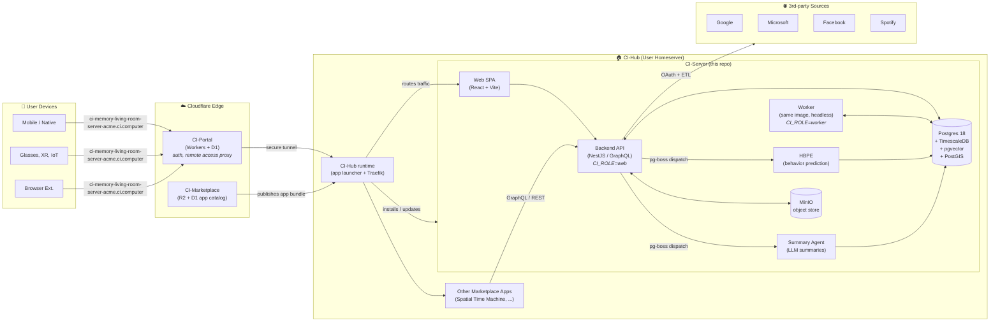
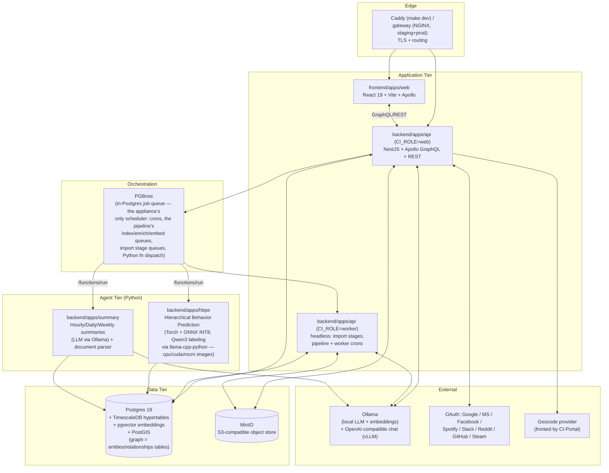
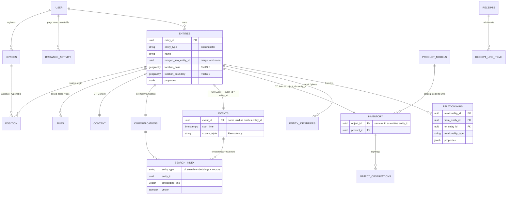
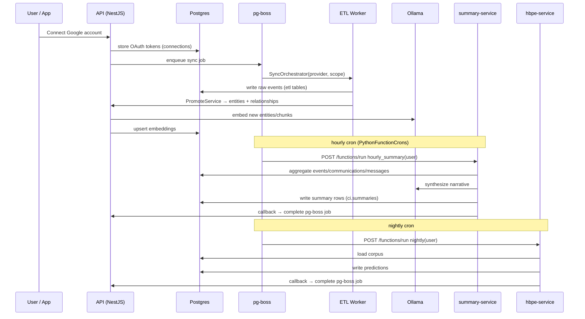
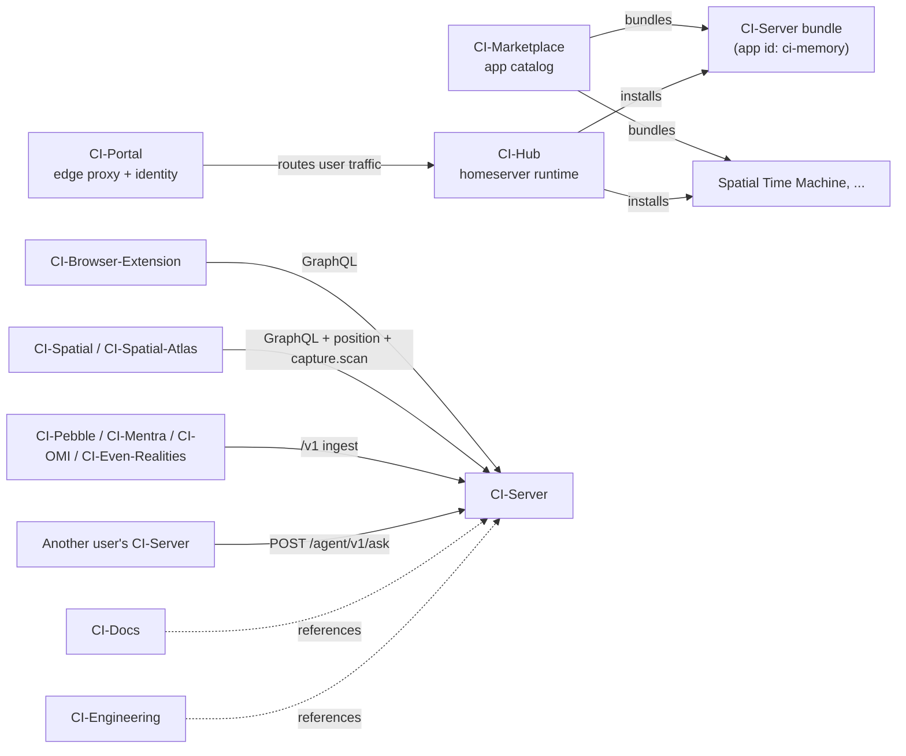
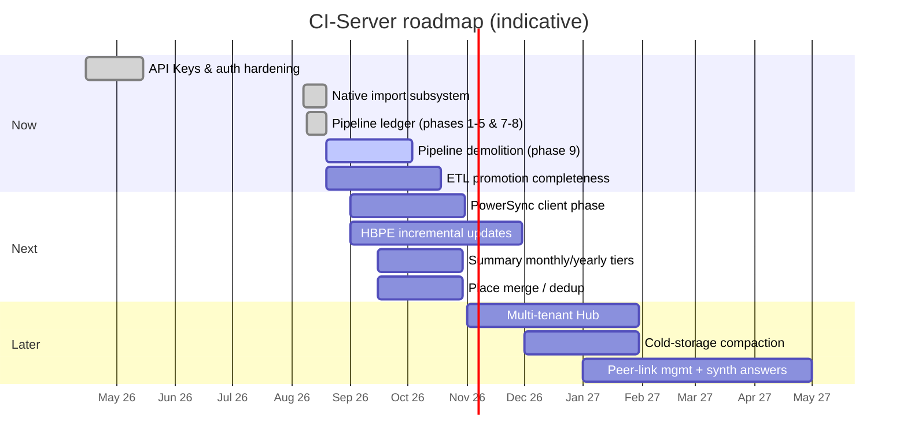

# CI-Server Architecture

> **Status:** Living document &nbsp;•&nbsp; **Last updated:** 2026-08-19
>
> CI-Server is the personal digital-memory appliance at the heart of Companion Intelligence. It owns the user's graph of entities, relationships, files, timeline records, summaries and predictions, and exposes them to apps via REST/GraphQL/MCP.
>
> Companion docs: [API reference](../api/README.md) · [Database architecture](Database.md) · [backend developer guide](../../backend/apps/api/README.md) · [docs index](../README.md)

---

## 1. Executive Summary

CI-Server is a **self-hostable, multi-service personal data platform**. It ingests data from a user's connected accounts, exports and devices, normalizes it into a graph-of-entities knowledge model (with a vector + full-text search index, time-series position/snapshot hypertables, and behavior models), and serves it to apps, agents, and front-ends.

It is deployed as a Docker Compose stack and is the **primary backend** that other Companion Intelligence (CI) systems target:

| System | Role | Relationship to CI-Server |
|---|---|---|
| [CI-Server](https://github.com/companionintelligence/CI-Server) (this repo) | The "memory" appliance — graph DB, ETL, summarization, prediction, API | The source of truth for personal data |
| [CI-Hub](https://github.com/companionintelligence/CI-Hub) | App runtime / homeserver (NestJS + Docker Compose + Traefik + an OCI registry client) that hosts CI-Server + 3rd-party apps | Hosts CI-Server as one of many installable apps (marketplace id `ci-memory`) |
| [CI-Marketplace](https://github.com/companionintelligence/CI-Marketplace) | App catalog: `config.json` + `docker-compose.json` per app, deployed to R2/D1 | Defines and distributes the CI-Server bundle (and sibling apps) to Hubs |
| [CI-Portal](https://github.com/companionintelligence/CI-Portal) | Cloudflare-hosted proxy & control plane: auth, tenancy, remote access to a user's Hub | Brokers external traffic and identity into the user's CI-Server (public ingress via the Portal Cloudflare tunnel) |

> **CI-Gateway is retired** (repo deleted from the org). Its routing role split: local
> TLS/routing is the Hub-managed **Traefik** stack (and, for CI-Server development, the
> host **Caddy** that `make dev` configures — see the [root README](../../README.md));
> public ingress is the **Portal Cloudflare tunnel**.

---

## 2. The CI Ecosystem

**How a request flows end-to-end**

1. A user (or an app, or a device) hits the appliance's public hostname —
   `https://ci-memory-<device>-<org>.ci.computer`, e.g.
   `ci-memory-living-room-server-acme.ci.computer`. It is **one flat DNS label**,
   not a dotted `app.hub.domain`: CI-Hub joins app + device + org with hyphens
   (`buildFqdnSubdomain` / `buildPublicWebIdentity` in CI-Hub's
   `packages/common/src/public-web/identity.ts`), and its `sanitizeAppSubdomain`
   truncates the app slug at the first dot, so a dotted form cannot survive.
2. **CI-Portal** authenticates the caller and proxies the request through a tunnel to that user's **CI-Hub**.
3. **CI-Hub** routes traffic to the installed **CI-Server** app (or to any other app installed from **CI-Marketplace**).
4. CI-Server resolves the request against its Postgres + object-store, enqueueing pg-boss jobs for anything async (ETL syncs, summarization, prediction).

---

## 3. CI-Server Internal Architecture

### 3.1 Services

`CI_ROLE` (`all` | `web` | `worker`, default `all` —
[`configuration.ts`](../../backend/apps/api/src/configuration.ts)) splits one image
into two processes. `web` serves HTTP; `worker` is headless and consumes the queues
and crons marked `role: worker` — chiefly the import stages, whose parsers run long
synchronous stretches that must not share an event loop with interactive requests.
Staging/production run both as containers off `ci/api`; `make dev` runs both as
overmind processes from the [`Procfile`](../../Procfile). Exactly **one** worker
replica: the import recovery sweep assumes it.

### 3.2 Container / Compose Topology

| Service | Image | Role | Persistence |
|---|---|---|---|
| `database` | `ci/database` (Postgres 18 + Timescale + pgvector + PostGIS — [`infrastructure/database/`](../../infrastructure/database/Dockerfile)) | Primary store, hypertables, vector + geo search, PGBoss queue | `db-data` |
| `object-store` | `ci/object-store` (MinIO) | Files, images, captures | `object-data` |
| `hbpe-service` | `ci/hbpe-service` | Behavior prediction engine: nightly model train + INT8 inference | `hbpe-models`, `hbpe-corpus` |
| `summary-service` | `ci/summary-service` | Hourly→Daily→Weekly summary agent | (via DB) |
| `setup-database` | `ci/setup-database` | One-shot: creates the roles and database, enables the extensions (`timescaledb`, `postgis`, `vector`, `pg_stat_statements`, `btree_gist`), and provisions the PowerSync replication role + publication. Runs **no** migrations and no seed — migrations are `migrate-database` (staging/production) or `scripts/dev-stack` (local) | — |
| `generate-secrets` | `ci/setup-secrets` | One-shot: generates and mounts `.env.secrets` — **production compose only** | — |
| `migrate-database` | `ci/api` | One-shot `yarn migrate` before the API starts — **staging/production only** | — |
| `gateway` | NGINX ([`infrastructure/gateway/`](../../infrastructure/gateway), port 8642) | TLS + routing — **staging/production compose only**; local dev fronts the stack with host Caddy via `make dev` (see the [root README](../../README.md)) | — |
| `dbproxy` / `dbconnstr` | `alpine/socat`, `alpine` | `tooling`-profile helpers: TCP proxy to the DB and the connection string printer (`make dbshell`, `make dburl`) | — |
| `powersync` | `journeyapps/powersync-service` | Logical-replication sync service for local-first clients — **`staging`/`production` profiles only**. Deliberately *not* in `local`: the scaffold is server-side only, no client has connected, and it held a replication slot for a reader that does not exist, so `make dev` does not start it | — |
| `api` | `ci/api` | The NestJS backend (`CI_ROLE=web`) — containerized in **staging/production**; under `make dev` it runs on the host via overmind | — |
| `worker` | `ci/api` | The headless half of the API (`CI_ROLE=worker`): import stage queues and worker-role crons — **staging/production**; one replica only | — |

Environments are selected via the Compose **file** stack (`docker-compose.yml` +
`docker-compose.{local,staging,production}.yml`), plus the `tooling` profile for
ad-hoc DB proxies/shells (`make dbshell`, `make tooling`). Every service also
declares a matching Compose **profile** (`local` / `staging` / `production` /
`tooling`), which is how `powersync` stays out of the local stack.
`docker-compose.rocm.yml` is an **overlay**, never a base — it passes `/dev/kfd`
and `/dev/dri` through to `hbpe-service` and is layered in only on hosts that
actually have the AMD device nodes (the dev supervisor decides automatically;
staging/production add the file by hand). That portability argument only holds
for the **local** stack, though: `docker-compose.staging.yml` and
`docker-compose.production.yml` each already declare `devices: /dev/kfd` +
`/dev/dri` and `group_add: video` on `hbpe-service` unconditionally, so those two
environments refuse to start on a host without the AMD device nodes whether or
not the overlay is added — and there the overlay contributes only the numeric
`AMD_RENDER_GID`/`AMD_VIDEO_GID` group IDs and `seccomp:unconfined`.

### 3.3 Backend Domains

Located at `backend/apps/api/src/domains/` — **47 domains** as of 2026-08-19. Each is a
NestJS module with some subset of `controllers/`, `services/`, `entities/`, `listeners/`
and `cron/`, plus its own typed events on the in-process (PGBoss-backed) event bus.
The table below is grouped roughly by concern rather than alphabetically.

| Domain | Purpose |
|---|---|
| `auth` | Sessions, JWT, API Keys (scopes × capability), OIDC (CI-Portal), guards |
| `user` | Accounts, signup codes, profile |
| `onboarding` | First-run flow and account bootstrap |
| `connections` | OAuth clients (Google, MS, Facebook, Spotify, Slack, Reddit, …), token storage |
| `etl` | Per-provider sync services (`Google/`, `Microsoft/`, `Facebook/`, `Spotify/`, `Steam/`, `GitHub/`, `Slack/`, `Reddit/`, `Signal/`), `SyncOrchestrator`, `PromoteService` (raw → graph) |
| `import` | **The native import/ETL subsystem** (ported from the retired CI-Import-Tools): file datasources, the `unpack → parse → media → push` stage machine over the `ci_import` staging schema, the `ci-import` CLI, and `doctor` data-quality checks |
| `ingest` | The REST bulk-ingest plane (`/v1/*`): NDJSON + JSON-envelope batches for events, communications, contents, inventory, browser-activity, notes, positions, receipts, product-models and observations, plus `/v1/ingest/finish` + `/v1/ingest/status` |
| `graph` | Graph primitives over the relational `ci.entities`/`ci.relationships` tables (no graph extension), plus `entity_identifiers`, `object_identifiers`, `item_relationships`, and bulk graph ingest |
| `memory` | High-level domain services: `PersonService`, `PlaceService`, `EventService`, `ContentService`, `FileService`, `ItemService`, `ConceptService`, `CommunicationService`, `UserContextService`, the merge/duplicate services (`PersonMergeService`, `ObjectMergeService`, `MergeCandidateService`, …), the object-identity services (`ObjectMintService`, `ObjectResolutionService`, `ProductModelService`, `ReceiptService`) and `GraphDeltaWriter` |
| `identity` | Pure library: canonical URLs, natural keys, provider matching. Fully implemented and **deliberately unwired** — nothing imports it yet (see its module header) |
| `entity-resolution` | Entity dedup/merge heuristics |
| `parsing` | Document parsing: extractors (MarkItDown), chunking, and `ci.file_chunks` |
| `pipeline` | **The versioned enrichment ledger** (`ci.pipeline_state`) plus one generic worker: 37 declared stages across `index.*` / `enrich.*` / `clean.*` / `promote.*` on three resource-class queues (`pipeline-index`, `pipeline-enrich`, `pipeline-embed`), with a control plane for pause/resume, coverage, dead letters and replay |
| `intelligence` | The "ask my memory" surface: `QuestionService`, `AnswerService`, `ActionService` (`ci.questions`/`ci.answers`/`ci.actions` — the **product** name for the questions surface is now *Reflections*; tables, GraphQL types and REST routes still say `question`) |
| `personalization` | Context prompts, life context, concept extraction, feed-queue population |
| `persona` | Persona × task "how you'd do it" compose and the About-you surface |
| `conversations` | Chat threads and messages (`ci.threads` / `ci.messages`) |
| `daily-metrics` | The daily feature store in `ci_derived` (`daily_metrics` + anomalies/correlations/suggestions), place clustering/transitions, and the metric forecaster behind `/forecast` |
| `activity` | Hourly activity rollups (`ci.activity_rollup`) and the activity-timeline rail |
| `summaries` | Reads of hourly/daily/weekly summaries produced by `summary-service` |
| `predictions` | Reads of HBPE model output: forecast history, calibration, place forecast |
| `schedule` | Event candidates and rhythms (`ci.event_candidates`, `ci.rhythms`), task breakdown, suggestion sync |
| `planning` | Tasks (`ci.tasks`) and planned blocks — a planned block is a `ci.events` row with `event_type = 'planned_block'`; GraphQL-only, flag-gated |
| `smart-rotation` | Meta-controller that round-robins background intelligence work (answer inference, graph enrich/link, insights, context prompts) under the `smart.rotation` flag |
| `python-functions` | The pg-boss replacement for Temporal: per-user crons fan out onto queues, a dispatch listener POSTs `/functions/run` to the HBPE and summary sidecars, and an authenticated webhook completes the deferred job |
| `llm` | `OllamaService` — local LLM + embedding wrapper — plus the OpenAI-compatible chat driver (vLLM), the durable chat turn/broker path, and the LLM proxy routes |
| `maintenance` | Post-ingest enrichment + operator endpoints (`/api/maintenance/*`): geocoding, linking backfills, search-index backfill (now deferring to the pipeline ledger for types it owns), index deferral, ingest reset |
| `geocode` | Forward/reverse geocoding + `ci.geocode_cache` |
| `agent` | Agent memory (`/memory/*`) and the intent catalog (`GET /api/intents`, `GET /api/agent/intents`) |
| `tools` | The shared **ToolRegistry** — `IntentDefinition` is the canonical tool schema; feeds MCP, the intent catalog and the on-device tool layers |
| `mcp` | The MCP server (`POST /mcp`) — every registered tool exposed as a privacy-labelled MCP tool |
| `asks` | The interpersonal **Ask**: bounded questions against another user's memory, gated by standing consent grants, with a per-ask audit log |
| `peers` | Peer federation — two appliances exchanging asks (`POST /agent/v1/ask`); discovery is CI-Portal's job, the relationship and every answer stay on the two boxes |
| `solid` | Flag-gated Solid Protocol facade over the existing store: WebID profiles, RDF projection of entities, LDP containers (`/solid/*`) |
| `portability` | Account export/import archives (NDJSON) for backup and Hub migration; the routes themselves hang off `auth`'s `AccountDataController` (`GET /account/export`, `POST /account/import[/stream]`) |
| `notes` | First-class user notes |
| `events` | **The in-process PGBoss event bus** (send/subscribe, queues, job taxonomy, job monitor) — *not* calendar events, which live in `memory` |
| `files` | Uploads, previews, signed URLs (MinIO), media dimensions, saved searches |
| `powersync` | The PowerSync token endpoint (`GET /api/powersync/token`) for local-first clients |
| `devices` | IoT/wearable device registry |
| `position` | GPS + relative coordinates (hypertable; supports headpose / AR) |
| `browser-activity` | Browser extension capture (`ci.browser_activity` is the sole home for page views — the 2026-08-08 fold into `ci.events`/`ci.content` was reverted) |
| `search-ingress` / `search-next` | Search index **write** path (queue listeners + the shared `searchTexts.ts` document builders → `ci_search`) / search **read** path (the combinable `search` query, `mapPins`, tags) |
| `graphql` | Apollo schema assembly and resolvers |
| `audit` | Graph-delta audit log (`ci.graph_deltas`) |

Cross-cutting infrastructure (guards, request context, zod validation, body limits, the
`bulkInsertIdempotent` persistence helper, embeddings, feature flags) lives in
`backend/apps/api/src/common/` — see the
[backend developer guide](../../backend/apps/api/README.md).

### 3.4 Data Model in One Picture

`ci.entities` is the **root of an inheritance hierarchy**, not a side table.
Person / Pet / Group / Concept / File / Location are single-table-inheritance rows
in `ci.entities` itself; `ci.objects` (`Item`), `ci.events` (`Event`),
`ci.communications` (`Communication`) and `ci.content` (`Content`) are
**class-table inheritance**: each detail row *requires* a base row that shares its
uuid. For `events` and `inventory` the base row is the **sole owner** of the
name/title and description — those columns were dropped from the detail table —
and for `content` only the title moved. `communications` is the exception:
nothing was dropped there (subject/content/preview/summary are domain data), and
the base row's `name` is a *derived* display label — subject, else preview, else
a 140-char clip of content — that `CommunicationService` re-derives on write.

See [Database.md](Database.md) for the canonical, verified schema: schemas
(`ci`/`ci_search`/`ci_etl`/`ci_import`/`ci_derived`/`hbpe`), tables by domain, the
provenance-triple idempotency/dedup design, indexing (HNSW/GIN/GIST), hypertables
(`position`, `hbpe.prediction_log`), and the list of dropped
legacy tables (`measurements`/`sensors`/`documents`/`document_chunks`/`facts` are
gone).

### 3.5 Data Flows

Besides the connector ETL above, there are two **direct ingest surfaces** (both idempotent
on the provenance triple):

- **Remote clients** batch-POST NDJSON (or a JSON envelope) to the `/v1/*` bulk plane —
  `/v1/events` for unified capture, plus one lane per bulk kind — and drive the load with
  `POST /v1/ingest/finish` + `GET /v1/ingest/status`.
- **The importer** (CI-Server's own native import domain,
  `backend/apps/api/src/domains/import/` — ported from the now-retired
  `ZARCHIVED-CI-Import-Tools`) runs *in process*. An import is a durable run of four
  ordered stages — `unpack → parse → media → push` — recorded in the `ci_import` schema and
  executed on four per-kind pg-boss queues (`import-unpack`, `import-parse`, `import-media`,
  `import-push`) inside the `worker` process. `PushStage` calls the NestJS services
  directly rather than shipping rows over HTTP.

Both use **deferred search indexing**: bulk writes suppress per-row create events for
throughput, and rows become searchable when the pipeline's `index.*` stages (or the
`/api/maintenance/search-index/backfill` safety net) reach them. See
[api/rest.md](../api/rest.md#ingest-bulk-capture-write-path),
[api/graphql.md §4.7](../api/graphql.md#47-bulk-ingest-mutations-the-importer-surface--detailed),
[docs/cli/ci-import.md](../cli/ci-import.md),
and the [bulk load runbook](../../backend/apps/api/db/postgres/BULK_LOAD_RUNBOOK.md).

---

## 4. Frontend & Client Surfaces

| Surface | Path | Notes |
|---|---|---|
| Web SPA | `frontend/apps/web` | React 19 + Vite + Apollo + `react-router-dom` 7; 3D force-graph, Leaflet maps, ShadCN UI. Memory browsing lives under a `/memory/*` hub — **seven** sections (Events, People, Places, Things, Receipts, Content, Tags). *Reflections* left the hub on 2026-08-23 for the new Self hub at `/self/reflections`; `/memory/reflections` still redirects |
| Capture lib | `frontend/packages/capture` | Camera capture primitives, shared by the web SPA and the native shells that wrap it |
| Editor lib | `frontend/packages/editor` | Rich-text / note editor |
| Common lib | `frontend/packages/common` | Shared hooks, types, GraphQL fragments |
| ShadCN lib | `frontend/packages/shadcn` | Local copy of the component library |
| Mobile | `frontend/apps/ios`, `frontend/apps/android` | Capacitor shells around the `@ci/fe-web` SPA; native plugins in `frontend/packages/capacitor-*`. `frontend/apps/mobile` is the pointer README left by the iOS/Android split |
| Capacitor plugins | `frontend/packages/capacitor-local-hub`, `capacitor-speech`, `capacitor-local-llm` | Loopback sidecar + encrypted capture outbox; on-device dictation/synthesis; on-device LiteRT-LM (Android — iOS ships its own Swift implementation) |
| Browser ext. | [CI-Browser-Extension](https://github.com/companionintelligence/CI-Browser-Extension) | Talks to `browser-activity` |
| XR / Spatial | [CI-Spatial](https://github.com/companionintelligence/CI-Spatial), [CI-Spatial-Atlas](https://github.com/companionintelligence/CI-Spatial-Atlas), [CI-Spatial-Web](https://github.com/companionintelligence/CI-Spatial-Web) and siblings | Use `position` + AR relative coordinates; scans arrive as a GLB upload plus one `capture.scan` event |
| Wearables / IoT | [CI-Pebble](https://github.com/companionintelligence/CI-Pebble), [CI-Mentra](https://github.com/companionintelligence/CI-Mentra), [CI-OMI](https://github.com/companionintelligence/CI-OMI), [CI-Even-Realities](https://github.com/companionintelligence/CI-Even-Realities) | Register in `devices`; readings land on the `/v1/*` ingest lanes (`ci.position`, `ci.events`). The old `sensors`/`measurements` tables were dropped in Feb 2026 |

---

## 5. Cross-Repo Interaction Map

**Contracts between repos**

| Boundary | Contract |
|---|---|
| CI-Marketplace → CI-Hub | `apps/<slug>/config.json` + `docker-compose.json` + `metadata/` + verified screenshot |
| CI-Hub → CI-Server | Standard Compose lifecycle; CI-Server exposes ports & volumes per its `docker-compose.json` |
| CI-Portal → CI-Hub | Authenticated tunnel; tenant identity propagated as HTTP headers / JWT |
| Client apps → CI-Server | GraphQL + REST under `/api`; OAuth-style API keys for service callers |
| Agents → CI-Server | Same GraphQL/REST plus signed service JWTs (HBPE / summary) |
| Tools → Agents | Built-in MCP server (`POST /mcp`, `domains/mcp`) over the shared **ToolRegistry** (`domains/tools`), whose `IntentDefinition` is the canonical tool schema; also published as a versioned manifest at `GET /api/intents`. Third-party MCP servers run as their own processes, not vendored here |
| CI-Server → CI-Server (peer) | `POST /agent/v1/ask` — a bounded question against another user's memory, gated by that user's standing consent grants (`domains/asks` + `domains/peers`); CI-Portal only resolves handle → endpoint, the relationship and every answer stay on the two boxes. See [peer-federation.md](../peer-federation.md) |

---

## 6. Operational Profiles

| Environment | Compose file | Use |
|---|---|---|
| local | `docker-compose.yml` + `docker-compose.local.yml` | **`make dev`** developer loop — per-worktree stack (`database`, `object-store`, `hbpe-service`, `summary-service`, `setup-database`), API + worker + Vite on the host under overmind, Caddy route at `https://<project>.localhost`. Driven by `scripts/dev-stack/` (see the [root README](../../README.md)) |
| staging | `docker-compose.yml` + `docker-compose.staging.yml` | Pre-prod parity (containerized `api` + `worker` + NGINX `gateway`, `migrate-database`); runs against staging secrets |
| production | `docker-compose.yml` + `docker-compose.production.yml` | Production deploys inside CI-Hub (adds `generate-secrets`) |
| `tooling` (profile) | (profile flag on the above) | DB proxies/shells, ad-hoc admin (`make dbshell`, `make tooling`) |
| ROCm overlay | `+ docker-compose.rocm.yml` | Layer onto any of the above where the host has AMD `/dev/kfd` + `/dev/dri` |

Secrets are mounted via the `secrets` volume produced by the `generate-secrets`
one-shot (image `ci/setup-secrets`, production compose), with provider OAuth
credentials, DB credentials, JWT signing keys, and the cross-service shared secret
used by HBPE and Summary to sign service JWTs.

> **CI is dispatch-only, with one release exception.** As of 2026-08-17 the check
> workflows (`ci`, `e2e`, `migration-integrity-check`, `mobile-build`, `publish`,
> `style-canon-lint`) declare only `workflow_dispatch`. Nothing in those runs on
> push, pull request, tag or schedule — pushing a version tag does **not** publish
> images. **`mobile-release.yml` is the exception:** a push of `ios-v*`,
> `android-v*`, or `mobile-release-v*` uploads to TestFlight / Play internal.
> An absent check still means nobody dispatched it, not that anything passed.

---

## 7. Development Roadmap

The roadmap below is synthesized from the current repo state (domains present, comments in code, agent READMEs) and from the surrounding ecosystem repos.

### 7.1 Near-term (Now)

| Theme | Item | Where |
|---|---|---|
| Pipeline demolition | Phase 9: retire the legacy backfill services the versioned ledger replaced — none have been deleted yet, so both paths still exist | `domains/pipeline`, `domains/maintenance` |
| Retrieval | Finish moving bulk (re)indexing onto the ledger; `SearchIndexBackfillService` survives only as a safety net for types the pipeline has never seen | `domains/search-ingress`, `domains/pipeline` |
| ETL | Harden Google/Microsoft sync, finish Facebook + Spotify promotion paths | `domains/etl/services/*` |
| Entity merge | People and things have merge/duplicate services; **places do not**, and `PlaceService.createMany` is still a plain chunked multi-row INSERT with no arbiter (places do dedupe elsewhere — provider `place_id`, `entities_location_snap_dedup_uniq`, `entities_admin_place_uniq` — just not on that path). See [entity-merge.md](entity-merge.md) | `domains/memory` |
| Identity | `domains/identity` is implemented but unwired; deciding whether the ingest write paths adopt it is still open | `domains/identity` |
| Onboarding | Streamline first-run flow with seeded demo entities | `domains/onboarding` |

> `search-ingress` and `search-next` are the **write** and **read** halves of one
> search subsystem, not competing implementations — an earlier revision of this
> table read them as rivals.

### 7.2 Next

| Theme | Item |
|---|---|
| Native shell | The Capacitor apps (`frontend/apps/ios`, `frontend/apps/android`) already carry on-device inference and speech; the local-first PowerSync **client** phase is still unstarted (the service is scaffolded server-side and excluded from the local Compose profile) |
| HBPE | Move from nightly batch to incremental online updates; expose richer prediction reads in `domains/predictions` |
| Summary | Add monthly + yearly tiers; surface summary timeline in the web SPA |
| Tools | Grow the **ToolRegistry** (`domains/tools`) beyond today's intent catalog — exposed through `POST /mcp` and `GET /api/intents` |
| Devices/XR | First-class `position` query API for AR clients (relative coords + headpose); the spatial scan contract still drops every 3D extent/rotation a scan carries |
| Marketplace | Keep the published `ci-memory` bundle current — `metadata/`, screenshot, and `docker-compose.json` |

### 7.3 Later

| Theme | Item |
|---|---|
| Multi-tenant Hub | Hardening for shared Hubs hosting multiple users (today CI-Server is single-tenant per Hub) |
| Federation | Both directions of the ask exchange have shipped (`domains/asks` + `domains/peers`, `POST /agent/v1/ask`), **disclosure filtering included**: `buildDisclosedAnswer` runs under the trust-tier ceiling, so only counts, free/busy boundaries or entity `{id, type}` references cross — never raw nodes or signed media URLs. Still ahead: an LLM-synthesized answer (today's summary is a fixed template), any write path for `ci.peer_links` (links are hand-inserted), the ask UI's route, an MCP tool, and Portal token exchange so the peer access token is minted rather than passed in. See [peer-federation.md](../peer-federation.md) |
| Cold storage | Revisit graph compaction (the old facts-as-cold-storage design; its tables were dropped in `20260212191500`) |
| On-device LLMs | Ship a default model selection per hardware profile (CUDA / ROCm / Metal); the HBPE image already builds three GPU variants |
| Backup/Export | `GET /account/export` / `POST /account/import` exist (`domains/portability`); restore *across* Hubs is the remaining piece |

> The bars are **indicative planning shapes, not commitments**; only the `done`
> rows correspond to landed work — and even there, read the pipeline bar
> narrowly: phase 6 (GET consolidation onto `ci.source_records`) has not started,
> and phases 3 and 7 landed only in part (`ci.derived_facts`, tombstone repair
> and reaping did not). The per-phase state table is in
> [`domains/pipeline/README.md`](../../backend/apps/api/src/domains/pipeline/README.md).

---

## 8. Open Questions / Known Tensions

| Question | Context |
|---|---|
| When does an item become an `entity` vs. stay in `objects`? | **Settled by construction.** Class-table inheritance (`20260811061402`) makes an `Item` base row in `ci.entities` *mandatory* for every `ci.objects` row, so the old "only significant things get an entity" heuristic no longer describes the schema. What remains open is the softer question the heuristic was really about: which items deserve *relationships* and surface area, not which get a row. |
| Instance vs. model | `ci.objects` holds the owned **unit**; `ci.product_models` holds the catalog **model** it is an instance of. Today that link is a plain `objects.product_id` column surfaced through GraphQL, **not** a graph edge — `INSTANCE_OF`, `PURCHASED_AT`, `PURCHASED_FROM` and `SEEN_AT` appear only in the memory domain's filter mirror and cannot be written. |
| How aggressively to prune the graph? | The old facts-as-cold-storage design was never implemented and its tables were dropped; compaction remains an open design question (§7.3). |
| Where does multi-user logic live? | Today: single user per Hub. Multi-tenant would touch `auth`, `connections`, `etl`, and Portal contracts. |
| In-Hub saved-search sharing vs. single-tenant model | Saved searches are link-shareable: the share token authorizes running the search **as the owner** (`SearchResolver.runSharedSearch`; `SavedSearchService.findByShareToken` is intentionally not user-scoped) — the first cross-user read path inside a Hub. Capability-scoped (the token only surfaces the owner's stored query/types/tags; viewer-supplied filters are ignored) and still behind `JwtOrApiKeyAuthGuard` (signed-in viewers only, **not** anonymous). A node's sub-fields (media/relations/tags) resolve under the node's owner, so a shared result's signed media URLs are the owner's — forwardable until the URL's TTL. Distinct from the Portal-brokered federation in §7.3. |
| Tool surface: NestJS controllers vs. MCP servers? | Largely resolved: the shared **ToolRegistry** (`domains/tools`) now feeds both the MCP server (`POST /mcp`, `domains/mcp`) and the intent catalog (`GET /api/intents`) — see [api/auth-and-conventions.md §5](../api/auth-and-conventions.md#5-mcp-surface). There is no in-repo `mcp-servers/` tree — the former `web-search` helper was an upstream third-party server cloned at build time, and its build glue was removed in Feb 2026. |
| Real-time push to clients | Still no WebSocket or GraphQL-subscription layer — XR and wearable clients poll. The one streaming surface is chat: `ChatGenerationBroker` serves `text/event-stream` per thread, and because generation is queued on pg-boss the reply keeps producing after the reader disconnects. |

---

## 9. Glossary

| Term | Meaning |
|---|---|
| **Entity** | A row in `ci.entities` — the root of the memory model, discriminated by `entity_type`, with arbitrary `properties` JSONB. Embeddings live in `ci_search.embeddings`, keyed `(entity_type, entity_id)`; the old per-table `embedding` columns were dropped in `20260213113000`. |
| **CTI** | Class-table inheritance: `ci.objects` / `ci.events` / `ci.communications` / `ci.content` each hold *detail* columns and require a `ci.entities` *base* row sharing the same uuid. For `objects` and `events` the base row owns the name/title and description; for `content`, the title. `communications` keeps its own subject/content/preview/summary and the base row carries only a derived display label. |
| **Relationship** | A typed edge between entities (`PREFERS`, `KNOWS`, `LIVES_IN`, ...) with its own `properties`. The write-time vocabulary is `RelationshipType` in `domains/graph/types.ts`. |
| **Pipeline stage** | A unit of enrichment with a declared integer **version**; `ci.pipeline_state` records per `(entity_type, entity_id, stage)` whether it ran and what it decided, so bumping the version in `versions.ts` re-enriches the corpus without a backfill script. |
| **Fact** | *(historical)* Atomic, cold-storage information extracted from document chunks. The `facts`/`document_chunks` tables were dropped (`20260212191500`); the cold-storage compaction idea survives only as the §7.3 roadmap item. Document parsing itself came back as `domains/parsing` → `ci.file_chunks`. |
| **HBPE** | Hierarchical Behavioral Prediction Engine; the per-user model in `backend/apps/hbpe`. |
| **Summary** | LLM-synthesized narrative at hourly/daily/weekly granularity, stored in `ci.summaries`. |
| **Reflections** | The product name for the questions/answers surface (`domains/intelligence`). The tables (`ci.questions`, `ci.answers`), GraphQL types and REST routes are still spelled `question`. |
| **Position** | Hypertable of absolute *and* relative coordinates; supports AR headpose with an entity as origin. |
| **Hub** | The user's homeserver (CI-Hub) that runs CI-Server alongside other apps. |
| **Portal** | The Cloudflare-hosted control plane (CI-Portal) that fronts every user's Hub. |
| **Marketplace** | The R2/D1 catalog (CI-Marketplace) that publishes installable app bundles to Hubs. |
