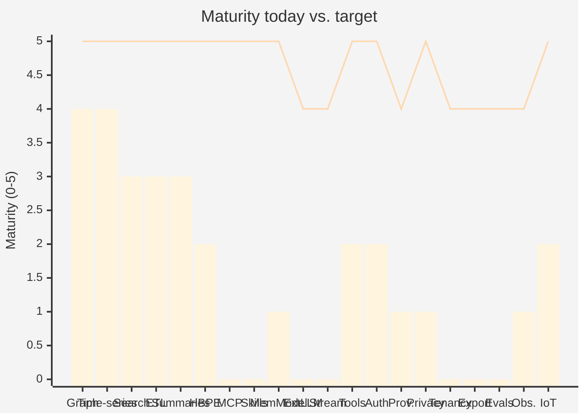
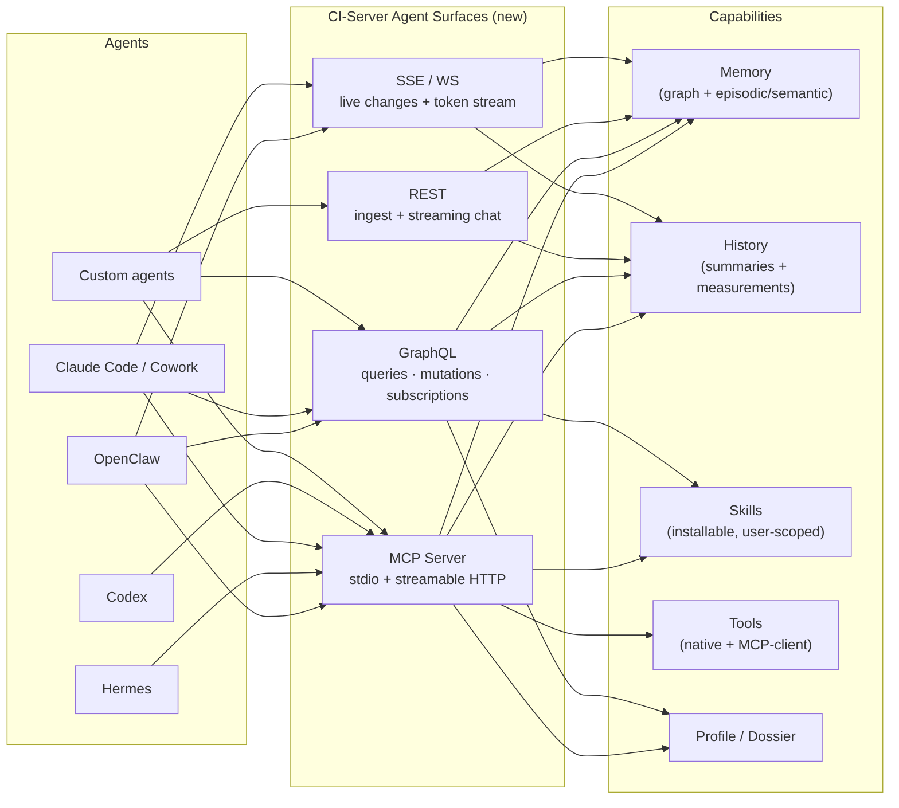
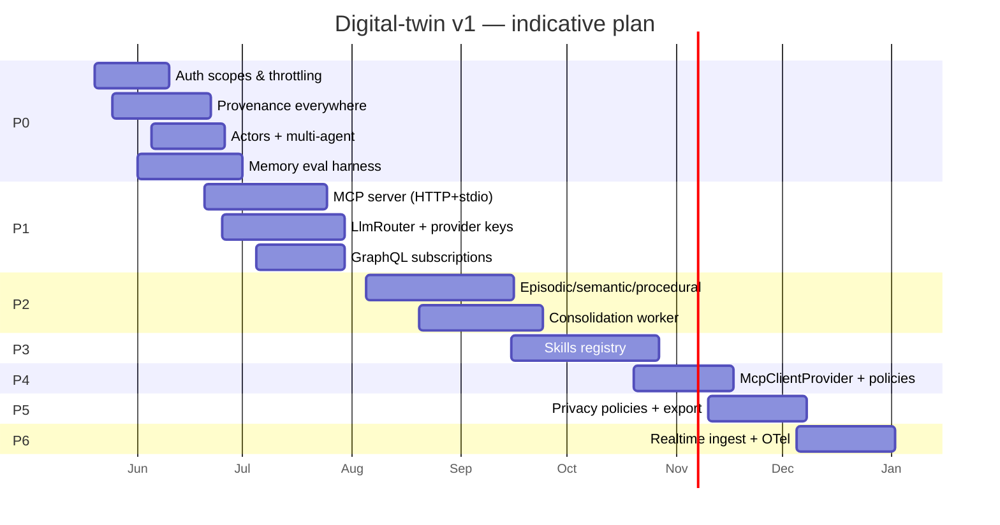

# CI-Server Gap Audit — Toward a Human Digital-Twin Backend

> **Status:** Draft v2 (revised after branch audit) &nbsp;•&nbsp; **Branch:** `audit/digital-twin-gap-analysis` &nbsp;•&nbsp; **Date:** 2026-05-18
>
> **Goal:** turn CI-Server from a personal-memory web app into a **first-class digital-twin backend** that personal AI agents (OpenClaw, Hermes, Claude Cowork, Codex, custom agents) can use as their durable memory, knowledge, and tool surface — over HTTP/GraphQL **and** MCP — with rich agent-skill primitives.
>
> This is an honest gap analysis: what's strong today, what's strong **in flight on unmerged branches**, what's structurally missing, and the specific changes that move us toward the target.
>
> **Detailed sub-plans** for each gap live in [docs/architecture/plan/](plan/00-overview.md). Read this audit for the *what* and *why*; read the sub-plans for the *how*.

---

## 0. North Star

A digital-twin backend that any agent can plug into and instantly behave as if it has lived the user's life. Concretely, an agent should be able to:

1. **Discover** the user (identity, preferences, schedules, relationships, devices) via a stable schema.
2. **Read** any fact, memory, embedding, summary, or measurement with provenance.
3. **Write** new observations, episodic memories, and inferences with confidence + source attribution.
4. **Subscribe** to changes (new events, new messages, new sensor readings).
5. **Use tools** that act on the user's behalf (calendar, messaging, files, web, IoT) via a single registry exposed as MCP and as native calls.
6. **Discover and load agent skills** scoped to the user's context.
7. **Reason on a memory model** with proper episodic / semantic / procedural separation, time-decay, and consolidation.

CI-Server today has most of the *substrate* but is missing the *agent-facing surface* and several memory-science features that distinguish a personal-memory web app from a digital twin.

---

## 1. Scoring at a Glance

Self-assessed maturity per area. **0 = absent, 5 = production-grade for digital-twin use.**

| Area | Today | Target | Gap |
|---|:-:|:-:|:-:|
| Graph data model (entities/relationships/facts) | 4 | 5 | Low |
| Time-series (measurements, position) | 4 | 5 | Low |
| Embeddings & semantic search | 3 | 5 | Medium |
| Source-of-truth ETL (Google/MS/Facebook/Spotify) | 3 | 5 | Medium |
| Hierarchical summaries | 3 | 5 | Medium |
| Predictions / behavior modeling (HBPE) | 2 | 5 | High |
| **MCP server surface** (two unmerged branches exist) | 2 | 5 | **High** |
| **Agent skills registry** | 0 | 5 | **Critical** |
| **Memory model (episodic/semantic/procedural)** | 1 | 5 | **Critical** |
| **External LLM provider support** | 1 | 4 | **High** |
| **Streaming / subscriptions** | 0 | 4 | **Critical** |
| Tool registry | 2 | 5 | High |
| API auth / scopes / rate limiting | 2 | 5 | High |
| Provenance, lineage, audit | 1 | 4 | High |
| Privacy, redaction, consent | 1 | 5 | High |
| Multi-tenancy / multi-agent isolation | 0 | 4 | High |
| Backup / export / portability | 0 | 4 | High |
| Eval harness (memory recall benchmarks) | 0 | 4 | High |
| Observability / tracing (OTel branch in flight) | 2 | 4 | Medium |
| Realtime device/IoT ingest | 2 | 5 | High |
| Voice / multimodal (branch in flight) | 1 | 4 | Medium |
| Graph algorithms (rustworkx spike) | 1 | 4 | Medium |
| Document parsing (doc-parse branches) | 2 | 4 | Medium |
| Red-team / safety evals (promptfoo branch) | 1 | 4 | Medium |
| ETL provider catalog (refactor + 4 new providers in flight) | 3 | 5 | Medium |



---

## 2. What's Strong Today

The bones are right. Several decisions that look obvious in hindsight are already locked in:

| Strength | Why it matters for digital-twin |
|---|---|
| **Unified graph** (`entities` + `relationships` with JSONB `properties`) | Avoids the trap of dozens of entity-typed tables; agents reason on a single shape. |
| **JSONB + embeddings on the same row** | One write produces both structured and semantic access — no parallel store to keep in sync. |
| **Hypertables** (`measurements`, `position`) | Sensor and AR data scale cleanly; the data model already accepts continuous streams. |
| **AGE graph extension on Postgres** | Real graph traversal without a second database — a major operational win. |
| **Temporal orchestrator** | Long-running ingest/predict/summarize workflows survive restarts. |
| **Hierarchical summary agent** (hourly → daily → weekly) | The chassis for memory consolidation is in place. |
| **HBPE service** | A foothold for personalization beyond retrieval — most personal-memory products lack any model. |
| **Domain-oriented backend** | Clear seams (`memory`, `intelligence`, `graph`, `etl`, `tools`) that map to digital-twin capabilities. |
| **Local-first LLM via Ollama** | Privacy posture is good by default; user can run fully offline. |
| **Self-host via Hub + Marketplace** | Distribution model already exists. |

---

## 3. Gaps — Detailed

Each gap below has: **what's missing, why it matters for the digital-twin goal, where to land the change, and concrete steps.**

### 3.1 MCP Server Surface — Two Unmerged Implementations, No Consolidation  ⚠ high

**Today (corrected).** MCP support exists in **two parallel branches** that haven't been merged or reconciled:

| Branch | Approach | Strengths | Open issues |
|---|---|---|---|
| **`add-mcp-endpoints`** | In-process NestJS module at `backend/apps/api/src/domains/mcp/` | Auto-generates MCP tools from the GraphQL schema (every query/mutation becomes a tool); also registers native tools from the existing `ToolRegistry`; exposes the SDL as an MCP resource; session management with hijacking protection and 30-min TTL reaper; SSE-compatible NGINX blocks; gated by `JwtOrApiKeyAuthGuard` | Inside the API process — couples MCP availability to API uptime and shares the same blast radius; no MCP prompts; no resource subscriptions; no scope enforcement (see §3.7) |
| **`feature/MCP`** | Standalone container at `backend/apps/mcp/` talking to the API via `CiApiClient` | Curated tools (`search_memory`, `read_entity_graph`, `get_user_context`, `get_recent_activity`, `get_thread`, `get_document`); owner-binding enforcement; published through CI-Gateway; isolated network; can scale independently | Hand-curated tool list (drifts from GraphQL); duplicates auth; needs its own observability |

The `mcp-servers/web-search` directory is still an empty placeholder.

**Why it matters.** Two competing implementations is worse than one. Until consolidated, neither can ship as a Marketplace-listed connector, and clients (OpenClaw, Hermes, Claude Code, Cowork, Codex) don't know which to target.

**Recommendation:** keep the **`add-mcp-endpoints` in-process module as the canonical implementation** (auto-generation is the right call long-term), and **port the curated, owner-binding, gateway-exposed deployment story from `feature/MCP`** on top of it. The standalone container becomes a thin re-deployment of the same code for users who want process isolation.

**See:** [plan/01-mcp-consolidation.md](plan/01-mcp-consolidation.md).

---

### 3.2 No Agent-Skills Registry  🚨 critical

**Today.** No notion of "skills" exists. Tools (`domains/tools`) are server-managed singletons registered at boot. There is no per-user installable, sandboxed, parameterized capability.

**Why it matters.** A digital twin is most useful when the same skills work across every agent runtime. Claude Code has skills (e.g., `productivity:memory-management`), Cowork has plugin skills, OpenClaw/Hermes will too. The user shouldn't have to re-author the same "summarize my week" or "draft a thank-you to anyone I haven't messaged in 30 days" workflow inside each agent. The twin should *own* those skills and any agent should be able to `skill.invoke`.

**Target shape.**
- A new `domains/skills` module with:
  - `Skill` entity: `id, name, version, description, owner_user_id, scope, input_schema, output_schema, instructions_md, capabilities[], source (built-in | user | marketplace)`.
  - Server-side execution engine for **deterministic** skills (SQL/graph queries, transforms).
  - **LLM-driven** skills that wrap an instructions blob + tool allow-list; executed via the configured LLM provider with the user's dossier auto-injected.
- A **marketplace channel** within CI-Marketplace for user-facing skills (separate from app bundles).
- Skills exposed simultaneously as: MCP prompts, MCP tools, GraphQL mutations, and the conversation runtime.

**Steps.**
1. Spec a `skill.yaml` format (name, version, capabilities, prompt template, tool allowlist).
2. Migration: `skills`, `skill_versions`, `user_skill_installs`, `skill_invocations` (with full trace).
3. Implement deterministic-skill executor first (lower risk), then LLM-skill executor.
4. Expose `skill.list/install/invoke` over MCP and GraphQL.
5. Seed three starter skills: `summarize_my_day`, `who_should_i_follow_up_with`, `find_in_my_memory`.

---

### 3.3 Memory Model Is Flat, Not Episodic/Semantic/Procedural  🚨 critical

**Today.** Everything goes into `entities` + `relationships`, with summaries as just another entity type. Facts are designed but treated as cold storage. There is no first-class distinction between:

- **Episodic memory** (events that happened at a specific time to *me*),
- **Semantic memory** (general knowledge I've internalized),
- **Procedural memory** (how I do things — routines, habits, workflows).

There is also no **time-decay**, **importance scoring**, **rehearsal/consolidation loop**, or **emotional valence** on memories.

**Why it matters.** Agents asking "what did I do last Tuesday at 4pm?" want episodic memory. Agents asking "what kind of coffee do I drink?" want semantic memory. Agents asking "what's my standard morning routine?" want procedural memory. A twin that can't tell these apart will retrieve poorly and forget poorly.

**Target shape.**
- Add `memory_kind` enum on entities (`episodic | semantic | procedural | reflective | meta`).
- Add structured columns: `importance` (0–1), `decay_rate`, `last_recalled_at`, `recall_count`, `valence` (-1..1), `confidence` (0..1), `source_provenance[]` (entity IDs).
- A **consolidation worker** that periodically:
  - Promotes high-recall episodic → semantic ("I keep ordering oat-milk lattes" → preference).
  - Demotes low-importance, never-recalled memories → facts cold storage (the design already in `Database.md`).
  - Generates reflective entities ("notice that you've called your mother every Sunday for 6 weeks").
- Embeddings layered by memory kind; retrieval pipeline selects the right index per query intent.

**Steps.**
1. Migration to add memory metadata columns + indexes.
2. Backfill `memory_kind` for existing data heuristically (events → episodic; concepts/preferences → semantic; routines → procedural).
3. Build the consolidation Temporal workflow alongside the existing summary workflow.
4. Update `search-next` to bias scoring by `importance × recency × kind-fit`.

---

### 3.4 LLM Layer Is Ollama-Only  ⚠ high (voice branch adds Whisper/TTS but not external LLMs)

**Today.** `domains/llm/services/OllamaService.ts` is the only LLM service. Models are hardcoded (`gemma3:1b`, `qwen3:14b`). No `OpenAIService`, `AnthropicService`, `OpenRouterService`, no per-user "BYO key" path. No streaming exposed to clients.

**Why it matters.** The digital twin's *data layer* can be local; the *agent's brain* often won't be (Claude, GPT, Hermes-on-API). The twin needs to:
- Accept the agent's choice of model and not assume Ollama.
- Allow a user to bring their own API key for external LLMs *for skills the twin runs server-side* (e.g., consolidation, summarization quality boosts).
- Stream tokens out so agent UIs feel native.

**Target shape.**
- A generic `LlmProvider` interface; implementations for Ollama, OpenAI, Anthropic, OpenRouter, Together.
- `provider_keys` table already exists (good!); wire it into a `LlmRouter` that picks provider+model based on task class (`embed`, `summarize`, `chat`, `tool-call`).
- Stream over SSE for HTTP, and over MCP's chunked transport.
- Per-skill model selection (e.g., consolidation uses local; emotional summarization uses Claude if a key is set).

**Steps.**
1. Refactor `OllamaService` → `LlmService` with provider strategy pattern.
2. Implement OpenAI + Anthropic providers using `provider_keys`.
3. Add `model_policy` per skill / per task.
4. Add SSE endpoint and MCP streaming for chat completions.

---

### 3.5 No Streaming / Subscriptions  🚨 critical

**Today.** `grep "subscription\|WebSocket"` in `domains/graphql` returns nothing. No `@nestjs/websockets`, no GraphQL subscriptions, no SSE. The Apollo server is plain HTTP. The summary agent **polls** `agent_messages` (per its README).

**Why it matters.** Agents and devices need pushed updates: "new email arrived", "new measurement", "summary ready". Polling burns battery and adds latency. AR/XR clients (per `Database.md` notes on headpose) need sub-second updates.

**Target shape.**
- GraphQL subscriptions over WebSocket (`graphql-ws`) for entity/relationship change events.
- SSE on REST endpoints for chat streaming.
- A `EventBusGateway` that fans the existing NestJS `EventEmitter` events out to clients filtered by `user_id` and topic.

**Steps.**
1. Add `@nestjs/websockets` + `graphql-ws`.
2. Define a `ChangeEvent` GraphQL union (`EntityCreated`, `EntityUpdated`, `RelationshipCreated`, `MessageStreamed`, …).
3. Wire to existing per-domain events (most domains already emit them — they're just not exposed externally).
4. Add MCP **resource subscriptions** for `memory://entity/*`, `memory://thread/*`.

---

### 3.6 Tool Registry Is Server-Internal Only

**Today.** `domains/tools` has `BaseTool`, `ToolRegistry`, `NativeToolProvider`, and ~8 hardcoded native tools (`DatabaseSearchTool`, `ReadKnowledgeTool`, `WriteKnowledgeTool`, etc.). No way to register external tools at runtime; no MCP-client provider; no per-user tool allowlist; no permission model on individual tools.

**Why it matters.** The twin should be able to **consume** other MCP servers (the user's calendar, Linear, Slack, browser, etc.) and **expose** them as a unified, governed tool surface. This is what makes a twin a useful executive layer, not just a database.

**Target shape.**
- New providers:
  - `McpClientProvider` — connects out to other MCP servers and surfaces their tools.
  - `GraphqlProvider` — auto-generates tools from the GraphQL schema (read mutations as tools).
  - `WebhookProvider` — exposes user-defined HTTP tools.
- Per-user, per-skill **tool allowlists** and **arg policies** (e.g., "any tool that writes is gated behind confirmation").
- Tool **provenance** in `tool_invocations` (who called, what args, what return) for audit + eval.

**Steps.**
1. Extend `ToolProvider` interface to declare `requires_user_consent: boolean` and `permission_scopes: string[]`.
2. Implement `McpClientProvider`.
3. Build a `tool_invocations` table and write to it from `ToolRegistry.execute`.

---

### 3.7 API Key Scopes Stored but Not Enforced

**Today.** `ApiKeyEntity.scopes` is a `text[]` field; `ApiKeyService.create` accepts scopes; `ApiKeyStrategy.validate` does **not** check scopes against the request. There's no `@RequiredScopes(...)` decorator on controllers/resolvers. There is no rate limiting at all (`ratelimit`/`throttle` grep returns nothing).

**Why it matters.** As soon as third-party agents start using API keys, abuse risk is real. A key meant only for "read my summaries" must not be able to delete entities. No rate limit on an MCP endpoint with LLM behind it is a wallet attack vector if external providers are added.

**Target shape.**
- Define a scope taxonomy: `memory:read`, `memory:write`, `tools:invoke:<tool>`, `chat:stream`, `skill:invoke:<skill>`, `admin:*`.
- `@Scopes('memory:read')` decorator + guard.
- Throttling via `@nestjs/throttler` (already a peer of NestJS) — global per-key budget plus per-tool budgets.
- Audit trail of denied calls.

**Steps.**
1. Build the scope guard and decorate every resolver/controller.
2. Backfill existing keys to wildcard for compatibility.
3. Add `rate_limit_per_minute` to `api_keys`.

---

### 3.8 Provenance / Lineage Is Thin

**Today.** Entities have `created_by`/`updated_by`-ish fields in some tables but no uniform `source` model. ETL writes don't carry forward "this entity came from Google Calendar event abc123 imported at T". The summary agent writes summaries but the `SUMMARIZED_BY` relationships are only entity-to-summary, not chunk-to-source.

**Why it matters.** An agent that recalls a memory must be able to **cite** its source. Without provenance:
- Hallucination is indistinguishable from recall.
- Compliance / "show me where you got that" is impossible.
- Rolling back a bad ETL (e.g., a noisy provider) leaves orphan beliefs.

**Target shape.**
- A `provenance` JSONB on every entity, relationship, fact, and summary: `{kind: 'etl'|'agent'|'user'|'inferred', source_id, source_provider, ingested_at, model?, confidence?}`.
- A `derived_from` self-referencing edge from any derived entity to its sources.
- Retrieval API returns `sources[]` alongside `content`.

**Steps.**
1. Migration to add `provenance` JSONB + GIN index.
2. Update each ETL `Promote` path to populate it.
3. Update summary + HBPE writes to carry sources.

---

### 3.9 Privacy / Redaction / Consent

**Today.** No PII tagging. No redaction at retrieval time. No consent record for which fields an agent may see. The `audit` domain exists but is barely used. Embeddings are computed over raw text — meaning if you ever share an embedding model output, you may leak PII (especially with public models).

**Why it matters.** The twin will hold extremely sensitive data — messages, location, health metrics, finances. As soon as you let agents talk to it, you need **field-level policies** ("OpenClaw can read locations from the last 7 days; Codex cannot"), **redaction templates**, and **consent receipts**.

**Target shape.**
- PII tags on JSONB properties (computed at write time by a classifier).
- **Sharing policies** as first-class entities: `Policy{ agent_key, allow_paths[], deny_paths[], retention, purpose }`.
- A `redact()` pipeline applied at every read for non-owner consumers.
- **Consent receipts**: every external-agent read produces a receipt the user can later inspect/revoke.

**Steps.**
1. Add a PII tagger pass in the ETL `Promote` step.
2. Add `agent_access_policies` table + enforcement guard on the API and MCP layers.
3. Surface a "data access log" view in the SPA.

---

### 3.10 Single-User Assumption

**Today.** Auth, sessions, sync, and most domains assume one user per Hub. Multi-tenant isolation is via `WHERE user_id = ?` — fine for one-Hub-per-person, brittle if you ever want **multi-agent isolation within one user** (where each agent has a "sub-tenant" view), or **family/team twins**.

**Why it matters.** Agents like Claude Cowork, OpenClaw, Hermes will likely run **multiple personas per user**. Family/household twins are a natural follow-on. The simplest path is to treat **`actor`** as the access unit, with `user` as a special actor type.

**Target shape.**
- `actors` table: `id, kind ('user'|'agent'|'household'), parent_user_id, display_name`.
- Every write carries `actor_id` (not just `user_id`).
- Reads filtered by `actor_id` membership.

**Steps.**
1. Add `actors` table + migration.
2. Backfill: one actor per user.
3. Update `RequestContext` to carry `actor_id`.

---

### 3.11 Backup, Export, Portability

**Today.** No export endpoint. No documented backup procedure beyond the docker volume `db-data`. No "move my twin to another Hub" path.

**Why it matters.** The trust pitch for a self-hosted personal twin is data sovereignty. A user who can't take their twin elsewhere doesn't actually have one.

**Target shape.**
- Streaming JSONL export of every domain with embeddings + media references.
- Encrypted backup to S3-compatible / R2 / user-specified bucket via Temporal workflow.
- Import endpoint that reconstructs the graph and re-embeds where needed.

**Steps.**
1. `backend/apps/api/src/domains/export` with stream-based exporter per entity type.
2. Encrypted-archive format with a manifest.
3. CLI in `scripts/` plus a UI button.

---

### 3.12 No Eval Harness for Memory Quality

**Today.** No tests of the form "given this corpus, when asked X, the system returns Y". The recall pipeline (`search-next`) is well-engineered but its **answer quality** is untested.

**Why it matters.** Every change to embeddings, scoring weights, or consolidation rules can silently degrade recall. As soon as agents depend on the twin, recall regressions become user-visible incidents.

**Target shape.**
- A **memory eval suite** in `tests/memory-evals/`:
  - **Recall-at-k** on a seeded corpus with known facts.
  - **Episodic dating** (was X really on May 3?).
  - **Relationship-inference** (does the system know A is B's spouse from contextual cues?).
  - **Forgetting/precision** (does it correctly say "I don't know" when it shouldn't).
- Run in CI on every PR that touches `memory`, `search-next`, or `graph`.

**Steps.**
1. Build a seedable test corpus.
2. Author 50–100 graded queries per memory kind.
3. CI job emits a scorecard; regressions block merge.

---

### 3.13 Realtime Device / IoT Ingest

**Today.** `devices`, `sensors`, `measurements` exist with hypertables. There is no documented ingest endpoint optimized for high-rate writes; no batching protocol; no MQTT/WebSocket; no schema-on-write for new sensor types.

**Why it matters.** Wearables (Pebble, Mentra, OMI, Even-Realities) are core to the twin. They generate orders of magnitude more rows than ETL.

**Target shape.**
- A dedicated ingest endpoint (HTTP + WebSocket + optional MQTT bridge) with COPY-style batched inserts into hypertables.
- Per-device API keys with strict scopes (`device:ingest:<device_id>`).
- Schema-on-write for unseen `measurement_type` (creates a sensor descriptor on first sight).

**Steps.**
1. `domains/ingest` module with batched hypertable writers.
2. Backpressure + dead-letter queue.
3. Document the protocol in `CI-Engineering`.

---

### 3.14 Observability

**Today.** `LoggerService` exists; no traces, no metrics, no error reporting beyond console. The `audit` domain has minimal usage.

**Why it matters.** When an agent silently mis-recalls, you need traces from MCP call → tool → DB query → embedding lookup → answer. Without OpenTelemetry, debugging a twin is guesswork.

**Target shape.**
- OpenTelemetry tracing across NestJS, Temporal workers, HBPE, Summary.
- Prometheus metrics: query latency, embedding latency, tool-call success rate, recall-at-k drift.
- Structured audit log: every external-actor read/write, every tool invocation, every skill run.

---

### 3.15 In-Flight Branches That Belong in the Plan

The audit must own the fact that the repo has substantial unmerged work whose fate is undecided. Letting these branches rot is a bigger drag on velocity than any of the gaps above.

| Branch | Status | Disposition in plan | Sub-plan |
|---|---|---|---|
| `add-mcp-endpoints` | Active | **Merge as canonical MCP**, harden | [01-mcp-consolidation.md](plan/01-mcp-consolidation.md) |
| `feature/MCP` | Active | Take deployment/owner-binding ideas; archive container | [01-mcp-consolidation.md](plan/01-mcp-consolidation.md) |
| `codex/add-opentelemetry-client-support` | Active | Merge with hardening | [14-observability.md](plan/14-observability.md) |
| `copilot/add-llm-red-team-prompt-foo` | Active | Merge as eval CI step | [19-red-teaming.md](plan/19-red-teaming.md) |
| `copilot/add-imessage-integration` (BlueBubbles) | Active | Promote to connector entry in catalog | [15-etl-expansion.md](plan/15-etl-expansion.md) |
| `feat/discord`, `feat/instagram`, `steam-etl`, `github-etl` | Various | Merge after the ETL catalog refactor lands | [15-etl-expansion.md](plan/15-etl-expansion.md) |
| `copilot/refactor-connections-etl-system` | Active | **Land this first** — unblocks the four ETLs above | [15-etl-expansion.md](plan/15-etl-expansion.md) |
| `feat/voice-mode` | Active | Merge; build proper STT/TTS provider layer on top | [16-voice-multimodal.md](plan/16-voice-multimodal.md) |
| `spike/rustworkx` | Spike | Productionize ego graph + Steiner tree for memory retrieval | [17-graph-algorithms.md](plan/17-graph-algorithms.md) |
| `feature/doc-parse`, `feature/parser-container` | Active | Merge after `parser-container` is sandboxed | [18-document-parsing.md](plan/18-document-parsing.md) |
| `ChatKnowledge` | Active | Tighten and merge — improves the dossier read surface used by every agent prompt | (see §3.3 memory model) |

## 4. Memory Model — Proposed Schema Additions

```mermaid
erDiagram
    ACTORS ||--o{ ENTITIES : owns
    ACTORS ||--o{ AGENT_ACCESS_POLICIES : "subject of"
    ENTITIES ||--o{ ENTITY_PROVENANCE : "has"
    ENTITIES ||--o{ ENTITY_MEMORY_META : "has"
    ENTITIES ||--o{ DERIVED_FROM : "links to sources"
    SKILLS ||--o{ SKILL_VERSIONS : "versions"
    SKILL_VERSIONS ||--o{ SKILL_INVOCATIONS : "executed"
    TOOL_INVOCATIONS }o--|| ENTITIES : "may produce"
    AGENT_ACCESS_POLICIES ||--o{ CONSENT_RECEIPTS : "issues"

    ACTORS {
      uuid id PK
      string kind "user|agent|household"
      uuid parent_user_id FK
      string display_name
    }
    ENTITY_MEMORY_META {
      uuid entity_id PK
      string memory_kind "episodic|semantic|procedural|reflective|meta"
      float importance
      float decay_rate
      float valence
      float confidence
      timestamptz last_recalled_at
      int recall_count
    }
    ENTITY_PROVENANCE {
      uuid entity_id PK
      string kind "etl|agent|user|inferred"
      string source_provider
      string source_id
      timestamptz ingested_at
      string model
      float source_confidence
    }
    SKILLS { uuid id PK; string name; string scope; string source }
    SKILL_VERSIONS { uuid id PK; uuid skill_id FK; string version; jsonb spec }
    SKILL_INVOCATIONS { uuid id PK; uuid skill_version_id FK; uuid actor_id; jsonb input; jsonb output; timestamptz at }
    TOOL_INVOCATIONS { uuid id PK; uuid actor_id; string tool; jsonb args; jsonb result; timestamptz at }
    AGENT_ACCESS_POLICIES { uuid id PK; uuid agent_actor_id; jsonb allow_paths; jsonb deny_paths; interval retention }
    CONSENT_RECEIPTS { uuid id PK; uuid policy_id FK; jsonb access; timestamptz at }
```

---

## 5. Proposed API Surface for Agents



**API ergonomic targets:**
- One config block per agent connects every capability.
- Auth via API key (scoped) or OAuth2 device-flow against CI-Portal.
- Stable, versioned MCP tool names (`ci.memory.recall@1`).
- Idempotent writes (client-supplied UUID v7s).

---

## 6. Prioritized Roadmap to Digital-Twin v1

| Phase | Theme | Outcomes | Repo touch points |
|---|---|---|---|
| **P0 — Foundations (4–6 wks)** | Auth scopes, provenance, actors, eval harness | API keys actually enforce; every write has a source; multi-agent ready; recall measured | `auth`, `audit`, every `Promote*`, `tests/memory-evals` |
| **P1 — Agent Surface (6–8 wks)** | MCP server, streaming, LLM routing | Any MCP-capable agent connects in one step; BYO LLM; live updates | new `domains/mcp`, `domains/llm` refactor, `graphql` subscriptions |
| **P2 — Memory Model (6–8 wks)** | Episodic/semantic/procedural, consolidation, importance/decay | Twin retrieves *correctly*, not just plausibly | `memory`, `search-next`, new consolidation workflow |
| **P3 — Skills (6 wks)** | Skill registry, deterministic + LLM executors, marketplace channel | Users author once, use everywhere | new `domains/skills`, CI-Marketplace |
| **P4 — Tooling Out (4 wks)** | `McpClientProvider`, tool policies, per-tool throttling | Twin is an executive layer, not just a DB | `tools` |
| **P5 — Privacy & Portability (4 wks)** | Policies, redaction, export, encrypted backup | Sovereign, shareable, revocable | `audit`, new `export` |
| **P6 — Realtime & Observability (4 wks)** | IoT ingest, OTel, audit dashboards | Wearables/XR feel live; debuggable | new `ingest`, infra wiring |



---

## 7. Cross-Repo Implications

| Repo | Impact |
|---|---|
| **CI-Marketplace** | New "skill" channel alongside "app" channel; `CI-Server-MCP` listed as a connector. |
| **CI-Hub** | Surface a per-app **agent connection** flow: "Connect Claude Code to your twin" → generates scoped API key + writes MCP config. |
| **CI-Portal** | Issue OAuth2 device codes for agents; broker remote MCP transport without exposing the Hub directly. |
| **CI-Gateway** | Add `/mcp` route for the new transport. |
| **CI-Docs / CI-Engineering** | Publish the agent integration guide (this audit's §5). |
| **CI-Browser-Extension / CI-Spatial-Companion-* / CI-Pebble / CI-Mentra / CI-OMI** | Migrate from polling to subscriptions; adopt the new ingest endpoint. |

---

## 8. Risks and Trade-offs

| Risk | Trade-off | Mitigation |
|---|---|---|
| MCP spec is still evolving | Coupling tightly = churn | Keep an internal abstraction; MCP adapter is one layer. |
| External LLM keys leak data | Privacy regression | Per-task policy: never send `episodic_kind` text to external models unless flag set; redact PII before egress. |
| Consolidation rewrites history | Loss of fidelity | Always write derived records, never destructively overwrite source episodic. |
| Multi-actor permissions add friction | UX cost | Default the "household primary user" actor to wildcard; granular policies only when an external agent connects. |
| Marketplace skills can run arbitrary prompts | Prompt-injection / exfiltration | Sandboxed tool allowlists per skill version; require user accept before first run; never allow a skill to read API keys. |
| Backfilling provenance is expensive on existing data | Long migration | Background Temporal workflow; mark `provenance.kind = 'legacy'` for pre-cutoff rows. |

---

## 9. Concrete Quick Wins (1–2 days each)

These are small, isolated, immediately useful, and don't require buying into the whole roadmap:

1. **Enforce API-key scopes** in `ApiKeyStrategy` + `@Scopes()` decorator.
2. **Add `@nestjs/throttler`** with sensible defaults per route class.
3. **Wire `provenance` JSONB** onto `entities` + populate from `etl/services/PromoteService.ts`.
4. **Replace the empty `mcp-servers/web-search` placeholder** with a real Node-based MCP server that wraps the existing tool registry — shippable in days, proves the seam.
5. **Add SSE streaming** to chat completions in `OllamaService` and the conversation controller.
6. **Memory-recall smoke test**: seed John Smith with 100 deterministic facts, query 20, score recall-at-5. Run in CI.
7. **`POST /api/v1/memory/remember`** convenience endpoint that takes free text + optional `memory_kind` and writes an entity with embedding — the simplest possible agent on-ramp.

---

## 10. Open Questions

| Question | Why it matters |
|---|---|
| Should skills run inside CI-Server or as separate Marketplace apps with their own containers? | The latter is more secure; the former is much lower latency for memory-heavy skills. |
| Does CI-Portal own agent identity, or does CI-Server? | If Portal does, multi-Hub agent identity works; if Server, simpler but no cross-Hub sharing. |
| Embeddings: stay on `nomic-embed-text`, or move to a model that supports better cross-lingual + longer contexts? | Affects recall ceiling; non-trivial re-embed cost. |
| How do we model "the twin's opinion vs. observed fact"? | A reflective tier helps, but it's its own can of worms (calibration, drift). |
| Procedural memory: do we infer routines automatically, or only via explicit user "habit" entities? | Inference is magical when right and gaslighting when wrong. |

---

## 11. TL;DR

**CI-Server's bones are excellent.** The graph + hypertable + embedding substrate, Temporal-backed agents, and Hub/Marketplace distribution model are real assets few competitors have.

**What's missing is the agent-facing layer**:

1. **An MCP server** so OpenClaw, Hermes, Claude Code/Cowork, Codex, and friends can plug in without bespoke clients.
2. **An agent-skills registry** so the twin owns the user's "how I want my agent to work" knowledge.
3. **A proper memory model** (episodic / semantic / procedural with provenance, importance, decay, consolidation) so retrieval is correct, not just plausible.
4. **External LLM routing + streaming + subscriptions** so live agent loops feel native.
5. **Scopes, throttling, policies, audit, export** so external agents are safe to invite in.

Each of these is achievable as an additive module within the existing architecture; none requires a rewrite. P0 alone (scopes + provenance + actors + eval harness) unlocks every subsequent phase.
