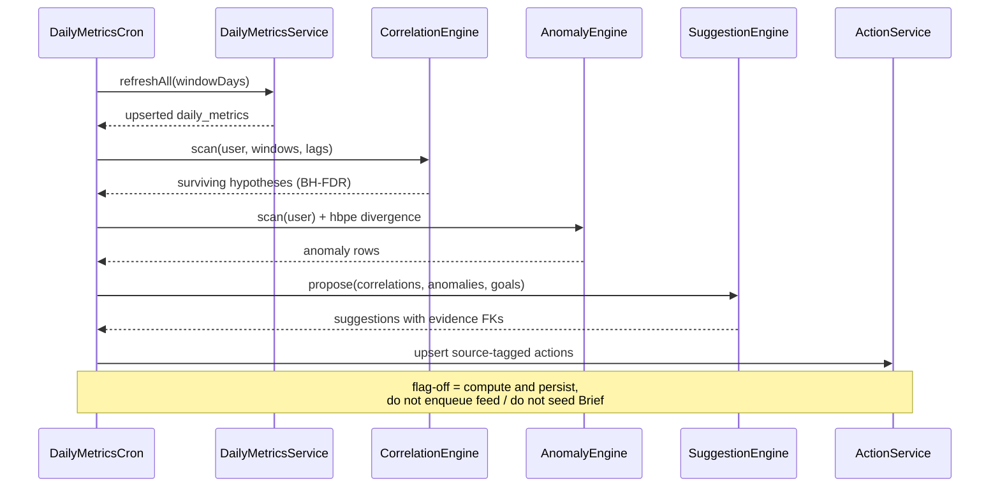
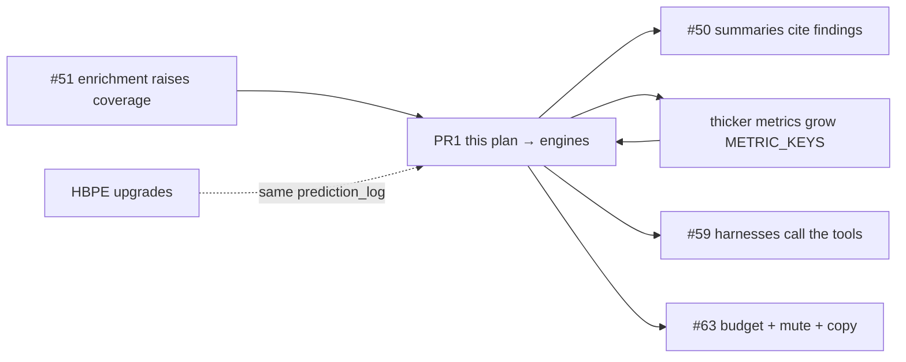

# Correlation, anomaly, and suggestion engines

> **Private & Confidential — Property of Lifescope Inc. Do not distribute.**
>
> Status: **implemented and merged to `main`** — the `feat/derivation-engines` work
> (PR #2029) reached `main` on 2026-08-17 inside
> [#2032](https://github.com/companionintelligence/CI-Server/pull/2032). Later
> workstreams in §10 stay out of scope.
> Tracker: [CI-Engineering #55](https://github.com/companionintelligence/CI-Engineering/issues/55)
> · epic [#49](https://github.com/companionintelligence/CI-Engineering/issues/49)
> · ADRs [0006–0008](https://github.com/companionintelligence/CI-Engineering/pull/56).
>
> Grounded against `origin/main` on 2026-08-17. Path citations spot-checked
> against `main` on 2026-08-19 and still resolve; the numbers and prose below
> were not re-derived.

This is **PR 1 of the remaining derivation-layer work**. It fills the largest hole:
daily-metrics and the question catalog are a dashboard, not a derivation layer.
Later PRs (summary grounding, enrichment, thicker metrics, agent harnesses,
cold-start gates, HBPE model upgrades) plug into the contracts locked here.
They are sequenced in §10; they are not in scope to build now.

---

## 1. The hole

Capture, identity, storage, and retrieval are real. HBPE forecasts. The Daily
Feature Store materializes ten scalars per `(user, date)`. The descriptive catalog
answers "how many conversations did I have this week?" by aggregating those
scalars and phrasing the number.

None of that can answer the motivating question on
[#54](https://github.com/companionintelligence/CI-Engineering/issues/54):

> How much did exercise change my mood this quarter?

That question is not retrieval and not a single-metric aggregate. It is a
**lagged association** between two series, tested against a multiple-comparisons
budget, with coverage so missing days are not zeros, surfaced as a **hypothesis**
("associated with", never "causes"), and — if the user has a goal and a current
gap — turned into an **evidence-linked suggestion** in `ci.actions`.

Until that producer exists, Brief, the feed, and the agent are reading
scaffolding:

| Surface | What it reads today | Who writes it |
|---|---|---|
| `brief.list` anomalies | `ci.summaries.content.anomalies` (free-text list) | Python `backend/apps/summary` LLM, inventing the list |
| `brief.list` actions | `ci.actions` with no `source`/`kind` | Onboarding stubs + the same LLM action aggregator |
| Brief surprise picker | `pickMetricSurprise` — four hardcoded yesterday-vs-week rules | Called from `ContextPromptGenerateService` behind `grounded.prompts` (default **on** after [agent-harness-and-cold-start.md](agent-harness-and-cold-start.md)) |
| Descriptive catalog | One metric, one aggregate, one timeframe | `DescriptiveQuestionService` — real, but descriptive-only |
| Metric forecast | Seasonal-naive + EWMA on one series | `MetricForecastService` — predictive, not correlational |

The catalog's five analytic types are `descriptive · predictive · correlational ·
anomaly · optimization` (ADR-0008). Only the first is implemented; the second is
a separate forecaster that the catalog does not call. Types 3–5 have no engine,
no table, no standing job, and no tool.

That is the hole. This plan closes it.

---

## 2. What exists today

### 2.1 Feature store (the substrate — keep using it)

`ci_derived.daily_metrics` is a **wide** per-`(user_id, date)` table
(`backend/apps/api/db/postgres/migrations/20260817180000_create_ci_derived_daily_metrics.sql`).
ADR-0006 preferred the long form `(user, date, metric_key)`; we shipped wide.
That is a locked deviation: engines iterate `METRIC_KEYS`, they do not assume a
fixed pair list, and they do not wait for a long-form rewrite.

Shipped columns (`backend/apps/api/src/domains/daily-metrics/types.ts`):

```
n_messages, n_conversations, n_unique_contacts, outbound_ratio, avg_sentiment,
n_places, km_traveled, screen_minutes, n_domains, spend_total
```

Named in [#53](https://github.com/companionintelligence/CI-Engineering/issues/53)
and **not yet columns**: `sleep_*`, `deep_work_minutes`, `meeting_minutes`,
`time_at_home`, `mood_index` / `stress_proxy`, `top_topic`. Body / Mind / Time
catalog cells that point at those keys must remain N/A until the thicker-metrics
PR lands. Correlation automatically picks up a new key the day it is added to
`METRIC_KEYS` — that is the extension point.

Contract already encoded in `assembleDailyMetrics`
(`backend/apps/api/src/domains/daily-metrics/metrics/assembleDailyMetrics.ts`):

- A metric is `null`, not `0`, when its source produced no usable rows.
- `coverage[metric]` is `[0, 1]`. Readers branch on coverage before treating a
  value as data.

Nightly/hourly recompute: `DailyMetricsCron` (`0 10 * * * *`) plus a 30-day
bootstrap backfill.

### 2.2 Compute-then-narrate (reuse, don't fork)

`DescriptiveQuestionService` already does ADR-0007 correctly: compute a number,
hand it to a `Narrator` that cannot change `.value`. `TemplateNarrator` is the
default; `OllamaNarrator` is a phrasing swap. Correlation / anomaly /
optimization answers must use the **same** `NARRATOR` token and the same
provenance shape (`metric`, `sources`, `daysWithData`, `coveragePct`), extended
with the evidence fields in §6.

`QUESTION_CATALOG` is ~18 descriptive specs. `QuestionSpec` has no
`analyticType`. Adding that field — default `'descriptive'` — is the catalog
extension. Do not invent a second registry.

### 2.3 The tiny surprise picker (replace as a consumer, keep as a test)

`pickMetricSurprise`
(`backend/apps/api/src/domains/daily-metrics/grounded/metricSurprises.ts`) is
four if-statements: conversations ≤ 40% of week mean, one place, sentiment
dip of 0.25, screen ≥ 1.6× week mean. Coverage floor 0.5, ≥ 14 coverage-gated
days (same as the engines — see [agent-harness-and-cold-start.md](agent-harness-and-cold-start.md)).
At most one surprise. Flag `grounded.prompts` defaults on.

This is a preview of the anomaly engine, not the engine. Implementation keeps
the function as a **thin adapter** over the latest anomaly row so the selector
generator does not break, then deletes the hardcoded thresholds.

### 2.4 `ci.actions` is an untyped feed card

`ActionEntity` (`backend/apps/api/src/domains/intelligence/entities/ActionEntity.ts`)
has `title`, `text`, `priority`, `metadata jsonb`, `seen`, `dismissed`. No
`source`, no `kind`, no evidence FK. `ActionService.findAll` returns everything
ordered by priority. `BriefListTool` dumps the lot next to LLM-invented
summary anomalies.

[#63](https://github.com/companionintelligence/CI-Engineering/issues/63) owns the
full provenance discriminator. **A minimal `source` column is load-bearing for
this work** — without it, computed suggestions are indistinguishable from
onboarding stubs and free-LLM actions, and `suggestions.list` / `anomalies.recent`
cannot be honest. Pull that thin slice forward (see §6.4). The rest of #63
(proactivity budget, non-clinical copy audit, "still learning" empty states)
stays on its own PR.

### 2.5 Agent surface (tools registered; REST execute is #59)

Live domains include `insights`, `anomalies`, `suggestions` plus the original
set. Live tools include `insights.explain`, `anomalies.recent`,
`suggestions.list`, `suggestions.feedback`, `forecast.read`,
`forecast.calibration`, `brief.list`. Ticket name `predictions.nextPlaces`
is `places.next` (domain `places`) — see
[agent-harness-and-cold-start.md](agent-harness-and-cold-start.md).

Hermes `get_tool_schemas()` and OpenClaw intent tools are already
catalog-driven. The remaining #59 hole on CI-Server was REST
`POST …/:name/execute` (and the canonical `/api/agent/intents` GET). Memory
MCP already ran `ToolRegistry.executeTool`.

### 2.6 HBPE scoring (consume, don't upgrade)

`hbpe.prediction_score` and `hbpe.prediction_log.actual_*` exist
(`20260817190000_hbpe_prediction_score.sql`,
`backend/apps/hbpe/src/ci/hbpe/pipeline/scoring.py`). Basis is
**self-consistency vs Qwen labels**, not ground truth. The anomaly engine
treats predicted-vs-actual L0 divergence as a **behavioral anomaly source**.
It does not change the kernel, add an L2 head, or feed `daily_metrics` into
HBPE as **training** signal. Inference-time kernel covariates, HMM smoothing,
and the B0/B1/B2 serve gate live in
[hbpe-landing.md](hbpe-landing.md).

---

## 3. Target architecture

```mermaid
flowchart TB
    subgraph Store["ci_derived.daily_metrics"]
        DM["wide (user, date) scalars<br/>NULL ≠ 0 · coverage jsonb"]
    END

    subgraph Engines["daily-metrics engines — pure math + Nest services"]
        C["CorrelationEngine<br/>Pearson / Spearman / MI<br/>lags 0,1,2,7 · BH-FDR"]
        A["AnomalyEngine<br/>robust z + CUSUM changepoint<br/>+ HBPE L0 divergence"]
        S["SuggestionEngine<br/>goal × driver × gap<br/>evidence-linked only"]
    end

    subgraph Derived["ci_derived first-class findings"]
        COR["metric_correlations"]
        ANO["metric_anomalies"]
        SUG["metric_suggestions"]
    end

    subgraph Surfaces["existing surfaces — new producers"]
        CAT["QUESTION_CATALOG<br/>analyticType = correlational / anomaly / optimization"]
        ACT["ci.actions<br/>source = correlation | anomaly | suggestion"]
        FEED["ci.feed_queue"]
        TOOLS["insights.explain · anomalies.recent<br/>suggestions.list / .feedback"]
        BRIEF["brief.list — filter by source"]
    end

    DM --> C --> COR
    DM --> A --> ANO
    COR --> S
    ANO --> S
    S --> SUG
    COR --> CAT
    ANO --> CAT
    SUG --> CAT
    SUG --> ACT
    ANO --> ACT
    ACT --> FEED
    COR --> TOOLS
    ANO --> TOOLS
    SUG --> TOOLS
    ACT --> BRIEF
    ANO --> BRIEF
```

Standing mode runs on the existing `DailyMetricsCron` tick, **after** the
feature-store refresh for that window. Ad-hoc mode is the catalog / GraphQL /
tool read path over the same tables. There is no second job system.



---

## 4. Locked decisions

| # | Decision | Why |
|---|---|---|
| D1 | **Stay on the wide table.** Engines iterate `METRIC_KEYS`. Adding a column (sleep, deep work, …) is additive. No long-form rewrite in this work. | ADR-0006's long form is right eventually; it is not a blocker. A rewrite now delays the hole. |
| D2 | **Findings are first-class `ci_derived` rows**, not JSON stuffed into `ci.summaries.content`. Summaries may *cite* them later (#50). | Anomalies today are a free-text list inside an LLM blob. That is the anti-pattern. |
| D3 | **Hypotheses, never causes.** Copy is "associated with" / "tends to precede". No causal language in templates, tools, or GraphQL descriptions. | FDR + lag ≠ identification. |
| D4 | **Coverage-gated pairwise.** A day contributes to a pair only when **both** metrics are non-null **and** `coverage ≥ MIN_PAIR_COVERAGE` (0.5, matching `pickMetricSurprise`). | Missing-data-as-zero is how you invent "exercise crashed on vacation." |
| D5 | **BH-FDR at `q = 0.1`** per user per window, over the full pair × lag family. Rank survivors by `abs(effect) × robustness × novelty`. | 10 metrics × C(10,2)=45 pairs × 4 lags × 3 windows ≈ 540 tests. Uncorrected p-values will always find something. |
| D6 | **TemplateNarrator default** for Body/Mind. Ollama narrator allowed for Relationships/Places/Attention/Money only, and it still cannot change numbers. | #63's non-clinical rule, pulled forward for the categories this engine will actually emit. |
| D7 | **Suggestions cite an evidence row or they do not emit.** No evidence FK → no `ci.actions` row. | "Never fabricate the evidence link" (#55). |
| D8 | **No normative goals in v1.** Personal baseline gap + surviving driver correlation only. Skip "people should sleep 8h". Skip Body/Mind health suggestions until thicker metrics + #63 copy review. | Conservative posture. Explicit `ci.objectives` wait for planning. |
| D9 | **Flag `derivation.engines`**, default **on** after the #63 floors land ([agent-harness-and-cold-start.md](agent-harness-and-cold-start.md)). Compute+persist always runs; the flag gates feed enqueue and Brief seeding. | Same pattern as `grounded.prompts`. |
| D10 | **Pure math modules, Nest shells.** `correlationMath.ts` / `anomalyMath.ts` / `suggestionMath.ts` take arrays, return structs, have no DB. Services persist. | Matches `forecastMath.ts`, `answerMath.ts`, `transitionMath.ts`. |

---

## 5. Schema

All new tables in `ci_derived`. One dbmate migration. TypeORM entities next to
the existing daily-metrics entities. `user_id UUID REFERENCES ci.users(id) ON
DELETE CASCADE` everywhere.

### 5.1 `ci_derived.metric_correlations`

One row per `(user_id, metric_a, metric_b, lag_days, window_days)` — the
latest scan. History of scans is not required in v1; upsert on the natural key.

| Column | Type | Notes |
|---|---|---|
| `id` | uuid PK | `gen_uuid_v7()` |
| `user_id` | uuid | FK |
| `metric_a`, `metric_b` | text | Members of `METRIC_KEYS`. Store **canonical order** (`a < b` lexicographically) so pairs don't double. Lag sign lives in `lag_days`. |
| `lag_days` | int | `0, 1, 2, 7`. Positive = `b` lags `a` (`a` today, `b` in `lag` days). |
| `window_days` | int | `30, 90, 180` |
| `n` | int | Paired days that cleared coverage |
| `pearson`, `spearman` | double | Nullable if `n` too small |
| `mutual_info` | double | Optional in v1; compute if cheap, else null |
| `p_value` | double | Two-sided Pearson (or Spearman if either series is rank-like) |
| `q_value` | double | BH-FDR adjusted, over the family for this `(user, window)` |
| `effect` | double | Signed; Pearson r for ranking |
| `robust` | boolean | Survived ≥ 2 of the 3 windows at `q ≤ 0.1` with the same sign |
| `novelty` | double | `1` on first survival; decays if shown and dismissed |
| `coverage_mean` | double | Mean of the two per-day coverage values over paired days |
| `computed_at` | timestamptz | |

Indexes: `(user_id, q_value)`, `(user_id, robust, computed_at DESC)`.

### 5.2 `ci_derived.metric_anomalies`

One row per detected event. Not upserted away — an anomaly is a dated finding.
Dedup key: `(user_id, metric, date, detector)` unique.

| Column | Type | Notes |
|---|---|---|
| `id` | uuid PK | |
| `user_id` | uuid | |
| `metric` | text | `METRIC_KEYS` **or** `'hbpe.l0_divergence'` |
| `date` | date | Local calendar day of the observation |
| `detector` | text | `'robust_z'` \| `'cusum'` \| `'hbpe_l0'` |
| `value` | double | Observed (null for hbpe, which uses `metadata`) |
| `baseline` | double | Rolling mean / expected |
| `score` | double | \|z\| or CUSUM magnitude or `1 - p(actual_l0)` |
| `direction` | text | `'high'` \| `'low'` \| `'change'` \| `'divergence'` |
| `coverage` | double | |
| `metadata` | jsonb | HBPE: `{expected_l0, actual_l0, bucket_count}`; CUSUM: `{run_start, run_end}` |
| `action_id` | uuid null | Set when promoted to `ci.actions` |
| `computed_at` | timestamptz | |

### 5.3 `ci_derived.metric_suggestions`

| Column | Type | Notes |
|---|---|---|
| `id` | uuid PK | |
| `user_id` | uuid | |
| `key` | text | Stable type key, e.g. `rel.reach_out_low_conversations` — the bandit arm |
| `title`, `text` | text | Template-narrated; numbers interpolated |
| `priority` | int | 1..5, mapped from gap × effect, matching `ci.actions.priority` |
| `correlation_id` | uuid null | FK to `metric_correlations` |
| `anomaly_id` | uuid null | FK to `metric_anomalies` |
| `evidence` | jsonb | `{metric, window_days, baseline, current, gap, sources[]}` — **required, non-empty** |
| `action_id` | uuid null | The `ci.actions` row, once inserted |
| `accepted_at` / `dismissed_at` | timestamptz null | Written by `suggestions.feedback` |
| `computed_at` | timestamptz | |

Check: `num_nonnulls(correlation_id, anomaly_id) >= 1` — D7 in SQL.

### 5.4 `ci.actions.source` (thin #63 slice)

```sql
ALTER TABLE ci.actions
  ADD COLUMN IF NOT EXISTS source TEXT NOT NULL DEFAULT 'legacy';

ALTER TABLE ci.actions
  ADD CONSTRAINT actions_source_check
  CHECK (source IN (
    'legacy',           -- existing rows, onboarding stubs, free-LLM aggregator
    'correlation',
    'anomaly',
    'suggestion'
  ));
```

`ActionService.findAll` gains an optional `source` filter.
`BriefListTool` and `suggestions.list` / `anomalies.recent` **must** filter.
Legacy rows stay visible on Brief until a later PR decides otherwise; they must
never appear as evidence-linked.

Draft CI-Server PR [#1681](https://github.com/companionintelligence/CI-Server/pull/1681)
sketched this; take the column, not the sandbox branch.

### 5.5 What we are not adding

- A catalog table. Specs stay in `questionCatalog.ts` (ADR-0008's "registry"
  is the typed array, same as descriptive).
- `ci_derived.metric_observations` long form.
- Per-scan history hypertables. Latest correlation + dated anomalies are enough.
- Event-study / interrupted-time-series tables. Interface reserved (`scanAround(event)`
  on the correlation engine); v1 does not persist ITS results. Discrete life
  events need a cleaner event taxonomy than `ci.events` currently gives us.

---

## 6. Engines

All three live under `backend/apps/api/src/domains/daily-metrics/` next to
`forecast/` and `narrate/`. Cron stays `DailyMetricsCron` — add a third try/catch
block after places, same "one user failing does not abort the rest" pattern.

### 6.1 Correlation

**Input.** For one user, `DailyMetricsService.getRange` over `window_days`
(30 / 90 / 180), ending yesterday (today is incomplete).

**Pairwise.** Every unordered pair of `METRIC_KEYS`. Skip a pair if either key
is absent from the type union (shouldn't happen) or if paired `n < MIN_PAIR_N`
(14).

**Lag.** For lag `L ∈ {0, 1, 2, 7}`, align `a[t]` with `b[t+L]`. Drop days
where either side is null or below coverage. Lag 0 is contemporaneous; lag 1
is the "exercise today, mood tomorrow" case.

**Stats, in `correlationMath.ts`:**

1. Pearson r + two-sided p (t-distribution, `n - 2` df).
2. Spearman ρ on the same paired sample (rank both; Pearson on ranks). Use
   Spearman p when either series looks ordinal (v1: always compute both, report
   Pearson p unless `|spearman| - |pearson| > 0.15`, then Spearman — a simple
   robustness switch, documented in the spec).
3. Mutual information: optional. If we skip it in v1, leave the column null;
   do not block on a JS MI library. Prefer a 20-line histogram estimator over
   a new dependency.
4. BH-FDR: Benjamini–Hochberg over all tests for that `(user, window_days)`.
   `q_i = p_{(i)} × m / i`. Survive at `q ≤ 0.1`.

**Robustness.** A pair is `robust = true` when at least two windows survive
with the same sign. Only robust survivors are suggestion-eligible. Non-robust
survivors are still stored (the catalog can answer "is there any association
this month?") but are not promoted to Brief.

**Novelty.** `1.0` on first robust survival. Multiply by `0.5` each time a
suggestion of that pair is dismissed. Floor `0.1`. Ranking key:

```
score = abs(effect) * (robust ? 1 : 0.4) * novelty * coverage_mean
```

**Standing output.** Upsert `metric_correlations`. Do not write `ci.actions`
from this engine — correlations are hypotheses, not nudges. The catalog and
`insights.explain` read them.

**Tests (blocking).** Fixture series:

- Known r = 0.8, n = 90 → survives FDR; copy never contains "cause".
- Independent noise → zero survivors at q = 0.1 (allow ≤ 1 false positive in
  1000 seeded runs; assert the median is 0).
- Series with 40% nulls in one metric → those days are dropped, r matches the
  complete-case oracle.
- Zeros-as-missing regression: a week of null `km_traveled` must not become a
  "travel collapsed" correlation with sentiment.

### 6.2 Anomaly

**Per-metric, in `anomalyMath.ts`:**

1. **Robust z.** Rolling 28-day median and MAD on coverage-gated values.
   Flag when `|x - median| / (1.4826 * MAD) ≥ 3.5` and `coverage ≥ 0.5`.
   MAD = 0 → no flag (don't divide by a fake scale).
2. **CUSUM changepoint.** Two-sided CUSUM on the same 90-day window, threshold
   `5σ` of the residual from the 28-day median. Emit one `'change'` anomaly at
   the detected date, not a flag per subsequent day. v1 is CUSUM, not STL —
   daily series at this length do not justify a seasonal-trend library.
3. **HBPE L0 divergence.** From `hbpe.prediction_log` rows for that local day
   with `actual_l0 IS NOT NULL`: if the fraction of buckets whose argmax L0 ≠
   actual L0 exceeds `0.5` **and** mean `1 - p(actual_l0) > 0.4`, emit one
   `'hbpe.l0_divergence'` anomaly for the day. Copy must say the day "looked
   unlike the usual pattern", never "the forecast was wrong" (self-consistency,
   #62). Skip when `prediction_score.n_buckets` for the latest score row is
   below a floor (50) or no checkpoint — cold-start borrowed from #63.

**Promotion.** At most **3** anomaly actions per user per day (the scarcity
cap). Rank by `score * coverage`. Write `ci.actions` with `source = 'anomaly'`
only behind `derivation.engines`. Always persist the `metric_anomalies` row.

**Replace `pickMetricSurprise`.** Adapter: pick the highest-score anomaly from
yesterday whose `metric` is one of the four the selector generator already
understands (`n_conversations`, `n_places`, `avg_sentiment`, `screen_minutes`);
fall back to null. Keep the existing spec file green by rewriting cases against
the math module.

**Tests.** A level shift of +4σ on day 60 of 90 is detected once. A single
outlier is a robust-z, not a changepoint. A coverage-0 day is never an anomaly.
HBPE fixture: 48 buckets, 30 mismatched, emits one divergence; 2 mismatched
does not.

### 6.3 Suggestions

**Formula (#55):**

```
Goal (inferred: personal baseline) × driver-correlation (robust survivor)
  × current-vs-baseline gap  →  intervention
```

**v1 arms** (only categories whose metrics exist today):

| `key` | Trigger | Evidence | Copy shape |
|---|---|---|---|
| `rel.conversations_low` | `n_conversations` yesterday ≤ 0.4 × 28-day mean **and** a robust correlation with `avg_sentiment` or `n_unique_contacts` | correlation_id + anomaly_id | "You had {n} conversations yesterday vs about {baseline} most days. That's been associated with {other}." |
| `attention.screen_spike` | `screen_minutes` ≥ 1.6 × 28-day mean | anomaly_id; correlation_id if one exists with sentiment or spend | "About {n} minutes on the web yesterday vs about {baseline}." |
| `places.one_place` | `n_places = 1` with coverage ≥ 0.5 | anomaly_id | "You stayed in one place yesterday." — question, not a prescription. |
| `money.spend_spike` | `spend_total` robust-z high | anomaly_id | Amount + baseline. No shaming. |

No Body/Mind arms until sleep / mood columns exist **and** #63 has reviewed
the templates. No "you should exercise more" even if `km_traveled` correlates
with `avg_sentiment` — that is a catalog answer (`insights.explain`), not a
nudge, until we have an explicit goal.

**Bandit (minimal).** Arm = `key`. Reward: `accepted_at` +1, `dismissed_at` −1,
ignored 0. Thompson sampling with Beta(1,1) prior, stored in
`ci_derived.suggestion_arms (user_id, key, alpha, beta)` — three columns, not
a library. If the table feels like overkill, keep `{alpha,beta}` in
`ci.actions.metadata` for v1 and promote later. Prefer the tiny table so
#59's `suggestions.feedback` has a real write target.

**Dedup.** One live (non-dismissed, non-accepted) suggestion per `key` per user.
Recompute refreshes `text` numbers in place; it does not mint a second card.

**Feed.** `ActionCreatedEvent` already fans into `FeedQueuePopulationListener`.
Do not add a new item_type. Flag-off skips `ActionService.create`.

---

## 7. Catalog extension

`QuestionSpec` gains:

```ts
analyticType?: 'descriptive' | 'predictive' | 'correlational' | 'anomaly' | 'optimization';
```

Default `'descriptive'` so the existing 18 specs do not change. New specs are
data: they name the engine, the metrics, the window, and a template with
placeholders `{effect}`, `{lag}`, `{q}`, `{baseline}`, `{value}`, `{coveragePct}`.

Add ~12 specs in this work — enough to prove each type, not the 500–2000 grid:

- **Correlational (4):** conversations↔sentiment (lag 0 and 1, 90d); screen↔sentiment
  (lag 0, 90d); km↔sentiment (lag 0, 90d) — the last will often be N/A until
  movement coverage is real, which is the point of `daysWithData`.
- **Anomaly (4):** wrap the four v1 detectors as questions ("was yesterday
  unusual for conversations?").
- **Optimization (2):** the two suggestion arms that have a driver correlation.
- **Predictive (2):** thin wrappers over `MetricForecastService` for
  `n_conversations` and `screen_minutes` so the catalog finally calls the
  forecaster it already has.

`DescriptiveQuestionService` becomes `CatalogQuestionService` (or grows
`answer()` to branch on `analyticType`). One GraphQL field
`catalogAnswers(analyticType:)` next to `descriptiveAnswers`. Keep
`descriptiveAnswers` as an alias so the current UI does not break.

NL→catalog router is **not** this PR (ADR-0008 ad-hoc mode). Standing + explicit
GraphQL/tool is enough.

---

## 8. Surfaces

### 8.1 GraphQL

New types, same resolver file (`DailyMetricsResolver`) or a sibling
`DerivationResolver` in `domains/graphql` if the file would exceed the local
style budget:

- `metricCorrelations(windowDays, robustOnly): [MetricCorrelationType]`
- `metricAnomalies(since, metric): [MetricAnomalyType]`
- `metricSuggestions(includeDismissed): [MetricSuggestionType]`
- `catalogAnswers(analyticType, date): [DescriptiveAnswerType]` — reuse the
  egress type; provenance already has room if we add optional `evidence` JSON.

No new page. `/predictions` is [#57](https://github.com/companionintelligence/CI-Engineering/issues/57).
Brief already exists. Stats visualizations are a different track.

### 8.2 Tools (the #59 leftover we *do* take)

Add domains to **both** `IntentDomainKey` and `INTENT_DOMAINS` (boot validation
fails if they drift — #59's warning).

| Tool | Access | Returns |
|---|---|---|
| `insights.explain` | read / personal | One correlation or catalog answer + evidence chain (the surviving row, n, r, q, lag, sources). Phrase: "associated with". |
| `anomalies.recent` | read / personal | `metric_anomalies` since `since`, not summary free-text. |
| `suggestions.list` | read / personal | Live `source='suggestion'` actions. |
| `suggestions.feedback` | write / personal | `{id, accepted \| dismissed}` → `accepted_at`/`dismissed_at` + arm prior. Non-destructive (`destructive: false`); it is a preference write. |

`brief.list` keeps working; it should prefer `source IN ('anomaly','suggestion')`
when any such rows exist, and still append legacy items so we don't empty Brief
on flag-on with a cold store.

`places.next` (ticket: `predictions.nextPlaces`) is the place-transition
engine's tool — shipped with [agent-harness-and-cold-start.md](agent-harness-and-cold-start.md),
not a new `predictions` catalog domain.

### 8.3 Feature flag

`derivation.engines` in `configuration.ts`, env `ENABLE_DERIVATION_ENGINES`,
default **true**. Cron: always persist findings (cheap, local); flag gates
`ActionService.create` + feed enqueue. GraphQL reads are live (empty arrays
when no rows) — same as `dailyMetrics` today.

---

## 9. Cold-start floors (borrowed from #63, not the whole issue)

Every engine and every tool `executeInternal`:

| Gate | Floor | Below-floor behavior |
|---|---|---|
| Pairwise n | 14 paired days | Skip pair; catalog answers "not enough overlapping days" |
| Anomaly baseline | 14 coverage-gated days of that metric | No robust-z / CUSUM |
| HBPE divergence | latest `prediction_score.n_buckets ≥ 50` | No `'hbpe.l0'` rows |
| Suggestions | robust correlation **or** anomaly + 14-day baseline | Do not emit |
| Tool copy | any of the above | `"Still learning your patterns for {metric}."` — never "you usually" |

Full proactivity budget (per-day nudge cap across heartbeat/push, snooze,
`drift_flag` on OpenClaw heartbeats) stays #63. The 3-anomaly and 1-live-arm
caps above are the engine-side scarcity so turning the flag on cannot flood
Brief even before #63 lands.

---

## 10. Future-proofing for the next PRs

These are **not** built now. The contracts above are shaped so they can land
without rewriting the engines.

| Later work | How this plan absorbs it |
|---|---|
| **#50 Ground the summary pipeline** | `backend/apps/summary` should **read** `metric_anomalies` / `metric_correlations` into `content.anomalies` / `keyInsights` instead of asking the model to invent them. The tables are the facts; the LLM narrates. Do not write summaries from this cron. |
| **#51 Enrichment after import** | Coverage already encodes thin history. Engines skip low coverage; they do not need positions to be search-indexed. After #51, named places and linked contacts raise coverage so pairs involving them start surviving FDR on their own. Plan: [post-ingest-enrichment.md](post-ingest-enrichment.md). |
| **Thicker daily metrics** | Honed subset `time_at_home` / `meeting_minutes` / `sleep_minutes`. Plan: [thicker-daily-metrics.md](thicker-daily-metrics.md). Pair space grows via `METRIC_KEYS`. Body/Mind suggestion arms stay off until #63. |
| **#59 Agent harness leftovers** | Tools were registered here. REST execute, `/api/agent/intents`, and `places.next` ship in [agent-harness-and-cold-start.md](agent-harness-and-cold-start.md). Hermes/OpenClaw are already catalog-driven. |
| **#63 Cold-start / non-clinical / provenance / budget** | `source` column and coverage floors ship here because #55 cannot emit honestly without them. 14-day grounded copy, Brief producer cap of 3, and flags default-on ship in [agent-harness-and-cold-start.md](agent-harness-and-cold-start.md). Heartbeat mute/snooze/`drift_flag` stay later. |
| **HBPE landing** (calendar-weighted kernel, HMM, hierarchical loss, L2 gated on tokens, daily_metrics as *inference* lifts) | Anomaly source `'hbpe.l0'` keeps working as the sidecar's `prediction_log` shape is stable. A future `'hbpe.l2'` detector is another `detector` enum value. Do not train HBPE from this domain. Plan: [hbpe-landing.md](hbpe-landing.md). |
| **#57 Predictions dashboard** | Panel D (metric strips) and "drivers" popovers consume `metric_correlations` when present. Empty = hide the drivers affordance, don't block the dashboard. |
| **#58 Next-place** | Independent `ci_derived.place_*` tables. Not an input to pairwise metric correlation in v1 (a place-id series is not a scalar). A later "time-at-cluster-X" metric would join naturally via `METRIC_KEYS`. |
| **Event-study / ITS** | `CorrelationEngine.scanAround(event)` is a reserved method. Persist only when we have a discrete event taxonomy we trust. |
| **Planning goals** | When `ci.objectives` is queryable, SuggestionEngine gains an `explicit` goal source. Schema already allows it (`key` is free text; evidence jsonb). |



---

## 11. Implementation slices

Landed together on this PR (the plan originally split them; the math + schema
were already designed so they compose):

| Slice | Ships | Acceptance of the slice |
|---|---|---|
| **A — schema + correlation math** | Migration, entities, `correlationMath` + tests, `CorrelationEngine` scan, cron hook, GraphQL read, flag | Known-r fixture survives FDR; noise does not; `daily_metrics` nulls are dropped |
| **B — anomaly** | `anomalyMath`, HBPE divergence reader, `metric_anomalies`, `pickMetricSurprise` adapter | Level shift detected once; coverage-0 silent; Brief picker tests still green |
| **C — suggestions + `actions.source`** | Suggestion engine, arm priors, ActionService filter, feed gated by flag | No evidence → no action row; dismiss writes `dismissed_at`; flag-off persists but does not enqueue |
| **D — catalog types + tools** | `analyticType`, ~12 specs, `insights.explain` / `anomalies.recent` / `suggestions.*`, domain keys | `brief.list` does not return legacy rows from `anomalies.recent`; boot validation passes |

Slice A is the first implementation PR. B/C/D can parallelize after A's types
exist. Estimate: A is the largest (math + FDR + migration).

---

## 12. Acceptance (the workstream, once A–D land)

From [#55](https://github.com/companionintelligence/CI-Engineering/issues/55),
translated onto this tree:

- [x] Pairwise + lagged (0/1/2/7) Pearson/Spearman across `METRIC_KEYS`, coverage-gated.
- [x] BH-FDR; rank by effect × robustness × novelty; copy is hypothesis language.
- [x] Robust survivors persist in `ci_derived.metric_correlations`.
- [x] Per-metric robust z + CUSUM; HBPE L0 divergence as a third detector.
- [x] Anomalies persist in `ci_derived.metric_anomalies` and optionally
      `ci.actions` with `source='anomaly'`.
- [x] Suggestions require an evidence FK, emit `source='suggestion'`, and
      learn from `suggestions.feedback`.
- [x] Catalog answers correlational / anomaly / optimization questions from
      those tables (compute-then-narrate; TemplateNarrator default).
- [x] `insights.explain`, `anomalies.recent`, `suggestions.list` /
      `suggestions.feedback` are registered intents.
- [x] Flag-off: no Brief/feed cards. Cold series: no "you usually".
  (Flags now default **on**; cold series still refuses "you usually" — see
  [agent-harness-and-cold-start.md](agent-harness-and-cold-start.md).)
- [x] Body/Mind suggestion arms absent until thicker metrics + #63.

The original "how much did exercise change my mood this quarter" is answerable
**as a catalog question** the day `km_traveled` (or a future `active_minutes`)
and a mood/sentiment series both clear coverage for that quarter. Until mood
is a real column, the honest answer is the existing narrator fallback: not
enough overlapping days — not a fabricated r.

---

## 13. Out of scope (this workstream)

- Rewriting `backend/apps/summary` (#50).
- Default-on enrichment, position search index, inventory reverse-geocode (#51).
- Adding sleep / deep work / meetings / time-at-home / mood / topic columns.
- Hermes / OpenClaw source changes (REST execute is on CI-Server; see
  [agent-harness-and-cold-start.md](agent-harness-and-cold-start.md)).
- `/predictions` UI (#57).
- Training HBPE from correlation/suggestion rows (inference-time metric lifts only — [hbpe-landing.md](hbpe-landing.md)).
- Causal graphs, Granger-causality theatre, STL, new npm stats frameworks.
- Normative health advice.
- NL→catalog router.
- Event-study persistence.

---

## 14. Open questions (do not block slice A)

1. **Mutual information in v1?** Lean no unless a 20-line histogram estimator
   is trivial in the math PR. Column exists either way.
2. **Arm priors table vs `actions.metadata`?** Lean the tiny table.
3. **Should `brief.list` hide `source='legacy'` once any derived row exists?**
   Lean no for v1 (don't empty Brief); revisit in #63.
4. **Spearman-vs-Pearson switch threshold (0.15)** — tune on fixtures; don't
   bikeshed before the tests exist.
