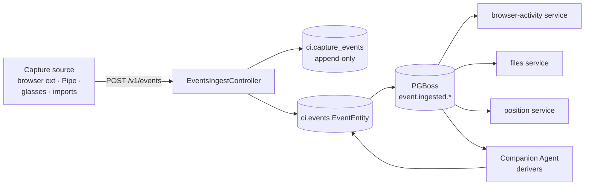

# Unified Capture Event Ingest — Spec (G1)

> Status: **PARTIALLY IMPLEMENTED** (originally a draft proposal).
> Tracks `planning.md` → **G1: Unified capture event schema**.
> Owner: CI-Server. Affects every capture client.

## Implementation status (2026-07-06)

**Shipped:**

- **`POST /v1/events`** — batch capture ingest, zod-validated, idempotent on
  `(user_id, source_system, source_id)`
  (`backend/apps/api/src/domains/memory/controllers/EventsIngestController.ts`,
  guarded by `JwtOrApiKeyAuthGuard`). Response shape `{ ingested, duplicate, rejected }`.
  Reference: [docs/api/rest.md — Ingest](../api/rest.md#ingest-bulk-capture-write-path).
- The **`ci.capture_events` raw log** (migration `20260621021634`) with a soft link to the
  materialized `ci.events` row — layers 1–2 of §5.

**Not (yet) built from this spec:** `POST /v1/events/:id/media`, `GET /v1/events/:id`,
`GET /v1/timeline`, `DELETE /v1/events/:id`, the per-device API-key binding, the per-kind
JSON-Schema registry, and the migration of existing typed controllers onto this path.

**Superseded in part:** bulk *import* (as opposed to live capture) did not converge on
`/v1/events` — CI-Import-Tools pushes through the **GraphQL bulk mutations**
(`createEvents`, `createCommunications`, …) with the same provenance-triple idempotency and
deferred search indexing. See
[docs/api/graphql.md §4.7](../api/graphql.md#47-bulk-ingest-mutations-the-importer-surface--detailed)
and the [bulk load runbook](../../backend/apps/api/db/postgres/BULK_LOAD_RUNBOOK.md).

The remainder of this document is the original spec, kept for the schema/enum design and
the still-open phases.

---

## 1. Problem

The product story is "everything you do flows into your private memory." Today the underlying graph already exists — `memory/entities/EventEntity.ts` has a mature schema (PostGIS coordinates, source provenance, participants, sentiment, confidence, prediction flags) backed by the `ci.events` PostgreSQL table.

What's missing is the **single public HTTP surface** that every capture source writes through. Today:

- `CI-Browser-Extension` posts to `browser-activity`
- `Companion-Pipe` (screenpipe) has no documented integration path at all
- `CI-Import-Tools` writes to its own local SQLite *(since resolved differently: it now pushes to CI-Server via the GraphQL bulk mutations — see the status block above)*
- `CI-Even-Realities`, `CI-Pebble`, `CI-OMI`, `CI-MaixCAM` write through whichever controller a developer chose at the time
- `CI-Active-Inference` produces derived events but has no destination

Result: the graph is rich but **fragmented at the edges**. No client gets a complete picture without compositing across N controllers. There is no shared schema for capture clients to target.

## 2. Goal

A single endpoint that every capture client — first- or third-party — writes through, that:

1. Is **idempotent** (capture sources are flaky; retries must not duplicate events).
2. Is **schema-explicit** (zod + OpenAPI), so SDKs can be generated.
3. Carries **provenance** (source_system, source_id) so audit and dedup work.
4. Accepts **batched** writes (e.g. a Pipe flushing 1000 events).
5. Emits internal `event.ingested` for downstream enrichment agents (G2).
6. Does **not** prescribe enrichment — derivers run async via the existing PGBoss event bus.

## 3. Non-goals

- Replacing the existing typed controllers (`browser-activity`, `position`, `files`, etc.). They stay; they become *typed views* over the unified store.
- Defining the enrichment pipeline (G2 — agent permissions + workflows).
- Replacing the GraphQL `graph` controller. That remains the read surface.

## 4. Surface

### 4.1 Endpoints

```
POST   /v1/events           # batch ingest, idempotent on (source_system, source_id)
POST   /v1/events/:id/media # attach media to an existing event
GET    /v1/events/:id       # canonical read by id
GET    /v1/timeline         # read model: chronologically merged events
DELETE /v1/events/:id       # tombstone (audit log retains)
```

All endpoints require a per-device API key (issued by the `keys` controller) bound to a `device_id` (issued by `devices` controller).

### 4.2 Request shape (POST /v1/events)

```ts
// Zod, transpiled to OpenAPI + JSON Schema
const CaptureEvent = z.object({
  source_system: z.string().min(1),     // 'ci-browser-extension' | 'companion-pipe' | 'ci-pebble' | …
  source_id: z.string().min(1),         // stable id within source_system → idempotency key
  device_id: z.string().uuid(),         // registered device this came from
  kind: z.enum([                        // closed set; new kinds require a PR
    'web.page_view',
    'web.media',
    'desktop.screen',
    'desktop.audio',
    'audio.transcript',
    'location.fix',
    'communication.message',
    'communication.call',
    'capture.photo',
    'capture.video',
    'capture.glasses_frame',
    'wearable.health',
    'import.archive_item',
    'agent.action',
    'agent.observation',
  ]),
  occurred_at: z.string().datetime(),   // ISO 8601, when the event happened
  observed_at: z.string().datetime(),   // when the capture source recorded it
  title: z.string().optional(),         // human label; deriver may overwrite
  description: z.string().optional(),
  // graph wiring (all optional; deriver may resolve)
  person_ids: z.array(z.string().uuid()).optional(),
  place_id: z.string().uuid().optional(),
  thing_ids: z.array(z.string().uuid()).optional(),
  // geo
  location_coordinates: z.object({
    lat: z.number(),
    lon: z.number(),
    accuracy_m: z.number().optional(),
  }).optional(),
  // media (uploaded separately via /v1/events/:id/media)
  media: z.array(z.object({
    mime: z.string(),
    bytes: z.number(),
    sha256: z.string(),
    upload_url: z.string().optional(),  // server returns presigned PUT
  })).optional(),
  // free-form, source-specific payload — schema validated per `kind` via JSON Schema registry
  payload: z.record(z.unknown()),
  // optional confidence (1.0 = direct capture, <1.0 = inferred)
  confidence_score: z.number().min(0).max(1).default(1.0),
  // optional derivation hints — derivers may overwrite
  is_predicted: z.boolean().default(false),
  is_inferred: z.boolean().default(false),
});

const IngestRequest = z.object({
  events: z.array(CaptureEvent).min(1).max(1000),
});
```

### 4.3 Response shape

```ts
{
  ingested: number,
  duplicate: number,         // already saw (source_system, source_id)
  rejected: Array<{ index: number, reason: string }>,
  upload_urls: Record<string, string>,  // keyed by event_id+sha256
}
```

### 4.4 Idempotency

`(source_system, source_id)` is a unique index. Re-POSTing the same event returns `duplicate +1` with the existing event_id, **not** an error.

### 4.5 Per-kind payload schemas

Each `kind` has its own JSON Schema in `domains/events/payloads/<kind>.schema.json`. The ingest controller validates the payload against the schema for the declared kind before persisting. Adding a new kind = adding a schema + an enum entry + a PR.

## 5. Mapping into the existing memory graph

The ingest controller writes through three layers, in order:

1. **Raw capture log** (`ci.capture_events`, new table) — append-only, keyed on `(source_system, source_id)`. This is the durable record.
2. **`EventEntity`** (`ci.events`) — created or updated from the capture row. Carries `source_type`, `source_system`, `source_id` fields that already exist in the schema.
3. **Internal event bus** (`event.ingested`, kind-specific) — emitted via `PGBossEventService`. Existing domains subscribe and do their thing (e.g. `browser-activity` indexes `web.page_view` for its bespoke read API; `files` materializes media into S3-backed `FileEntity` rows).

Existing typed controllers (`browser-activity`, `position`, `files`) **do not change their read API**. They become read views over the new write path. Their POST endpoints are deprecated (still served, but route through the ingest controller internally) and removed in a later release.



## 6. Backfill / migration

1. **Phase 1 — additive.** Ship the new controller + tables alongside existing endpoints. No client changes required. `event.ingested` bus is live and existing services subscribe.
2. **Phase 2 — one capture source migrates.** `CI-Browser-Extension` is the smallest blast radius and writes the most volume. Migrate it first; assert read parity for the `browser-activity` controller's existing API.
3. **Phase 3 — Companion-Pipe.** Wire screenpipe events through `/v1/events` with `kind: 'desktop.screen' | 'desktop.audio'`. This proves the schema can carry high-volume binary-adjacent sources.
4. **Phase 4 — backfill historic data.** Replay existing `browser_activity_*` rows through the ingest controller (idempotent: `source_system='ci-browser-extension'`, `source_id=<row id>`).
5. **Phase 5 — deprecate old POSTs.** Mark write endpoints on typed controllers as deprecated in OpenAPI. Remove after one release with no callers.

## 7. Test plan

- **Unit:** zod schema round-trips for every `kind`. Reject invalid payloads.
- **Integration:** idempotency under concurrent POST. Batch of 1000 events round-trips in <500 ms on dev hardware.
- **Contract:** every consumer (`browser-activity`, `files`, `position`) gets a fixture that drives it via `event.ingested`, not direct service calls.
- **E2E:** browser extension fixture → `/v1/events` → `/v1/timeline` returns the event within 1 s.

Coverage gate: this controller is the highest-leverage place to invest test budget. Target **>90% line coverage on `domains/events/controllers/EventsIngestController.ts` and its zod schemas**, not the platform-wide 70% from planning.md.

## 8. Open questions

- **PII redaction at ingest** vs. at read. Recommendation: store raw, redact at read based on per-consumer scopes (ties into G2 agent permissions).
- **Backpressure**: should the ingest controller block on PGBoss enqueue, or return 202 + queue locally? Default 202 + a local outbox is safer for capture sources on flaky links.
- **Media upload protocol**: presigned PUT to Minio, or multipart through the API? Presigned PUT is simpler and avoids the API proxying gigabytes of audio/video.
- **Versioning**: lock the v1 schema or expect to break it? Recommendation: lock `kind` enum as a feature-flagged registry, version the envelope (`/v1/events` → `/v2/events`) only on breaking envelope changes.
- **Cross-device dedup**: same event captured by two devices (e.g. phone + glasses) — same person at same place — should there be server-side merge, or always one row per `(source_system, source_id)`? Recommendation: one row per source, with a `same_as` edge in `RelationshipEntity` populated by an enrichment derivation.

## 9. Definition of done

- [ ] `EventsIngestController` lands behind a feature flag.
- [ ] Zod + JSON Schema for ≥5 `kind`s (`web.page_view`, `desktop.screen`, `audio.transcript`, `location.fix`, `capture.photo`).
- [ ] `event.ingested` bus topic is live; existing `browser-activity` service is migrated to subscribe.
- [ ] OpenAPI for `/v1/events*` is published to docs.ci.computer.
- [ ] One capture client (CI-Browser-Extension) is migrated end-to-end with parity tests.
- [ ] >90% line coverage on the ingest controller.
