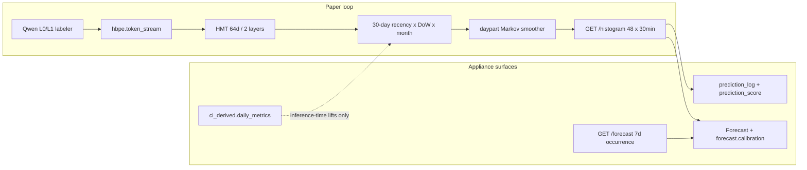

# HBPE landing — paper as contract, appliance as product

> **Private & Confidential — Property of Lifescope Inc. Do not distribute.**
>
> Status: **landed.** `feat/hbpe-landing` merged to `main` on 2026-08-17 as
> [#2045](https://github.com/companionintelligence/CI-Server/pull/2045)
> (`f4f058942`); verified an ancestor of `main` on 2026-08-19. D1–D5 below are
> shipped, not proposed: the kernel, the daypart HMM, the B0/B1/B2 baselines and
> the D3 serve gate all exist under `backend/apps/hbpe/src/ci/hbpe/pipeline/`,
> and the gated HMT math (`hierarchical_src_mask`) is in `model/transformer.py`.
> Paper: CI-HBPE-SUMMARY-001 v1.0 (2026-03-16). Capacity redesign (15-min
> buckets, static labeler, seasonal) stays in
> [scratch1-bdc/hbpe-data-rich-redesign.md](../scratch1-bdc/hbpe-data-rich-redesign.md)
> and is **out of this landing**.
>
> Sibling: [agent-harness-and-cold-start.md](agent-harness-and-cold-start.md)
> (#59/#63). Mute/snooze/`drift_flag` UX still belong to #63, not here.
>
> Plan snapshot as landed: [hbpe-landing.plan.md](hbpe-landing.plan.md).

The March paper is the right **ontology and loop**. We have evolved past
treating it as the **product backlog**. Paper-only would finish a 120k-param
day reconstructor and leave tomorrow's histogram as the same Nadaraya–Watson
average that live scoring already calls weak.

## What is true

- **Paper §3.4 is the forecast.** `InferenceEngine.predict` runs the encoder on
  each of the last 30 *history* days, then weights them. That is a kernel
  smoother. The transformer is a per-day reconstructor feeding it.
- **Paper HMT was half-there.** Token + bucket + level embeddings existed.
  Structured hierarchical attention and real `P(L0)·CE(L1|L0)` were stubs.
  `l2_probs` stayed `{}`. The evaluator is leave-one-token-out reconstruction,
  not next-day skill.
- **A second prediction plane grew up around it.** Live Brier/ECE/top-1, week
  occurrence, Nest `metricForecast` / `placeForecast`, `hbpe.l0` anomalies,
  `forecast.calibration`. Those consume a better kernel. They are not reasons
  to train HBPE on derivation findings.

Buckets stay **30 min / 48**. The 15-min redesign is capacity, not this PR.

## How much the paper weighs

| Keep from the paper | Evolved past |
|---|---|
| L0 fixed 8 / living L1 / L2 as *content topics* | Treating HMT output as the forecast (the paper itself aggregates) |
| Token stream + SOD/EOD + summary gap-fill at 0.7 | 10 calendar events/day; Qwen-on-everything |
| Small HMT, ONNX, nightly LoRA, T calibration, q10/q50/q90 | Evaluator targets with no baseline |
| Recency λ=7 and DoW×2 as the *core* kernel | Ignoring daily_metrics / week occurrence / Forecast honesty |
| Local-first, no external APIs | Feeding planned blocks or engine hypotheses into tokens |

HBPE L2 (content topics) ≠ life-graph L2 (derived relationships). Do not
conflate.

**daily_metrics:** never training tokens, never `metric_anomalies` as labels.
Use them as **inference-time kernel covariates** with the same 14-day coverage
floor as #63 (`COLD_START_MIN_DAYS` / coverage ≥ 0.5).

## Channels (do not mix)

| Object | Engine | Surface |
|---|---|---|
| 24h occupancy (bucket × L0/L1) | Histogram kernel + HMM | `GET /histogram`, GraphQL `forecast`, `forecast.read` |
| 7d occurrence (cluster × day) | Renewal / `week_forecast` | `GET /forecast`, GraphQL `weekForecast` |
| Metric bands | Nest `MetricForecastService` | GraphQL `metricForecast` |
| Next place | Nest `PlaceForecastService` | GraphQL `placeForecast`, `places.next` |

Do not stretch the transformer to a week.

## Locked decisions

| # | Decision |
|---|---|
| **D1** | Two objects, two engines (table above). |
| **D2** | Inference-time structure (HMM + kernel covariates) ships regardless of the transformer gate. Hierarchical attention / real conditional loss require retrain+export. |
| **D3** | Serve HMT if it beats **B1** by **+5 pp L0 top-1** *or* (strictly better Brier vs B1 **and** better ECE vs B2). Else serve **B2 emissions + HMM**. Persist one `prediction_score` row per `model_version`. |
| **D4** | No 15-min buckets, static-labeler drain, seasonal pass, `fromDue`, or training on derivation tables. |
| **D5** | Branch `feat/hbpe-landing`. Not on the harness/cold-start PR. |

## L2 topic head — skipped until data exists

`hbpe.token_stream` can already hold `level='L2'` rows from content labeling.
The histogram still emits `l2_probs: {}` until a user has enough L2 tokens
(`L2_MIN_TOKENS` in `pipeline/l2_gate.py`, default 50). Nightly logs the count.
Do **not** mint L2 from daily_metrics or the life graph. A future `'hbpe.l2'`
anomaly detector waits on that head.

## What #63 still owns

Mute / snooze / OpenClaw heartbeat `drift_flag` UX. The 14-day copy floor and
Brief cap already shipped in [agent-harness-and-cold-start.md](agent-harness-and-cold-start.md).
This landing reuses that floor for metric lifts (`metric_lift = 1` below it —
still-learning, not "usually").
