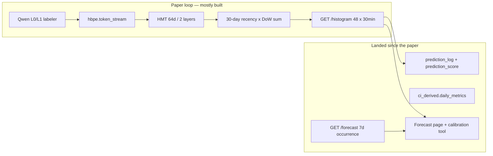

# HBPE landing — paper as contract, appliance as product

> **Historical snapshot.** This is the plan as written, kept for the reasoning. It
> shipped: `feat/hbpe-landing` merged to `main` on 2026-08-17 as
> [#2045](https://github.com/companionintelligence/CI-Server/pull/2045). Every
> `todos` entry above is `completed`, and the "What is true today" diagnosis below
> describes the **pre-landing** tree — in particular the structured hierarchical
> attention mask and the real `P(L0)·CE(L1|L0)` loss are no longer missing
> (`hierarchical_src_mask` in `model/transformer.py`, `_joint_loss` in
> `model/trainer.py`, whose docstring now reads "No more hard-coded weight of 1.0").
> For current state read [hbpe-landing.md](hbpe-landing.md), not this file.
>
> One mechanical note: the Python package was re-rooted from `ci.*` to
> `ci.hbpe.*`, and the paths here use the post-re-root spelling.
>
> **Δ 2026-08-23:** every link below used to be written `CI-Server/backend/…`
> from a workspace root — fourteen of them, none of which resolved from
> `docs/architecture/` or on GitHub. They are now repo-relative and were checked
> to exist.

The paper is still the right **ontology and loop**. We have evolved past treating it as the **product backlog**. Paper-only would finish a 120k-param day reconstructor and leave tomorrow’s histogram as the same Nadaraya–Watson average that scoring already calls weak — while ignoring daily_metrics, week-horizon, Forecast, and agents.

## What is true today

- **Paper §3.4 is the forecast.** [`inference_engine.predict`](../../backend/apps/hbpe/src/ci/hbpe/pipeline/inference_engine.py) runs the encoder on each of the last 30 *history* days, then `w = exp(-i/7) × (2 if same DoW)`. That *is* a kernel smoother. The transformer is a per-day reconstructor feeding it.
- **Paper HMT is half-there.** Token + bucket + level embeddings exist ([`transformer.py`](../../backend/apps/hbpe/src/ci/hbpe/model/transformer.py)). The paper’s “critical” **structured hierarchical attention mask is missing** (plain `TransformerEncoder` + padding). **Hierarchical loss is a stub:** [`_joint_loss`](../../backend/apps/hbpe/src/ci/hbpe/model/trainer.py) comments `P(L0) * CE(L1|L0)` then hard-codes weight `1.0` and adds independent CEs. **L2 head is empty:** `l2_probs: {}`. Evaluator is **leave-one-token-out reconstruction**, not next-day skill ([`evaluator.py`](../../backend/apps/hbpe/src/ci/hbpe/model/evaluator.py) 75%/65% targets with no baseline).
- **The appliance grew a second prediction plane.** Live Brier/ECE/top-1 ([`scoring.py`](../../backend/apps/hbpe/src/ci/hbpe/pipeline/scoring.py)), week occurrence ([`recurrence.week_forecast`](../../backend/apps/hbpe/src/ci/hbpe/pipeline/recurrence.py)), Nest `metricForecast` / `placeForecast`, `hbpe.l0` anomalies, `forecast.calibration`. Those are the users of a better kernel. They are not reasons to train HBPE on derivation findings.

Buckets stay **30 min / 48** for this landing ([`buckets.py`](../../backend/apps/hbpe/src/ci/hbpe/buckets.py)). The 15-min redesign is capacity, not forecast quality.

## How much the paper should weigh

| Keep from the paper | Evolved past |
|---|---|
| L0 fixed 8 / living L1 / L2 as *content topics* | Treating HMT output as the forecast (the paper itself aggregates) |
| Token stream + SOD/EOD + summary gap-fill at 0.7 | 10 calendar events/day; Qwen-on-everything |
| Small HMT, ONNX, nightly LoRA, T calibration, q10/q50/q90 | Evaluator targets with no baseline |
| Recency λ=7 and DoW×2 as the *core* kernel | Ignoring daily_metrics / week occurrence / Forecast honesty |
| Local-first, no external APIs | Feeding planned blocks or engine hypotheses into tokens |

HBPE L2 ≠ life-graph L2. Do not conflate.

**daily_metrics:** never training tokens, never `metric_anomalies` as labels. Use them as **inference-time kernel covariates** (same 14-day coverage floor as #63). That is the connection the four leftovers were pointing at, done without poisoning observed behavior.

## Locked decisions

- **D1 — Two objects, two engines.** 24h occupancy = `/histogram` kernel. 7d occurrence = existing renewal/`week_forecast`. Metric/place forecasts stay Nest. Do not stretch the transformer to a week.
- **D2 — Inference wins first.** Markov smoothing + richer kernel covariates change what Forecast shows *without* retrain. Hierarchical attention / real conditional loss / L2 head require retrain+export; they come after a baseline gate.
- **D3 — Gate:** on the same live `prediction_score` window (and the held-out token-stream split), the served 24h forecast must beat **B1 (bucket×DoW mode)** on L0 top-1 **and** Brier, and beat **B2 (daypart Markov)** on ECE. Working margin: **+5 pp L0 top-1 vs B1** or **strictly better Brier vs B1 and better ECE vs B2**. If the transformer misses, keep it for LoRA/reconstruction but **serve B2 emissions + HMM** as the product histogram (`model_version` says so).
- **D4 — No 15-min, no static-labeler drain, no seasonal pass, no `fromDue`, no training on derivation tables** in this landing. Those stay [hbpe-data-rich-redesign.md](../scratch1-bdc/hbpe-data-rich-redesign.md) P1–P2.
- **D5 — New branch** `feat/hbpe-landing` off whatever `feat/5-6-7` merges to. Item 7 does not go onto the harness/cold-start PR.

## Work (sequence)

### 0. Doc lock

New [docs/architecture/hbpe-landing.md](hbpe-landing.md): this diagnosis, D1–D5, channel map (histogram vs week vs metric vs place), what #63 still owns (mute). Pointer from [correlation-anomaly-suggestions.md](correlation-anomaly-suggestions.md) leftover “HBPE model upgrades” and [docs/README.md](../README.md). Do not rewrite the paper PDF.

### 1. P0 baselines against *live* forecasts

SQL/Python baselines on `hbpe.token_stream` (B0 per-bucket mode, B1 bucket×DoW, B2 daypart Markov). Score them on the **same** `prediction_log` rows `scoring.py` already backfills — not only leave-one-out. Persist beside `prediction_score` (e.g. `model_version` `b0`/`b1`/`b2` vs `hmt`). Per-class breakdown so SLEEP/WORK cannot hide. This is the redesign’s P0, now cheaper because scoring exists.

Files: new `backend/apps/hbpe/src/ci/hbpe/pipeline/baselines.py` + tests; hook from nightly after `scoring`.

### 2. Make the kernel a real forecast (always ship)

This is the quality landing. It does not wait on D3.

**2a. Within-day Markov smoother** (redesign §9.4a). `predict()` currently normalizes each bucket independently — WORK/LEISURE/WORK flicker. Forward-backward with B2 transitions as prior and current emissions (HMT or B1). Inference-only.

**2b. Feature-weighted kernel** — extend, do not replace, paper §3.4:

`w = recency(λ=7) × dow_boost(2) × calendar_lift × metric_lift`

- `calendar_lift`: same-DoW already exists; add a **month-of-year** lift from token_stream (same Dirichlet shape as [`_moy_lift`](../../backend/apps/hbpe/src/ci/hbpe/pipeline/recurrence.py)). No holiday tables.
- `metric_lift`: from `ci_derived.daily_metrics` for the *matched history day* (and refuse below 14 coverage-gated days / coverage&lt;0.5). Covariates: `sleep_minutes` → morning SLEEP mass, `time_at_home` → home-hours vs WORK, `coverage` as a reliability down-weight — **class priors / sample weights, not extra tokens**. Read-only SQL from the sidecar; no Nest engine writes.

**2c. Cold-start.** If no HMT checkpoint or &lt;16 train days, serve B1/B2 and flag the histogram (Forecast already has still-learning language). Stop returning a uniform prior.

Primary file: [`inference_engine.py`](../../backend/apps/hbpe/src/ci/hbpe/pipeline/inference_engine.py). Tests with synthetic DoW + metric rows.

### 3. Paper HMT math (retrain, gated)

Only if D3 says the transformer is worth keeping **or** as a bounded completeness pass after 2 is in and B1 is still winning because reconstructions are incoherent (SLEEP@L0 + gym@L1).

- **Structured attention mask** in `HMTModel.forward`: L0↔L0; L1→L0+L1; later L2→L0+L1+L2. Paper §3.2.
- **Real hierarchical loss:** `CE(L0) + Σ_c P̂(L0=c) · CE(L1 | L0=c)` using softmax at the paired L0 position, not `1.0`. At inference, L1 mass is **renormalized inside the predicted L0’s clusters** (never gym under SLEEP).
- Checkpoint/ONNX bump; nightly LoRA stays rank-8 on Q/K/V/O. `pos_emb` row count stays 48.

### 4. L2 topic head (data-gated)

Serializer already writes L2 from content. Before adding `l2_token_emb` / `l2_head` / `level_emb` size 3: count `hbpe.token_stream WHERE level='L2'` on a real user. If sparse, leave `l2_probs: {}` and document. If present: conditional `P(L2|L0,L1)`, top-k in the histogram, `actuals_backfill` already has an L2 path. **Do not** mint L2 from daily_metrics or life-graph.

### 5. Surfaces (consume, don’t fork)

- Histogram `model_version` + still-learning already flow to GraphQL Forecast / [`ForecastCalibrationTool`](../../backend/apps/api/src/domains/tools/tools/ForecastCalibrationTool.ts). Keep self-consistency copy (just landed). If B2 is served, say so in calibration — not “accuracy.”
- `hbpe.l0` anomalies keep reading `prediction_log` shape. No new detector until L2 exists.
- Agents already call `forecast.read` / `forecast.calibration`. No Hermes/Hub PR.

## Out of scope

15-min buckets and blast radius; static `kind_l0_map` drain; 90-day rollup corpus; vocab cap enforcement; `FREQ=YEARLY` / seasonal; completion records; `fromDue` → `event_candidates`; planned_block ingest (already excluded); Body/Mind arms; training HBPE from correlation/suggestion rows.

## Acceptance

- A user with a scored window can see B0/B1/B2 vs HMT on the same buckets; the served histogram is the winner per D3, not “whatever ONNX loaded.”
- Adjacent buckets no longer flicker independently (HMM).
- Same-DoW + month lift + (when ≥14 coverage days) metric class priors move mass; below the floor, metric_lift = 1 (still-learning, not “usually”).
- Calibration / Forecast copy still never claims ground-truth accuracy.
- Hierarchical mask + real P(L0) loss land only after the gate (or as the explicit completeness follow-up if reconstructions are incoherent).
- L2 head ships only if L2 tokens exist; otherwise documented skip.
- `hbpe/` Python is the only model change set; Nest stays a consumer except read-only metrics SQL and any `model_version` GraphQL field if missing.
