# Personal AI Architecture: Persona DB Training & Inference Planning with Decision Models (JEV/Laya/Clef)

**Status:** PROPOSAL & IMPLEMENTATION SPECIFICATION  
**Author:** Companion Engineering  
**Date:** November 11, 2026  
**Target Systems:** `Companion-Memory` (HBPE/Inference), `Companion-Hub` (Training Pool), `CI-Server` (Persona DB/Graph), `CI-Engineering` (Fleet QA)

---

## 1. Executive Summary: The Personal AI Paradigm Shift

A true **Personal AI** cannot merely be a generic off-the-shelf autoregressive LLM (e.g. Qwen, Llama, or Claude) accessed over an API. Autoregressive token-by-token generation suffers from fundamental limitations when deployed as an embedded personal assistant:
1. **Uncalibrated Latency:** Generating 30–100 tokens takes 400ms–2500ms even on local GPUs. Running this on every incoming message, calendar event, browser visit, or notification quickly stalls appliances and drains mobile batteries.
2. **Hallucinatory Commitments & Gating:** Generating free-form text or JSON to answer simple questions like *"Did the user make a firm commitment?"* or *"What activity type is this?"* frequently yields syntax errors, drifting probabilities, and uncalibrated confidence.
3. **Privacy & Locality Risk:** Routing raw personal lifelogs through external cloud APIs leaks sensitive personal context.

### The Solution: Dual-Engine "System 1 + System 2" Personal Architecture
This architecture introduces a non-autoregressive **System 1 Decision Engine** (based on JEV open alternatives: Convai Laya 320M, Clef 421M, and Unsloth `FastDecisionModel`) working in tandem with a **System 2 Autoregressive Reasoner** (Qwen3-8B):

```
                                  [ Personal Event Stream ]
                 (Communications, Calendar, Notes, Health, Browser Activity)
                                              │
                                              ▼
                        ┌──────────────────────────────────────────────┐
                        │       System 1: Fast Decision Engine         │  <10ms, Zero Token Burn
                        │ (Convai Laya 320M / Clef / FastDecisionModel)│  Mathematically Calibrated
                        ├──────────────────────────────────────────────┤
                        │ 1. Memory Ingress: should_remember (noul)     │ ──> Drop noise (P < 0.25)
                        │ 2. Live Planning: is_commitment / urgency    │ ──> Direct tool dispatch
                        │ 3. Retrieval Reranking: is_relevant / decay  │ ──> Filter vector candidates
                        │ 4. Proactive Insights: utility vs disruption │ ──> Suppress untimely pings
                        └──────────────────────┬───────────────────────┘
                                               │ Ambiguous / Complex
                                               │ (Confidence < Threshold)
                                               ▼
                        ┌──────────────────────────────────────────────┐
                        │         System 2: Autoregressive LLM         │  Deep Multi-Turn Reasoning
                        │                 (Qwen3-8B)                   │  300ms–2000ms
                        └──────────────────────────────────────────────┘
```

The substrate powering this is the **Persona DB**: the 826,478+ items in the personal data lake (`liam-test-data-export`) spanning 23 real personal data sources (Gmail, WhatsApp, Takeout, Browser history, Health/GPS, and the 24k-node entity knowledge graph).

---

## 2. The Four Personal AI Subsystems Powered by Decision Models

### Subsystem A: Reflexive Memory Ingress & Gating (System 1 Filter)
- **Objective:** Prevent memory bloat and vector pollution by filtering inbound chatter in $<10\text{ms}$.
- **Decision Questions:**
  - `should_store` (`noul`): Does this message or note contain durable personal knowledge, tasks, or preferences? (Drop if $P < 0.25$).
  - `memory_partition` (`choice`: `episodic_event`, `semantic_fact`, `procedural_preference`, `ephemeral_chat`).
  - `privacy_level` (`score`: 0=Public, 1=Personal, 2=Confidential/Sensitive). Automatically triggers on-device encryption or masking.
- **Impact:** Eliminates 70–80% of ephemeral chatter from Postgres write paths and vector embedding queues.

### Subsystem B: Live Planning & Action Commitment Gating
- **Objective:** Recognize when the user or companion makes a commitment, triggering automated tools without waiting for an LLM reasoning chain.
- **Decision Questions:**
  - `is_commitment` (`noul`): Did the user explicitly commit to an action, deadline, or appointment?
  - `action_type` (`choice`: `none`, `calendar_booking`, `todo_create`, `search_query`, `agent_delegate`).
  - `urgency` (`score`: 0=Someday, 1=Normal, 2=Time-sensitive, 3=Immediate).
  - `needs_confirmation` (`noul`): Does this action require explicit user confirmation before execution?
- **Impact:** Fast-path action triggers resolve in 7ms. High-confidence actions ($P \ge 0.90$) stage calendar events or tasks with zero perceived latency.

### Subsystem C: Calibrated Knowledge Graph Reranking & Dynamic Fact Deprecation
- **Objective:** Stop semantic vector search from surfacing outdated or irrelevant memories.
- **Decision Questions:**
  - `is_relevant` (`noul`): Is this candidate snippet genuinely useful for the current goal?
  - `contradiction_status` (`choice`: `reinforces`, `supersedes`, `orthogonal`, `contradicts`).
  - `temporal_decay` (`score`: 0=Current/Active, 1=Recent, 2=Historical/Stale).
- **Dynamic Fact Deprecation:** When a newly ingested memory is evaluated against existing graph nodes and scores `supersedes` with $P \ge 0.85$, the memory graph automatically marks the predecessor fact as deprecated.

### Subsystem D: Proactive Insight & Serendipity Gating ("Unannoying Agency")
- **Objective:** Enable the Personal AI to surface unprompted insights (sleep patterns, recurring task fatigue, neglected relationships) without becoming intrusive spam.
- **Decision Questions:**
  - `insight_utility` (`score`: 0=Trivial, 1=Helpful, 2=Actionable Breakthrough).
  - `user_interruptibility` (`noul`): Given time-of-day, active calendar state, and recent keyboard/app cadence, is now an appropriate moment?
  - `delivery_channel` (`choice`: `silent_widget`, `daily_digest`, `urgent_notification`).
- **Mathematical Gate:**
  $$\text{Actionable Score} = \text{Utility} \times P(\text{receptive}) - \text{Disruption Cost}$$
  Only deliver push notifications when $\text{Actionable Score} > \tau_{\text{notify}}$.

---

## 3. The Persona DB Dataset (`liam-test-data-export`)

The personal export dataset contains 826,478 verified personal items across 23 distinct sources. These are mapped into self-supervised and semi-supervised training tasks:

| Data Source | Volume | Primary Fields Extracted | Target Decision Model Task |
| :--- | :--- | :--- | :--- |
| **Gmail, WhatsApp, Slack, Discord** | 293,000 items | Message text, timestamps, sender/recipient, thread trees | `is_commitment`, `action_type`, `urgency`, communication tone calibration |
| **Google Takeout & Apple Calendar** | 32,000 events | Event title, description, start/end, attendees, location | HBPE Stage 1 `l0_class` activity classifier (`WORK`, `EXERCISE`, etc.) |
| **Chrome & Safari Browser Activity** | 330,000 rows | URL, page title, dwell time, transitions | Topic clustering, deep work vs. distraction detection, `should_remember` |
| **Entity Knowledge Graph** | 24,030 entities / 15,976 edges | Persons, concepts, organizations, relationships | `is_relevant` retrieval reranking, entity deduplication & resolution |
| **Garmin, Fitbit, GPX/GeoJSON** | 5,000+ tracks / points | Timestamp, activity type, HR, duration, coordinates | Circadian rhythm prediction, physical fatigue / rest state classification |
| **ChatGPT, Claude, Notes Exports** | 12,000+ conversations | Multi-turn prompts, generated code, thoughts, snippets | Personal AI stylistic alignment, `memory_partition` classification |

---

## 4. End-to-End Training Pipeline on Companion Hub Pool

Training jobs are packaged as declarative JSON manifests and submitted to the distributed Hub pool via `POST /api/training/jobs`:

```mermaid
flowchart LR
    A["Persona DB Export<br>(liam-test-data-export)"] --> B["Persona Curation Script<br>(extract_dataset.py)"]
    B --> C["JSONL Decision Sets<br>(train.jsonl, eval.jsonl)"]
    C --> D["Hub Training Placement<br>(training-placement.ts)"]
    D --> E["Worker Appliance Node<br>(core-3, core-4, or beta-max)"]
    E --> F["Unsloth FastDecisionModel<br>4-bit QLoRA Training"]
    F --> G["Hub Evaluation Gate<br>(Brier < 0.12, ECE < 0.05)"]
    G --> H["Hot-Swap Personal LoRA<br>(HBPE / Decision Engine)"]
```



### Appliance Hardware Allocation
- **`core-3`** (`100.126.23.45`, AMD Radeon 8060S gfx1151): Fast Decision Model fine-tuning (ModernBERT-320M, 16-rank LoRA).
- **`core-4`** (`100.121.17.113`, AMD gfx1151): Clef Action Commitment Model and HBPE parallel batch training.
- **`beta-max`** (`100.115.174.32`, NVIDIA RTX): Qwen3.5-0.8B Decision Model & multi-task embedding training.

---

## 5. Table of Planned Training Tests

| Test ID | Model / Task | Dataset Slice (`liam-test-data-export`) | Architecture & Base | Target Evaluation Gates | Placement Node | System 2 Fallback |
| :--- | :--- | :--- | :--- | :--- | :--- | :--- |
| **TR-DEC-01** | **Activity L0 Classifier**<br>(Stage 1 behavioral tagging) | Calendar Takeout & iCal (~32,000 events) | Convai Laya (ModernBERT 320M) + Unsloth LoRA ($r=16$) | Top-1 Acc $\ge 92\%$<br>Brier $\le 0.10$<br>ECE $\le 0.05$ | `core-3`<br>(Radeon 8060S) | `get_qwen().generate()` on Qwen3-8B |
| **TR-DEC-02** | **Action Commitment Gate**<br>(`is_commitment`, `urgency`) | Communications (Gmail, WhatsApp, Discord) — 50k threads | Clef Intent (ModernBERT 421M) | Precision $\ge 90\%$<br>Recall $\ge 88\%$<br>ECE $\le 0.04$ | `core-4`<br>(gfx1151) | Autoregressive JSON tool-planner |
| **TR-DEC-03** | **Memory Ingress Filter**<br>(`should_store`, `privacy_level`) | Multi-source Inbox (ChatGPT, Claude, notes, web history) | Qwen3.5-0.8B (Unsloth 4-bit QLoRA) | Noise drop $\ge 70\%$<br>False Neg $\le 1.5\%$<br>Latency $< 12\text{ms}$ | `beta-max`<br>(RTX) | Ingest everything into staging buffer |
| **TR-DEC-04** | **Retrieval Reranker & Conflict Detector**<br>(`is_relevant`, `supersedes`) | Entity Graph (24k entities, 16k edges) + historical search logs | ModernBERT-320M Dual-Encoder Head | MRR@10 $\ge 0.85$<br>Conflict Det $\ge 89\%$<br>Brier $\le 0.12$ | `core-3`<br>(gfx1151) | Raw cosine distance on vector embeddings |
| **TR-DEC-05** | **Proactive Insight Gater**<br>(`utility`, `interruptibility`) | Chronological timeline + activity rhythm token streams (HBPE) | Convai Laya 320M Decision Head | Utility AUC $\ge 0.91$<br>Disruption rate $< 5\%$ | `core-4`<br>(gfx1151) | Suppress notification to silent daily digest |
| **TR-DEC-06** | **HBPE Nightly LoRA Adapter**<br>(Behavioral forecast transition matrix) | Full personal token rollup stream (`hbpe.token_stream`) | HBPE Transformer ($d=64$, $L=2$) + Rank-8 LoRA | MAE $\le 0.08$<br>Walkforward Lift $> 5\%$ | `beta-max`<br>(RTX) | Base model checkpoint without adapter |
| **TR-DEC-07** | **Entity Resolution & Alias Matcher**<br>(`is_same_person`) | 17,174 communications participants & address stubs | ModernBERT 320M Binary Matcher | F1 $\ge 0.96$<br>False Merge rate $< 0.1\%$ | `core-3`<br>(gfx1151) | Exact normalized email/phone string matching |
| **TR-DEC-08** | **Tone & Persona Stylistic Adapter**<br>(Personal AI voice generation) | 12,000 sent emails and personal chat responses | Qwen3-8B (Unsloth QLoRA, $r=32$) | Perplexity $\le 4.2$<br>Persona adherence $\ge 88\%$ | `beta-max`<br>(RTX) | Base generic Qwen3-8B prompt |

---

## 6. Implementation Roadmap & Verification Milestones

1. **Milestone 1: Fast Decision Engine & HBPE Fast-Path (Completed ✅)**
   - Implemented `DecisionModelClient` & `LocalDecisionEngine` in Companion Memory ([PR #3430](https://github.com/companionintelligence/Companion-Memory/pull/3430)).
   - Wired Stage 1 L0 fast-path into `QwenLabeler` (all 497 tests passing).
   - Deployed dev container to `core-3`, `core-4`, and `beta-max` over Tailscale.
   - Verified live in Fleet QA with 7.2ms forward pass latency ([PR #471](https://github.com/companionintelligence/CI-Engineering/pull/471)).
2. **Milestone 2: Persona Dataset Curation Pipeline (Next)**
   - Implement `backend/apps/hbpe/src/ci/hbpe/dataset/persona_extractor.py` to process `/Users/liam/devel/liam-test-data-export` into calibrated JSONL training pairs.
3. **Milestone 3: Local Hub Training Runs (TR-DEC-01 & TR-DEC-02)**
   - Submit training manifests for L0 activity classification and action commitment gating to `core-3` and `core-4`.
   - Validate calibration metrics against Hub evaluation gate.
4. **Milestone 4: Live Action Commitment & Insight Integration**
   - Wire `is_commitment` gating into Companion Memory runner and planner.
   - Activate calibrated proactive insight push notifications.
