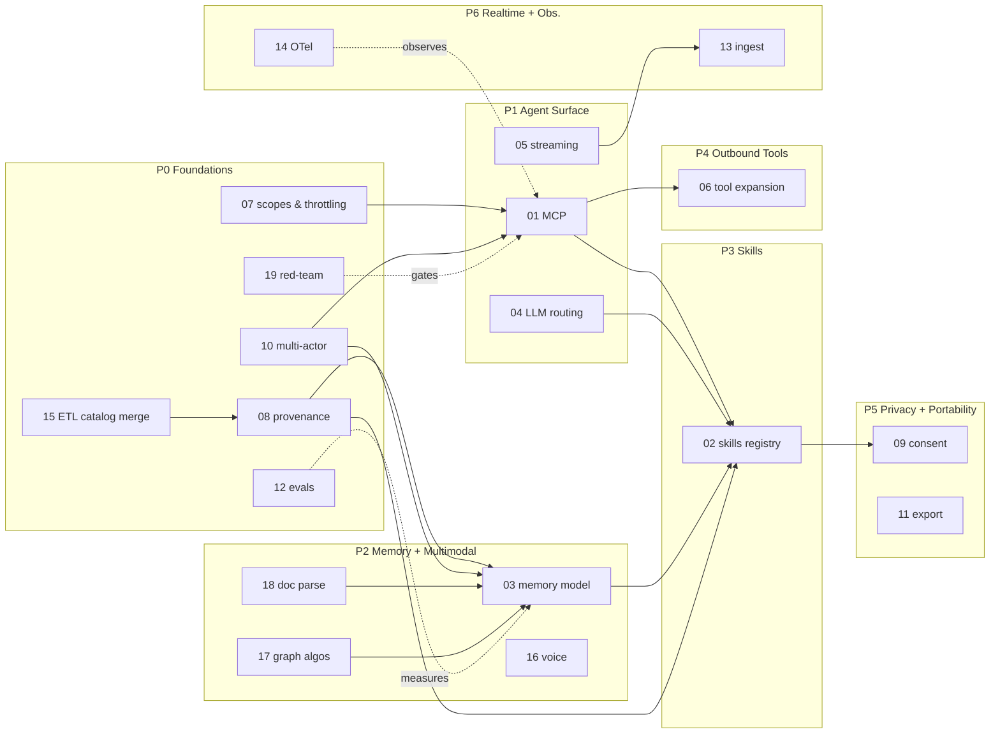

# Digital-Twin Plan — Index

This directory is the **detailed sub-plan** that backs the gap audit in [../audit.md](../audit.md).

Each document is **scoped to one workstream**, owns the migration path end-to-end, and tracks the unmerged branches that belong to it. Read them in any order; cross-references are explicit.

| # | Workstream | Phase | Critical path? | Doc |
|---|---|:-:|:-:|---|
| 01 | MCP consolidation (merge `add-mcp-endpoints` + `feature/MCP`) | P1 | ✅ | [01-mcp-consolidation.md](01-mcp-consolidation.md) |
| 02 | Agent-skills registry | P3 | ✅ | [02-skills-registry.md](02-skills-registry.md) |
| 03 | Episodic / semantic / procedural memory model | P2 | ✅ | [03-memory-model.md](03-memory-model.md) |
| 04 | Multi-provider LLM routing | P1 | ✅ | [04-llm-routing.md](04-llm-routing.md) |
| 05 | Streaming & subscriptions | P1 |   | [05-streaming-subscriptions.md](05-streaming-subscriptions.md) |
| 06 | Tool registry — outbound MCP clients, policies | P4 |   | [06-tool-registry-expansion.md](06-tool-registry-expansion.md) |
| 07 | Auth scopes & throttling | P0 | ✅ | [07-auth-scopes-throttling.md](07-auth-scopes-throttling.md) |
| 08 | Provenance & lineage | P0 | ✅ | [08-provenance-lineage.md](08-provenance-lineage.md) |
| 09 | Privacy, redaction, consent | P5 |   | [09-privacy-consent.md](09-privacy-consent.md) |
| 10 | Multi-actor (agents as first-class) | P0 | ✅ | [10-multi-actor.md](10-multi-actor.md) |
| 11 | Export / portability | P5 |   | [11-export-portability.md](11-export-portability.md) |
| 12 | Memory eval harness | P0 | ✅ | [12-memory-evals.md](12-memory-evals.md) |
| 13 | Realtime IoT/device ingest | P6 |   | [13-realtime-ingest.md](13-realtime-ingest.md) |
| 14 | Observability (merge OTel branch) | P6 |   | [14-observability.md](14-observability.md) |
| 15 | ETL expansion (catalog refactor + 4 providers) | P0 |   | [15-etl-expansion.md](15-etl-expansion.md) |
| 16 | Voice / multimodal | P2 |   | [16-voice-multimodal.md](16-voice-multimodal.md) |
| 17 | Graph algorithms (rustworkx) | P2 |   | [17-graph-algorithms.md](17-graph-algorithms.md) |
| 18 | Document parsing | P2 |   | [18-document-parsing.md](18-document-parsing.md) |
| 19 | Red-teaming & safety evals (promptfoo) | P0 |   | [19-red-teaming.md](19-red-teaming.md) |

## Reading order

If you only read three, read **01**, **03**, and **07**. They are the smallest set that defines what changes "personal memory app" into "digital-twin backend":

1. **01** — agents can connect.
2. **03** — what they recall is correct.
3. **07** — what they can do is bounded.

## Dependency map

## Conventions used in sub-plans

Each sub-plan follows the same skeleton:

1. **Summary** — one paragraph.
2. **Current state** — files/branches that exist today, with line refs.
3. **Target state** — what "done" looks like.
4. **Schema / API changes** — concrete migrations, types, endpoints.
5. **Branch disposition** — for each related branch: merge / rebase / port-then-archive / drop.
6. **Phased steps** — small enough to ship in a PR.
7. **Risks** and **open questions**.
8. **Eval / acceptance** — how we know it's done.

When a sub-plan is "small" the section may collapse to a paragraph — explicitly noted.

## Status tracking

Sub-plans are markdown only; status lives on each plan's own header:

- `status: draft` — first cut, open for review.
- `status: accepted` — direction approved, ready to PR.
- `status: in-progress` — at least one PR landed against it.
- `status: done` — all work merged, eval passing.
- `status: superseded by NN` — replaced by a different plan.
