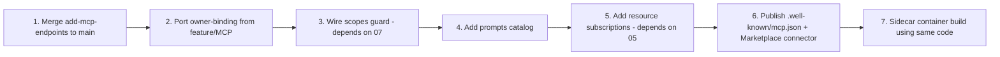

# 01 — MCP Consolidation

> **Status:** draft &nbsp;•&nbsp; **Phase:** P1 &nbsp;•&nbsp; **Critical path:** yes
>
> Reconcile the two unmerged MCP implementations into a single canonical surface, then harden it so OpenClaw, Hermes, Claude Code, Claude Cowork, and Codex can connect with one config.

---

## 1. Summary

We have **two MCP implementations** that have not been merged and don't reference each other:

| Branch | Implementation |
|---|---|
| `add-mcp-endpoints` | **In-process** NestJS module — auto-derives MCP tools from the GraphQL schema, plus registers existing native tools, plus exposes the SDL as a resource. Sessions are managed with TTL reaping. |
| `feature/MCP` | **Standalone container** at `backend/apps/mcp/` — hand-curated tool set (`search_memory`, `read_entity_graph`, `get_user_context`, `get_recent_activity`, `get_thread`, `get_document`), owner-binding, gateway-exposed, on its own `agents` docker network. |

**Decision:** keep `add-mcp-endpoints` as the canonical implementation. Port the deployment story (owner-binding, gateway route, agents network, generated secrets) on top of it. Optionally re-publish the same in-process server as a sidecar container for users who want process isolation — but the source of truth is one codebase.

## 2. Current state

### `add-mcp-endpoints` branch

```
backend/apps/api/src/domains/mcp/
├── controllers/McpController.ts        — POST/GET/DELETE /mcp, session mgmt, hijacking protection
├── services/
│   ├── McpServerService.ts             — creates an MCP server, registers tools + resources
│   ├── McpToolService.ts               — merges GraphQL + native tool catalogs
│   ├── GraphQLToolAdapter.ts           — SDL → MCP tool definitions
│   └── McpExecutorService.ts           — executes a GraphQL operation as a tool call
└── types.ts
```

Key properties:
- Uses `StreamableHTTPServerTransport`.
- Session map keyed by `Mcp-Session-Id`, reaped after 30 min idle.
- Session hijack protection: a request's `userId` must match the session's `userId`.
- Auth: `JwtOrApiKeyAuthGuard` (existing).
- Exposes the GraphQL SDL as `schema://graphql` resource.
- NGINX SSE blocks added to `infrastructure/{dev-gateway,gateway}/nginx.conf`.

### `feature/MCP` branch

```
backend/apps/mcp/
├── Dockerfile, entrypoint.sh
├── package.json
└── src/{main,server,apiClient,config}.ts
backend/apps/mcp/tests/server.test.ts
docker-compose.yml: mcp: image ci/mcp (extra_hosts: host-gateway, on `ci` net)
infrastructure/setup-secrets/entrypoint.sh: generates MCP secrets
```

Key properties:
- Standalone Express + MCP server.
- Talks back to API via a `CiApiClient` with a token.
- "Require explicit MCP owner binding" — refuses to start unless an owner user-id is configured.
- Curated tool list (smaller than in-process; doesn't auto-derive).

## 3. Target state

A single source of truth: `backend/apps/api/src/domains/mcp/`, deployable in two modes.

| Mode | When to use | How |
|---|---|---|
| **In-process** (default) | Most users — lowest latency, single process | Already done on `add-mcp-endpoints` |
| **Sidecar container** | Process isolation, scale separately, paranoid threat model | Reuse the same NestJS code as a stripped-down standalone app — only the MCP module + auth, no GraphQL, no ETL |

Both modes share:
- Auto-generated GraphQL-derived tools.
- Curated native tools registered through `ToolRegistry`.
- A new **prompts** catalog (see §4 below).
- A new **resource subscription** path so agents can subscribe to `memory://entity/<id>` updates (depends on [05-streaming-subscriptions.md](05-streaming-subscriptions.md)).
- Scope-aware tool gating (depends on [07-auth-scopes-throttling.md](07-auth-scopes-throttling.md)).
- Owner-binding enforced even in in-process mode.

## 4. Concrete changes on top of `add-mcp-endpoints`

### 4.1 Add prompts catalog

A prompt is "load this context before reasoning". The twin has the perfect substrate: `UserContextService.UserDossier` (already on the `ChatKnowledge` branch — see [03-memory-model.md](03-memory-model.md)).

```ts
// backend/apps/api/src/domains/mcp/services/McpPromptService.ts
server.registerPrompt('ci.user-context', {
  description: 'Load the current owner dossier (preferences, family, routines).',
  arguments: [],
}, async () => ({
  messages: [{
    role: 'system',
    content: { type: 'text', text: await renderDossier(ctx) }
  }]
}));
```

Seed prompts to ship in v1:

| Prompt | What it loads |
|---|---|
| `ci.user-context` | The full dossier |
| `ci.recent-activity(window)` | Last N events/messages |
| `ci.routine-for(day)` | Procedural patterns for that weekday |
| `ci.relationships(scope)` | Family/colleagues/etc. graph slice |
| `ci.summary(date|range)` | Hourly/daily/weekly summary |

### 4.2 Port owner-binding

From `feature/MCP`, port the **refuses-to-start-without-owner** check, and apply it inside the NestJS module:

```ts
// McpController constructor
if (!config.mcp.ownerUserId) {
  throw new Error('CI-MCP requires MCP_OWNER_USER_ID to be set');
}
```

For the in-process API the owner is the only user (single-tenant Hub), so this is automatic. For a sidecar build it must be set explicitly.

### 4.3 Scope-aware tools

Every MCP tool gets a `scopes: string[]` annotation (see [07-auth-scopes-throttling.md](07-auth-scopes-throttling.md)):

- GraphQL-derived tools get scopes based on the field's `@AuthScope` directive (added in 07).
- Native tools declare `requiredScopes` on `BaseTool`.

`McpToolService.executeTool` checks the calling API key's scopes against `tool.scopes` and throws `403` on mismatch.

### 4.4 Resource subscriptions

Add `server.registerResource` with a subscriber: when the API emits a relevant domain event (`EntityUpdatedEvent`, `RelationshipCreatedEvent`, `MessageCreatedEvent`), the MCP transport pushes a `notifications/resources/updated` to subscribed clients.

Implemented via NestJS `EventEmitter` → in-memory pubsub → MCP transport. Requires [05-streaming-subscriptions.md](05-streaming-subscriptions.md).

### 4.5 Tool name stability

Auto-derived names (`createPerson`, `removeRelationship`) drift as the GraphQL schema evolves. Add:

- `@McpToolName('ci.person.create')` directive on resolvers that overrides the derived name.
- `@McpDeprecated('ci.foo.bar')` to keep old names live for one release after rename.
- Persist a tool catalog snapshot in `mcp_tool_catalog` table so clients can list historical tools.

### 4.6 Auth: bearer + API key + (later) OAuth2 device flow

The current `JwtOrApiKeyAuthGuard` is sufficient for v1. For external agents that ship without a key, add OAuth2 device flow brokered by CI-Portal in v2 (see §6 below).

### 4.7 Discovery

Two ways to advertise the twin to an agent runtime:

1. **`.well-known/mcp.json`** at the gateway:
    ```json
    {
      "name": "companion-memory",
      "transports": { "http": "https://memory.<hub>.ci.app/mcp" },
      "scopes": ["memory:read", "memory:write", "tools:invoke:*"]
    }
    ```
2. **CI-Marketplace connector entry** — a one-click install that drops the right config into the user's agent runtime.

## 5. Migration & branch disposition

| Branch | Action |
|---|---|
| `add-mcp-endpoints` | **Merge to main** after porting the items in §4.2 (owner-binding) and §4.3 (scopes). Land in two PRs: (a) raw merge, (b) hardening. |
| `feature/MCP` | **Cherry-pick** the gateway nginx blocks and `setup-secrets` changes, plus the `agents` docker network if we keep sidecar mode. **Archive the standalone Express server** — its tool list is a subset of the in-process module. |
| `mcp-servers/web-search` (empty) | **Delete** — placeholder no longer needed; web-search lives as a native tool. |

## 6. Phased steps



| # | PR | Depends on |
|---|---|---|
| 1 | Merge `add-mcp-endpoints` | — |
| 2 | Owner-binding + nginx + secrets from `feature/MCP` | 1 |
| 3 | Scope-gate every MCP tool | [07](07-auth-scopes-throttling.md) |
| 4 | Prompts: dossier, recent-activity, routine, relationships, summary | [03](03-memory-model.md) (dossier shape) |
| 5 | Resource subscriptions on `memory://entity/*`, `memory://thread/*` | [05](05-streaming-subscriptions.md) |
| 6 | `.well-known/mcp.json` route + Marketplace connector entry | 1, 2, 3 |
| 7 | Sidecar container (optional, builds from same module) | 1 |

## 7. Risks

| Risk | Mitigation |
|---|---|
| MCP spec churn | Pin SDK; abstract transport behind one adapter so spec changes only touch the controller. |
| Auto-derived tool names leak schema internals | Override via `@McpToolName`; ship a deprecation surface. |
| Agents call write tools they shouldn't | All writes require explicit `memory:write` scope; default API keys read-only. |
| Two implementations diverge again | The standalone container is built **from** the in-process module's compiled output, not as a separate codebase. |
| Session map grows unbounded | Already TTL-reaped at 30 min; add a hard cap + LRU eviction. |

## 8. Open questions

- Should we ever expose `mutation:*` GraphQL operations as tools by default, or opt-in per resolver? (Lean: opt-in.)
- Where do we put the human-readable docs for each tool? (Lean: GraphQL `description` for derived tools, `BaseTool.description` for native; both already supported.)
- For the sidecar mode, is the wire format Express+streamableHTTP, or stdio for local agents? (Lean: both — stdio for Claude Code/Cowork local connect, HTTP for everything remote.)

## 9. Acceptance criteria

- A fresh checkout of `main` can do this with a single `claude mcp add`:
  ```
  claude mcp add ci-memory --transport http --url https://memory.<hub>.ci.app/mcp \
    --header "x-api-key: $CI_KEY"
  ```
  …and immediately call `ci.memory.recall`, `ci.user-context`, `ci.summary.daily` from inside Claude Code.
- The agent eval suite ([12-memory-evals.md](12-memory-evals.md)) runs end-to-end through MCP.
- Owner-binding refuses traffic for any `userId` other than the bound one.
- All write tools require `memory:write`; the default key issued by the SPA is read-only.
