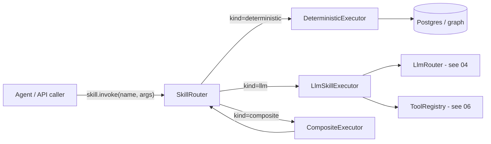

# 02 — Agent-Skills Registry

> **Status:** draft &nbsp;•&nbsp; **Phase:** P3 &nbsp;•&nbsp; **Critical path:** yes
>
> Make CI-Server the place a user defines their reusable "how I want my agent to work" recipes — once — and expose them to every agent runtime.

---

## 1. Summary

A **skill** is a parametrized, named, versioned, scoped piece of agent behavior. CI-Server today has none: tools are server-managed singletons, conversation prompts are inline strings, and the "how to summarize my day" knowledge has to be re-authored inside each agent runtime (Claude Code, Cowork, OpenClaw, Codex).

Adding a skills registry inverts that: the twin **owns** the playbook, every connecting agent **borrows** it.

## 2. Current state

- No skills concept in the API. `domains/tools` only has server-singleton tools.
- The conversation runtime in `domains/conversations` and `domains/intelligence` (`QuestionService`, `AnswerService`, `ActionService`) inlines all prompt logic.
- Claude Code, Cowork, and CI plugins already have their own skill mechanisms (`brand-voice:*`, `data:*`, `engineering:*`, etc.) — but those are runtime-local, not user-owned.

## 3. Target state

A first-class `domains/skills` module with three executor classes and one storage model.

### 3.1 Skill kinds

| Kind | Use | Trust |
|---|---|---|
| **deterministic** | SQL/graph queries, transforms, schema-bound computations | High — runs server-side with full DB access, parameterized only |
| **llm** | Prompt + tool allowlist + I/O schema | Medium — sandboxed, can only call allowlisted tools |
| **composite** | Calls other skills | Inherits the strictest member |

### 3.2 Skill spec (`skill.yaml`)

```yaml
name: ci.daily.summarize_my_day
version: 1.2.0
kind: llm
description: One-paragraph summary of today, with what to follow up on.
scopes_required: [memory:read, summary:read]
input:
  date: { type: string, format: date, default: "today" }
output:
  schema:
    summary: string
    follow_ups: { type: array, items: string }
model_policy: { task: summarize }   # routed by LLM router (see 04)
context_prompts:
  - ci.user-context
  - ci.summary(date)
tools_allowed:
  - ci.memory.search
  - ci.history.events_in_range
instructions: |
  You are summarizing the user's day for the user themselves.
  Write in their voice (see ci.user-context).
  ...
```

### 3.3 Storage

```mermaid
erDiagram
    SKILLS ||--o{ SKILL_VERSIONS : versions
    SKILL_VERSIONS ||--o{ USER_SKILL_INSTALLS : "installed by"
    SKILL_VERSIONS ||--o{ SKILL_INVOCATIONS : executed
    SKILL_INVOCATIONS }o--|| ACTORS : "by actor"

    SKILLS { uuid id PK; string name "unique"; string source "builtin|user|marketplace" }
    SKILL_VERSIONS { uuid id PK; uuid skill_id FK; string version; jsonb spec; text instructions_md; timestamptz published_at }
    USER_SKILL_INSTALLS { uuid id PK; uuid actor_id FK; uuid skill_version_id FK; jsonb config; bool enabled }
    SKILL_INVOCATIONS {
      uuid id PK
      uuid skill_version_id FK
      uuid actor_id FK
      jsonb input
      jsonb output
      jsonb tool_trace
      int latency_ms
      string status "ok|error|denied"
      timestamptz at
    }
```

### 3.4 Executors



### 3.5 Exposure

Every skill is published simultaneously over:

- **MCP tool**: `skill.<name>`.
- **MCP prompt**: skills can register an `ci.skill.<name>.prompt` that returns their instructions (useful when an agent wants to inline the instructions into its own loop instead of delegating).
- **GraphQL mutation**: `runSkill(name, input)`.
- **REST**: `POST /api/v1/skills/<name>/invoke`.
- **Conversation runtime**: skills are first-class actions the chat surface can dispatch.

## 4. Branch disposition

| Branch | Relevance |
|---|---|
| `add-mcp-endpoints` | Hook skills as MCP tools/prompts on top of this module — see [01](01-mcp-consolidation.md). |
| `ChatKnowledge` | Improved `UserContextService` — skills consume the dossier through it. |

## 5. Phased steps

| # | Increment | Notes |
|---|---|---|
| 1 | Migrations: `skills`, `skill_versions`, `user_skill_installs`, `skill_invocations` | use UUID v7 for time ordering |
| 2 | NestJS `domains/skills` module — entities, repos, REST + GraphQL CRUD | no executor yet |
| 3 | `DeterministicExecutor` with a small DSL: parameterized SQL/Cypher + JSONB shaping | ship 3 starter skills: `count_messages_with`, `last_seen`, `routine_for_day` |
| 4 | `LlmSkillExecutor` — wires `LlmRouter` ([04](04-llm-routing.md)) + `ToolRegistry` allowlist | ship `summarize_my_day`, `who_should_i_follow_up_with` |
| 5 | MCP exposure (`skill.list/install/invoke` tools + per-skill prompts) | depends on [01](01-mcp-consolidation.md) |
| 6 | `CompositeExecutor` | yagni? — gated on real demand |
| 7 | Marketplace **skills channel** in CI-Marketplace | publishes signed `skill.yaml` + `instructions.md` bundles |
| 8 | UI: skill library page (browse, install, configure, view invocations) | |

## 6. Security model

| Threat | Mitigation |
|---|---|
| Prompt injection via skill instructions | `instructions_md` is sandboxed: it runs with **only** the tools listed in `tools_allowed`. No tool access = no exfiltration vector. |
| Skills exfiltrating data via output | Output schema is enforced; the runtime rejects extra fields. |
| Malicious Marketplace skill | Bundles are signed; user must accept on install; new tool requests trigger re-consent. |
| Runaway LLM costs | `model_policy` defaults to local; external-LLM use only if user explicitly approves on install. |
| Skill versions go stale | `skill_versions` is immutable; installs pin to a specific version. |

## 7. Eval / acceptance

- A user can run `ci.daily.summarize_my_day` from inside Claude Code via MCP and get the same answer as running it via the SPA.
- Every invocation has a full `tool_trace` retrievable from `skill_invocations` for audit.
- Skill execution latency is logged; deterministic ≤ 200ms p95, LLM ≤ model latency + 100ms p95.

## 8. Open questions

- Do skills get their own filesystem-like namespace (`ci.daily.*`, `ci.contacts.*`) or stay flat? (Lean: dotted namespace.)
- Can a skill mutate memory? (Lean: yes but only via `memory:write`-scoped tools; never direct SQL from an LLM-kind skill.)
- Do we surface "edit this skill in plain text" inside the SPA? (Lean: yes for user-source, no for marketplace.)
