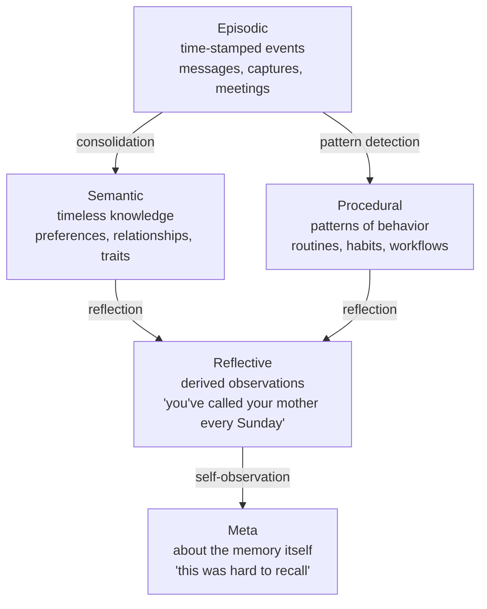
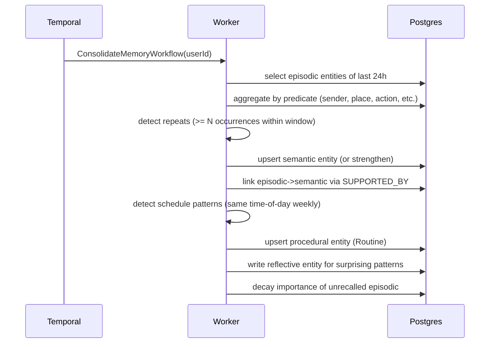

# 03 — Episodic / Semantic / Procedural Memory Model

> **Status:** draft &nbsp;•&nbsp; **Phase:** P2 &nbsp;•&nbsp; **Critical path:** yes
>
> Move from a flat "everything is an entity" graph to a memory model with first-class **episodic**, **semantic**, **procedural**, and **reflective** kinds, plus importance, decay, valence, and a consolidation loop.

---

## 1. Summary

Today the graph treats a calendar event, a coffee preference, a workflow ("how I start my mornings"), and a self-reflection as the same kind of node. That works for storage; it breaks for retrieval.

A digital twin needs to answer three structurally different question types:

| Question type | Memory kind | Example |
|---|---|---|
| "What did I do last Tuesday at 4pm?" | **Episodic** | A specific event in time |
| "What kind of coffee do I drink?" | **Semantic** | A timeless preference / fact about me |
| "What's my standard morning routine?" | **Procedural** | A reusable pattern of behavior |
| "What patterns am I in lately?" | **Reflective** | A higher-order observation about my data |

Cleanly separating these unlocks correct retrieval, consolidation, decay, and surface-area ranking.

## 2. Current state

- `entities` + `relationships` with JSONB properties; no `memory_kind` distinction.
- `summary-service` produces `HourlySummary` / `DailySummary` / `WeeklySummary` entities and a `SUMMARIZED_BY` edge.
- Facts are designed as cold storage but never harvested.
- `UserContextService.UserDossier` (and the `ChatKnowledge` branch) already extracts preferences/traits at read time — a hint that the model wants tiering.
- No importance / decay / valence / recall count anywhere.

## 3. Target state

### 3.1 Memory kinds



### 3.2 Schema additions

```sql
-- migrations/<ts>_memory_model_columns.sql
ALTER TABLE entities ADD COLUMN memory_kind text
  CHECK (memory_kind IN ('episodic','semantic','procedural','reflective','meta','other'))
  DEFAULT 'other';
ALTER TABLE entities ADD COLUMN importance real DEFAULT 0.5;     -- [0,1]
ALTER TABLE entities ADD COLUMN decay_rate real DEFAULT 0.0;     -- per-day decay
ALTER TABLE entities ADD COLUMN valence real DEFAULT 0;          -- [-1,1]
ALTER TABLE entities ADD COLUMN confidence real DEFAULT 0.5;     -- [0,1]
ALTER TABLE entities ADD COLUMN last_recalled_at timestamptz;
ALTER TABLE entities ADD COLUMN recall_count int DEFAULT 0;
ALTER TABLE entities ADD COLUMN occurred_at timestamptz;         -- episodic only
ALTER TABLE entities ADD COLUMN time_range tstzrange;            -- episodic spans

CREATE INDEX entities_memory_kind ON entities(memory_kind);
CREATE INDEX entities_occurred_at ON entities(occurred_at) WHERE memory_kind='episodic';
CREATE INDEX entities_time_range_gist ON entities USING gist(time_range);
CREATE INDEX entities_importance ON entities(importance DESC) WHERE importance > 0.5;
```

Episodic-specific:
- `occurred_at` (or `time_range` for spans) is required.
- An episodic entity references the **source** via `entity_provenance` (see [08](08-provenance-lineage.md)).

Semantic-specific:
- `valence` is meaningful (a like/dislike).
- `confidence` matters more than for episodic ("I think they prefer espresso" is provisional).

Procedural-specific:
- Stored as an entity of `entity_type='Routine'` with `properties.pattern` (cron-like or natural-language).
- Linked to its supporting episodic entities via `SUPPORTED_BY` edges, so the routine is **explainable**.

Reflective-specific:
- Always derived; `entity_provenance.kind='inferred'`.
- Linked to source episodic/semantic/procedural via `DERIVED_FROM`.

### 3.3 Retrieval ranking

`search-next` `SearchService.ts` adjustments:

```
final_score =
  base_keyword_score
    * (1 + EMBEDDING_BOOST * similarity)
    * importance_factor(importance)
    * recency_factor(occurred_at, decay_rate, kind)
    * kind_fit(query_intent, memory_kind)
```

- `importance_factor`: `0.5 + 0.5*importance` (mid for unknowns).
- `recency_factor`: episodic decays fast, semantic decays slowly, procedural barely decays.
- `kind_fit`: inferred by a small classifier on the query — "when did I…" → episodic; "what kind of…" → semantic; "how do I…" → procedural. Falls back to all kinds.

### 3.4 Consolidation loop

A Temporal workflow `ConsolidateMemoryWorkflow` runs nightly per user:



Promotion rules (initial heuristics — tunable):

| From | To | Rule |
|---|---|---|
| episodic × N | semantic | Same predicate observed ≥ 5 times in 14d. |
| episodic schedule | procedural | Same time-of-week ≥ 3 weeks consecutively. |
| semantic + opposing episodic | reflective | "Said dislikes X, did X anyway." |
| episodic, unrecalled, importance<0.2, age>90d | fact (cold) | Move to `facts` table; keep `derived_from` edge stub. |

### 3.5 Importance scoring (initial heuristic)

- +0.2 if the user authored it (vs. inferred).
- +0.2 if it has ≥ 1 outgoing relationship at write time.
- +0.1 per recall (saturates at +0.3).
- +0.2 if it appears in a summary.
- −0.05 per month with zero recalls.

Override always available via API (`PATCH /entities/<id>` with `importance`).

## 4. Branch disposition

| Branch | Role |
|---|---|
| `ChatKnowledge` | Already iterates the dossier surface; rebase on top of this module's `memory_kind=semantic` semantics. |
| `spike/rustworkx` | Powers ego-graph retrieval used by procedural detection — see [17](17-graph-algorithms.md). |
| `feature/doc-parse` | Provides the chunk→fact pipeline; consolidation reuses the same fact-shape — see [18](18-document-parsing.md). |

## 5. Phased steps

| # | Increment |
|---|---|
| 1 | Migration: add columns + indexes; backfill `memory_kind` heuristically from `entity_type` |
| 2 | Update writers in `domains/memory/*` to set `memory_kind` + `occurred_at` |
| 3 | Update `search-next/SearchService` with the ranking model |
| 4 | Build `ConsolidateMemoryWorkflow` (Temporal) and schedule nightly |
| 5 | Importance scorer (writes on insert + on recall) |
| 6 | Reflective writer with explainable `DERIVED_FROM` edges |
| 7 | Cold-storage move to `facts` for low-importance, unrecalled episodic |
| 8 | UI: show memory_kind, importance, sources on each entity card |

## 6. Risks

| Risk | Mitigation |
|---|---|
| Bad consolidation overwrites correct memories | Never destructively edit episodic. Semantic/procedural are derived; can be re-derived. |
| Importance score becomes a popularity contest | Cap recall contribution; weight user-edits highest. |
| Reflective memories feel intrusive | Mark them clearly in UI; require user confirmation before they influence dossier. |
| Promotion thresholds wrong | All thresholds in config; eval suite ([12](12-memory-evals.md)) measures recall before/after. |

## 7. Eval / acceptance

- The eval harness ([12](12-memory-evals.md)) adds three new suites: **episodic dating**, **semantic preference recall**, **routine detection**.
- After consolidation, the dossier (`UserContextService`) re-reads from semantic-kind entities and reports stable preferences across days.
- A "where did this come from?" query on any reflective entity returns its source chain.

## 8. Open questions

- Do we expose `memory_kind` to writers (agents can say "this is procedural"), or always infer? (Lean: writers can hint; consolidation can override.)
- How is "the same routine" detected across slight schedule drift? (Probably: cluster by hour-of-day + day-of-week with tolerance.)
- Should episodic span more than one entity? (Yes — meetings already do via `participants` relationships.)
