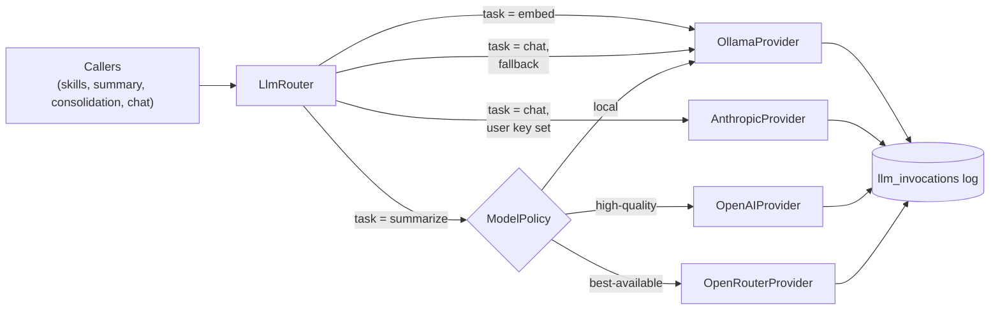
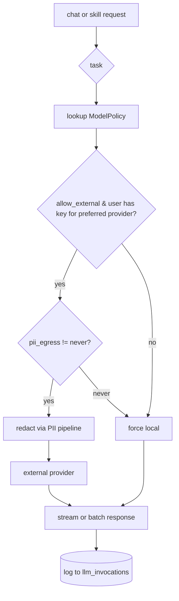

# 04 — Multi-Provider LLM Routing

> **Status:** draft &nbsp;•&nbsp; **Phase:** P1 &nbsp;•&nbsp; **Critical path:** yes
>
> Refactor `OllamaService` into a provider-agnostic `LlmRouter` that picks the right provider/model per task class, supports BYO-key, and streams.

---

## 1. Summary

Today every LLM call goes through `domains/llm/services/OllamaService.ts`. Model names are hardcoded (`gemma3:1b`, `gemma3:27b`, `qwen3:14b`). External providers (OpenAI, Anthropic, OpenRouter, Together) are not supported at all, and there's no per-task model policy.

A digital twin used by external agents has two LLM needs:

1. **Server-side tasks** — embeddings, summarization, consolidation, classification. These should stay local by default; only escalate to an external model when the user opts in.
2. **Pass-through agent traffic** — when the user asks the twin to chat, or when a skill ([02](02-skills-registry.md)) needs better reasoning, route to whatever provider the user has configured.

## 2. Current state

- `OllamaService` is the only LLM service.
- `provider_keys` table already exists (migration `20260303194253_add_provider_keys_table.sql`) — wired into the UI but not into the LLM call path.
- No streaming endpoint exposed to clients.

## 3. Target state



### 3.1 Interfaces

```ts
// domains/llm/providers/LlmProvider.ts
export interface LlmProvider {
  readonly name: string;
  readonly supports: Set<'embed'|'chat'|'tool-call'|'stream'>;
  embed(text: string, opts?: EmbedOpts): Promise<number[]>;
  chat(messages: ChatMessage[], opts: ChatOpts): Promise<ChatResponse>;
  chatStream(messages: ChatMessage[], opts: ChatOpts): AsyncIterable<ChatChunk>;
}
```

Concrete: `OllamaProvider`, `OpenAIProvider`, `AnthropicProvider`, `OpenRouterProvider`, `TogetherProvider`.

### 3.2 Model policy

```ts
// domains/llm/policy.ts
type Task = 'embed' | 'classify' | 'summarize' | 'chat' | 'reflect' | 'consolidate';

interface ModelPolicy {
  task: Task;
  preference: 'local'|'high-quality'|'balanced';
  allow_external: boolean;
  pii_egress: 'never'|'with-redaction'|'allow';
}
```

Default policies (per user, editable in Settings):

| Task | Preference | Allow external | PII egress |
|---|---|---|---|
| embed | local | no | never |
| classify | local | no | never |
| summarize | balanced | yes | with-redaction |
| chat | high-quality | yes | with-redaction |
| reflect | balanced | yes | with-redaction |
| consolidate | local | no | never |

### 3.3 Routing logic



### 3.4 Trace table

```sql
CREATE TABLE llm_invocations (
  id uuid PRIMARY KEY,
  actor_id uuid NOT NULL,
  task text NOT NULL,
  provider text NOT NULL,
  model text NOT NULL,
  input_tokens int,
  output_tokens int,
  latency_ms int,
  cost_usd_micro int,         -- micro-USD to avoid float
  redacted bool DEFAULT false,
  skill_invocation_id uuid REFERENCES skill_invocations(id),
  status text,                -- ok|error|aborted
  error_kind text,
  created_at timestamptz DEFAULT now()
);
CREATE INDEX llm_invocations_actor ON llm_invocations(actor_id, created_at DESC);
```

### 3.5 Streaming

- HTTP: SSE endpoint at `/api/v1/chat/stream` (already used by `feat/voice-mode` for TTS — see [16](16-voice-multimodal.md)).
- MCP: chunked transport, native to `StreamableHTTPServerTransport`.
- GraphQL: subscription `messageStreamed(threadId)` ([05](05-streaming-subscriptions.md)).

## 4. Branch disposition

| Branch | Role |
|---|---|
| `feat/voice-mode` | Already streams audio + uses Whisper/TTS — keep that path; this plan adds streaming for text. |
| `add-mcp-endpoints` | MCP tools that delegate to LLM use `LlmRouter` directly. |

## 5. Phased steps

| # | Increment |
|---|---|
| 1 | Extract `LlmProvider` interface; refactor `OllamaService` into `OllamaProvider`; introduce `LlmRouter` returning Ollama for every task (no behavior change) |
| 2 | Add `OpenAIProvider` and `AnthropicProvider` using `provider_keys`; default disabled |
| 3 | Settings UI: per-task `ModelPolicy` editor |
| 4 | Streaming: SSE endpoint + GraphQL subscription |
| 5 | `llm_invocations` trace table + writes |
| 6 | OpenRouter / Together providers (one PR each) |
| 7 | Cost guardrails: per-actor monthly budget; soft-cap → warn, hard-cap → fall back to local |

## 6. Risks

| Risk | Mitigation |
|---|---|
| External provider leaks PII | Redact via the PII pipeline ([09](09-privacy-consent.md)); `pii_egress='never'` is the default for any task that touches episodic content. |
| Cost surprise | Hard per-actor budget; trace table makes per-skill cost queryable. |
| Provider outage | Falls back through policy chain to local Ollama. |
| Model drift breaks downstream prompts | `LlmRouter.chat()` is idempotent given inputs; trace captures model+temp+seed where supported. |
| User installs a skill that forces an external model | Skill install flow shows "this skill prefers <model>"; user has final say. |

## 7. Eval / acceptance

- Switching the chat task policy from "local" to "high-quality" with an Anthropic key set actually routes to Claude — verified in `llm_invocations`.
- With **no** external keys, every call routes to Ollama and works offline.
- Streaming text shows token-by-token in the SPA *and* in Claude Code via MCP.
- The eval harness ([12](12-memory-evals.md)) can re-run a fixed suite against any configured provider for A/B comparison.

## 8. Open questions

- Where do per-skill model overrides come from — skill spec or user install config? (Lean: both, install wins.)
- Do we cache Anthropic prompts (`cache_control`)? Yes — auto-injected by `AnthropicProvider` on system messages.
- Same model for embeddings across providers? No — keep `nomic-embed-text` local; only OpenAI optional for users who really want it.
