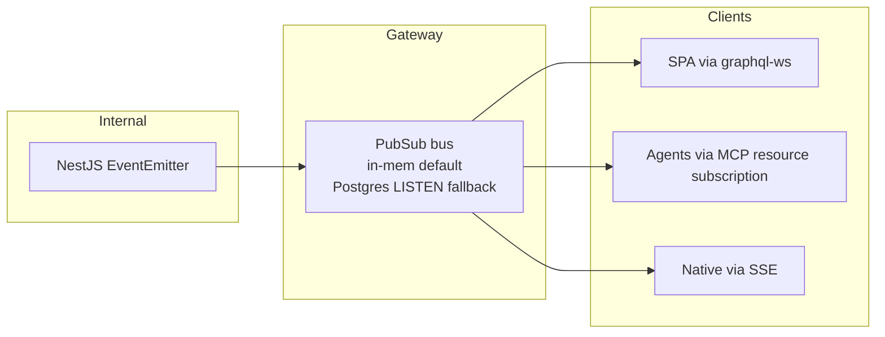

# 05 — Streaming & Subscriptions

> **Status:** draft &nbsp;•&nbsp; **Phase:** P1
>
> Replace polling with pushed updates. SSE for chat tokens, GraphQL subscriptions for entity/relationship/thread events, MCP resource subscriptions for agents.

---

## 1. Summary

Every read surface today is pull-based: the SPA polls, the summary agent polls `agent_messages`, MCP resources are static reads. Agents and AR/XR clients need pushed updates to feel live and to stop burning battery.

## 2. Current state

- Apollo Server is plain HTTP — no `graphql-ws`, no subscriptions.
- No SSE on REST.
- `feat/voice-mode` adds audio streaming but on top of the same plain-HTTP plumbing.
- `add-mcp-endpoints` uses `StreamableHTTPServerTransport` — primed for resource subscriptions, but none registered.
- NestJS `EventEmitter` events flow internally between domains (`MessageCreatedEvent`, `EntityCreatedEvent`, etc.) but never escape the process.

## 3. Target state



### 3.1 Channels

| Channel | Filter | Emitter |
|---|---|---|
| `entity.<userId>.<entity_type>` | type optional | `EntityCreated/Updated/RemovedEvent` |
| `relationship.<userId>` |   | `Relationship*Event` |
| `thread.<threadId>.message` |   | `MessageCreatedEvent` |
| `thread.<threadId>.stream` |   | chat token stream |
| `summary.<userId>` |   | summary writer |
| `measurement.<userId>.<sensor_id>` |   | ingest pipeline |
| `skill.<invocation_id>.trace` |   | skill executor |

### 3.2 GraphQL subscriptions

```graphql
type Subscription {
  entityChanged(userId: ID!, kind: String): EntityChange!
  relationshipChanged(userId: ID!): RelationshipChange!
  messageStreamed(threadId: ID!): MessageStreamChunk!
  summaryReady(userId: ID!): Summary!
}
```

### 3.3 MCP resource subscriptions

```
subscribe memory://entity/<id>
subscribe memory://thread/<id>
subscribe memory://summary/today
```

`McpServerService` wires `server.sendResourceUpdated(uri)` when the matching event fires for an entity in the session's `userId`.

### 3.4 SSE endpoints (REST)

- `GET /api/v1/chat/stream?threadId=...` — token stream.
- `GET /api/v1/changes?topics=entity,thread.<id>.message` — generic SSE.

## 4. Branch disposition

| Branch | Role |
|---|---|
| `feat/voice-mode` | Existing audio streaming validates the SSE plumbing; reuse the transport. |
| `add-mcp-endpoints` | Already uses streamable transport — add subscription handlers. |

## 5. Phased steps

| # | Increment |
|---|---|
| 1 | Pubsub abstraction (in-memory default, Postgres `LISTEN`-backed for horizontal scale later) |
| 2 | Fan internal events to pubsub, scoped by `userId` |
| 3 | GraphQL subscriptions via `graphql-ws` over WebSocket |
| 4 | SSE `/api/v1/chat/stream` and `/api/v1/changes` |
| 5 | MCP resource subscriptions |
| 6 | SPA: subscribe instead of poll on the thread view, the summary view, and the graph view |

## 6. Risks

| Risk | Mitigation |
|---|---|
| Memory pubsub doesn't scale beyond one process | Defer Postgres LISTEN backend until multi-process is needed; the appliance model is single-process today. |
| Subscription fan-out becomes expensive | Per-actor topic filtering at publish time; clients can't subscribe to other users' channels. |
| Long-lived connections leak file descriptors | Idle reaper (10 min); ping/pong; bounded concurrency per actor. |

## 7. Eval / acceptance

- Open Claude Code, run `subscribe memory://thread/<id>`, send a message from the SPA, see the agent receive a `resources/updated` within 100ms p95.
- The SPA's chat view stops polling and consumes the GraphQL subscription only.
- A subscription scoped to actor A cannot receive events for actor B (test).
