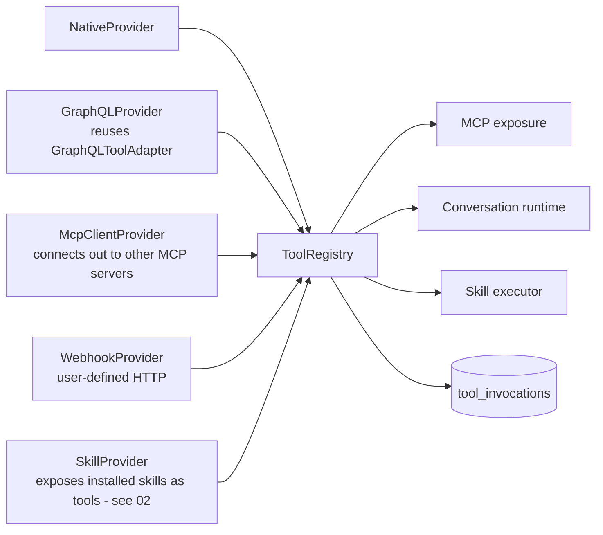
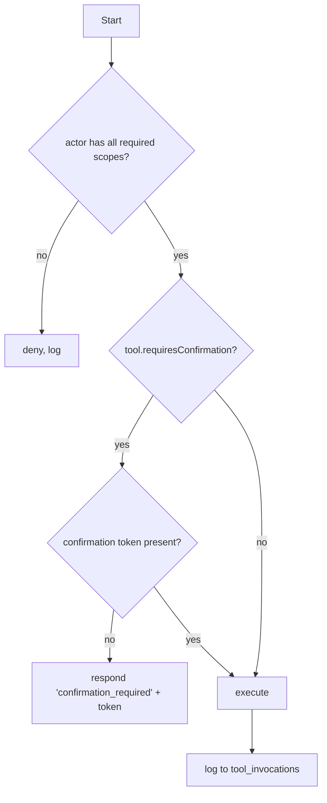

# 06 — Tool Registry Expansion

> **Status:** draft &nbsp;•&nbsp; **Phase:** P4
>
> Turn the tool registry into a bidirectional bridge: the twin both **publishes** tools to agents (already partial via MCP) and **consumes** tools from external MCP servers + webhooks + GraphQL.

---

## 1. Summary

The existing `domains/tools/registry/ToolRegistry` and `NativeToolProvider` give us a clean place to plug in more tools. What's missing:

- **Outbound MCP client provider** — the twin connects to *other* MCP servers (user's calendar, Slack, Linear, browser, smart-home) and exposes their tools through the twin's own registry. This is what makes the twin an executive layer rather than just a memory store.
- **GraphQL-auto provider** — superseded by the MCP module's `GraphQLToolAdapter` on the `add-mcp-endpoints` branch (re-use that adapter inside the registry so non-MCP consumers benefit too).
- **Webhook provider** — user-defined HTTP tools.
- **Per-tool permission model**: required scopes, requires-confirmation, dry-run, allow-list per actor.
- **Tool invocation trace** for audit and eval.

## 2. Current state

```
backend/apps/api/src/domains/tools/
├── core/{BaseTool,types}.ts
├── providers/{ToolProvider,native/NativeToolProvider, native/<8 hardcoded tools>}
├── registry/ToolRegistry.ts
└── services/ToolsRegistrationService.ts
```

Eight native tools today (Database search, Read/Write/Forget knowledge, Family, Streaming availability, Entertainment preferences, User preferences). All trusted, no permission checks, no invocation logs.

## 3. Target state



### 3.1 `ToolProvider` extensions

```ts
export interface ToolProvider {
  readonly name: string;
  readonly trusted: boolean;          // native = true, mcp-client = false
  initialize(): Promise<void>;
  shutdown(): Promise<void>;
  getAvailableTools(): Promise<ToolSchema[]>;
  getTool(name: string): BaseTool | undefined;
  canHandle(toolName: string): boolean;
  health(): Promise<ProviderHealthStatus>;
}

export interface ToolSchema {
  // existing fields plus:
  requiredScopes: string[];           // e.g. ['memory:write']
  requiresConfirmation?: boolean;     // human-in-the-loop for destructive ops
  dryRunSupported?: boolean;
  permissionPolicy?: PolicyRef;       // optional finer-grained policy id
}
```

### 3.2 `McpClientProvider`

```ts
// providers/mcp-client/McpClientProvider.ts
// Connects out to a configured MCP server (the user's calendar, Slack, etc.)
// Surfaces each remote tool as a BaseTool wrapping a JSON-RPC call.
```

Configuration entries live in a `connected_mcp_servers` table (per user):

```sql
CREATE TABLE connected_mcp_servers (
  id uuid PRIMARY KEY,
  actor_id uuid NOT NULL,
  name text NOT NULL,
  transport text NOT NULL CHECK (transport IN ('stdio','http')),
  url text,
  command text,
  args jsonb,
  headers jsonb,
  enabled bool DEFAULT true,
  last_connected_at timestamptz,
  last_error text,
  created_at timestamptz DEFAULT now()
);
```

### 3.3 `WebhookProvider`

A user defines a tool via the SPA:
```
name: ci.weather.now
url: https://api.weather.example/v1/now
method: GET
input_schema: { lat: number, lon: number }
output_schema: { temp_c: number, summary: string }
```
…and it appears in the registry, gated on a scope `tools:webhook:weather`.

### 3.4 Invocation trace

```sql
CREATE TABLE tool_invocations (
  id uuid PRIMARY KEY,
  actor_id uuid NOT NULL,
  tool_name text NOT NULL,
  provider text NOT NULL,
  args jsonb,
  result jsonb,
  status text,                -- ok|error|denied|confirmed
  required_confirmation bool,
  confirmed_by uuid,          -- actor that confirmed (often the user)
  latency_ms int,
  skill_invocation_id uuid REFERENCES skill_invocations(id),
  created_at timestamptz DEFAULT now()
);
```

### 3.5 Permission model

Decision flow on every `ToolRegistry.execute`:



Confirmation tokens are issued by the API, valid for 60s, single-use, bound to actor+tool+arg-hash.

## 4. Branch disposition

| Branch | Role |
|---|---|
| `add-mcp-endpoints` | Already auto-derives tools from GraphQL — reuse `GraphQLToolAdapter` here so the registry has the same tools whether consumed via MCP or in-process. |

## 5. Phased steps

| # | Increment |
|---|---|
| 1 | Extend `ToolSchema` with `requiredScopes`, `requiresConfirmation`; backfill defaults on the 8 native tools |
| 2 | Add `tool_invocations` table + writes from `ToolRegistry.execute` |
| 3 | Confirmation-token flow (controller + verifier) |
| 4 | `GraphQLProvider` re-using `GraphQLToolAdapter` |
| 5 | `McpClientProvider` + `connected_mcp_servers` UI |
| 6 | `WebhookProvider` + SPA editor |
| 7 | `SkillProvider` (depends on [02](02-skills-registry.md)) |
| 8 | Per-actor tool allowlist editor |

## 6. Risks

| Risk | Mitigation |
|---|---|
| External MCP server returns malicious output | Treat outputs as untrusted text; pass through tagger before storing in memory; never use raw output as a subsequent tool's args without confirmation. |
| Webhook tools called too often | Per-tool rate limit; budget per actor per day. |
| Confirmation fatigue | `requiresConfirmation` only for writes/destructive ops; reads never prompt. |
| MCP-client provider hangs | Per-call timeout (30s default), circuit breaker after 3 consecutive errors. |

## 7. Eval / acceptance

- A user can add their Google Calendar MCP and call `calendar.list_events` through their twin (via skill or directly).
- Every tool call has a row in `tool_invocations`.
- A read-only key cannot execute any tool with `memory:write` in its required scopes.
- Webhook tool execution is sandboxed: no access to internal services unless URL passes an allowlist.
