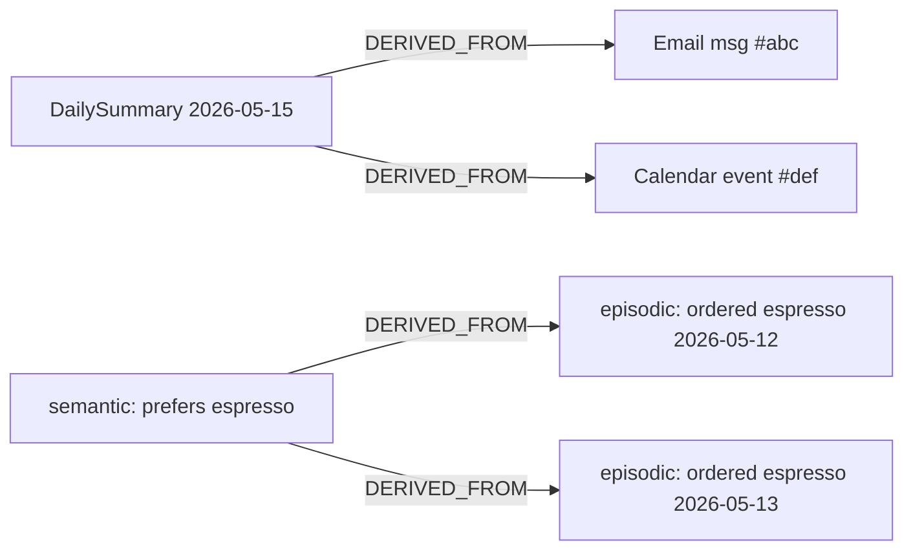

# 08 — Provenance & Lineage

> **Status:** draft &nbsp;•&nbsp; **Phase:** P0 &nbsp;•&nbsp; **Critical path:** yes
>
> Every entity, relationship, fact, and summary must carry a structured `provenance` record and a `derived_from` edge to its source. Without this the twin cannot cite, the user cannot trust, and we cannot roll back bad ingests.

---

## 1. Summary

CI-Server stores user data but loses the question "where did this come from?". When an agent recalls "you prefer espresso", we need to be able to answer: from which messages, on which dates, with what confidence, by which ETL job — and roll any of that back if the source provider was wrong.

## 2. Current state

- Some tables have ad-hoc `created_by`-style fields.
- ETL writes (`etl/services/*/transform/*`) populate `properties` but don't keep a structured pointer back to the raw source row.
- `SUMMARIZED_BY` edges exist (summary entity ↔ inputs) but they're sparse — the actual chunk-to-source linkage is lost.
- Facts have no source tracking.

## 3. Target state

### 3.1 Provenance shape

```sql
CREATE TABLE entity_provenance (
  entity_id uuid PRIMARY KEY REFERENCES entities(id) ON DELETE CASCADE,
  kind text NOT NULL CHECK (kind IN ('user','etl','agent','inferred','skill','migration','legacy')),
  source_provider text,         -- 'google.calendar', 'spotify.recent_plays', 'agent:claude', 'skill:summarize_my_day'
  source_id text,               -- provider-side id (event_id, playback_id, message_id)
  source_uri text,              -- canonical URI back to source
  ingest_run_id uuid,           -- ETL run id (FK to etl runs table when we add one)
  model text,                   -- if produced by LLM
  ingested_at timestamptz NOT NULL DEFAULT now(),
  source_confidence real,       -- 0..1
  raw_excerpt_hash text         -- hash of the raw source text for dedup
);
CREATE INDEX entity_provenance_source ON entity_provenance(source_provider, source_id);
CREATE INDEX entity_provenance_ingest_run ON entity_provenance(ingest_run_id);
```

Same shape for `relationship_provenance`, `fact_provenance`. Polymorphic across tables; we keep them split to allow ON DELETE CASCADE cleanly.

### 3.2 Derived-from edges

A relationship type `DERIVED_FROM` (in `relationships`) links any derived node (summary, semantic, procedural, reflective, fact) to its sources. Allows graph traversal "show me the sources of this belief":



### 3.3 Ingest run table

```sql
CREATE TABLE ingest_runs (
  id uuid PRIMARY KEY,
  actor_id uuid NOT NULL,
  provider text NOT NULL,         -- 'google.calendar', etc.
  started_at timestamptz NOT NULL,
  ended_at timestamptz,
  status text NOT NULL,           -- running|ok|error|partial
  cursor text,                    -- provider sync cursor
  entities_written int DEFAULT 0,
  relationships_written int DEFAULT 0,
  error text,
  rollback_at timestamptz         -- if non-null, treat outputs as retracted
);
```

A `rollback_at` makes "undo last sync" a single update, with retrieval filtering on the join.

### 3.4 Retrieval API surface

Every read returns provenance summaries:

```graphql
type Entity {
  id: ID!
  type: String!
  properties: JSON
  provenance: Provenance!
  derivedFrom: [Entity!]!     # short list, paginated
}

type Provenance {
  kind: ProvenanceKind!
  sourceProvider: String
  sourceId: String
  sourceUri: String
  ingestedAt: DateTime!
  confidence: Float
}
```

MCP tools return the same shape (`memory.recall` includes `sources`).

## 4. Branch disposition

| Branch | Role |
|---|---|
| `copilot/refactor-connections-etl-system` | The right place to land provenance — its catalog-driven adapters write through one common `Promote` path. Add provenance there. See [15](15-etl-expansion.md). |
| Existing ETL providers (Google/MS/Facebook/Spotify) | Need a small update each to populate `entity_provenance` at promote time. |

## 5. Phased steps

| # | Increment |
|---|---|
| 1 | Migrations: `entity_provenance`, `relationship_provenance`, `fact_provenance`, `ingest_runs` |
| 2 | `PromoteService` writes provenance on every entity/relationship created; backfill `kind='legacy'` for existing rows |
| 3 | `DERIVED_FROM` edges from summaries, semantic, procedural, reflective, facts |
| 4 | Expose `provenance` + `derivedFrom` on every read API |
| 5 | "Undo last sync" endpoint: sets `rollback_at` and filters in queries |
| 6 | UI: a "sources" disclosure on every entity/summary card |
| 7 | Backfill workflow: nightly Temporal job upgrades pre-cutoff rows with best-effort provenance from raw ETL tables |

## 6. Risks

| Risk | Mitigation |
|---|---|
| Provenance write doubles ingest cost | One row per entity = same order of magnitude as the write itself; ingest already touches multiple tables. |
| Backfill is huge | Idempotent, throttled Temporal workflow; `kind='legacy'` is acceptable until back-pressure clears. |
| Source URIs leak through to agents | Filter `source_uri` based on caller scope; default external agents see `kind` + `source_provider` only. |

## 7. Eval / acceptance

- Asking `memory.recall("espresso")` via MCP returns the answer **and** a list of source IDs.
- Setting `rollback_at` on an `ingest_run` immediately removes its rows from every read API.
- A summary card in the SPA expands to show the messages/events that fed it.
- The eval harness ([12](12-memory-evals.md)) adds a "must cite sources" check on every recall test.
