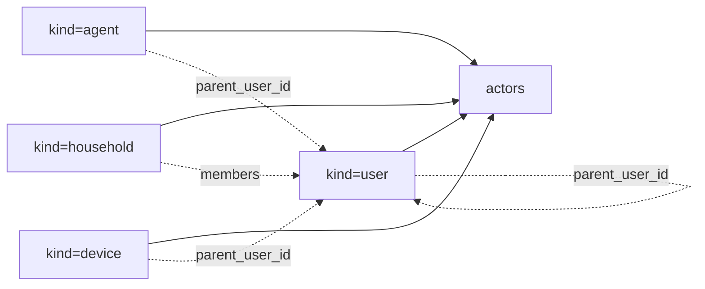
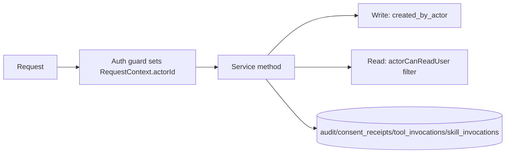

# 10 — Multi-Actor (Agents as First-Class)

> **Status:** draft &nbsp;•&nbsp; **Phase:** P0 &nbsp;•&nbsp; **Critical path:** yes
>
> Replace the implicit single-user assumption with a first-class `actor` concept: users, agents, household members all are actors. Reads, writes, scopes, policies, and audit all key on `actor_id`.

---

## 1. Summary

Every table is filtered by `user_id`. As soon as an agent has an API key, the agent **is** the user from the system's view. That blurs three things we need to keep distinct:

- **Authorship** — who wrote this memory? The user, an agent, or another household member?
- **Access control** — what can a given agent see?
- **Audit** — who did what, when?

A single `actors` table fixes all three with minimal churn.

## 2. Current state

- `users` table.
- `api_keys.user_id` ties keys to users (1:N).
- Sessions, ETL writes, summaries — all key on `user_id`.
- No household / family / agent distinction.

## 3. Target state

### 3.1 Actor types



| Kind | Use |
|---|---|
| `user` | The human owner. Exactly one per Hub today; multiple allowed for family/household. |
| `agent` | An external agent runtime: Claude Code, Cowork, OpenClaw, Codex, custom. |
| `device` | A wearable, browser extension, or IoT device with its own credentials. |
| `household` | A logical group owning shared entities (the family). |

### 3.2 Schema

```sql
CREATE TABLE actors (
  id uuid PRIMARY KEY,
  kind text NOT NULL CHECK (kind IN ('user','agent','device','household')),
  parent_user_id uuid REFERENCES users(id) ON DELETE CASCADE,
  display_name text NOT NULL,
  metadata jsonb NOT NULL DEFAULT '{}',
  created_at timestamptz DEFAULT now()
);
CREATE INDEX actors_parent ON actors(parent_user_id);

-- Backfill: one user-kind actor per existing user
INSERT INTO actors (id, kind, parent_user_id, display_name)
SELECT id, 'user', id, COALESCE(display_name, email) FROM users;

-- API keys gain an actor_id pointer (still under a user owner)
ALTER TABLE api_keys ADD COLUMN actor_id uuid REFERENCES actors(id);
UPDATE api_keys SET actor_id = user_id;   -- back-compat: same uuid for user-kind actor
ALTER TABLE api_keys ALTER COLUMN actor_id SET NOT NULL;

-- Authorship on writes
ALTER TABLE entities ADD COLUMN created_by_actor uuid REFERENCES actors(id);
ALTER TABLE relationships ADD COLUMN created_by_actor uuid REFERENCES actors(id);
ALTER TABLE messages ADD COLUMN actor_id uuid REFERENCES actors(id);
```

### 3.3 Request context

`common/context/RequestContext` gains `actorId`. Every service method that takes `UserServiceContext` learns about `actorId` too — usually they match (`actorId === userId` when JWT session) but for API-key calls the actor is the agent.

Read filtering shifts from `user_id = ?` to "actor has access to user_id":

```ts
// helper
actorCanReadUser(actorId, userId): boolean {
  // user-kind: own data only
  // agent kind: parent_user_id === userId
  // household kind: any member's user_id
}
```

### 3.4 Agent creation flow

1. User goes to Settings → Agents → "Connect Claude Code".
2. SPA creates an `agent`-kind actor with `display_name="Claude Code (Liam's laptop)"`.
3. Issues an API key bound to that actor with default scopes.
4. Returns the MCP config blob for the user to paste.

The same flow generates the entry in `connected_mcp_servers` if applicable (see [06](06-tool-registry-expansion.md)).

### 3.5 Where actor_id flows



## 4. Branch disposition

None directly — this is a foundational change.

## 5. Phased steps

| # | Increment |
|---|---|
| 1 | Migrations: `actors` table; backfill user-kind actors; FK on `api_keys` |
| 2 | `RequestContext.actorId`; populate from JWT (=userId) or API key |
| 3 | Add `created_by_actor` to writes; backfill from `user_id` |
| 4 | Helper `actorCanReadUser`; switch read filters in `domains/memory/*` |
| 5 | UI: "Agents" page — create agent actor, issue scoped key, view activity |
| 6 | Audit, skill, tool, consent tables key on `actor_id` |
| 7 | Household-kind actor (future PRs); device-kind actor (depends on [13](13-realtime-ingest.md)) |

## 6. Risks

| Risk | Mitigation |
|---|---|
| Touches every domain | Add `actorId` as an optional context field with a default to `userId`; flip enforcement after all writes populate it. |
| Performance: extra join on every read | Use lateral views or denormalize `parent_user_id` on actor; index aggressively. |
| Agents impersonating users | `created_by_actor` always wins; `user_id` is a separate column that says *which user the data belongs to*. |
| Household sharing complexity | Defer; ship user+agent first, household later. |

## 7. Eval / acceptance

- An agent-issued key can only read data where `parent_user_id` matches its user.
- Authorship of every new entity is visible: "Claude Code wrote this" vs "you wrote this".
- Revoking an agent revokes all its keys atomically and stops all in-flight requests at the next call.
- The SPA's "Agents" page shows each connected agent + last activity + per-agent revoke.
