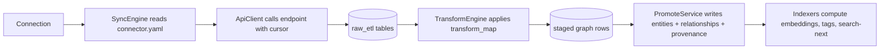

# 15 — ETL Expansion & Catalog Refactor

> **Status:** draft &nbsp;•&nbsp; **Phase:** P0
>
> Land the catalog-driven refactor first; then merge the four ready-to-go providers (Discord, Instagram, Steam, GitHub) plus iMessage on top of it.

---

## 1. Summary

The branch matrix says we have:

- A **catalog-driven ETL refactor** (`copilot/refactor-connections-etl-system`) covering 26 providers + mock APIs + transform-map JSON for 27 providers (61 new sources).
- **Four ready ETL provider branches**: `feat/discord`, `feat/instagram`, `steam-etl`, `github-etl`.
- **iMessage via BlueBubbles** on `copilot/add-imessage-integration` with docs.

These are sitting on branches. None has landed because (correctly) the catalog refactor needs to go first or the providers will conflict with each other.

## 2. Current state

Four providers in `backend/apps/api/src/domains/etl/services/{Google,Microsoft,Facebook,Spotify}/`. Each repeats the sync/transform/promote scaffolding. Adding a fifth requires copying the same shape.

## 3. Target state

### 3.1 Catalog model

```yaml
# connectors/<provider>.yaml
name: discord
display: Discord
auth: oauth2
oauth2:
  authorize_url: https://discord.com/api/oauth2/authorize
  token_url: https://discord.com/api/oauth2/token
  scopes_required: [identify, messages.read]
sources:
  - id: messages
    endpoint: /users/@me/channels
    cursor: { kind: 'time', field: 'timestamp' }
    transform_map: ./discord/messages.transform.json
    rate_limit: { requests_per_min: 50 }
  - id: relationships
    endpoint: /users/@me/relationships
    cursor: { kind: 'snapshot' }
    transform_map: ./discord/relationships.transform.json
```

Each `transform_map` is a JSON document mapping provider fields → graph fields. Today this is buried in TypeScript inside each `Transform*.ts`; the refactor extracts it.

### 3.2 Pipeline



### 3.3 Provenance integration

The refactor is the perfect place to land [08-provenance](08-provenance-lineage.md) because there's exactly one promote path to instrument.

### 3.4 Mock providers for tests

The refactor includes a mock API per provider — keep and wire into the eval suite ([12-evals](12-memory-evals.md)) so we can seed deterministic ingest events without hitting real APIs.

## 4. Branch disposition

| Branch | Action |
|---|---|
| `copilot/refactor-connections-etl-system` | **Land first.** It is the foundation. |
| `feat/discord` | Rebase as a catalog entry; merge. |
| `feat/instagram` | Same. |
| `steam-etl` | Same. |
| `github-etl` | Same. |
| `copilot/add-imessage-integration` | Land as a catalog entry. BlueBubbles is a local proxy; note infra dependency. |
| `mock-providers` | Roll into the refactor; archive. |
| `dedupe-ingest` | Apply after the catalog lands; idempotency keys live in `ingest_runs`. |

## 5. Phased steps

| # | Increment |
|---|---|
| 1 | Merge the catalog refactor (multi-PR; behind feature flag) |
| 2 | Migrate Google/MS/Facebook/Spotify off bespoke code onto the catalog |
| 3 | Cut over staging; verify parity |
| 4 | Remove the bespoke services |
| 5 | Land Discord, then Instagram, then Steam, then GitHub (one per PR) |
| 6 | Land iMessage / BlueBubbles |
| 7 | Wire provenance + ingest_runs into the catalog promote path |
| 8 | Connect the eval corpus to mock providers |

## 6. Risks

| Risk | Mitigation |
|---|---|
| Refactor regresses an existing provider | Stage cutover behind flag; eval suite has provider-specific tests. |
| Many branches diverge from main during cutover | Time-box the cutover (≤ 2 weeks); rebase others against the catalog branch weekly. |
| Catalog DSL becomes its own framework | Keep `transform_map` deliberately small (mapping, field-flatten, simple regex/format). Anything more lives in a code-level `transform_extension` hook. |

## 7. Eval / acceptance

- New provider lands as one PR: connector.yaml + transform_map + ≤ 100 lines of code.
- All four original providers still pass their existing tests post-refactor.
- Mock APIs let CI run end-to-end ingest tests without real credentials.
- Every promote-time write has `entity_provenance` populated.
