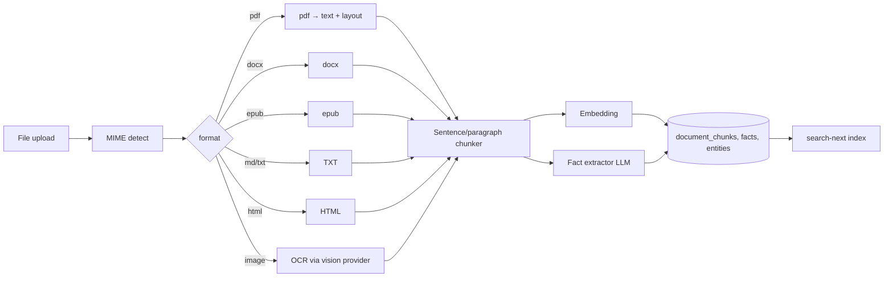

# 18 — Document Parsing

> **Status:** draft &nbsp;•&nbsp; **Phase:** P2
>
> Merge the document-parsing work behind a sandboxed container so the twin can ingest PDFs, Office docs, EPUBs, and notes into the chunk → fact pipeline cleanly.

---

## 1. Summary

`feature/parser-container` and `feature/doc-parse` add sentence-level chunking, GraphQL wiring, document chunk search, snapshots. The `Database.md` data model already names `document_chunks` and the fact pipeline. Today's pipeline accepts files but doesn't reliably extract structured text from arbitrary formats.

## 2. Current state (across both branches)

- Snapshots for parser ("vizier")
- Document chunk search wired
- Sentence base
- GraphQL exposure
- Parser as a container (sandboxed)
- Note: branch has `unsandbox` commit — that's a regression; production must stay sandboxed.

## 3. Target state

### 3.1 Pipeline

### 3.2 Sandboxing

Parser runs in its own container (`ci/parser`) on a restricted seccomp profile and read-only FS. Reasons: PDFs and Office docs are a common malware vector; keep them away from the API process.

Wire format: HTTP POST raw bytes → JSON response with chunks. Time-bounded (30s default); OOM-bounded.

### 3.3 Chunking strategy

- Sentence-level base from the branch.
- 200–800 token windows with 50-token overlap.
- Preserve a `section_path` (heading hierarchy) when format provides it.
- Each chunk carries `byte_range` back to the source file.

### 3.4 Fact extraction

LLM pass per chunk (or per N chunks for context):
- Prompt: "Extract atomic facts about the file owner and their world."
- Output: `[{predicate, subject, object, confidence}]`.
- Written to `facts` with `entity_provenance.kind='inferred'` and `derived_from` to source chunks.

### 3.5 Search integration

`search-next` already exists; document chunks become a top-level indexable kind. The existing `EmbeddingEntity` carries the vector. Retrieval returns chunks alongside entities — the answer surface can use both.

## 4. Branch disposition

| Branch | Action |
|---|---|
| `feature/parser-container` | **Re-sandbox** (revert the `unsandbox` commit) then merge. |
| `feature/doc-parse` | Merge after the container is sandboxed. |

## 5. Phased steps

| # | Increment |
|---|---|
| 1 | Sandboxed parser container with PDF + DOCX + TXT/MD/HTML |
| 2 | Sentence chunking + section path |
| 3 | Embeddings on chunks (reuse `nomic-embed-text`) |
| 4 | Search-next wiring |
| 5 | EPUB + image OCR |
| 6 | Fact extractor (LLM, gated to local model by default) |
| 7 | UI: file detail view with chunk-level highlighting on search hits |

## 6. Risks

| Risk | Mitigation |
|---|---|
| Malicious file exploits parser | Sandbox: seccomp, read-only FS, no network, OOM/time bounded. |
| Fact extractor hallucinates | Confidence threshold; `kind='inferred'`; user can purge a fact + suppress its source. |
| Chunk size wrong for retrieval | A/B in the eval suite ([12](12-memory-evals.md)); chunking parameters are config. |
| Re-parse explosion on file edits | Hash the file; only re-parse on hash change. |

## 7. Eval / acceptance

- A PDF uploaded via the SPA is searchable within 5 seconds (small file) by content.
- The parser cannot make outbound network requests (verified by test).
- Fact extraction populates `facts` with `derived_from` edges back to chunks.
- A chunk hit on search highlights the exact byte range in the source file viewer.
