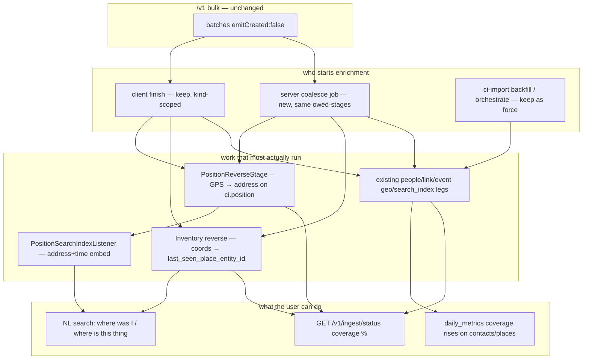

# Post-ingest enrichment (#51)

> **Private & Confidential — Property of Lifescope Inc. Do not distribute.**
>
> Status: **implemented and merged to `main`** — `feat/3-and-4` landed on
> 2026-08-17 as [#2032](https://github.com/companionintelligence/CI-Server/pull/2032).
> Thicker daily metrics (#53 leftovers) is a sibling plan:
> [thicker-daily-metrics.md](thicker-daily-metrics.md).
> Tracker: [CI-Engineering #51](https://github.com/companionintelligence/CI-Engineering/issues/51)
> · epic [#49](https://github.com/companionintelligence/CI-Engineering/issues/49)
>
> Grounded against `feat/derivation-engines` (`f5031185e`) on 2026-08-17.
> §2 ("What exists today") therefore describes the tree **before** this plan
> landed — read it as the diagnosis, not as current state. §11–§12 were
> re-verified against `main` on 2026-08-19.

This is **item 3 of the remaining derivation-layer work**. #55 can correlate
only what the feature store actually saw. If bulk import never reverse-geocodes
GPS, never links people, and never embeds places, `n_places` / `km_traveled` /
contacts stay thin and the engines honestly return "still learning." This
closes the producer hole **behind** those columns. New metric keys are item 4.

---

## 1. The hole

The user imports a year of Takeout, or the phone writes a day of location
fixes. Rows land in `ci.position` / `ci.communications` / `ci.objects`.
Memory search, the place engine, and daily metrics then look empty:

> I imported my location history. Why can't I ask where I was last Tuesday?
> Why does Forecast still have no places?

That is not a missing model. It is **deferred work that nobody is required to
run**, plus two coverage gaps the deferred work would not close even if it ran.

| Surface | What it needs | What bulk ingest actually does |
|---|---|---|
| Semantic search ("where was I") | `ci_search.embeddings` for the row | `/v1/*` materializes with `emitCreated: false` — no `*CreatedEvent`, so no search-index listener |
| Place engine / `n_places` | GPS points (`ci.position.location`) | Points land. Reverse-geocode of those points is a **different** system than the finish leg named `reverse_geocode` |
| Daily contacts / sentiment | `from_entity_id` / `to_entity_ids` filled | `extract_people` + `link_communications` only run if a client calls finish/orchestrate |
| Inventory "where is this" | a place name on the item | `ci.objects.current_location_coordinates` can be set; nothing reverse-geocodes it onto `last_seen_place_entity_id` |

The ticket's three acceptance bullets are still the right ones. The tree has
moved: there are **two** enrichment systems, and the client/server contract
for GPS is internally inconsistent. This plan names that, then closes #51
without unifying the two systems (that is the jobs-system rebuild).

---

## 2. What exists today

### 2.1 Bulk ingest defers on purpose (keep this)

`BulkIngestController` (`backend/apps/api/src/domains/ingest/controllers/BulkIngestController.ts`)
is explicit: every `/v1/{events,communications,contents,inventory,browser-activity,positions}`
batch uses `emitCreated: false` semantics. No per-row `*CreatedEvent`. Search
indexing and enrichment are **the client's job** via `POST /v1/ingest/finish`.

That is the throughput lock. Turning fan-out back on at import volume is how
you stall the appliance. **D1:** do not set `emitCreated: true` on bulk paths.

### 2.2 Finish exists, and is optional

`IngestLifecycleController` (`…/ingest/controllers/IngestLifecycleController.ts`):

1. POST batches
2. POST `/v1/ingest/finish` — full `MaintenanceOrchestratorService` chain, a
   stage subset, or `{ searchIndexOnly: true }`
3. Poll GET `/v1/ingest/status`

Finish is synchronous JSON. A second finish for the same user is **409**.
Streaming clients are told to use `POST /api/maintenance/orchestrate?stream=1`.

Who actually calls it:

| Client | What it calls | When |
|---|---|---|
| Device / web outbox (`frontend/packages/common/src/utils/outboxFlush.ts`) | `/v1/ingest/finish` with a **kind-scoped** stage list, debounced 60s, in-memory debt | After a successful `/v1` flush |
| `ci-import backfill` (`docs/cli/ci-import.md`) | `POST /api/maintenance/orchestrate` (NDJSON) | **Operator command**, not automatic after push |
| GraphQL bulk importer docs | "run the enrichment chain via orchestrate" | Same: a human/step, skippable |
| Any `/v1` poster that never finish | nothing | Rows sit unenriched forever |

The hole is not "finish is missing." It is **finish is a courtesy**.

### 2.3 The orchestrator is 13 legs, still event-centric on geo

> *Since this plan landed:* `ORCHESTRATE_STAGES` is **16** legs. This work added
> `reverse_position` and `reverse_object`; `heal_self_collation` arrived
> separately. The order below is otherwise unchanged.

`ORCHESTRATE_STAGES` in `MaintenanceOrchestratorService.ts` (canonical order):

```
extract_people → link_communications → link_events →
materialize_edges → normalize_relationships → derive_relationships →
fold_notes → extract_graph →
geocode → reverse_geocode → estimate_locations →
media_dimensions → search_index
```

`runGeocodeLeg` counts and enqueues against **`ci.events` only**:

- forward: `location_name` present, `location_coordinates` null
- reverse: `location_coordinates` present, `location_name` blank

`search_index` re-emits `*CreatedEvent` onto the `search-index` queue for
`BACKFILLABLE_ENTITIES`:

```
communication, event, content, item, browser-activity, file, person
```

**There is no `position`.** The outbox file already documents this:

> Positions are not a searchable entity — `BACKFILLABLE_ENTITIES` lists
> communication/event/content/item/browser-activity/file/person, not position.

> **Shipped on this branch:** `reverse_position` and `reverse_object` are
> orchestrate legs; `position` is in `BACKFILLABLE_ENTITIES` /
> `INDEXABLE_ENTITIES`. The lists above are the pre-fix world this plan closed.
> See §5.

### 2.4 The GPS / finish mismatch (the glossed-over bug)

Device position captures owe:

```ts
POSITION_FINISH_STAGES = ['reverse_geocode', 'estimate_locations']
```

The comment says `reverse_geocode` "turns the point into address/city **on the
row itself**." The server leg reverse-geocodes **events**, not `ci.position`.

GPS reverse-geocode **does** exist: `PositionReverseStage`
(`backend/apps/api/src/domains/pipeline/stages/enrich/PositionReverseStage.ts`),
ledger `entity_type = 'position'`, stage id `enrich.position_reverse`. It writes
address components onto the position row via `GeocodeService.reverseGeocode`
and `ci.geocode_cache`. It runs on the **pipeline tick**, inside the nightly
enrichment window (`EnrichmentWindowService`), not on `/v1/ingest/finish`.

So today:

- A phone fix can reverse-geocode **hours later**, if the pipeline window is
  open, and still never become searchable.
- A Takeout GPS dump that never sees a pipeline window stays nameless.
- Calling finish with `reverse_geocode` after a position import can no-op
  (zero events with coords-and-no-name) and look successful.

`n_places` / `km_traveled` do **not** wait on reverse-geocode. They count
distinct 3-decimal GPS cells and path length from `ci.position.location`
(`dailyAggregateSql.ts`). The place-transition engine labels clusters from
`ci.geocode_cache` when a reverse hit exists. Enrichment makes places
**named and queryable**; it is not what makes the scalar `n_places` non-null.

### 2.5 Inventory is not `location` — it is coordinates + an empty FK

The ticket says `ci.objects.location (geography)`. That column is not on
this tree. `ItemEntity` has:

- `current_location_coordinates` — `geography(Point,4326)`, nullable
- `last_seen_place_entity_id` — FK to `ci.entities`, nullable
- `location_description` / `storage_location` — free text

`EdgePromoteStage` will project `inventory.located_at` **once the FK is set**.
Nothing in the reverse-geocode leg reads `current_location_coordinates`.
Items with a pin and no place name stay anonymous.

`item` **is** search-indexed (`ItemSearchIndexListener`, `BACKFILLABLE_ENTITIES`).
If finish/`search_index` ran, the item's name/brand embed. The pin still has
no place.

### 2.6 Two enrichment systems (do not unify here)

| | Maintenance orchestrator | Pipeline |
|---|---|---|
| Trigger | HTTP finish / orchestrate / `ci-import backfill` | `PipelineTickCron` (~5 min) inside a nightly window |
| "done?" | nullability on the column it writes | `ci.pipeline_state` per `(entity_type, entity_id, stage)` + version |
| GPS reverse | no | `enrich.position_reverse` |
| Event geocode | yes (`ci.events`) | `GeocodeStage` |
| Embed | `search_index` re-emit of CreatedEvents | `index.embed` (not `position`) |
| LLM graph | `extract_graph` | separate promote/enrich stages |

`docs/jobs-system-rebuild-plan.md` wants finish to become a pipeline shim and
the orchestrator to go away. That rewrite is **out of scope**. Dual-running
both on every finish would double geocode bills. This PR plugs the holes
**inside the contracts that already serve `/v1`**, and reuses pipeline GPS
reverse rather than cloning it into the orchestrator.

### 2.7 Observability is counts, not coverage

GET `/v1/ingest/status` (`IngestStatusService`) returns:

- row counts per bulk table (including `position`)
- `ci_search.embeddings` / `index_skips` by `entity_type`
- search-index queue depth

It does not return linked %, geocoded %, or "positions with an address."
A skip-marked row looks as "decided" as an embed. Under-enrichment is silent
unless someone divides two numbers by hand.

---

## 3. Target architecture



Standing rule: **the server owes the same stages the client would have owed**,
even if the client never calls finish. Client finish remains the low-latency
path (device already has this). The new job is the safety net for Takeout /
scripts / a process death between flush and finish.

```mermaid
sequenceDiagram
    participant V1 as POST /v1/positions
    participant Boss as pg_boss_singleton
    participant PR as PositionReverseStage
    participant SI as search-index queue

    V1->>V1: materialize GPS, no CreatedEvent
    V1->>Boss: enqueue ingest.coalesce userId startAfter 60s
    Note over V1,Boss: client finish, if it comes, is the fast path; overlap via isRunning
    Boss->>PR: owed reverse_position + estimate_locations
    PR-->>SI: PositionUpdated / index event once address exists
    SI-->>SI: embed "I was at {address} at {local time}"
```

---

## 4. Locked decisions

| # | Decision | Why |
|---|---|---|
| D1 | **Keep `emitCreated: false` on bulk `/v1`.** | Throughput. The ticket already says keep fan-out suppression for the load itself. |
| D2 | **Server-side coalesce, kind-scoped, same 409 overlap as finish.** | Finish stays optional for clients; it stops being optional for the appliance. |
| D3 | **Do not unify orchestrator and pipeline in this PR.** | Jobs rebuild. Cloning GPS reverse into `runGeocodeLeg` would double-bill when the pipeline also runs. |
| D4 | **GPS reverse reuses `PositionReverseStage`**, invoked from the owed-stages runner (finish + coalesce), not only the nightly window. | The stage already has cache, versions, and tests. The bug is *when* it runs, not *how*. |
| D5 | **`reverse_geocode` on finish keeps meaning events.** Add an explicit owed stage `reverse_position` (or call the pipeline stage id). Fix the outbox comment/list so the client asks for the stage that actually names GPS. | Stop lying in the client contract. |
| D6 | **Position search indexes a compact address+time string, and skips until reverse has an address.** | Embedding raw lat/lng is noise. Cold-start copy stays "still learning" until names exist. |
| D7 | **Inventory reverse writes `last_seen_place_entity_id` via `PlaceService.findOrCreateForGeocode`.** No new geography column. Ticket's `location` name was stale. | Edge promote and daily spend already understand that FK. |
| D8 | **Coverage % on `/v1/ingest/status` (and the jobs ingest snapshot).** Denominator = table rows for that user; numerator = decided (embedded **or** skip) / linked / named. Zero is a number, not an omission. | #51 acceptance. |
| D9 | **Coalesce does not run `extract_graph` for GPS-only debt.** Kind → owed stages, mirrored from outbox. Communications/events import owes people+link+search; positions owe reverse_position + estimate + position index. | A phone drain must not start an LLM graph pass over the whole archive. |
| D10 | **Flag `ingest.selfHeal` default on.** Cheap locally. Off is the escape hatch if a host is mid-migration. | Same pattern as other derivation flags, but this one should ship **on** — the current default (hope the client remembers) is the bug. |

---

## 5. Schema and contracts

### 5.1 Coalesce is a delayed pg-boss singleton (no debt table)

Outbox debt is **in-memory** and dies with the process. Server debt survives
as a delayed singleton job, not a new ledger:

- After successful `/v1` materialize, `boss.send` `ingest.coalesce` with
  `singletonKey = userId` and `startAfter ≈ 60s`.
- Payload is the **full kind → owed-stages map** for that user so a later
  batch of a different kind cannot drop earlier keys (singleton replace).
- Worker: if `MaintenanceOrchestratorService.isRunning(user)`, reschedule;
  else `orchestrate({ stages })` plus `PositionReverseStage` / inventory
  reverse for the owed extras. Client finish is the fast path (same 409).

No `ci.ingest_enrichment_debt`. `ci.pipeline_state` stays per-entity, not
per-user owed stages. The only DDL on this branch is the thicker-metrics
ALTER (see [thicker-daily-metrics.md](thicker-daily-metrics.md)).

### 5.2 Kind → owed stages (server copy of the client map)

| `/v1` kind | Owed after materialize |
|---|---|
| positions | `reverse_position`, `estimate_locations`, `search_index.position` |
| events | `geocode`, `reverse_geocode`, `link_events`, `search_index` |
| communications | `extract_people`, `link_communications`, `search_index` |
| inventory | `reverse_object`, `search_index` |
| contents / browser-activity / notes | `search_index` (notes already have a live CreatedEvent path — do not double-owe if that path still emits) |

Keep this table next to `BulkIngestController` so it cannot drift from
`outboxFlush.ts`. A unit test should assert the two maps name the same stages
for `positions` / `events` / `communications` / `inventory`.

### 5.3 Position search

Add `position` to:

- `INDEXABLE_ENTITIES` (`domains/search-next/types.ts`) — boot guard on
  `ENTITY_SOURCE_MAP` will fail until the map is updated
- `ENTITY_SOURCE_MAP` → `{ schema: 'ci', table: 'position', idColumn: 'id' }`
- `BACKFILLABLE_ENTITIES`
- a new `PositionSearchIndexListener` on `search-index`

Index text (deterministic, no LLM):

```
{local date} {local time} at {formatted address or city}
```

Skip (write `ci_search.index_skips`, same as other listeners) when address
components are empty. Re-index on position update after reverse fills them
(`PositionReverseStage` `sendMany`s `PositionUpdated` onto `search-index` after
the address write, and clears unnamed skips so a later backfill cannot stick).

Do **not** embed every raw fix in a 1Hz trace. Listener/backfill should
downsample to the same 3-decimal cell + **local** hour the daily-metrics place
count uses. Embed text is `{local date} {local time} at {address}` in
`ci.users.timezone`. Default GraphQL entity search still omits `position`
(`SearchResultType` has no `PositionType`); recall is via
`includeTypes: ['position']` / agent tools until that union grows.

### 5.4 Inventory reverse

New owed stage `reverse_object` (maintenance-shaped, cache-aware):

- Candidates: `current_location_coordinates IS NOT NULL` AND
  `last_seen_place_entity_id IS NULL` (and not a permanent geocode skip).
- `GeocodeService.reverseGeocode(lat, lng)`
- `PlaceService.findOrCreateForGeocode` (already the reverse-geocode identity
  path)
- `UPDATE ci.objects SET last_seen_place_entity_id = …`

Then `materialize_edges` / edge promote can emit `located_at`. Re-run
`search_index` for those item ids so the embed can include the place name.

### 5.5 Coverage snapshot

Extend `IngestStatusSnapshot` (user-scoped — today's snapshot is global counts,
which is wrong for a multi-user appliance; **fix that in the same slice**):

```
coverage: {
  embedded: { entityType: { rows, embedded, skipped, pctDecided } }
  linked: {
    communicationsWithFrom: { rows, linked, pct }
    eventsWithOrganizer: { rows, linked, pct }
  }
  geocoded: {
    eventsNamedOrSited: { rows, geocoded, pct }
    positionsAddressed: { rows, named, pct }
    inventoryPlaced: { rowsWithCoords, withPlaceFk, pct }
  }
}
```

`pctDecided = (embedded + skipped) / rows`. Skips are not failure; they are
"we looked." A 0% decided after a bulk load is the alarm.

Jobs dashboard can read the same DTO. Do not build a new page.

---

## 6. Engines / code map

| Piece | Where |
|---|---|
| Kind → owed stages | module next to `BulkIngestController`; snapshot-tested against outbox |
| Coalesce enqueue | end of successful `/v1` materialize (all kinds) — delayed pg-boss singleton |
| Coalesce worker | `domains/ingest/` — per-user 409, fail-soft per stage |
| Finish | keep; overlap via `isRunning` |
| GPS reverse from finish/coalesce | call `PositionReverseStage` (or a thin `PositionReverseService` extracted from it) for the user, bounded slice, same versioning |
| Position index | `search-ingress/listeners/PositionSearchIndexListener.ts` |
| Inventory reverse | new small service beside `GeocodeBatchListener`, invoked as orchestrate-able stage |
| Status | `IngestStatusService` |

Pipeline nightly window **stays**. It remains how a stale corpus catches up
when versions bump. Finish/coalesce is how **new** bulk rows don't wait until
tonight.

---

## 7. Cold-start and load

| Gate | Below-floor |
|---|---|
| Position embed | no address yet → skip marker, not a fake "unknown place" sentence |
| Inventory reverse | no coordinates → no-op (not a failure) |
| Coalesce | orchestrator already running → reschedule, don't 500 the ingest |
| `extract_graph` | never owed by GPS-only or inventory-only debt |
| Geocode provider down | fail-soft; singleton retries; coverage % stays low (visible) |

Full-corpus Takeout: one finish/coalesce after the last batch, not per batch.
The singleton key is the user, so 400 position batches still produce one
GPS reverse sweep.

---

## 8. Surfaces

- No new user-facing page.
- Device outbox: change `POSITION_FINISH_STAGES` to include `reverse_position`
  (and `search_index.position` once it exists). Keep `estimate_locations`.
- `ci-import backfill`: add the new stage names to `STAGE_HELP` so the compiler
  lock still holds.
- GraphQL: not required. REST status is the contract the importer already polls.

---

## 9. Future-proofing

| Later work | How this absorbs it |
|---|---|
| **Item 4 — thicker metrics** | [thicker-daily-metrics.md](thicker-daily-metrics.md). Enrichment raises coverage on contacts/places. New columns read the same `ci.position` / events. Shared migration file; #51 itself adds no DDL. |
| **#55 engines** | Already skip low coverage. After this, `n_places` stays a GPS-cell count; **named** place questions and NL "where" start working. |
| **Jobs rebuild (pipeline shims finish)** | Kind map + coalesce job are the shim's input. Orchestrator call sites stay one function. |
| **#50 summaries** | Still out of scope. Named places in search/index help the sidecar later. |

---

## 10. Item 4

Honed subset (`time_at_home`, `meeting_minutes`, `sleep_minutes`) lives in
[thicker-daily-metrics.md](thicker-daily-metrics.md). Same branch, one shared
migration. Skip `deep_work_minutes` / `mood_index` / `top_topic`.

---

## 11. Implementation slices

| Slice | Ships | Acceptance |
|---|---|---|
| **A — coalesce** | kind map, delayed pg-boss singleton from `/v1`, finish overlap via `isRunning`, flag on | Import 1k positions with **no** client finish; within ~2 min GPS reverse has run (or the singleton is retrying) |
| **B — GPS reverse on the owed path** | Finish/coalesce invokes `PositionReverseStage`; outbox asks for `reverse_position` | Device finish no longer no-ops; `ci.position` address columns fill without waiting for tonight's window |
| **C — position search** | listener + INDEXABLE + BACKFILLABLE + downsample rule | `anomalies.recent`-style: `SearchService` returns a Tuesday afternoon place hit; raw 1Hz firehose does not 10× embed count |
| **D — inventory reverse** | coords → `last_seen_place_entity_id` | Item with a pin and no name gets a place FK; edge `located_at` can land |
| **E — coverage %** | user-scoped status DTO | After a skipped-finish import, `positionsAddressed.pct` is 0 then rises; zeros are present in JSON |

A is the first implementation commit. B depends on A. C depends on B (skip
until named). D can parallelize with C. E can start after A (zeros) and gain
numerators from B–D.

---

## 12. Acceptance (the #51 ticket, on this tree)

Re-checked against `main` on 2026-08-19.

- [x] Bulk load that never calls finish is still enriched (coalesce), without
      per-row `*CreatedEvent` during insert. — `IngestCoalesceService`, event
      `ingest.coalesce`, queue `ingest-coalesce`.
- [x] GPS points get addresses on `ci.position` via the existing reverse stage,
      triggered from finish/coalesce, not only the nightly pipeline window. —
      `reverse_position` is in `ORCHESTRATE_STAGES` and in `COALESCE_STAGES`.
- [x] Positions are semantically queryable (downsampled), not map-only. —
      `'position'` is in `INDEXABLE_ENTITIES`; `PositionSearchIndexListener`
      does the downsampling.
- [x] Inventory coordinates reverse-geocode onto `last_seen_place_entity_id`. —
      `ObjectReverseService`, leg `reverse_object`.
- [x] `/v1/ingest/status` reports embedded / linked / geocoded coverage per
      user. Under-enrichment is a percentage, not an absent field. —
      `IngestStatusService` returns `{ rows, matched, pct }` counts including
      `coverage.geocoded.positionsAddressed`.
- [x] Device outbox stage list matches what the server actually runs for GPS. —
      `INGEST_KIND_STAGES` in `domains/ingest/owedStages.ts` is the server copy,
      mirrored on `outboxFlush.ts`.
- [x] `extract_graph` is not owed by a location-only drain. — absent from every
      `INGEST_KIND_STAGES` entry and from `COALESCE_STAGES`, which says so in
      its own comment.

---

## 13. Out of scope

- Unifying `MaintenanceOrchestratorService` with `PipelineModule`.
- `emitCreated: true` on bulk ingest.
- Thicker `METRIC_KEYS` schema beyond the shared ALTER (item 4 owns those columns).
- Summary pipeline (#50).
- Hermes / OpenClaw (#59).
- Re-embedding the full corpus on a model bump (already a pipeline version
  concern).
- A new coverage UI page.

---

## 14. Locked from the open questions

1. **Downsample** — hour × 3-decimal-cell (same cell as `n_places`).
2. **Coalesce** — delayed per-user pg-boss singleton, not a debt table.
3. **Status** — user-scoped by default; `?scope=appliance` keeps the operator
   global snapshot.
