# CI-Server Database Schema - Visual Diagrams

This document contains visual representations of the CI-Server PostgreSQL database schema using multiple diagram formats.

*Last updated: Generated from current codebase analysis on October 9, 2024*

## Mermaid Entity Relationship Diagram

The following Mermaid diagram shows the complete database schema with all 21 entities and their relationships:

```mermaid
erDiagram
    %% User Domain
    users {
        string id PK
        string name
        string email UK
        string password
        boolean onboarded
        timestamptz created_at
        timestamptz updated_at
    }
    
    signup_code {
        string id PK
        string signup_code UK
        boolean used
        timestamptz created_at
    }
    
    sessions {
        uuid id PK
        text token
        text ip
        text user_agent
        timestamptz expires_at
        uuid user_id FK
        timestamptz created_at
        timestamptz updated_at
    }

    %% Search Domain
    tags {
        uuid id PK
        text label
        uuid user_id FK
        timestamptz created_at
    }
    
    embeddings {
        string id PK
        string model
        string raw_input
        string raw_input_hash
        string entity_type
        string data_path
        string entity_id
        text embedding_vector
        uuid user_id FK
        timestamptz created_at
    }

    %% Connection Domain
    providers {
        uuid id PK
        text name
        timestamptz created_at
        timestamptz updated_at
    }
    
    connections {
        uuid id PK
        text name
        boolean active
        text schedule
        text access_token
        text refresh_token
        timestamptz token_expiry
        jsonb sync_state
        uuid user_id FK
        uuid provider_id FK
        timestamptz created_at
        timestamptz updated_at
    }

    %% Files Domain
    files {
        uuid id PK
        text bucket
        uuid key
        text original_name
        text content_type
        bigint size
        uuid user_id FK
        timestamptz created_at
        timestamptz updated_at
    }

    %% Conversation Domain
    threads {
        uuid id PK
        text name
        text model
        text description
        uuid user_id FK
        timestamptz created_at
        timestamptz updated_at
        timestamptz deleted_at
    }
    
    messages {
        uuid id PK
        text model
        text role
        text text
        text mimetype
        jsonb tool_calls
        boolean prompt
        boolean canceled
        uuid user_id FK
        uuid thread_id FK
        uuid prompt_message_id FK
        timestamptz created_at
        timestamptz updated_at
        timestamptz deleted_at
    }

    %% Intelligence Domain
    questions {
        string id PK
        string category
        string text
        string example_answer_1
        string example_answer_2
        string example_answer_3
        string subcategory
        uuid user_id FK
        timestamptz created_at
        timestamptz updated_at
    }
    
    answers {
        string id PK
        string rag_answer_1
        string rag_answer_2
        string rag_answer_3
        string give_answer_1
        string give_answer_2
        string give_answer_3
        uuid user_id FK
        string question_id FK
        timestamptz created_at
        timestamptz updated_at
    }
    
    actions {
        uuid id PK
        text title
        text text
        text image_url
        text thread_id FK
        uuid user_id FK
        timestamptz created_at
        timestamptz updated_at
    }

    %% Memory Domain
    events {
        uuid id PK
        text type
        text name
        text description
        timestamptz start_time
        timestamptz end_time
        text external_id
        text source_url
        jsonb source_data
        uuid user_id FK
        uuid connection_id FK
        timestamptz created_at
        timestamptz updated_at
    }
    
    people {
        uuid id PK
        text type
        text first_name
        text last_name
        text gender
        text address
        text street_address
        text street_address_2
        text city
        text region
        text country
        text postal_code
        text avatar_url
        text external_id
        text source_url
        jsonb source_data
        uuid user_id FK
        timestamptz created_at
        timestamptz updated_at
    }
    
    contacts {
        uuid id PK
        text type
        text avatar_url
        text handle
        text identifier
        text external_id
        text source_url
        jsonb source_data
        uuid user_id FK
        uuid person_id FK
        timestamptz created_at
        timestamptz updated_at
    }
    
    places {
        uuid id PK
        text type
        text name
        text geo_format
        jsonb geolocation
        jsonb location_boundary
        boolean estimated
        boolean tracked
        boolean uploaded
        uuid parent_id FK
        uuid user_id FK
        timestamptz created_at
        timestamptz updated_at
    }
    
    locations {
        uuid id PK
        text identifier
        timestamptz datetime
        text geo_format
        jsonb geolocation
        boolean estimated
        boolean tracked
        boolean uploaded
        uuid place_id FK
        uuid user_id FK
        timestamptz created_at
        timestamptz updated_at
    }
    
    content {
        uuid id PK
        text type
        text title
        text text
        text url
        text mimetype
        text external_id
        text source_url
        jsonb source_data
        uuid user_id FK
        uuid event_id FK
        timestamptz created_at
        timestamptz updated_at
    }
    
    things {
        uuid id PK
        text type
        text name
        text description
        text external_id
        text source_url
        jsonb source_data
        uuid user_id FK
        uuid event_id FK
        timestamptz created_at
        timestamptz updated_at
    }

    %% ETL Domain
    api_logs {
        uuid id PK
        uuid user_id FK
        uuid connection_id FK
        text scope
        jsonb content
        timestamptz last_processed
        timestamptz created_at
    }

    %% Join Tables for Many-to-Many relationships
    person_tag {
        bigint id PK
        uuid person_id FK
        uuid tag_id FK
        timestamptz created_at
    }
    
    contact_tag {
        bigint id PK
        uuid contact_id FK
        uuid tag_id FK
        timestamptz created_at
    }
    
    event_tag {
        bigint id PK
        uuid event_id FK
        uuid tag_id FK
        timestamptz created_at
    }
    
    content_tag {
        bigint id PK
        uuid content_id FK
        uuid tag_id FK
        timestamptz created_at
    }
    
    thing_tag {
        bigint id PK
        uuid thing_id FK
        uuid tag_id FK
        timestamptz created_at
    }
    
    place_tag {
        bigint id PK
        uuid place_id FK
        uuid tag_id FK
        timestamptz created_at
    }
    
    location_tag {
        bigint id PK
        uuid location_id FK
        uuid tag_id FK
        timestamptz created_at
    }
    
    action_tag {
        bigint id PK
        uuid action_id FK
        uuid tag_id FK
        timestamptz created_at
    }
    
    thread_file {
        bigint id PK
        uuid thread_id FK
        uuid file_id FK
        timestamptz created_at
    }
    
    event_person {
        bigint id PK
        uuid event_id FK
        uuid person_id FK
        timestamptz created_at
    }

    %% Primary Relationships
    %% User relationships (central hub)
    users ||--o{ sessions : "has"
    users ||--o{ tags : "owns"
    users ||--o{ embeddings : "owns"
    users ||--o{ connections : "has"
    users ||--o{ files : "uploads"
    users ||--o{ threads : "creates"
    users ||--o{ messages : "sends"
    users ||--o{ questions : "asks"
    users ||--o{ answers : "provides"
    users ||--o{ actions : "performs"
    users ||--o{ events : "has"
    users ||--o{ people : "knows"
    users ||--o{ contacts : "has"
    users ||--o{ places : "visits"
    users ||--o{ locations : "tracked_at"
    users ||--o{ content : "creates"
    users ||--o{ things : "owns"
    users ||--o{ api_logs : "logs"

    %% Provider and Connection relationships
    providers ||--o{ connections : "used_by"
    connections ||--o{ events : "imports"
    connections ||--o{ api_logs : "generates"

    %% Thread and Message relationships
    threads ||--o{ messages : "contains"
    messages ||--o{ messages : "responds_to"
    threads ||--|| actions : "linked_to"

    %% Question and Answer relationships
    questions ||--o{ answers : "answered_by"

    %% Memory domain relationships
    people ||--o{ contacts : "has_contact"
    places ||--o{ locations : "contains"
    places ||--o{ places : "parent_of"
    events ||--o{ content : "contains"
    events ||--o{ things : "involves"

    %% Many-to-Many relationships via join tables
    people ||--o{ person_tag : ""
    tags ||--o{ person_tag : ""
    
    contacts ||--o{ contact_tag : ""
    tags ||--o{ contact_tag : ""
    
    events ||--o{ event_tag : ""
    tags ||--o{ event_tag : ""
    
    content ||--o{ content_tag : ""
    tags ||--o{ content_tag : ""
    
    things ||--o{ thing_tag : ""
    tags ||--o{ thing_tag : ""
    
    places ||--o{ place_tag : ""
    tags ||--o{ place_tag : ""
    
    locations ||--o{ location_tag : ""
    tags ||--o{ location_tag : ""
    
    actions ||--o{ action_tag : ""
    tags ||--o{ action_tag : ""
    
    threads ||--o{ thread_file : ""
    files ||--o{ thread_file : ""
    
    events ||--o{ event_person : ""
    people ||--o{ event_person : ""
```

## Domain Organization Overview

The database is organized into 8 main functional domains:

### Core Domains
- **User Domain**: Authentication, sessions, and user management
- **Memory Domain**: Personal information storage (people, places, events, content, things)
- **Intelligence Domain**: AI-powered Q&A system and action tracking
- **Conversations Domain**: Chat threads and AI interactions

### Supporting Domains  
- **Connections Domain**: External service integrations with OAuth2
- **Search Domain**: Tagging system and vector embeddings
- **Files Domain**: File storage and attachment management
- **ETL Domain**: API logging and data processing monitoring

## Special Schema Features

### TimescaleDB Hypertables
- `api_logs` is implemented as a TimescaleDB hypertable for time-series optimization
- Partitioned by `created_at` (time) and `user_id` (space) for efficient querying  
- Includes specialized indexes for time-based queries and JSONB content search
- Composite primary key: (id, created_at, user_id) for optimal partitioning

### PGBoss Job Queue Schema
- Dedicated `pgboss` schema contains job queue tables
- Auto-managed by the PGBoss library for background processing
- Handles job scheduling, retries, and parallel execution
- Separate from main application schema for operational isolation

### Vector Search Integration
- `embeddings` table supports AI-powered semantic search across any entity type
- Flexible entity linking via `entity_type` and `entity_id` pattern
- Support for multiple embedding models with versioning
- Raw input hash for deduplication and consistency validation

### Universal Tagging System
- Standardized many-to-many tagging across all major content entities
- Eight dedicated `*_tag` join tables for different entity types
- Case-insensitive tag labels with automatic normalization
- Enables cross-domain content discovery and organization

### External Data Integration
- Comprehensive data provenance tracking (`external_id`, `source_url`, `source_data`)
- Modern OAuth2 implementation with automatic token refresh
- API logging optimized for high-volume time-series data
- Sync state tracking for external service synchronization

### Audit and Compliance
- Complete timestamp tracking (created_at/updated_at) on all entities
- Soft delete support for conversations (deleted_at columns)
- Join tables include creation timestamps for complete audit trails
- User-scoped data isolation for privacy and security

This schema provides a robust foundation for a personal AI assistant with comprehensive memory management, intelligent search, external data integration, and scalable background processing capabilities.