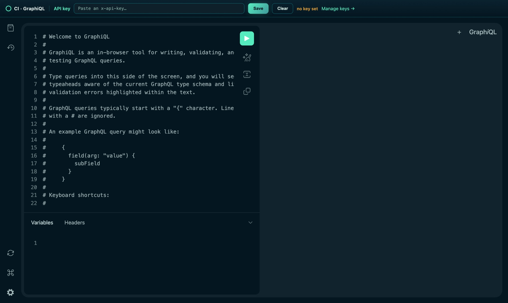
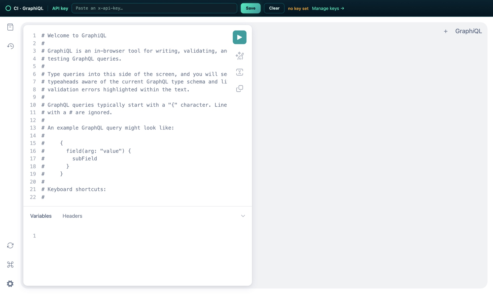

# GraphiQL IDE & GraphQL developer workflow

> **The GraphQL API reference has moved to [`docs/api/graphql.md`](api/graphql.md)** —
> endpoint & routing, auth/context, the full query & mutation catalog, the bulk-ingest
> contract, key types, and error semantics. Auth mechanics (sessions, API keys, OIDC) are in
> [`docs/api/auth-and-conventions.md`](api/auth-and-conventions.md).
>
> This page keeps what those references don't cover: the in-app **GraphiQL** IDE (how to
> open, authenticate, and re-theme it) and the **schema/codegen workflow** for developers
> changing resolvers.

## Quick orientation

- Endpoint: `POST /graphql` on the API, called same-origin from the browser as
  `/api/graphql` (the proxy strips `/api`). Details:
  [api/graphql.md §1](api/graphql.md#1-endpoint--how-to-call-it).
- Every resolver requires a credential — session JWT Bearer, `x-api-key`, or Portal OIDC
  Bearer via `JwtOrApiKeyAuthGuard`, which every resolver but one declares. The exception is no
  looser: `GraphResolver` declares no guard but still refuses an anonymous caller, because its `graph`
  query resolves the user through `toServiceContext`, which throws `UnauthorizedException` when
  the request carries no principal. No GraphQL field is pre-auth.
  Details: [api/auth-and-conventions.md §1–2](api/auth-and-conventions.md#1-authentication-mechanisms).
- API keys are created under **Settings → API Keys** (full value shown once) or via
  `POST /keys` — which needs a browser session or a CI-Portal bearer, never another key;
  send the key as the `x-api-key` header. Details:
  [api/auth-and-conventions.md §1.2](api/auth-and-conventions.md#12-api-keys-programmatic-clients).
- **Create the key without scopes.** A key carrying a non-empty `scopes` array is confined
  deny-by-default to the routes that grant one of its scopes, and no GraphQL resolver declares
  a scope — so a scoped key authenticates and is then refused on every field. Leave `scopes`
  empty (full user authority) for a GraphiQL/exploration key.

```bash
# Query the API with a key
curl -sX POST https://<host>/api/graphql \
  -H 'content-type: application/json' \
  -H "x-api-key: $CI_API_KEY" \
  -d '{"query":"{ events(first: 5) { edges { node { id title } } } }"}'
```

## GraphiQL IDE

CI-Server ships the official [GraphiQL](https://github.com/graphql/graphiql) IDE for
exploring the schema and running queries interactively, themed to the CI palette.



**Availability:** gated by the `graphql.ide` feature flag — on by default, **off in
production** (`config/production.json`), where the route answers 404 and the Settings link is
hidden. Set `ENABLE_GRAPHQL_IDE=true` on a deployment that wants it. The page itself is
static HTML that authenticates per request (below), which is why it is flag-gated rather than
put behind the auth guard.

**Open it:** Settings → **GraphiQL** (opens `/api/graphiql` in a new tab). It's a full-page
IDE served by the API — [`GraphQLController`](../backend/apps/api/src/domains/graphql/controllers/GraphQLController.ts)
returns the page from
[`graphiql.html.ts`](../backend/apps/api/src/domains/graphql/controllers/graphiql.html.ts)
(the markup is inlined as a string, not a static asset, so it ships in the `tsc`-built
`dist` without an asset-copy step).

**Authenticate with an API key:**

1. Create a key under Settings → API Keys.
2. In GraphiQL's top bar, paste it into the **API key** field and click **Save**. It is
   persisted in `localStorage` (`ci-graphiql-api-key`) and attached as `x-api-key` on every
   request; the status pill turns green (`key active`). **Clear** removes it.
3. Run queries. The fetcher POSTs to `/api/graphql`; if a session `accessToken` happens to
   be in `localStorage` it is also sent as a `Bearer` token, so an existing web session
   keeps working without a key.

> Because GraphiQL authenticates per-request from the pasted key (not a cookie/session), it
> works in a standalone tab or bookmark. Access it through the app origin (`/api/graphiql`)
> so the proxy resolves `/api/graphql`; hitting the raw backend port directly won't have the
> `/api` prefix.

**Theming:** the page is themed to the CI palette (mint `#58ebbf` → teal `#409b9b` → aqua
`#00a9a7` on the ink `#041620` ground). GraphiQL 2.x reads its colors from HSL-component
custom properties (`--color-base` / `--color-neutral` / `--color-primary|secondary|tertiary`)
and toggles `body.graphiql-dark` / `body.graphiql-light`; `graphiql.html.ts` overrides those
by mirroring GraphiQL's own theme selectors (so the declarations tie on specificity and win
on source order), and defaults the IDE to CI's dark theme. To re-skin it, edit those variable
blocks. Bumping `GRAPHIQL_VERSION` may change the internal theme selectors — re-check them if
you upgrade. GraphiQL's own light/dark toggle still works — the branding carries across both:



> **User-facing version:** the "API Playground (GraphiQL)" walkthrough for end users lives on
> the **Companion Memory** page in CI-Docs
> (`src/content/docs/apps-available/first-party-apps/companion-memory-server.mdx` → *API Access*).
> The pre-2026-07 slug `/docs/first-party-apps/digital-memory-server` still resolves via a 301.

## Schema & code generation

The schema is **code-first**: it's assembled from NestJS resolver decorators, not
hand-written SDL. `autoSchemaFile` emits the SDL to
[`backend/apps/api/src/domains/graphql/__generated__/schema.graphql`](../backend/apps/api/src/domains/graphql/__generated__/schema.graphql)
— a **generated, do-not-edit** artifact that the frontend codegen consumes.

Regenerate after changing resolvers/types:

```bash
make graphql          # schema (backend) + typed hooks/fragments (frontend)

# …equivalently, run the two halves yourself:
yarn workspace @ci/be-api graphql:generate   # resolvers → __generated__/schema.graphql (no DB needed)
yarn workspace @ci/fe-web graphql:generate   # schema.graphql → frontend/apps/web/src/graphql/
```

The frontend step reads the emitted schema to produce typed documents under
`frontend/apps/web/src/graphql/` (see the web app's `graphql-codegen` setup). If you see
merge conflicts in the generated `gql.ts`/`graphql.ts`, **regenerate** rather than
hand-merging.

## Troubleshooting

| Symptom | Likely cause / fix |
|---|---|
| `401 Unauthorized` from GraphiQL | No/expired key. Create one in Settings → API Keys and Save it in the GraphiQL bar. |
| `Forbidden resource` on every query, with a key that authenticates | The key is **scope-limited**. GraphQL resolvers declare no scopes, so deny-by-default refuses them. Use an unscoped key. |
| `Error fetching schema` in production | Introspection is off when `NODE_ENV=production` (`domains/graphql/index.ts:122`). Queries still work; the schema explorer does not. |
| `Error fetching schema` in GraphiQL when hitting the backend port directly | The fetcher targets `/api/graphql`; open GraphiQL via the app origin (`/api/graphiql`) so the proxy maps `/api/graphql` → `/graphql`. |
| `Query is too complex: N` | Exceeds `graphql.maxQueryComplexity` (150 — [api/graphql.md §1](api/graphql.md#1-endpoint--how-to-call-it)). Request fewer fields / smaller `first`, or raise the limit in config. |
| HTTP 413 on a big mutation | The 10 MB `/graphql` body limit ([api/graphql.md §1](api/graphql.md#1-endpoint--how-to-call-it)); split the batch. |
| Frontend types out of date after a resolver change | Run `make graphql` (or the two `graphql:generate` steps). |
