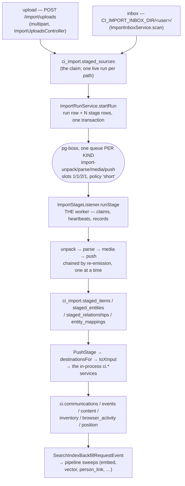

# The import ETL, for the agent who has to fix it

> **Private & Confidential — Property of Lifescope Inc. Do not distribute.**

You have been handed a bug in the import system and no context. This document is
the context. It is written for an AI agent as much as for a person, so it
optimises for one thing: being able to answer, from a cold start, **what ran, how
long it took, what it produced, what it dropped, and why** — with a query or a
file path for every answer rather than a story.

Everything here was verified against the tree at `origin/main` (`93fc6d8a9`) and
against a live 13-source import in flight on 2026-08-19. Numbers are measured,
not estimated, and the query that produced each one is included so you can
re-measure rather than trust this file. Where something could not be verified it
says so out loud — a confident wrong sentence here is worse than a missing one,
because the next agent will act on it.

> **Code re-verified against `ead9fb425` later on 2026-08-19** (tree only — the
> measured counts below are still the earlier readings and are labelled as
> such). What moved: the doctor registry is **23** checks, not nineteen, and
> `comms-missing-thread-id` is now `medium`; every check that named a backfill
> migration was repointed off it — to the guard it copies where one exists, to
> `null` where none does (five of the ten `mirrors` values `75ecc6c7a` touched
> went to `null`, and `events-timestamped-at-import` still names a migration);
> `DESTINATION_ORDER` puts **events before content**, which this file previously
> stated backwards;
> `destinationsFor` gained a route-nowhere branch for `contact.card` and a
> content-skipping branch for social affiliations; `isNotAPlaceName` grew a
> fourth arm; every stage now writes a structured `detail.summary` under a closed
> drop vocabulary; and `push`'s `partial` no longer keys off
> `entities.unresolved`.

> **This file has already been wrong once, in the worst direction.** The revision
> written against `5f29d3fdb` told you that `ci doctor` did not exist and
> not to cite it. It had merged as [#2105](https://github.com/companionintelligence/CI-Server/pull/2105)
> a few hours later, so every reader who believed §6 hand-typed a fifteen-query
> baseline instead of running the nineteen-check suite that already existed. Two
> more sections went stale the same way when
> [#2100](https://github.com/companionintelligence/CI-Server/pull/2100) split the
> stage queue per kind and made the inbox per-user. Re-verify before you cite;
> correcting what you find is part of your change.

**Companion docs.** The command line: [`docs/cli/ci.md`](../cli/ci.md).
The last full acceptance pass, with real archive numbers:
[`docs/runbooks/import-acceptance-2026-08.md`](../runbooks/import-acceptance-2026-08.md).
The enrichment half that runs *after* an import:
[`docs/runbooks/pipeline-operations.md`](../runbooks/pipeline-operations.md).
The wire contracts: [`docs/api/graphql.md`](../api/graphql.md) and
[`docs/api/rest.md`](../api/rest.md). Wiping and starting over:
[`INGEST_RESET_RUNBOOK.md`](../../backend/apps/api/db/postgres/INGEST_RESET_RUNBOOK.md).

---

## 0. The six questions, and where each answer lives

Start here. Every one of these is a single statement against the appliance
database or a single command; none of them needs the UI, and none of them needs
this document.

| Question | Answer lives in | Get it with |
|---|---|---|
| **Is the data it wrote sound?** | 23 checks over `ci.*`, `ci_search.*`, `ci.pipeline_*` | `ci doctor` — see [§6](#6-what-to-measure--ci-doctor). Ask this first; the four below are the drill-downs |
| What ran? | `ci_import.import_runs.data_sources`, `ci_import.import_stages.kind` | `select label, status, percent, data_sources from ci_import.import_runs order by started_at;` |
| How long? | `import_stages.duration_ms`, `.items_per_sec`, `.started_at/.finished_at` | `select kind, processed, total, round(duration_ms/1000.0,1) secs, items_per_sec from ci_import.import_stages where run_id = '…' order by seq;` |
| What did it produce? | `import_stages.detail` (per stage), then the `ci.*` tables | `select jsonb_pretty(detail) from ci_import.import_stages where kind='push' and run_id='…';` |
| **What did it drop?** | `detail->'summary'` on **every** stage (`consumed`/`produced`/`dropped`, `dropsByReason`, `gaps`); the older per-stage keys are still there — `detail->'sources'->N->'drops'` (parse), `detail->'rejected'` (unpack), `staged_items.push_status='failed'` + `.push_error` (push) | `ci doctor`, then the drop-ledger queries in [§6.2](#62-what-did-it-drop--the-single-most-useful-query-here) |
| Why? | `import_stages.error` **and `detail->'summary'->'failure'`** (the same facts as fields: `dataSource`, `file`, `destination`, `phase`), `staged_items.push_error`, `staged_entities.push_error`, then `ci.pipeline_dead_letters` for the enrichment half | `select kind, status, error, detail->'summary'->'failure' from ci_import.import_stages where error is not null;` |

If the answer to any of those is "the table does not say", that is itself the
bug worth fixing — this system's whole design premise is that a half-worked
import is normal and must be *legible*, never a silent success.

---

## 1. The shape

### 1.1 The path a byte takes



Two structural facts fall out of that picture and explain most of the system's
behaviour:

**A stage is a durable row, not a long-lived job.** `ci_import.import_stages` is
the truth; the pg-boss job only says *which row*. `types.ts` says why: a payload
carrying state would be a second copy of the run, written when the job was
enqueued and stale by the time a retry picked it up. Chaining is by
re-emission — a stage that completes enqueues the next one
(`ImportRunService.advance`) — so a killed worker resumes at stage granularity
instead of restarting a 40GB import.

**The run row is a cache.** `import_runs.status` and `.percent` are recomputed
from the stage rows on every transition (`refreshRunRollup`). Nothing ever reads
them to decide whether work remains. If you are debugging "the bar says X but
reality is Y", the stage rows are right and the run row is stale, never the other
way round.

### 1.2 The files, by name

| Concern | File |
|---|---|
| Queue names, stage kinds, per-kind slot counts, weights | `backend/apps/api/src/domains/import/constants.ts` |
| The one event | `.../import/events.ts` (`import.stage`) |
| Payload + `StageRunner` / `StageOutcome` contracts | `.../import/types.ts` |
| **The worker** (claim, heartbeat, progress throttle, failure recording) | `.../import/listeners/ImportStageListener.ts` |
| Run/stage spine (start, advance, resume, cancel, retry, rollup) | `.../import/services/ImportRunService.ts` (1,525 lines) |
| Stage runners | `.../import/stages/{UnpackStage,ParseStage,MediaStage,PushStage}.ts` |
| Archive extraction, zip-slip and cap enforcement | `.../import/archive/{extract,unpack,repairEntryNames,systemExtract}.ts` |
| Recognition + the 71 parsers | `.../import/datasources/` (`registry.ts`, `index.ts`, one file per source) |
| Staging writer, within-run dedupe, drop **and keep** ledgers | `.../import/staging/{StagedWriter,identity,contentDigest}.ts` |
| Staging writer, within-run dedupe, drop ledger | `.../import/staging/{StagedWriter,identity,contentDigest}.ts` |
| **Per-stage telemetry**: the closed drop vocabulary, the `consumed = produced + dropped` summary, the failure context | `.../import/telemetry/{dropReasons,stageSummary,stageError}.ts` |
| **Routing**: one staged row → which destinations | `.../import/push/canonical.ts` (`destinationsFor`) |
| **Mapping**: canonical record → each destination's DTO | `.../import/push/inputs.ts` (`toXInput`) |
| **Commerce vocabulary**: which metadata key means what, and every spelling a reader tolerates | `.../import/push/commerceKeys.ts` |
| Receipt discovery in mail archives (`isLikelyReceipt`, field extraction) | `.../import/datasources/receipt_detect.ts` |
| Graph entities + the "is this actually a name" guard | `.../import/push/entities.ts`, `.../graph/utils/participantSanity.ts` |
| Owner/self resolution (message direction) | `.../import/push/self.ts` |
| Inbox scan/claim | `.../import/services/ImportInboxService.ts` |
| **Per-user inbox path, roots containment** | `.../import/sources/importRoots.ts` (`userInboxDir`), `.../import/sources/sanitizeFilename.ts` |
| Per-service inbox drop folders | `.../import/sources/inboxFolders.ts`, fed by `.../import/sources/guides.ts` |
| Acquisition (rename, EXDEV copy fallback, crash recovery) | `.../import/sources/localAcquire.ts` |
| Scratch tree lifecycle | `.../import/services/ImportScratchService.ts` |
| **Data-quality checks** (`ci doctor`) | `.../import/doctor/checks.ts`, `.../import/doctor/ImportDoctorService.ts` |
| REST surface | `.../import/controllers/{ImportRunsController,ImportInboxController,ImportUploadsController,ImportDoctorController}.ts` |
| CLI | `backend/apps/cli/` — its own workspace, `@ci/cli` (see [`docs/cli/ci.md`](../cli/ci.md)) |
| Web UI | `frontend/apps/web/src/pages/ImportPage/` (`StageBar.tsx`, `RunPipeline.tsx`, `wizard/LiveRun.tsx`, `useImportApi.ts`) and `frontend/apps/web/src/components/ImportActivity/` (the region pinned to the Import and Jobs pages) |

### 1.3 The four stages, and what each one can lose

| Stage | Weight | Does | Loses, if anything, at |
|---|---|---|---|
| `unpack` | 20 | Acquires the source **by rename**, expands through the guarded extractor (zip-slip, entry/byte caps), recursively expands nested archives, flattens the `Takeout/` wrapper, strips symlinks | `detail.rejected[]`, `detail.extractionLoss`, `detail.symlinksRemoved` |
| `parse` | 35 | Recognises data sources under the tree, then runs one parser per match into `StagedWriter` | `detail.failures[]` (a parser that threw), `detail.sources[N].drops` (records a parser deliberately discarded), `detail.sources[N].itemsDeduped`. Its opposite, `detail.sources[N].keeps`, counts records a gate would have discarded and the parser rescued — deliberately NOT folded into `drops` |
| `media` | 30 | Uploads every staged row's bytes to the object store and stamps `metadata.FileId` | `detail.failed`; a row whose bytes could not be read gets `metadata.FileMediaError` and is skipped by the resume query |
| `push` | 15 | Fans each staged row through `destinationsFor` into the in-process `ci.*` services | `staged_items.push_status='failed'` + `.push_error`; `detail.entities.unresolved` |

Those per-stage keys are the originals and still mean what they meant. **Every
stage now also writes a structured `detail.summary`** (`SUMMARY_KEY`,
`telemetry/stageSummary.ts`) that answers the same questions uniformly —
`consumed` / `produced` / `dropped`, a `drops` slug ledger, the same drops folded
into the closed `dropsByReason` vocabulary, the `gaps` subset, and per-unit rows
(a parse's units are data sources, an unpack's are archives, and a push's are
data sources too — `unitKind: 'data_source'`, plus one synthetic `(entities)`
unit — **not** the `ci.*` tables it wrote into). See [§6.2](#62-what-did-it-drop--the-single-most-useful-query-here).

Weights are wall-clock proportions from real imports, not equal quarters
(`IMPORT_STAGE_WEIGHTS` in `constants.ts`). `media` is weighted 30 because on a
photo archive it is the longest leg — it talks to the object store while parse
reads a tree and push writes Postgres.

**A stage that half-worked is not a failure.** `StageOutcome.partial` rolls the
run up as `partial` — terminal and success-ish — rather than `failed`. This is
deliberate and load-bearing: reporting five-of-six-sources as a failure is what
teaches people to re-upload 40GB because one parser met a file it disliked.
`partial` runs stay eligible for a later `push` (see `PUSH_ELIGIBLE_WHERE` in
`ImportRunService.ts`); `cancelled` ones do not.

### 1.4 One queue per stage KIND, and what that costs

> **Changed by [#2100](https://github.com/companionintelligence/CI-Server/pull/2100).**
> Until commit `507c1e2f1` there was a single `import-stages` queue at
> `localConcurrency: 1`, so exactly one stage of any kind ran appliance-wide.
> An earlier revision of this document said so, and it is no longer true. If you
> are reading a comment, a PR body or a runbook that says "one stage at a time,
> appliance-wide", check its date.

`ImportStageListener` now declares **four** handlers, one per stage kind:

```ts
@OnEvent(ImportStageEvent, {
  queue: IMPORT_STAGE_QUEUE_BY_KIND.parse,          // 'import-parse'
  queueOptions: { policy: 'short', role: 'worker', localConcurrency: IMPORT_STAGE_CONCURRENCY.parse },
})
```

`localConcurrency` is an in-process `p-limit` semaphore
(`PGBossEventService.onModuleInit`), and `role: 'worker'` means only the headless
worker process consumes the queue. `IMPORT_STAGE_CONCURRENCY` in `constants.ts`
is the whole scheduling policy:

| Queue | Slots | Why that number (from the source comment) |
|---|---:|---|
| `import-unpack` | 1 | Two archives' disk preflights could both pass and then jointly fill the volume |
| `import-parse` | 1 | Long synchronous parser stretches plus a firehose of staged-row writes; two abreast is how the event loop starved |
| `import-media` | 2 | I/O-bound against the object store, so two overlap fine |
| `import-push` | 1 | Concurrent pushes into shared `ci.*` are an untested dedup path (two runs resolving the same person at once), and push is fast enough that serial costs nothing |

So up to **five** stages can be in flight at once in one worker process, but never
two of the same kind. `IMPORT_QUEUE` (`'import-stages'`) still exists as a
**drain** for jobs an older release left queued, and as the fallback for the
deleted-stage race in `enqueueStage`; new work never targets it.

A run's own stages are still strictly ordered — chaining is by re-emission — so
the split changes only *cross-run* scheduling.

> Strictly: the semaphore is per consuming process. Two worker replicas would
> double every slot count. Nothing in this repo deploys two, but do not read
> these numbers as an invariant enforced anywhere; they are a consequence of the
> `Procfile` topology (`api: CI_ROLE=web`, `worker: CI_ROLE=worker`) and of the
> single-process `CI_ROLE=all` topology tests and standalone `yarn dev` use.
> The global per-queue default is six (`config/default.json` →
> `queues.perQueueConcurrency: 6`); every import queue overrides it.

**Measure the overlap rather than believing either version of this paragraph.**
This is the query that distinguishes them, run against the live 13-source import
on 2026-08-19:

```sql
select a.kind as ka, b.kind as kb, count(*) as n
  from ci_import.import_stages a
  join ci_import.import_stages b
    on a.id < b.id
   and a.finished_at is not null and b.finished_at is not null
   and a.started_at < b.finished_at and b.started_at < a.finished_at
 group by 1, 2 order by 3 desc;
--  ka    |  kb    | n
-- parse  | push   | 7
-- media  | push   | 7
-- parse  | media  | 6
-- push   | parse  | 4
-- media  | parse  | 4
-- media  | media  | 1
-- push   | media  | 1
```

Read it as a check on the table above, not as a performance number: **every pair
that overlapped is a pair of different kinds, except `media`×`media`, which has
two slots.** There is no `parse`×`parse`, no `push`×`push`, no
`unpack`×`unpack` row — the slot counts are doing exactly what they say. If you
ever see a same-kind pair for a one-slot kind, either a second worker process is
running or the `localConcurrency` on that handler changed.

What has *not* changed is the shape of a big import: `parse` is still one at a
time and still dominates. On the pre-split run of the same corpus the Google
Takeout parse took 703,956 items in **45.6 minutes**, 65% of the whole batch's
wall clock, with twelve runs waiting. Per-kind queues let those twelve runs'
media and push legs proceed meanwhile; they do not make the parses overlap. So:

- **Do not read "queued for an hour" as a hang.** `GET /import/runs/active`
  answers this directly and is the endpoint to poll or curl: it separates
  `queueState: 'waiting'` (enqueued, needs a slot) from `'blocked'` (its own run
  has not reached that stage), reports `queuePosition` and `queue.concurrency`,
  and names which source each run is importing. Both states are `status:
  'queued'` in the database, and conflating them is exactly why a normal
  51-minute wait is indistinguishable from a stall.
- **A per-run ETA is not a system ETA.** `import_stages.eta_seconds` describes
  the stage that is running. Everything queued behind it has an unstated wait
  equal to the sum of the work in front of it *on its own queue*.
- **A throughput fix on the biggest parser is still worth more than parallelism
  anywhere else**, because the parse total is still a sum.
- **The inbox starts units smallest-first** (`ImportInboxService`,
  `prepared.sort((a, b) => a.sizeBytes - b.sizeBytes …)`), so the 350GB archive
  is deliberately last and the small sources land early.

### 1.5 Crash recovery, and why the timings are what they are

| Constant | Value | Where | Why |
|---|---|---|---|
| `PROGRESS_THROTTLE_MS` | 1,000 ms | `ImportStageListener.ts` | A parse ticking per record would write a row per record for the length of a 40GB import |
| `IMPORT_STAGE_HEARTBEAT_SECONDS` | 30 s | `constants.ts` | Keeps the claim fresh through silent stretches (a giant archive mid-extract says nothing for minutes). Every threshold below is a multiple of it |
| `IMPORT_STAGE_STALLED_SECONDS` | 90 s (3 beats) | `constants.ts` | A `running` stage silent this long is reported **stalled** — on the run detail, the active snapshot, `ci runs` and the import activity panel. A report, never an action |
| `IMPORT_STAGE_ORPHAN_SECONDS` | 180 s (6 beats) | `constants.ts` | A stage claimed through a pg-boss job and silent this long is taken back, and the job **failed through pg-boss**, which retries it in place (same id, same place in line) or dead-letters it. Short is safe because the reaper never touches a stage its own process is running, and claims are fenced — see below |
| `ORPHAN_REAP_CRON` | `15 * * * * *` | `ImportStageListener.ts` | The orphan reaper, every minute (and at boot, inside the sweep) |
| `STALE_STAGE_MINUTES` | 10 | `ImportRunService.ts` | The **backstop**: claims no pg-boss job holds (in-process connector runs, pre-claim-ownership rows) and anything the reaper failed to handle. A live stage is never silent this long |
| `RESUME_SWEEP_CRON` | `30 */5 * * * *` | `ImportStageListener.ts` | Recovery is periodic, not boot-only, so a crash is picked up without a restart |
| `STAGE_FAILURE_RECORD_RETRY` | 10 min budget, 1s → 30s | `ImportStageListener.ts` | A failure is recorded through a database that is away (not ready *or* crashed), so the sweep never re-runs a stage whose failure write was lost |

Every recovery gate is a **staleness test on `updated_at`**, never an assumption
about who else is running. The comment on `resumeInterrupted` records why: the
first version assumed "at bootstrap, any running stage is orphaned", and a dev
restart that leaked the old process disproved it — two executors interleaved
progress writes with different totals on the same stage. The one thing a
process does know for certain is what IT is running, so both recovery passes
take the caller's live stages (`liveStageIds`) and never touch them, however
silent — a parser blocking the event loop, or a database away, no longer costs
a stage to the very process running it.

**Claims are fenced.** `claimStage` mints a `claim_token` per claim and records
the delivering job (`claim_job_id`, `claim_queue`); the listener's heartbeat,
progress, completion and failure writes all land only while the token still
matches, and both recovery passes clear it. A worker that was only slow and lost
its stage therefore finds out at its next beat or progress report, stops, cannot
complete the stage or advance the run behind its replacement, and acknowledges
its delivery with `defer` — pg-boss re-issued the job under the same id, so
completing it would mark the replacement's job done.

**A dead worker is retried, and pg-boss counts the retries.** The orphan
reaper (`ImportRunService.reclaimOrphanedStages`) fails the dead worker's job
through pg-boss rather than enqueueing a new one: the retry keeps the job's id
and `created_on`, so the interrupted run resumes at the head of its kind's queue
instead of behind every run that queued meanwhile, and nothing is left `active`
for a twelve-hour lease. It also means the queue's `retryLimit: 3` applies: a
stage whose worker dies a fourth time is FAILED, with its job dead-lettered and
a message saying the worker kept dying — where the ten-minute sweep would have
re-run a worker-killing stage forever. Stage `detail.interrupted` records each
take (when, how far it had got, which retry is next); `ci runs <id>` prints it.

**Failure is recorded, not retried.** A throw fails the stage and is rethrown so
pg-boss dead-letters it, but the redelivery is a deliberate no-op: `beginStage`
only claims a `queued` stage, so a redelivered job for a `failed` stage logs and
returns (the queue's `retryLimit: 3` with backoff therefore re-runs nothing for a
*recorded* failure, and neither does the recovery sweep, which leaves a `failed`
stage alone — the retries it does spend are on workers that died, above). That
holds only if the failure is actually *recorded* — a stage left `running` is
exactly what the recovery sweep re-queues after `STALE_STAGE_MINUTES` — so
`ImportStageListener` records it through an absent database:
`STAGE_FAILURE_RECORD_RETRY` waits up to ten minutes (1s → 30s backoff), through
a crash as well as a not-ready server, since the record is bookkeeping by id that
cannot be what crashed anything. The failure most likely to meet an absent
database is one the database caused (a push that crashed Postgres, below), and
unrecorded it would crash the database again every sweep. Past the wait the
failure is logged unrecorded and the staleness rule applies as before.
Re-running a failed stage is a user action —
`POST /import/runs/:runId/stages/:stageId/retry`, or
`POST /import/runs/:runId/push/retry` (`ci push --run <id> --retry-failed`) for
individual rows the push could not write. The push retry also re-drives a push
stage that ran and failed — rows still `pending`, or all settled and it died in
the close-out. It refuses (409) while any stage of the run is still working (a
stage left `running` in a *finished* run and silent past `STALE_STAGE_MINUTES`
does not count — `cancel()` closed the run while its worker died), while a stage
ahead of the push did not complete (a run cancelled mid-parse is half staged;
retry that stage first), and when the push itself never ran (cancelled or failed
before a worker claimed it — the stage retry is the explicit way to run it). The
push stage is reopened only from the status that was read, because `retryStage`
and a claiming worker move stages without the run lock.

**Inside the push, a database that is not ready is waited out, not recorded.**
Every database step in `PushStage` goes through `retryOnTransientDatabaseError`
(`common/persistence/transientDatabaseError.ts`), which classifies code-first. A
server that never took the statement — SQLSTATE 57P03 ("in recovery mode", "not
yet accepting connections"), 53300, 08001/08004, a refused or unreachable socket
(ECONNREFUSED, EHOSTUNREACH, ENETUNREACH, EAI_AGAIN, a `connect` ETIMEDOUT), a
pool connect timeout (`isDatabaseNotReadyError`) — is retried on a doubling
backoff (1s → 30s cap, three-minute budget), batch as a batch. Past the budget the
stage fails with every unwritten row still `pending`. No failure of the database
being away (`isTransientDatabaseError`) ever degrades a batch to per-row or
quarantines a row: a row is `failed` only for something the database said about
that row. Before this, a Postgres crash-restart mid-push marked 437 good rows
`failed` with "the database system is in recovery mode", on a run nothing would
ever push again.

**…but a database that crashed with a statement in flight stops the push.** A
statement can *crash* Postgres (a TimescaleDB 2.28 segfault during a bulk upsert
is the precedent), and from the client "met a crash" and "caused one" are the
same error. So a failure that ended the session with the statement possibly in
flight (`isDatabaseCrashError`: 57P01/57P02, 08000/08003/08006, ECONNRESET,
EPIPE, an ETIMEDOUT on an open socket, pg's bare "Connection terminated
unexpectedly" — which pg also raises for a socket closed during connect, and
which is a crash because nothing on the error tells the two apart) is **never
resent in-process and never written off against a row**. Wherever it lands — a
destination write, the entity lane and the receipt place lookup (both read from
the message half of ingest's `entity <key>: <message>` text — ingest catches a
batch-level failure and returns it as data, so a crash there is not a throw), the
shared-content edge write, a read, a ledger write — the stage fails at once with
`DatabaseCrashedDuringPushError`:

```text
the database crashed while this push was writing 500 communications record(s);
rows are left pending — re-drive with `ci push --run <id> --retry-failed` once
the database is healthy (last error: Connection terminated unexpectedly)
```

One crash per stage attempt, whatever caused it; every unsettled row stays
`pending`; an error log line (`The database crashed with these staged rows in
flight; the push stops here`) names the first and last staged item id and the
data sources of the batch in flight. Re-drive it with `--retry-failed` once the
database is back. If the re-driven push crashes the database again at the same
place, the data in that batch is the suspect — it costs one crash per re-drive,
so do not loop it. **Automatic poison-row isolation is a known follow-up, not
done here.** An in-process version (resend the batch once, then each row alone,
quarantine the row that crashed it twice) was tried and withdrawn: it crashed the
server four times per poison row, never isolated the row when crash recovery
took more than about a minute, crashed it dozens of times and quarantined good
rows when *every* write crashed the server, and left the entity lane resending
a crashing batch ten times.

**Known follow-up, pre-existing and not fixed here: `GraphIngestService.indexIdentifiers`
swallows any error, a crash included.** After the entities are upserted, ingest indexes
their email/phone/name identifiers in one more statement that only logs (`Failed to
index entity identifiers`) and returns, so `ingest` still reports every entity as
resolved and the push marks the staged row `pushed`. A crash in that statement is
therefore not a stage failure and the push carries on — so it breaks the "one crash per
stage attempt" promise above, and if the identifier insert is what takes the server
down, every batch does it again. The rows' identifiers are silently missing rather
than the run reporting anything; `EntityIdentifierBackfillService` (maintenance) can
rebuild the index for Person rows from their `properties`. Making the swallow raise
would have to distinguish a crash from a refusal there without failing an ingest whose
entities did land — the same message-half reading the two lanes above use is the
starting point.

**The sweep re-enqueues waiting stages, and only `policy: 'short'` stops it.**
`resumeInterrupted` judges staleness from `import_stages.updated_at`, which
nothing advances while a stage merely waits its turn — so every waiting stage
crosses `STALE_STAGE_MINUTES` and collects a fresh job on every sweep. Measured
before the fix: **16 distinct stage ids holding 107 pending pg-boss jobs after 47
minutes**, growing linearly. `enqueueStage` now passes `singletonKey: stage.id`,
which only bites because the four per-kind queues are declared `policy: 'short'`
— pg-boss 10's unique index on `(name, singleton_key)` is partial,
`WHERE state='created' AND policy='short'`, and under the default `standard`
policy a `singletonKey` is **stored and never enforced**. Confirm on any
appliance:

```sql
select name, policy from pgboss.queue where name like 'import%' order by 1;
--  import-inbox-provision | standard
--  import-media           | short
--  import-parse           | short
--  import-push            | short
--  import-stages          | standard      ← the legacy drain, deliberately
--  import-unpack          | short
```

Live on 2026-08-19: 4 queues `short`, 29 `standard`. That ratio is the trap —
see [§4.5](#45-a-test-that-would-pass-with-the-fix-reverted) for the fix whose
whole mechanism was inert for exactly this reason, with a green test.

---

## 2. Where data goes

### 2.1 Two functions decide everything

Every staged row becomes a `CanonicalRecord` (`toCanonical` in
`push/canonical.ts`), and then two functions decide its fate:

1. **`destinationsFor(rec): Destination[]`** — *which tables*. One row can
   legitimately reach several: a geotagged photo is both a timeline capture and
   a GPS donor.
2. **`toXInput(rec)`** in `push/inputs.ts` — *what shape* each destination gets.

`PushStage` groups a 500-row batch by destination and calls the in-process
service once per destination per batch. `DESTINATION_ORDER` fixes that order and
it is **load-bearing**, in the opposite direction an earlier revision of this
document claimed:

```ts
// PushStage.ts
export const DESTINATION_ORDER: readonly Destination[] = [
  'communications', 'events', 'content', 'inventory', 'browser_activity', 'position',
];
```

**Events before content.** `ContentService.createManyDetailed` resolves
`ci.content.event_id` from the provenance triple (`resolveEventIdsByTriple`) *at
INSERT time*, so writing content first asks for an event row that does not exist
yet and leaves the column NULL — and `findMediaFilesByEventIds`, the query behind
every gallery, list and drawer thumbnail, filters on `content.event_id`. Measured
on a 1,393,402-record corpus imported with content ahead of events: **0 of
41,851** content rows carried an `event_id`, while 2,916 shared a triple with an
event and should have. Fixed in commit `a02540179`.

### 2.2 The routing table, as the code has it today

`kind` comes from `kindFor(classification, mediaType)` — the coarse importer
`classification` mapped onto the closed G1 capture-kind taxonomy. Read
`destinationsFor` top to bottom; the first match wins.

| Condition | Destinations |
|---|---|
| any record whose `identifiers` include a **globally-unique** one (ISBN/ASIN/GTIN/IMEI/VIN) | `product_models`, **prepended** to whatever the kind gives it |
| `isRedditPost` / `isRedditComment` | `communications`, plus `content` when `redditMediaUrl` finds media |
| `commerce.purchase` with `metadata.Subscription === true` | `receipts` (a subscription fee is a service, so no `inventory`/`content` row — but it is a real purchase and the money must be visible) |
| `commerce.purchase` otherwise | `receipts` + (`content` if `isDigitalGood`, else `inventory`), plus `observations` when a physical good carries a globally-unique identifier |
| …any `commerce.purchase` carrying `metadata.ReceiptRollupId` | the `receipts` half is dropped — the per-order aggregate already itemises this line (`amazon.ts` stamps the marker) |
| `commerce.receipt` (a detected order-confirmation email) | `receipts`, plus `communications` when `metadata.HumanCorrespondence === true` |
| any other `commerce.*` | `events`, plus `receipts` when the record carries `metadata.LineItems` |
| `communication.*` | `communications`, plus `position` if geotagged |
| `web.bookmark` | `content` |
| `web.page_view`, `web.search` | `browser_activity`, plus `position` if geotagged |
| `calendar.event` | `events`, plus `content` **only** if it carries a real file |
| `media.play` / `.watch` / `.listen` / `.read` | `events` + `content` |
| `media.saved` | `content` (a library artifact has no occurrence) |
| `note`, `reading.annotation` | `content` |
| **`contact.card`** | **nothing** (the parser already emits the card as a `Person` on the entity lane, and being undated it is not an occurrence either) |
| `social.*` where `isSocialAffiliation` matches | `events` alone, plus `position` if geotagged |
| any other `social.*` | `events` + `content`, plus `position` if geotagged |
| `travel.trip` | `events` |
| `location.fix` | `events` + `position` when `eventType === 'place'`; otherwise `position` **alone** |
| **undated** `capture.*` or `import.archive_item` | `content` alone |
| dated `capture.*` | `events` + `content`, plus `position` if geotagged |
| anything else | `events` |

Three of those branches are scar tissue worth internalising, because they are the
shape of every future routing bug:

- **`location.fix` without `eventType='place'` leaves `events` entirely.**
  Before that branch the timeline drowned in millions of GPS trackpoints.
- **Dated `capture.*` always takes a `content` row alongside its event.**
  `EventMediaLoader` resolves an event's thumbnail by INNER JOINing `ci.content`
  on `ci.events` through the provenance triple. A destination list of just
  `['events']` never creates that row, so the join finds nothing. Measured on a
  real import: 2,098 photo/video events, **0** with a linked content row — every
  gallery tile blank.
- **A row with no body does not get a `content` row.** Affiliation-shaped
  `social.*` — a LinkedIn connection, a moderated subreddit — keeps its `events`
  home and skips `content` (`336a71951`, PR #2152), and `contact.card` routes
  **nowhere at all** (`01cd5e776`); both 2026-08-19. `ci.content` has no title
  column, so a row with a NULL `text` and a NULL `url` renders as nothing in
  every Content view. Measured on a fresh full-corpus import carrying every fix
  merged that day: **4,870** `ci.content` rows typed `'file'` from `vcard`,
  **2,085** of them with neither text nor url — a "file" pointing at no file.
  The facts are not lost either way: the connection is a `ci.entities` Person
  carrying the profile URL plus a dated social event, the subreddit is an event
  titled `r/<sub>`, and the contact card was already emitted as a `Person` on the
  entity lane by `vcard.ts` / `contactlist.ts` / `applecontacts.ts`.

The lesson generalises in both directions. **`destinationsFor` returning too few
destinations is invisible**: nothing errors, and you get an empty gallery, an
empty map, or a missing search hit, weeks later. **Returning too many is equally
invisible**, and produces body-less rows that occupy a view and say nothing. Ask
of each destination "what does this row *render* as there?" — and note that a
routed-nowhere row is now recorded rather than hidden: `PushStage` marks it
skipped with `NO_DESTINATION_REASON` and the stage summary counts it under the
`no_destination` drop reason, which is classified a **gap**, not an expected
outcome. The exception is a row routed nowhere **by design because another lane
carries it** — a contact card (its Person arrives on the entity lane) or a
rolled-up subscription line (its order's itemised receipt holds it). Those are
named by `push/canonical.ts isRepresentedElsewhere`, marked with
`REPRESENTED_ELSEWHERE_REASON`, and counted under `represented_elsewhere`, which
is **expected**: still visible in `dropsByReason`, not in `gaps`. Adding a new
`[]` branch to `destinationsFor` reads as a gap until you list it there on
purpose — that default is deliberate.

**A purchase ALWAYS produces a receipt**, and that is the third scar. The
receipt is what carries the merchant, the money and the moment; an
`ci.objects` row alone cannot answer "where did I buy this?" and has no
timeline presence at all. Before the commerce plane, a subscription fee routed
NOWHERE and its spend was invisible.

### 2.2.1 The commerce plane, and the order it is written in

Three destinations, three questions, three tables:

| Destination | Table | Answers | Written by |
|---|---|---|---|
| `product_models` | `ci.product_models` | WHAT the thing is, independent of this purchase | `ProductModelService.createManyDetailed` + `ObjectIdentifierService.upsertForSubjects` |
| `receipts` | `ci.receipts` + `ci.receipt_line_items` | WHEN and WHERE money changed hands, and for WHAT | `ReceiptService.upsertFromExtraction` |
| `observations` | `ci.object_observations` | THAT an identified object was somewhere at some moment | `ObjectObservationService.createMany` |

Four things about this that are easy to get wrong:

- **`product_models` is written FIRST** (`DESTINATION_ORDER`, and
  `destinationsFor` prepends it so the two agree).
  `ReceiptService.upsertFromExtraction` resolves each line's product by looking
  up its identifier claim and only falls back to find-or-create by brand+model
  when nothing resolves. Written second, an ISBN the same batch is about to
  catalogue mints a *second*, guessed product row — and
  `ci.object_identifiers` is **first-writer-wins**, so the guess keeps the
  barcode forever.
- **The catalogue row is keyed on the IDENTITY, not on the record.** Its
  provenance triple is `(ci-import-tools, object_identity, '<namespace>:<value>')`,
  so the same ISBN arriving from Goodreads and from an Amazon order is ONE row.
  The parser that minted it is in `metadata.mintedFrom`.
- **The receipt extraction sets `skipMint: true`.** The importer already owns
  the `ci.objects` row for a purchase (`toInventoryInput`); letting
  `ObjectMintService` create a unit from the same line is a duplicate
  possession with no way to tell which is real.
- **Money is integer MINOR units** on `ci.receipts` / `ci.receipt_line_items`.
  The parsers speak major units, so `toReceiptInput` converts through the
  currency's own exponent (`minorUnitExponent`) — dividing yen by 100 turns
  ¥1,200 into ¥12.

`line_number` is 1-based and **stable**: `(receipt_id, line_number)` is the
natural key `replaceLineItems` upserts on, and it folds within-batch repeats
last-write-wins — so two lines sharing a number does not fail, it silently
DELETES one.

**A negative amount is refused, not written.** The canonical TOTAL chain reaches
`Amount` / `Net` / `Gross` / `Total Owed`, which are SIGNED ledger columns:
PayPal books a refund as a negative `Amount`, and `amazon.ts` writes `Total`
verbatim from a CSV that does the same. Neither `ci.receipts.total_minor` nor
`ci.receipt_line_items.total_price_minor` has a CHECK, so `-19.99` landed
silently as `-1999` and every "what did I spend" read summed a credit as a cost.
`toCostMinorUnits` refuses it — on the line's unit price and total, and on the
receipt's total, subtotal and tax — and a refused receipt total does **not** fall
back to the sum of the lines, which would report whatever positive line survived
the same guard. It is refused rather than *modelled* because `ci.receipts` has no
status column to say "this is a credit" with: the lifecycle it carries
(`extraction_state`) is about the READ of the document, not about the purchase.
Modelling refunds honestly needs that column and a migration. The amount is not
dropped on the floor — it stays on the row as `metadata.NegativeTotalRefused`.

**WHERE the purchase happened** is `ci.receipts.place_entity_id`, the `place_prior`
rung `ObjectResolutionService` leans on and the only thing that puts an imported
purchase on a map. It was populated by no import path at all. `PushStage.receiptPlacesFor`
resolves it two ways, in order: a staged edge naming a place entity (relations
`place`/`location`/`venue`/`address`, read back through `ci_import.entity_mappings`
— the same join a message's from/to uses), then the record's own `locationName`
(the allow-listed `Location`/`Place`/`Venue`/`Address` metadata keys), ingested
through `GraphIngestService` under the SAME natural key a staged `place` entity
takes (`place:<lowercased name>`), so the two can never become two nodes for one
location. **Today this rarely fires**: no commerce parser states an address yet,
so the honest reading is that the wiring is in place and waiting on a source that
does. `merchant_entity_id` is still null by choice — resolving every merchant
string into a graph Organization is a node-volume decision that belongs with the
merchant-resolution work, and `merchant_name` already carries the name as printed.

**A rollup marker is computed in a PRE-PASS, never patched on after the push.**
`amazon.ts` emits one item per order LINE and one aggregate per ORDER, and each
line carries `metadata.ReceiptRollupId` naming its aggregate so `destinationsFor`
suppresses the line's own single-line receipt. The aggregate can only be built
after the last file (an order id legitimately spans two CSVs), so the marker used
to be written onto the line items afterwards — safe, the reasoning went, because
`StagedWriter` buffers the graph by reference. It buffers by reference AND
splices the batch out at `DEFAULT_FLUSH_THRESHOLD`, then reads `item.metadata`
inside the write, many awaits later. On a 10-file × 100-line export that left
half the lines marker-less and duplicated their orders. **Anything that is part
of a record's identity must be set before `pipeline.push`.**

### 2.2.2 Receipt discovery in the mail importers

`gmail.ts` runs `isLikelyReceipt` **before** its bulk gate and overrides it,
because `isHumanCorrespondence` rejects Category Promotions/Updates,
`List-Unsubscribe` and `no-reply@` senders — a precise description of how a
merchant sends a receipt.

- Flagged by `CI_IMPORT_RECEIPTS` (default **on**; `0`/`false`/`no`/`off` turns
  it off and restores the old behaviour exactly).
- The override is only as safe as its false-positive rate, so the weak paths
  (a marketing-shaped subject, a shop-shaped sender) require **body evidence** —
  a currency amount AND a receipt structure word. Only an unambiguous subject
  ("Your receipt from …", "Invoice #4417") skips the body.
- A rescued message is counted in the **keep** ledger
  (`detail.sources[N].keeps.receipt_kept_from_bulk`), never in `drops`. The drop
  ledger is the run's loss report; counting a save there reports it as a loss.
- HTML-only bodies are flattened by `email_mime.htmlToText` before the body
  signal reads them, and the body cap rises from 4k to 32k for a receipt (an
  itemised order confirmation IS its body).
- The message ID is **not** affected by that flattening. A message with no
  `Message-ID` falls back to a sha1 of its headers plus its body, and that hash
  is taken over the body as `parseMime` returns it — raw markup for an HTML-only
  message — precisely because it predates `readableBody`. Hashing the flattened
  text would give every such message a new id and fork it from the row a
  previous import already staged, with no migration behind it. **An id must
  outlive a change to how a body is READ.**
- A non-media attachment on a receipt is stamped `receipt_document` instead of
  `file` on the staged `metadata.MediaAttachments` descriptor (`gmail.ts`,
  `email.ts`, and `canonical.communicationMediaAttachments` passes the value
  through). **Nothing consumes it yet.**
  `communicationMediaAttachments` has no callers anywhere in the repo — that is
  pre-existing, not something this work removed — so no `ci.content` row is
  catalogued from it today and no attachment is currently filed as a receipt
  document. The descriptor is written and correct; the reader is missing.

### 2.3 The provenance triple

Every input carries `(source_type, source_system, source_id)`:

- `source_type` is the constant `SOURCE_TYPE = 'ci-import-tools'`
  (`push/canonical.ts`). Deliberately unchanged from the retired standalone
  importer (the repo is now `ZARCHIVED-CI-Import-Tools`) — a row this appliance
  imports must carry the same value the old one wrote historically, or every
  previously-imported record duplicates on the first re-import. **Distinguish the
  retired repo from this still-live constant:** renaming the repo does not rename
  the value, and nothing should.
- `source_system` is the parser's name (`staged_items.data_source`) — the
  *registered* name, which for three importers is not the filename:
  `applecontacts.ts` → `apple_contacts`, `contactlist.ts` → `contact_list`,
  `googlevoice.ts` → `google_voice`.
- `source_id` is **`staged_items.content_hash`**, *not* `staged_items.id`. The
  staging id is a fresh uuid per run; using it would make an identical re-import
  a brand new record instead of the no-op the triple exists to produce.

Idempotency belongs to the destination, not to the push. Nothing in `PushStage`
checks whether a record already exists; the database decides:

```sql
select schemaname||'.'||tablename as tbl, indexname
  from pg_indexes where indexname like '%source_triple%'
   and schemaname not like '\_timescaledb%' order by 1;
```

(The `schemaname` filter matters: `ci.position` is a hypertable, so on a live
appliance the unfiltered query returns one
`_timescaledb_internal._hyper_13_N_chunk_position_source_triple_idx` per chunk —
25 of them on 2026-08-19 — burying the nine rows you wanted.)

| Table | Index | Unique? |
|---|---|---|
| `ci.browser_activity` | `browser_activity_source_triple_uniq` | yes |
| `ci.communications` | `communications_source_triple_uniq` | yes |
| `ci.content` | `content_source_triple_uniq` | yes |
| `ci.events` | `events_source_triple_uniq` | yes |
| `ci.objects` | `objects_source_triple_uniq` | yes |
| `ci.object_observations` | `object_observations_source_triple_uniq` | yes |
| `ci.product_models` | `product_models_source_triple_uniq` | yes |
| `ci.receipts` | `receipts_source_triple_uniq` | yes |
| **`ci.position`** | `position_source_triple_idx` | **NO — plain btree** |

All of them are partial (`WHERE source_id IS NOT NULL`) and keyed
`(user_id, source_type, source_system, source_id)`.

**`ci.position` is the exception and it matters.** `PositionService.create`
decides existence by **`(user_id, time)`** — `deduplicateByTime` collapses the
input batch on the parsed instant, then `findExistingByTimes` skips anything
already at that instant. Consequences, all verified in
`PositionService.ts` / `PositionService.bulk.spec.ts`:

- Two different fixes at the same instant from different sources collapse to
  one, whichever arrives first.
- A re-import with a corrected `name` does **not** update the existing row; it is
  skipped by timestamp before the triple is ever consulted.
- The triple *is* persisted (`toPositionInput` spreads `sourceTriple(rec)`;
  `PositionEntity.sourceType/sourceSystem/sourceId` exist), so the two comments
  in `PushStage.ts` (the batch path and the single-row path) saying "positions
  carry no provenance triple" are **out of date** — still, as of `ead9fb425`
  (lines 1726-1727 and 1824-1825).
  The operative fact — no upsert-by-triple, no per-row upsert report — is
  unchanged.

### 2.4 `INGEST_REFRESH_COLUMNS`: a re-import does NOT repair your data

This is the single most consequential fact in this document.

`backend/apps/api/src/common/persistence/ingestRefreshColumns.ts` is the central
list of columns that a re-ingest of an **existing** provenance triple refreshes
(the `ON CONFLICT DO UPDATE SET` list). Verbatim, today:

```ts
export const INGEST_REFRESH_COLUMNS: Record<IngestEntityKind, readonly string[]> = {
  communication: ['direction', 'participants_metadata', 'content', 'preview', 'subject'],
  event: [],
  item: [],
  content: [],
  browser_activity: [],
};
```

An **empty list means `DO NOTHING`** — find-or-return. The existing row is left
exactly as it is.

The five keys map onto the destinations as: `communication` → `ci.communications`,
`event` → `ci.events`, `item` → `ci.objects` (the `ItemEntity` table),
`content` → `ci.content`, `browser_activity` → `ci.browser_activity`. So:

**for `ci.events`, `ci.objects`, `ci.content` and `ci.browser_activity`, a
re-import repairs nothing** — four of the five kinds in that list.
`ci.communications` self-heals only those five named columns. `ci.position` is
not in the list at all and does not self-heal (§2.3), and neither is
`ci.product_models` — but `ci.receipts` is the exception that does: its header
is a PATCH of the fields an extraction actually supplied
(`ReceiptService.upsertHeader`), and its lines re-upsert on
`(receipt_id, line_number)`, so a re-import genuinely corrects them. This has bitten several
fixes in a row, in both directions:

1. **A code fix alone does not fix the corpus.** "Fixed forward" means *new*
   imports are correct; the rows already there stay wrong forever unless a
   migration corrects them. Migration `20260818224249` exists solely because of
   this: the 92 Amazon Appstore rows typed `'media'` by the pre-fix code "stay
   typed 'media' forever unless corrected directly", quoting its own commit
   (`5dafcf14b`, PR #2079).
2. **A backfill migration can be silently undone.** A row a migration repaired is
   *not* protected: whatever still mints the bad value will write it again on the
   next import, and for `communication` the five refresh columns will actively
   overwrite the repair. See failure mode 3 below for the case where 241 rows
   came back in full.
3. **Sometimes deleting is the only repair.** When the bad rows lack the data
   needed to fix them in place, `DO NOTHING` means a re-import cannot help
   either — so the migration deletes, and the re-import then lands them
   correctly. That is exactly what `20260819001323` does for the contentless
   Instagram rows, and its commit says so: "they cannot be repaired in place (the
   permalink was never persisted) and ingest is find-or-return, so deleting is
   what lets a re-import land them correctly."

**Rule to carry:** whenever you change what a mapper writes, ask *and answer in
the PR body* — "what happens to the rows already in the database?" There are only
three valid answers: this column is in `INGEST_REFRESH_COLUMNS` so a re-import
heals it; here is the migration; or these rows must be deleted so a re-import can
re-land them. "Re-import will fix it" is not one of them unless you checked the
list.

`INGEST_SCHEMA_VERSION` must be bumped alongside any change to those lists, and
the snapshot in `common/persistence/__tests__/ingestRefreshColumns.test.ts`
enforces it.

---

## 3. The failure modes that keep recurring

Every one of these is from this month's fixes on `main`. They are listed as
*classes*, because each has already recurred at least once in a different
disguise — that is why they are in this document rather than only in a commit
message.

### 3.1 A non-place string written into a place-name column

`ci.position.name` and `ci.events.location_name` say **where** something was. A
value that is provably not a place keeps landing in them, and a fake name is
strictly worse than no name: a NULL name is what makes a row a reverse-geocode
candidate, so a fake one guarantees the row is never offered a real one.

Four separate variants, four separate fixes, all in August 2026:

| Variant | Evidence | Fix |
|---|---|---|
| A meeting-join URL (`https://…zoom.us/j/…`, `altspace://…`) in `events.location_name` | 79 calendar rows | `isUriLocation` (`domains/geocode/util/virtualLocations.ts`), gated in `toEventInput` **and** the Google/Outlook calendar transform services; migration `20260818215813` nulls 78 of them (the 79th pairs a Zoom link with a real room designation and is deliberately excluded). Commit `b53f8d52f`, PR #2078 |
| A bare coordinate pair, then a **labelled** one (`Location 33.51469, -117.72169`) | three registered datasources minted the labelled form | `isCoordinateText` widened to tolerate one generic geo noun; `google_location.ts` / `kmlgx.ts` / `nmea.ts` stopped minting the pseudo-name at all; migrations `20260818212254` then `20260818235752`. Commit `3099044e6`, PR #2087 |
| A media filename (`IMG_0139.JPG`, `A20CEAAC-…_3.mov`) | **2,085 rows** on a real appliance | `isMediaFilename` (media extension, or a bare UUID stem with Apple's `_N` burst suffix). Same PR |
| The record's **title** — a clipped tweet body, an Uber ride narration | **44 of 203** named positions, and 7 of 118 `Location` entities | `isTitleText`: a trailing clip ellipsis (U+2026 is `clip`'s truncation mark, so the value is a *prefix* of longer text), a `!` or `?` (a name neither exclaims nor asks), or more than `MAX_PLACE_NAME_WORDS = 14` words. Commit `5e1de45b5` |

The four are now one rule, `isNotAPlaceName(value)` in `push/inputs.ts`:
`isCoordinateText(value) || isUriLocation(value) || isMediaFilename(value) || isTitleText(value)`.
It has **three** SQL mirrors that must stay in step — `NOT_A_PLACE_NAME_SQL` in
`pipeline/stages/promote/PositionPlacePromoteStage.ts`, the
`position-not-a-place-name` doctor check, and the backfill migration. Adding the
title arm to the guard and not to the check left the check reporting a clean bill
of health for exactly the class the arm exists to reject; commit `44b43d750`
closed that gap. Widen a predicate, widen all three mirrors in the same commit.

**Why it recurs:** the name slot is filled by a fallback chain, and the fallbacks
are individually reasonable. `titleFor` gives a `capture.*` item its filename as
a display title — correctly, it is the only label a photo has —
and `toPositionInput` then reads that title as the position's name. Fix one
producer and the *next* fallback slides into the vacated slot: removing the
`Location <lat>, <lon>` pseudo-name would have made `titleFor` fall through to
`basename(row.filename)`, so every Google Timeline fix would have written
`ci.position.name = 'location.txt'`. That regression was caught in review of the
fix itself and is the entire subject of commit `2f354d2af`.

**What to do:** guard the *column*, structurally, not the producer. A predicate
over the value's grammar covers importers you do not own and third-party exports;
a per-importer denylist does not.

### 3.2 A label or heading captured as a person's name

Parsers read documents whose structure is presentation. When a label and its
subject share one element, a naive read takes both.

- **Google Voice call logs.** `processCallLog` derives a `CallType` from the
  export's filename and wraps the contact in a heading it builds itself,
  `${callType} call ${preposition} ${contact}`. In some exports the heading and
  the name share **one** `<span class="fn">` separated by a newline, so the
  built heading landed on top of the raw one. **3,079 `Person` rows** were named
  with a call-log heading (`"Missed call from"`, `"Placed call to\nNancy Davis"`).
- **Messenger/Voice exports.** **241 more** `Person` rows were named with the
  literal export filename, `"Group Conversation - 2024-09-25T01_45_41Z.html"`.
- **Instagram.** The same class one level up: the Meta HTML activity parser built
  every entry from `htmlToText(chunk)`, so everything identifying an entry — the
  permalink in an `href` — was unreachable, and 2,010 rows reached `ci.content`
  with a blank text *and* a blank url. Commit `ae4db5d6e`, PR #2098.

The durable fix is `backend/apps/api/src/domains/graph/utils/participantSanity.ts`
— **one** exported predicate that says a string is structurally not a name, asked
by every minter: `classifyParticipant`, `PersonLinkStage.classifyIdentifier`,
`EntityIdentifierService.upsertForEntities`, and the import push path. Each of
those was previously a fallthrough: anything that was not an email and not a
phone became a name, and a name became a contact. `googlevoice.ts` now *strips*
headings with the same exported pattern it *refuses* on, so strip and refuse can
never drift.

Note what the predicate deliberately is **not**: it is not a "does this look
human" heuristic. Three shapes only — a call-log heading, an export filename,
anything containing a newline. A short handle, a bare phone, an all-caps nickname
all still pass. Widening it widens what the system silently drops.

### 3.3 A backfill that repairs rows while the code that MINTS them is untouched

Migration `20260818220731` deleted the 241 filename-named `Person` rows. **All
241 came back.** Its own comment explains why it thought that was safe: it
emptied `to_entity_ids` so "a future relinking sweep naturally revisits them".
The relinking sweep *is the minter*. It handed 446 communications back with the
same filename still sitting in `participants_metadata.to`, and produced the same
241 people.

> **Deleting the output of a generator that is still running is theatre.**

The durable fix (commit `ac2286e14`, PR #2099) is three parts, and the commit
states plainly that **none of them works alone**:

1. **The guard** — `participantSanity.ts`, asked by every minter, logging each
   refusal.
2. **The source string** — migration `20260819001555` repairs
   `participants_metadata` itself: the heading comes off `from` on 38,398 Google
   Voice call records (28,827 keep a real contact; 9,571 named nobody and lose
   the key), and the filename comes out of `to` on the 446 chat records.
3. **The entities** — migration `20260819002002` repairs 3,320 `ci.entities`
   rows, split by whether they carry a phone/email — which is the difference
   between a mislabelled person and a stub that should never have existed. The
   commit's own figures: 2,353 renamed, 720 merged onto whoever owns that name in
   `ci.entity_identifiers`, 241 deleted with references repointed first — and now
   with no source string left to re-create them.

**Checklist for any data-repair migration.** Before you write the SQL, answer all
four:

- What **mints** this value? Is that path now refusing it?
- What **already-stored string** does the minter read? Is that repaired too?
- Is the repaired column in `INGEST_REFRESH_COLUMNS` (§2.4)? If yes, will the
  next import overwrite your repair?
- Is the migration **idempotent**, and **disjoint** from every earlier migration
  touching the same column? (`20260818235752` documents exactly this: its
  coordinate arm *requires* the label, so it cannot re-match the bare pairs
  `20260818212254` already cleared.)

### 3.4 A guard narrower than the bug

`processCallLog` derives `CallType` from a **five**-way alternation:
`Missed | Placed | Received | Voicemail | Recorded`. Migration `20260818213148`
repaired **three** of them — and said so. For Missed/Placed/Received the built
prefix (`"Missed call from"`) is textually identical to the raw markup heading,
so one backreference detects and collapses the repeat. The other two are not
self-duplicates: Google Voice writes `"Voicemail from"` and
`"Recorded call with"` while the template builds `"Voicemail call from"` and
`"Recorded call from"`, so the backreference never matched them.

**2,891 `ci.communications` rows reading `"Voicemail call from Voicemail from"`
and 188 reading `"Recorded call from Recorded call with"`** carried the heading
twice until `20260819002531` finished the job — and that migration's header
carries the verification query *and* the exact shape counts, so the next reader
can confirm there are no other shapes rather than taking its word for it. Copy
that habit: a repair migration that states its own denominator is auditable; one
that does not is a promise.

**Why it recurs:** the guard is written from the *observed* examples, and the
observed examples are a sample. The producing code names the full domain — here,
a five-branch alternation sitting in `googlevoice.ts` — and the guard was derived
from data instead of from that list.

**What to do:** derive the guard from the **producer's own enumeration**, and
assert the two agree. `participantSanity.ts`'s `CALL_LOG_HEADING` pattern now
lists all five verbs and is exported so `googlevoice.ts` strips with the same
pattern; there is nowhere left for a fourth and fifth case to hide.

### 3.5 A sizing budget shared with a discovery budget

`ImportInboxService.scan` walks the inbox to find units; `aggregate` recurses
through each recognised unit to report `sizeBytes` / `fileCount`. Both charged
the **same** 20,000-entry budget (`MAX_ENTRIES`), so measuring a large export
consumed the budget discovery needed.

On the real test corpus that is not a corner case, it is the normal case: a
**79,623-file `google-takeout` exhausts 20,000 entries by itself**, and the walk
returns on its very next iteration. The scan reported 28 units — every top-level
source sorting after `google-takeout` (gpx, grok, instagram, linkedin, reddit,
spotify, twitter, uber, whatsapp, withings, …) **never became a unit at all**.
`truncated: true` came back, but a caller reading a 28-unit list cannot tell
*which* sources it lost, and importing that list reads as "imported everything".

Fixed (commit `873a60ff3`, PR #2088) by giving sizing its own per-unit budget,
`MAX_UNIT_SIZING_ENTRIES = 50_000`, and reporting exhaustion **on the unit** as
`sizeApproximate` rather than by silently ending discovery. A unit whose size is
a lower bound is still fully importable; only the preview numbers are partial.

**Why it recurs:** two loops sharing one counter is invisible in a diff, and the
symptom is *absence* — a source that never appears looks like a source you do not
have. The lesson has since been applied twice more in the same file, so the
budget list is six separate ceilings, not one. All in `ImportInboxService.ts`,
verified on `93fc6d8a9` — an earlier revision of this table listed a `MAX_DEPTH`
that no longer exists:

| Constant | Value | Governs | Exhaustion means |
|---|---|---|---|
| `MAX_ENTRIES` | 20,000 | **discovery** — the walk | `truncated: true` on the scan |
| `MAX_UNITS` | 500 | units a scan will report | `truncated: true` on the scan |
| `MAX_UNIT_SIZING_ENTRIES` | 50,000 | **per-unit sizing** (`aggregate`) | `sizeApproximate` on that unit |
| `FILE_PROBE_DEPTH` / `PROBE_ENTRY_BUDGET` | 4 / 5,000 | the has-any-file probe that hides empty drop folders | that folder is not offered; nothing is flagged |
| `SCAN_RECOGNITION_TIMING` | 10,000 ms total, 3,000 ms per call | recognition, the scan's only unbounded cost | `recognitionPartial: true` — **never** `truncated`; a timed-out recognition is never cached, so the next scan retries it |
| `MAX_INBOX_BATCH_UNITS` | 100 | units one batch may start | the request is **rejected**, not truncated |

`SCAN_RECOGNITION_TIMING` exists because many recognizers read files
*synchronously* — fine in the CLI they were ported from, event-loop blocking
here — so without a deadline a half-copied 350GB Takeout left every request on
the process pending. `SCAN_RECOGNITION_CACHE` carries two TTLs for the same
reason: a positive directory verdict only gets stronger as more of the archive
lands (10 min), but an *empty* verdict cached mid-copy must age out fast (60 s),
because a directory's mtime does not move when files land deep inside it.

The two flags are **not** interchangeable, and the CLI reports them separately
(`cli/commands/inbox.ts`). `truncated` means UNITS are missing — only the walk
ceilings set it. `recognitionPartial` means only CHIPS are missing: every unit is
listed and importable, some just carry fewer (or no) recognitions than a rescan
would show. That is the milder failure but not a harmless one, because a unit
listed with **no** parsers matches no `--only <source>` and the run then reports
success over a smaller corpus than was asked for (§5.4).

**What to do:** when a budget is exhausted, degrade the *thing being measured*,
never the enumeration. And make the degradation visible on the item, not as a
single top-level `truncated` boolean — a caller must be able to name what it
lost.

### 3.6 "Fixed forward" mistaken for "fixed"

The straight consequence of §2.4, listed separately because it is the one that
gets missed under time pressure. Two real shapes:

- **`ci.content.external_id_kind`** — migration `20260818215331` added the column
  and backfilled it with `source_system IS DISTINCT FROM 'spotify' -> 'file'`.
  That is a snapshot observation, not a structural rule: `toContentInput` stamps
  `external_id` from `metadata.URI` for **any** record carrying one, and four
  other in-tree datasources set that field (amazon_music, audible,
  kindle_reading, prime_video). Every such row present when the migration ran was
  stamped `'file'` — a claim that the value is a `ci.files.id`, about a URI that
  can never resolve there. The migration's UPDATEs were also unguarded, so a
  re-run re-stamped rows a better writer had already corrected. Replaced by
  `20260818235804`, which re-derives from the value's *shape*, plus
  `domains/memory/externalIdKind.ts` as the single definition applied at the one
  choke point every write path funnels through — so **new rows never depend on a
  migration at all**. Commit `b486e67c5`, PR #2092.
- **Amazon Appstore entitlements** — the code fix landed first; the 92 existing
  rows would have stayed typed `'media'` forever. Migration `20260818224249`,
  commit `5dafcf14b`, PR #2079.
- **A contact's natural key** — the phone join key kept the last ten digits of
  line + extension, so `(212) 555-0147;229` keyed a card as `contact:5550147229`.
  Fixing the rule MOVES the key, so every affected card re-imports as a
  duplicate beside its old row. Migration `20260930020117` could only re-key
  the rows whose own `properties.Phones` still held the typed line (vCard); the
  Apple Contacts and CSV parsers kept their numbers only in identity
  ATTRIBUTES, which staging never persists. Two things close the gap: staging
  records the key the card was minted under (`legacy_identity_key`, read with
  the pre-fix rule) and the push moves the old row onto the new key
  (`push/legacyKeys.ts`, PR #2795's mechanism for shared office lines); and
  those parsers now keep `Phones` / `Emails`, so `push/truncatedPhoneKeys.ts`
  can prove from the card that the old key was a truncation and undo what it
  reached. `contactKeyRecomputable.test.ts` fails any contact parser whose key
  cannot be rebuilt from its own metadata. **The rule for a new parser:** every
  value its key is derived from must reach `metadata`, and a change to the key
  rule must keep the OLD rule callable (`legacyEntityIdentityKey`) until every
  stored row has been re-imported — or no fix can reach rows already stored.

**Why it recurs:** the test suite goes green on the code fix, and green feels
like done. It is not; the corpus is the deliverable.

**What to do:** the pattern the `external_id_kind` fix converged on is the one to
copy — put the rule in **one** function, apply it at the **one** choke point all
writes funnel through, and add an integrity endpoint that asserts the invariant
over the live corpus. `GET /api/maintenance/content/external-id-kind` asserts
that every row stamped `'file'` resolves against `ci.files`, and reported
"0 violations (33,499 `external_uri` + 11,432 `file`, all resolving)" when it
shipped. Then the migration is a one-time correction rather than the mechanism.

---

## 4. How to verify a fix

This repo has converged on one rule, and it is not negotiable:

> **A fix is not done until you can state the count before and after against real
> data. A test that passes with the fix reverted is not a test.**

### 4.1 State the count

Every fix cited in §3 carries a number that came out of a database or off a real
corpus: 2,085 media filenames; 79 Zoom URLs; 3,079 heading-named people;
2,891 + 188 double-read call headings; 92 mistyped Appstore rows; a 28-unit scan
that should have listed every top-level source; 2,098 capture events with 0
content rows. Those numbers are the argument. Write the read-only query first,
run it, and put it in the PR body and the migration header:

```bash
docker exec -i <stack>-database-1 psql -U companion -d companion -c "<SELECT …>"
# or, from a worktree with the stack up:
make dbshell        # psql on this worktree's database
make dburl          # connection URL for a second psql / DataGrip
```

Validate the *predicate*, not just the count: the non-place-name work was
"validated read-only against a 65,115-row appliance corpus: 2,085 media hits, all
camera-roll filenames; **0 hits on any real place name**." The zero on the
negatives is what makes the predicate safe to ship.

### 4.2 Neutralise the guard, watch the test fail, restore

The mechanical procedure, in full:

1. Write the test against the **real** shape you observed, not a paraphrase.
   (`inputs.test.ts` uses every real place name found in the live corpus as a
   negative case; the Instagram fixtures are "verbatim entry blocks cut from a
   real June 2026 export".)
2. Run it. It must **fail** on the unfixed code.
3. Apply the fix. Run it. It must pass.
4. **Now neutralise the fix and run again.** Comment out the guard, or make the
   predicate return `false`, or revert the one line — and confirm the test goes
   red. If it stays green, your test is asserting something else and you have not
   covered the defect.
5. Restore the fix. Re-run. Commit.

Step 4 is the step people skip, and it is the only one that proves anything. It
is why commit `2f354d2af` says, of its four new round-trip cases, "**all four
fail with the guard removed**" — that sentence is the receipt, and reviewers look
for it.

Prefer a test that goes through the real path end to end. Those four cases go
`staged item → toCanonical → toPositionInput` and assert `name` is `undefined`; a
unit test of `isMediaFilename` alone would have passed while the wiring stayed
broken.

### 4.3 Test a migration by running the migration

For a data-repair migration, the test applies **the real file**, inside a
transaction that always rolls back. The pattern is in
`backend/apps/api/src/domains/pipeline/stages/__tests__/backfillPositionNonPlaceNames.integration.spec.ts`:

```ts
function migrationUp(): string {
  const file = path.resolve(__dirname, '../../../../../db/postgres/migrations/20260818235752_backfill_position_non_place_names.sql');
  const sql = readFileSync(file, 'utf8');
  const start = sql.indexOf('-- migrate:up');
  const end = sql.indexOf('-- migrate:down');
  if (start < 0 || end < 0) throw new Error(`${file} has no migrate:up / migrate:down markers.`);
  return sql.slice(start + '-- migrate:up'.length, end);
}
```

The fixtures deliberately include the **negatives the arms must never touch** —
a real place name containing digits or a dot, a value an earlier migration
already cleared (so the two must be disjoint), a `name` already NULL (so the
migration is idempotent).

The suite skips legibly when there is no database rather than failing every test
on a connection error (`domains/__tests__/support/databaseConnection.ts`; the
end of the jest run lists every skipped file with its reason). Point it at a
scratch database with the suite's own variable — `IMPORT_TEST_DATABASE_URL` for
the import suites, `PIPELINE_TEST_DATABASE_URL`, `MEMORY_TEST_DATABASE_URL`,
etc. Take the value from `make dburl`: the dev stack reallocates ports on every
`up`, and a URL you set that nothing answers on now FAILS the suite, naming the
variable, where it used to skip as "no database".

### 4.4 The commands

```bash
export PATH="$HOME/.nvm/versions/node/v22.15.1/bin:$PATH"   # the repo pins 22.15.1 (.nvmrc)

yarn workspace @ci/be-api typecheck
yarn workspace @ci/fe-web typecheck

yarn workspace @ci/be-api test src/domains/import              # the whole import domain
yarn workspace @ci/cli test                                    # the CLI (its own workspace)
yarn workspace @ci/be-api test src/domains/import/push         # routing + mappers

yarn prettier --write <every file you changed>                 # CI checks ts/tsx/js/mjs formatting separately from eslint
```

Migrations are hand-written and are the source of truth; the TypeORM entities are
updated to match. **Never hand-write the timestamp prefix** — use
`yarn workspace @ci/be-api migrate:make <name>`, which stamps real UTC to the
second. Hand-picked round timestamps have collided across parallel branches, and
dbmate keys `schema_migrations` on the prefix, so a duplicate breaks `migrate`
for everyone. `bin/check-migration-versions.js` enforces uniqueness.

### 4.5 A test that would pass with the fix reverted

§4.2 states the rule. This section exists because several agent-written fixes
merged this month passed tests that would also have passed with the fix removed,
and one of them shipped a mechanism that did nothing at all.

**The specimen: [#2101](https://github.com/companionintelligence/CI-Server/pull/2101),
`fix(import): a stage waiting its turn must not collect a job every sweep`.** The
defect was real and measured (16 stage ids holding 107 pending jobs after 47
minutes). The fix added `singletonKey: stage.id` to `enqueueStage`. The test
asserted that the key was passed, against a **mocked** `eventService.send`.

The test passed. The de-duplication did nothing. pg-boss 10 makes de-duplication
a **queue** property: its unique index on `(name, singleton_key)` is partial,
`WHERE state='created' AND policy='short'`, and at that point every queue in this
repo was created with the default `standard` policy, under which a `singletonKey`
is stored and never enforced. `SyncOrchestrator.ts:299` already said so in a
comment, and `select policy from pgboss.queue` on the live appliance returned
`standard` for all 32 of them. The mock could not know any of that, because the
mock *was* the part that would have refused the duplicate.

Three transferable rules:

1. **A test that asserts your call's arguments tests your call, not your fix.**
   `expect(send).toHaveBeenCalledWith(…, { singletonKey })` is a restatement of
   the diff. The claim being made was "a second enqueue for the same stage does
   not produce a second job", and only a real queue can answer that.
2. **Neutralise, then run.** Delete the option, revert the one line, make the
   predicate return `false` — and watch the test go red. If it stays green you
   have not covered the defect. Commit `2f354d2af` says of its four round-trip
   cases "**all four fail with the guard removed**"; that sentence is the
   receipt, and reviewers look for it.
3. **Re-measure the original number on the live system.** The count that proved
   the bug is the count that proves the fix — here,
   `select count(*) from pgboss.job where state = 'created' and name like 'import%'`
   over two sweeps twenty minutes apart. §4.1 asks for the count before and
   after; when a fix is about a *rate*, "after" means a second reading, not one.

The eventual fix was one word in a different file — `policy: 'short'` on the four
per-kind stage queues (§1.5) — and it is verifiable in one statement:
`select name, policy from pgboss.queue where name like 'import%'`.

---

## 5. How to run it locally

### 5.1 The stack

`make dev` brings up a per-worktree isolated stack behind a per-worktree Caddy
route: the compose services (`database`, `object-store`, `hbpe-service`,
`summary-service`, `powersync`) plus the three `Procfile` processes — `api`
(`CI_ROLE=web`), `worker` (`CI_ROLE=worker`) and `web`. It requires `overmind`,
`caddy` with its admin API reachable on `:2019`, Docker, and Node 22.15.1.

Useful targets: `make dbshell`, `make dburl`, `make url`, `make urls`,
`make testuser` (creates a local user and prints a fresh API key), `make migrate`.

To point a second web dev server at an already-running API without disturbing it:

```bash
cd frontend/apps/web && API_PROXY_TARGET=http://127.0.0.1:3030 yarn dev --port 5181 --strictPort
```

The web app calls `/api/*`; Caddy (and the Vite dev proxy, `vite.config.ts`)
**strips the `/api` prefix**. The API's own routes are `/import/*`, not
`/api/import/*` — which is what the `ci` CLI and any direct `curl` must
use.

### 5.2 The environment variables

Declared in `backend/apps/api/config/custom-environment-variables.json`, defaults
in `config/default.json`:

| Variable | Default | What |
|---|---|---|
| `CI_IMPORT_INBOX_DIR` | `/var/lib/ci-import/inbox` | The **root** of the inbox. `ImportInboxService` scans only `<root>/<user>/` — see §5.3. Importer-owned; readable without any root configured |
| `CI_IMPORT_INBOX_HOST_DIR` | *(empty)* | Where `CI_IMPORT_INBOX_DIR` lives **on the host** when the API is a container and the inbox is a bind mount. The scan returns it re-rooted per user as `displayDir`, which the import page and `ci inbox` show instead of the in-container `inboxDir`. A label only — never resolved, never handed to the resolvers. Empty on bare metal |
| `CI_IMPORT_UPLOADS_DIR` | `/var/lib/ci-import/uploads` | Where `POST /import/uploads` lands multipart bytes |
| `CI_IMPORT_SCRATCH_DIR` | `/var/tmp/ci-import` | Per-run working tree. **Not `/tmp`** — `/tmp` is tmpfs on a stock appliance, so a large export would consume RAM until the machine died |
| `CI_IMPORT_ROOTS` | `[]` | Host paths an API caller may name. **Parsed as JSON** (`"__format": "json"`), so it must be a JSON array literal: `CI_IMPORT_ROOTS=["/path/one","/path/two"]`. A bare path silently yields nothing |
| `CI_IMPORT_MAX_ARCHIVE_ENTRIES` | 2,000,000 | Entry cap the guarded extractor enforces |
| `CI_IMPORT_MAX_ARCHIVE_BYTES` | 107,374,182,400 (100 GiB) | Byte cap, same |
| `CI_IMPORT_DB_DATA_DIR` | `""` | Where to read the database volume's free space. Unset means "unknown", which is **not** treated as full |
| `CI_IMPORT_MEDIA_CONCURRENCY` | 8 | Simultaneous object-store uploads in `MediaStage` (read directly from `process.env`, not through config) |

> **Environment changes need a full stack restart.** overmind exports `.env` to
> its children and dotenv will not override an already-set variable, so editing
> `.env` and letting nodemon reload silently keeps the old value.
> `CI_IMPORT_ROOTS` has looked broken for ten minutes for exactly this reason.

### 5.3 ⚠️ The inbox is PER USER, and it CONSUMES what it imports

**The layout, since [#2100](https://github.com/companionintelligence/CI-Server/pull/2100)
(`507c1e2f1`).** `CI_IMPORT_INBOX_DIR` is a root that nothing scans directly.
Each account owns a subtree named after its email, and units live inside it —
optionally inside a per-service folder:

```
$CI_IMPORT_INBOX_DIR/
└── test_example.com/          ← userInboxDir(user.email)
    ├── amazon/                ← a service folder; the drop DECLARES that source
    │   └── orders.zip         ← the unit
    ├── google-takeout/
    └── some-loose-archive.zip ← also a unit; declares nothing
```

The folder name is `sanitizeFilename(email.trim().toLowerCase())`
(`sources/importRoots.ts` → `sources/sanitizeFilename.ts`): lowercased, then every
character outside `[A-Za-z0-9._-]` replaced with `_`. So `Test@Example.com`,
`test@example.com` and `TEST@EXAMPLE.COM` all become **`test_example.com`** — the
`@` becomes `_`, the dot survives. It is derived from the email because that is
the one identifier that is both unique and recognizable from the desktop side of
the mount; without the scoping, any account could import — and thereby consume —
an archive another account dropped.

> **The trap, and it points at the wrong thing entirely.** Drop a unit in the old
> flat layout (`$CI_IMPORT_INBOX_DIR/amazon`) and starting it fails with
>
> ```
> <path> is outside the configured import roots (…).
> ```
>
> That message comes from `resolveWithinRoots` in `sources/importRoots.ts` and
> reads as "you forgot to set `CI_IMPORT_ROOTS`" — which is a different variable
> for a different purpose (host paths a caller may *name*; the inbox needs none
> of them). The actual fault is that the path is not under *this caller's*
> `userInboxDir`. Check the email spelling of the account whose API key you are
> using before you touch any configuration. This cost real time on the 2026-08-19
> QA pass.

The per-service folders are created for you on every scan
(`ensureServiceFolders`, mode `1777` on creation only so the desktop user can
drop into them). The set is the top-level segment of every export guide's
`inboxPath` whose importer actually exists — **54 folders** on `93fc6d8a9`
(`amazon`, `apple`, `browser`, `google-takeout`, `instagram`, … see
`sources/inboxFolders.ts`). Dropping into one sets the run's `declared_sources`,
so the usage roll-up credits declared ∩ detected instead of crediting only the
dominant detected source — which is what a multi-service archive like a full
Takeout otherwise loses. A unit at the root of the user subtree declares nothing
and keeps the dominant-source behaviour. Folders are only ever created, never
removed, so an appliance that has been through several releases may show a
superset of the 54.

**And it consumes.** `UnpackStage` acquires by **rename** (`sources/localAcquire.ts`;
an EXDEV copy falls back to copy-then-delete, and both routes are crash-recoverable
through a deterministic temp name). The unit leaves the inbox when the run starts;
the bytes then live only in the run's scratch tree, which is reclaimed when the run
finishes. **Never point the inbox at the only copy of a corpus.**

```bash
INBOX="$CI_IMPORT_INBOX_DIR/$(printf %s "$EMAIL" | tr 'A-Z' 'a-z' | tr -c 'a-z0-9._-' '_')"
mkdir -p "$INBOX"
cp -Rc /path/to/corpus/* "$INBOX"/           # macOS: -c is an APFS clone — instant, no extra disk
cp -r --reflink=auto /path/to/corpus/* "$INBOX"/   # Linux equivalent on btrfs/XFS
```

The upload path (`ci import <file>`, or the web drop zone) copies instead
and leaves the original alone.

There is one deliberate exception that saves you: `ImportStageListener` will
**not** reclaim the scratch tree when the run staged no records, or when any
staged media row's bytes were never uploaded. Keeping tens of gigabytes costs
disk; the alternative costs the archive. If you see
`Import staged no records; keeping its scratch tree rather than reclaiming it` in
the logs, your data is still on disk under `CI_IMPORT_SCRATCH_DIR`.

`ci inbox` also **scans by default** and imports only with `--start`, for
the same reason — a mistake is not a re-run away.

### 5.4 The CLI

Full reference: [`docs/cli/ci.md`](../cli/ci.md). It is an HTTP
client against a running appliance, never an embedded server (running
`ImportModule` in a CLI process would start a *second* set of stage workers
racing the server's for the same claims).

```bash
export CI_SERVER_URL=http://localhost:3030
export CI_API_KEY=…                       # web UI → Settings → API keys, or `make testuser`
yarn workspace @ci/cli dev <command>          # or `ci <command>` once installed
```

| Command | Does |
|---|---|
| `datasources [--catalog]` | The 71 registered importers, or the authored services list |
| `recognize <path>` | Asks every parser what it makes of a path, importing nothing. Confined to `CI_IMPORT_ROOTS` + the caller's inbox subtree |
| `import <path…> [--stages] [--wait]` | Uploads archives and runs `unpack → parse → media → push` |
| `inbox [--start] [--only] [--skip] [--units]` | Scans the caller's inbox subtree; `--start` imports it, smallest unit first. `~3.0GB` / `49788+` mark a size the walk stopped measuring, and a unit listed with **no parsers** ran out of recognition budget — it will not match `--only` |
| `runs [runId] [--wait]` | Runs and their stage bars |
| `push [--run <id>] [--dry-run]` | Appends a `push` stage to every run whose rows are staged and uncommitted |
| `push --run <id> --retry-failed [--wait]` | Re-drives a push that already **ran**: its `failed` rows (items and entities) go back to `pending` and its own push stage is re-queued; also re-runs a push stage that failed with nothing marked failed. Refused (409, per run) while a stage is working, when a stage ahead of the push did not complete, or when the push never ran. Explicit run ids only, no `--dry-run` |
| `stats` | `ci.*` row counts, search-index coverage, queue depth, run rollup |
| **`doctor [--list] [--check <id>] [--failures-only] [--timeout <ms>] [--json]`** | **The twenty-three data-quality checks over what the import actually wrote. See [§6](#6-what-to-measure--ci-doctor)** |
| `backfill [stages…] [--list]` | The post-import enrichment chain via `POST /api/maintenance/orchestrate` (NDJSON-streamed, because a `search_index` backfill outlives undici's 300s headers timeout) |

Exit codes: **0** success, **2** a failure you can fix (bad path, missing key,
unreachable server, an unknown `--check` id), **1** a failure the appliance owns.
`doctor` also exits **1** when its gate trips — see [§6](#6-what-to-measure--ci-doctor);
distinguish the two by whether stdout carried a report.

`--stages` warns when it omits `media`, because that stage uploads the archive's
bytes and stamps `metadata.FileId`; a run that parses photos without it leaves
the scratch tree as the only copy.

### 5.5 ⚠️ Resetting an appliance means dropping the DATABASE, not the schemas

For a scoped reset — wipe ingested rows, keep the users and the schema —
`POST /api/maintenance/ingest/reset` is the supported path
([`INGEST_RESET_RUNBOOK.md`](../../backend/apps/api/db/postgres/INGEST_RESET_RUNBOOK.md)).

For a *full* reset back to migration zero, **drop the database and recreate it.**
Dropping a hand-typed list of schemas does not work, and fails in a way that
reads as a migration bug:

```
ERROR: type "job_status" already exists
```

A fully-migrated database carries **seven** CI schemas — `ci`, `ci_derived`,
`ci_etl`, `ci_import`, `ci_search`, `hbpe`, `pgboss` — plus `public`, plus six
TimescaleDB ones, plus `ci_core`, which `20251021002020` creates and
`20251214211043` drops again mid-run. Miss one and you get a half-empty database
that is neither clean nor migrated: `CREATE SCHEMA IF NOT EXISTS` is idempotent, but
`CREATE TYPE` is not, so the first migration to re-create an object in a schema
you left behind aborts the whole run. On the 2026-08-19 QA pass the dropped set
was `ci`, `ci_import`, `ci_search`, `pgboss`; `ci_etl` survived, and
`20260210182932_create_sync_jobs.sql` — which creates `ci_etl.job_status`, and
whose error message prints the type **unqualified** — failed on the next
`make migrate`. Enumerate before you assume:

```sql
select nspname from pg_namespace
 where nspname not like 'pg\_%' and nspname <> 'information_schema' order by 1;

select n.nspname, t.typname from pg_type t
  join pg_namespace n on n.oid = t.typnamespace
 where t.typtype = 'e' order by 1, 2;
```

---

## 6. What to measure — `ci doctor`

**Start here. Do not hand-type a baseline.**
[#2105](https://github.com/companionintelligence/CI-Server/pull/2105) shipped the
audit that used to live in a scratch `psql` buffer as a nineteen-check suite; the
registry holds **23** today. Each check is a regression detector for a defect
that really shipped (the ones in §3, mostly), and where a live predicate exists
the check **mirrors** it, so the two are maintained together. `ci doctor
--list` is the authoritative count — do not trust the number in this file, or in
any other, over the registry.

```bash
yarn workspace @ci/cli dev doctor                 # the table
yarn workspace @ci/cli dev doctor --failures-only # hide the clean ones
yarn workspace @ci/cli dev doctor --list          # the vocabulary, running nothing
yarn workspace @ci/cli dev doctor --json          # for a loop
yarn workspace @ci/cli dev doctor --check comms-missing-thread-id --json
```

Under it are two GET routes, so an agent holding an api key and no database
credentials can do the same:

```bash
curl -sH "x-api-key: $CI_API_KEY" http://localhost:3030/import/doctor/checks | jq
curl -sH "x-api-key: $CI_API_KEY" 'http://localhost:3030/import/doctor?checks=person-name-garbage&timeoutMs=30000' | jq
```

### 6.0 The contract

**Flags.** `--list`, `--check <id>` (repeatable), `--timeout <ms>`,
`--failures-only`, `--json`, plus the CLI-wide `--server` / `--api-key`. That is
all of them — `program.ts` is the authority, and this list was read off it. There
is no `--fix`, no `--severity`, no `--since`.

**The gate.** Exit **1** when any `high` check found rows, **and** when any `high`
check could not answer. The second half is deliberate: a gate that reads "I could
not look" as "there is nothing there" passes exactly when the corpus got big
enough for the checks to matter. Raise `--timeout` rather than ignoring it. Exit
**2** is the CLI's usual "you asked for something impossible" — an unknown check
id (the 400 names it and lists the valid ones), no api key, no appliance. Exit
**0** when every `high` check answered and answered zero; `medium` findings never
gate.

**Severity** is not annoyance, it is actionability: `high` means "provably wrong,
with a known fix", `medium` means "look, but it may be legitimate" —
future-dated events are the canonical `medium`, because a calendar is a list of
things that have not happened yet. A check is also `medium` when its floor is not
zero on *correct* data: `comms-missing-thread-id` was downgraded from `high` in
commit `75ecc6c7a` because Apple's own `chat.db` holds genuinely unthreadable
messages (37,181 of 432,173 on the reference corpus), and a `high` check that can
never read zero would fail the gate forever.

**`--json`** is `DoctorReport` (`doctor/ImportDoctorService.ts`), and stdout stays
a single parseable document even when the gate trips — the gate message goes to
stderr. Shape below, with the totals and the one finding filled in from the
2026-08-19 measurement in [§6.0.1](#601-what-the-checks-cover). Read the numbers
as that reading, not as a target: the registry held nineteen checks when it was
taken and holds 21 now, and `comms-missing-thread-id` — one of the four
`highFindings` below — has since been downgraded to `medium`.

```jsonc
{
  "ok": false,                       // false if any HIGH found rows OR could not answer
  "at": "2026-08-19T…Z",
  "durationMs": 631,                 // whole suite; 631 ms is the figure checks.ts measured
  "statementTimeoutMs": 15000,       // the cap in force, so a TIMEOUT is interpretable
  "totals": { "checks": 19, "clean": 11, "found": 8, "timeout": 0, "error": 0,
              "highFindings": 4, "highUnresolved": 0 },   // the 2026-08-19 reading; 23 checks today
  "findings": [{
    "id": "capture-events-without-content",
    "severity": "high",
    "status": "found",               // clean | found | timeout | error
    "title": "Capture events pointing at a file but carrying no ci.content row — …",
    "scope": "ci.events, ci.content",
    "remedy": "…",                   // the sentence written FOR the agent: where to go next
    "mirrors": "db/postgres/migrations/20260818174213_backfill_capture_content_rows.sql",
    "count": 182,                    // null when the check did not answer
    "breakdown": { "whatsapp": 169, "facebook": 10, "grok": 1, "twitter": 1, "instagram": 1 },
    "sample": { "event_id": "01a01887-…", "file_id": "01a01886-…",
                "start_time": "2022-09-28T01:53:00+00:00", "source_system": "instagram" },
    "durationMs": 35,               // this statement's wall-clock; also what a TIMEOUT reports
    "error": null                    // the database's own message, for timeout/error
  }]
}
```

`status` splits four ways for a reason: `clean` and `found` are both the check
*succeeding*; `timeout` and `error` are it failing to answer, which is not the
same as answering zero. `remedy` and `mirrors` ride on every finding rather than
being an id to go look up, so a fresh agent can act on one finding without a
second call.

**Timeouts.** The default cap is 15,000 ms **per statement**
(`DEFAULT_STATEMENT_TIMEOUT_MS`), clamped to `[100, 600000]`; a `--timeout 0`
would otherwise mean "no timeout at all" to Postgres, which is the opposite of
what anyone types it for. The service pins one `QueryRunner` for the whole suite
(because `statement_timeout` is a session setting) and runs the checks
**sequentially** — twenty-one concurrent sequential scans over the same few large
tables would contend for the same buffers and finish later. One slow check
therefore costs one check, not the audit.

### 6.0.1 What the checks cover

Twenty-one, in pipeline order — communications, then the people and places pulled
out of them, then events and content, then the enrichment control plane, then the
search index. The counts below are from the live appliance mid-import on
2026-08-19 (15,456 communications, 123,194 events, 41,440 content, 2,006
inventory, 2,952 browser_activity, 3,284 `Person` entities), twelve of thirteen
sources pushed. **`sev` and `mirrors` are read off `doctor/checks.ts` at
`ead9fb425`; the counts are the older measurement**, so the last two checks — both
added later the same day — have no numbers here.

| check | sev | mirrors | mid-import | complete + enriched |
|---|---|---|---:|---:|
| `comms-missing-thread-id` | medium | `push/inputs.ts toCommunicationInput` | 19 | 19 |
| `comms-missing-participants` | high | — | 5,396 | 406 |
| `comms-placeholder-content` | high | `push/canonical.ts isAttachmentPlaceholderOnly` | 0 | 0 |
| `position-not-a-place-name` | high | `push/inputs.ts isNotAPlaceName` (+ geocode `isUriLocation`) | 0 | 0 |
| `person-name-garbage` | high | — | 0 | 0 |
| `person-bare-phone-name` | medium | — | 0 | 3,250 |
| **`contact-cards-typed-as-concept`** | **high** | — | — | — |
| `person-duplicate-names` | medium | — | 768 | 2,595 |
| `events-location-without-name` | medium | `geocode/util/virtualLocations.ts isUriLocation` (the exclusion) | 0 | 0 |
| `capture-events-without-content` | high | `push/canonical.ts destinationsFor` | 182 | 182 |
| **`blank-social-affiliation-content`** | **high** | `push/canonical.ts isSocialAffiliation` | — | — |
| `content-media-mimetype-mismatch` | medium | — | 14 | 14 |
| `events-dated-before-1990` | high | — | 0 | 0 |
| `events-dated-in-future` | medium | — | 3 | 3 |
| `events-timestamped-at-import` | high | `20260809184710_clean_stage_support.sql` (`time_source` vocabulary) | 0 | 0 |
| `pipeline-overdue-retries` | high | — | 801 | 806 |
| `pipeline-quarantined` | high | — | 0 | 0 |
| `pipeline-dead-letters` | high | — | 0 | 1 |
| `pipeline-orphan-shards` | medium | — | 0 | 10 |
| `events-missing-search-vector` | medium | — | 53,145 | 0 |
| `communications-missing-search-vector` | medium | — | 0 | 1 |

Only one of the two additions watches a §2.2 routing branch:
`blank-social-affiliation-content` mirrors `isSocialAffiliation` in
`push/canonical.ts` and catches a `ci.content` row for a connection or a
subreddit membership, which has no text and no url and therefore renders as
nothing. The other, `contact-cards-typed-as-concept`, is about entity **typing**,
not routing: it scopes to `ci.entities`, selects contact-shaped rows sitting at
`entity_type = 'Concept'` (`resolveEntityType` → `hasContactIdentity` →
`entityTypeFor` → `DEFAULT_ENTITY_TYPE`), and has `mirrors: null` because the fix
was made in the parsers (`f24110960`), not in a guard. It is deliberately
shape-scoped rather than source-scoped, so it fires on the *next* importer that
types the ITEM and not the ENTITY beside it.

**`mirrors` moved off the migrations** in commit `75ecc6c7a` — to the guard where
one exists, to `null` where none does (five of the ten values it touched became
`null`). The backfills those checks used to name still exist, but they are
one-time corrections that a future migration squash will delete; the guard is
what stays, so that is what the check is now kept in lockstep with. `null` means
no twin exists — which is the majority: six of the 23 checks name a guard, one
(`events-timestamped-at-import`) still names a migration, the two `identity-*`
checks name the registry's fallback marker and the cross-pipeline conformance
suite, and the remaining fourteen watch a shape or a control plane with nothing
to stay in step with.

The second column is the same checks on the FINISHED run (1,393,402
records: 325,145 communications, 325,849 browser_activity, 127,700 events,
63,044 position, 507,495 entities) after the enrichment chain ran. Read the two
together — §6.0.2 is why.

Read the first column as a **snapshot mid-import, not a target**: the two search-vector
checks and `pipeline-overdue-retries` are expected to be large while the index
sweeps trail the push, and `events-missing-search-vector` at 53,145 against
123,194 events is the sweeps being behind, not broken. The rows to treat as
**0 and staying 0** are the five `high` checks that already read 0 —
`comms-placeholder-content`, `position-not-a-place-name`, `person-name-garbage`,
`events-dated-before-1990`, `events-timestamped-at-import`. The first three
mirror a guard that is actively refusing bad values on the write path (§3); the
last two assert a date range no export legitimately produces. Any of the five
going non-zero means something stopped holding, and that is a defect, not a
backlog.

`pipeline-orphan-shards` **was narrowed after this measurement, and the `10` in
the second column is why**. Every one of those rows — and all twelve on the
appliance the next day — sat under a run the control tick had finalised with
`finalizedReason: 'not_due'`, which is the state `PipelineControlService` creates
*on purpose*: a leg that still has candidates but is not due keeps its shard
rather than being marked `done`, because saying `done` about it would put a
falsehood in the run progress view. The check now excludes those runs. A shard is
a run-scoped lease marker with a NULL cursor — the work itself lives in
`ci.pipeline_state` and THE ONE RULE re-derives the remainder every tick — so a
non-zero count here has never meant lost data, and the check no longer says it
does. What it means now is that a run stamped `drained` or `cancelled` while one
of its own legs never reported: a contradiction inside the run's own bookkeeping,
worth reading `ci.pipeline_runs.detail` over, not worth re-running a stage for.

Three rules the registry enforces on itself, worth knowing before you add a check
(`doctor/checks.ts`, `doctor/__tests__/checks.test.ts`):

- **One statement per check, returning exactly one row** with `count` /
  `breakdown` / `sample`. A single CTE containing every check was tried and one
  slow arm took the whole audit down after several minutes with nothing to show.
  A stray `;` is rejected by a test, because TypeORM would run the smuggled
  second statement and return *its* result.
- **Every SQL string is a `String.raw` template.** A plain quoted string eats the
  backslashes — `'\.'` is `.`, `'\d'` is `d`, `'\FFFC'` is `FFFC` — turning a
  precise predicate into a much broader one that still runs and still returns a
  number. That is the worst possible failure for a check, so there is a test that
  looks for surviving backslashes in two specimens.
- **A mirrored predicate names its twin.** `mirrors` must point at
  `db/postgres/migrations/…` or `src/domains/…`; `null` is allowed only where no
  twin exists (the pipeline checks watch a control plane, not a data shape).
  Change the predicate here, change it there.

The sections below are the drill-downs the doctor does not do: run-level
liveness, the drop ledger, and the push detail. Use them **after** a doctor
finding, or when you have database access and no api key.

### 6.0.2 Run it AFTER the enrichment chain, not before

The single most common way to misread this tool, and it costs hours. `doctor`
counts the DESTINATION tables, so every check whose repair lives in a backfill
leg reads as a catastrophe mid-import and cures itself minutes later.

`comms-missing-participants` above is the worked example. Measured 2026-08-19:

| | before `backfill` | after (14s later) |
|---|---:|---:|
| `comms-missing-participants` | **5,381** | **25** |
| ↳ twitter | 5,176 (100% of the source) | **0** |
| ↳ instagram | 160 | **0** |
| ↳ grok | 16 | **0** |

The 5,396 in the table is that same pre-enrichment reading. Twitter at 100% of
its source is the tell: a number that round is a leg that has not run, not a
parser that failed. It is worth knowing what that costs — one pass at this
concluded the absence of a `handle` identifier kind was the root cause, built a
theory on it, and was wrong. Handle-based sources resolve through `name`
identifiers; there is no `handle` row in `ci.entity_identifiers` and none is
needed.

So: run `ci backfill extract_people link_communications` (or the whole
chain) and only then believe a participant, vector, or geocode finding. Each
check's `remedy` names the leg that repairs it — read it before concluding a
parser is at fault.

**Some checks are permanently non-zero and should be.** The 25 that survive the
backfill (406 on the full corpus) are LinkedIn system notices ("Message request
accepted", "X left the conversation"), reddit `communication_type='post'` (an
author, no recipient), and claude chats (no person on either end) — rows that
arguably should not be `ci.communications` at all. **Chasing this check to zero
will delete real rows.** Judge a finding by whether the row should exist, not by
whether the count is zero.

A count can also rise for an honest reason: `person-duplicate-names` and
`person-bare-phone-name` go 768 -> 2,595 and 0 -> 3,250 between the two columns
purely because Google Voice landed 309,689 call/SMS rows whose counterparts are
phone numbers. More data, same rule.

### 6.1 Did the run do what it said?

```sql
-- What ran, how far, how long.
select r.label, r.status, r.percent, s.seq, s.kind, s.status, s.phase,
       s.processed, s.total, s.items_per_sec, round(s.duration_ms/1000.0,1) as secs, s.error
  from ci_import.import_runs r
  join ci_import.import_stages s on s.run_id = r.id
 order by r.started_at, s.seq;
```

Healthy shape: **at most one `running` stage per kind, except `media`, which may
have two** — those are the per-queue slot counts from §1.4, and they bind per
consuming worker process, of which this repo ships one. Plus: `error` null
everywhere, and `processed = total` on every `completed` stage. That last one
holds by construction for `parse` and `push` (both derive `total` from their own
final counts), so a mismatch there means the stage never reached its own return
statement. `media` is the honest exception — it computes `total` up front as
`remaining + alreadyUploaded` and counts uploads, dedups and failures into
`processed`, so the two agree even when `detail.failed > 0`. Read `detail`, not
the counters, to find out whether a media stage lost anything.

**Before you conclude the invariant is broken, check whether the rows are real.**
`ci_import.import_runs` and `import_stages` are ordinary tables, and on a shared
dev appliance the UI work seeds them directly. Two tells, both code-backed:

- **A run with zero stage rows was not created by `startRun`.** That method
  inserts the run and materializes its stages in **one** transaction, so the two
  cannot exist apart. Observed on this appliance while writing this document:
  21 `completed` run rows with no stages at all, seeded for progress-UI work
  alongside the 13 real ones.
- **A `running` stage whose `updated_at` is minutes old is not running.** A live
  stage is touched by progress writes up to once a second and heartbeated every
  30 (§1.5). Several simultaneously-`running` stages of the SAME kind with frozen
  `updated_at` are seeded rows or abandoned claims, not a concurrency violation —
  and the recovery sweep will reclaim the abandoned ones after ten minutes.

```sql
-- Real, live work only.
select left(run_id::text, 8) as run, kind, status, phase, processed,
       now() - updated_at as silent_for
  from ci_import.import_stages where status = 'running' order by updated_at;
```

`GET /import/runs/active` answers the same question for the caller's own runs
without a database, and adds what SQL cannot: `waiting` (enqueued, needs a slot)
against `blocked` (its own run has not reached that stage), the queue position,
the slot count, and which source each run is importing. It is the endpoint to
poll while an import runs and the one to curl when an import looks wrong.

### 6.2 What did it drop? — the single most useful query here

**Ask `detail->'summary'` first.** Every stage writes one
(`telemetry/stageSummary.ts`, `STAGE_SUMMARY_VERSION = 1`, under the reserved key
`summary`), and it is the only place that answers the question uniformly across
all four kinds and tells apart the outcomes `deduped` used to merge:

```sql
select kind,
       detail->'summary'->>'consumed'  as consumed,
       detail->'summary'->>'produced'  as produced,
       detail->'summary'->>'dropped'   as dropped,
       detail->'summary'->>'reconciled' as reconciled,
       detail->'summary'->'gaps'       as gaps,
       detail->'summary'->'dropsByReason' as by_reason
  from ci_import.import_stages
 where run_id = '…' order by seq;
```

The contract is **`consumed = produced + dropped`**, per unit and in the roll-up.
`buildStageSummary` computes `consumed` *from* the other two rather than taking a
stage's word for it; a stage that measured its input independently passes
`consumedOverride`, and a disagreement sets `reconciled: false` rather than
being hidden. `reconciled: false` is a defect in the stage's accounting, not in
the import — it is recorded and never thrown, because a telemetry disagreement
must not fail a 40GB import that otherwise worked.

`units` is per data source (parse **and** push — `unitKind: 'data_source'`, which
`PushStage.summarize` passes, with one extra synthetic `(entities)` unit), per
archive (unpack), or the single object store (media), with `passes` when
recognition matched one source at several paths, and `path` so a false-positive
match can be traced. Do not expect `events` / `content` / `inventory` under a
push's `units`: one Takeout push writes thirteen sources into six tables and the
summary is grouped by the row's own `data_source`, so what you get back is
`google_photos`, `linkedin`, … plus `(entities)`. The `StageUnitKind` doc comment
in `telemetry/stageSummary.ts` still says a push's units are the `ci.*` tables it
wrote into — that comment is stale; the `unitKind` the stage passes is not.

A unit that produced nothing carries an `emptyReason` from a closed list —
`no_input`, `recognized_not_read`, `all_dropped`, `all_already_present`,
`nothing_pending`, `failed` — which is what finally distinguishes "matched and
found nothing inside" from "never tried". Before this, nine of the Google
Takeout's 56 parse entries read `0/0/{}` and the two were indistinguishable.

**The drop vocabulary is closed and two-level** (`telemetry/dropReasons.ts`). The
parsers' own slugs are kept verbatim as the human-facing detail — a few dozen of
them across the datasource pack — and every slug is *also* classified through
`DROP_SLUG_REASONS` into one of the **22** `DROP_REASONS` codes, which is what
you group and compare by. Four parsers
spell "the archive references bytes it does not contain" four different ways
(`media_asset_missing`, `media_file_missing`, `missing_media`,
`whatsapp_attachment_missing`); all four classify as `media_missing`. A slug the
registry does not know lands in `unclassified` rather than vanishing, and a test
walks `datasources/` for `drop?.('…')` literals and fails on one this table has
not classified.

Each reason is `expected` or a `gap` (`DROP_SEVERITY`). `cancelled`, `filtered`,
`duplicate_in_run`, `already_present`, `entity_excluded` and
`represented_elsewhere` are expected; every other reason means the appliance was
handed something it could not turn into a memory. `summary.gaps` is that subset, precomputed and sorted, and it is the one
list to read first: a run that dropped 40,000 records under `filtered` worked, and
a run that dropped 12 under `collapsed_ambiguous` lost twelve things nobody can
name.

The older per-stage keys are still written and still mean what they meant. The
parse-stage drop ledger:

```sql
select src->>'dataSource' as data_source, src->'drops' as drops
  from ci_import.import_stages st
  cross join lateral jsonb_array_elements(st.detail->'sources') src
 where st.kind = 'parse' and src->'drops' <> '{}'::jsonb;
```

Live output from the in-flight 13-source run:

| data_source | drops |
|---|---|
| amazon | `{"cancelled_order": 43, "unnamed_product": 13}` |
| vcard | `{"empty_card": 5}` |
| twitter | `{"retweet_media_not_imported": 78}` |
| uber | `{"cancelled_trip": 2}` |
| lyft | `{"cancelled_trip": 2, "trip_without_start_time": 79}` |

`StagedWriter.drop(reason)` is a reporting hook only — the parse continues — and
the per-record free-text detail is deliberately discarded so the ledger stays a
comparable set of stable slugs rather than growing with the import. If a parser
you are touching discards a record and does **not** call `drop()`, that is a bug
in its own right: it is the difference between a decided record and silent loss.

`COLLAPSED_DISTINCT_PATH` (the slug `collapsed-distinct-path`) is the one you
should never ignore: it means two records hashed alike from different paths with
nothing to confirm they are the same thing — as opposed to `itemsDeduped`, which
is the honest expected collapse of one photo replicated across three albums. The
vocabulary keeps the two apart on purpose: it classifies as
`collapsed_ambiguous`, a **gap**, while the honest collapse is
`duplicate_in_run`, **expected**.

Also check the other two loss channels:

```sql
select detail->'rejected' as rejected_archives, detail->>'extractionLoss' as loss,
       detail->>'symlinksRemoved' as symlinks
  from ci_import.import_stages where kind = 'unpack' and (detail->'rejected' <> '[]'::jsonb
                                                       or detail->>'extractionLoss' is not null);

select push_status, count(*) from ci_import.staged_items group by 1 order by 2 desc;
select data_source, push_error, count(*) from ci_import.staged_items
 where push_status = 'failed' group by 1,2 order by 3 desc;
```

### 6.3 Did the push land where it should have?

```sql
select jsonb_pretty(detail) from ci_import.import_stages where kind = 'push' and status = 'completed';
```

A real one from the live run:

```json
{
  "failed": 0, "pushed": 6013, "deduped": 0, "partial": true,
  "storage":      { "databaseBytes": 847861439, "databaseDataDir": null, "databaseFreeBytes": null },
  "entities":     { "failed": 0, "skipped": 1, "resolved": 4039, "unresolved": 1 },
  "searchIndex":  { "requested": ["event", "content", "person"] },
  "destinations": { "events": 1143, "content": 4870 }
}
```

Read it like this: `destinations` is where the rows went (compare against the
§2.2 table for the kinds you expect); `deduped` is a real outcome, not a loss —
the record is in `ci.*`, it just arrived earlier.

> **Two things in that sample have since changed.** It was taken before commit
> `a07f29903`, when `partial` was `failed > 0 || entities.unresolved > 0`. Today
> **`partial: failed > 0`, full stop** — an unresolvable entity is a reportable
> loss, not a partial run, because a row with no handle and no name will not
> resolve on a retry *or* on the next import of the same archive, and a status
> that is permanently on stops being read. The loss is not hidden: `entities.unresolved`
> is still counted, `detail.entities.unresolvedDetail` names the reason, the data
> sources and example records, and the stage logs a warning. The `content: 4870`
> figure is also pre-`01cd5e776`: those were vCard contact cards, which now route
> nowhere at all (§2.2).

`entities.skipped` never made a run partial: it also counts bookkeeping-type
exclusions (`isGraphExcluded` — an `email_thread` per thread on every ordinary
gmail import), which is the stage working as designed.

`detail.summary` (§6.2) is the additive part of this JSON, and the only place
`deduped`'s three constituent outcomes are told apart — already present in the
destination, routed nowhere at all, or quarantined. It is read back out of
`ci_import.staged_items` with two grouped queries rather than from in-process
counters, so it survives a resume and is keyed per data source rather than per
destination table.

### 6.4 Did enrichment run?

The push ends by sending `SearchIndexBackfillRequestEvent`, consumed by
`domains/pipeline/listeners/SearchIndexSweepRequestListener.ts`, which starts the
`(embed, vector)` stage pair for each requested entity type. Everything else is
picked up by `PipelineTickCron` on `20 */5 * * * *`.

```sql
-- The ledger: one row per (entity_type, entity_id, stage).
select stage, status, count(*) from ci.pipeline_state group by 1,2 order by 1,2;

-- What died and has not been replayed. `stage` is NULL for non-stage jobs,
-- so coalesce onto the event name or you will get one anonymous bucket.
select coalesce(stage, event_name) as what, queue, count(*), max(failed_at) as last
  from ci.pipeline_dead_letters where replayed_at is null group by 1,2 order by 3 desc;
```

A `status = 'skipped'` row is a *decided* row, not a shortfall — the stage looked
and had nothing to do. `failed` with a `next_attempt_at` in the future is a
retryable external failure (`enrich.geocode` recording `provider_unavailable`
against a metered provider is the routine one, and is expected on a dev box).

```bash
curl -sH "x-api-key: $CI_API_KEY" http://localhost:3030/api/maintenance/ingest-status | jq
curl -sH "x-api-key: $CI_API_KEY" http://localhost:3030/api/maintenance/search/coverage | jq
curl -sH "x-api-key: $CI_API_KEY" http://localhost:3030/api/maintenance/content/external-id-kind | jq
```

`GET /api/maintenance/ingest-status` answers "did the import land, and how far
along is the index?" in one call: row counts for
`communications / events / content / inventory / browser_activity`, embeddings
and skip markers per entity type, and the `search-index` pg-boss queue depth.
Live, mid-import on 2026-08-19 (a different, earlier snapshot than the one in
[§6.0.1](#601-what-the-checks-cover) — the appliance was re-wiped between them):

```json
{"tables":{"communications":69031,"events":2868,"content":5167,"inventory":2005,"browser_activity":75305},
 "searchIndex":{"embeddingsByType":{"communication":11,"content":5069,"browser-activity":2951,
                                    "event":1842,"item":2005,"person":1303,"file":181,"place":1},
                "skipsByType":{},"queue":{"created":0,"active":0,"failed":0}}}
```

11 embeddings against 69,031 communications is *expected* while an import is
still running — the index sweeps trail the push, and `queue` being all-zero here
says the sweeps are idle, not stuck. What would be alarming is that ratio
staying flat once every push has completed.

> **A trap in reading these two numbers.** `GET /api/maintenance/search/coverage`
> counts `ci_search.embeddings` rows only (`EmbedCoverageTelemetryService`), but
> the hybrid search path selects its candidates `FROM ci_search.vectors` and
> LEFT JOINs `embeddings` purely as a ranking boost
> (`domains/search-next/services/SearchService.ts`). A type can therefore report
> full coverage while having no `vectors` rows and returning nothing at all from
> hybrid search. Check both tables before concluding an import is searchable —
> the pipeline writes them as a stage *pair* (`index.embed_*` **and**
> `index.vector_*`, see `INDEX_STAGES_BY_ENTITY_TYPE`), and only the first is
> what coverage measures.

Full pipeline operations: [`docs/runbooks/pipeline-operations.md`](../runbooks/pipeline-operations.md).

### 6.5 The same invariants by hand, when you have psql and no api key

**`ci doctor` runs these for you** — `position-not-a-place-name` and
`person-name-garbage` are the same predicates, maintained next to the guards they
mirror, and the doctor's version is the one that will not drift. Reach for the
queries below only when you have a psql prompt and no api key, or when you are
writing a *new* predicate and need to sanity-check it before it becomes a check.

Hand-mirrored from the TypeScript predicates — `isCoordinateText` /
`isMediaFilename` / `isUriLocation` / `isTitleText` in `push/inputs.ts`, and
`nonNameParticipantReason` in `graph/utils/participantSanity.ts`. All three
returned **0** on `93fc6d8a9` against the live corpus (3,284 `Person` rows) on
2026-08-19, which is the number to preserve. The title arm below was added to
the guard afterwards (`5e1de45b5`) and is included here for parity with the
doctor check; it was not part of that measurement.

```sql
-- isNotAPlaceName: a coordinate pair, a whole-string URI, a media filename,
-- a bare UUID stem, or a TITLE is never the name of a place.
select count(*) as bad_position_names
  from ci.position
 where btrim(name) ~* '^\s*(?:(?:location|position|coordinates?|coords?|point|waypoint|fix|gps)\s*[-:]?\s*)?[-+]?\d{1,3}(?:\.\d+)?\s*,\s*[-+]?\d{1,3}(?:\.\d+)?\s*$'
    or btrim(name) ~* '^[a-z][a-z0-9+.-]*://\S+$'
    or btrim(name) ~* '\.(?:jpe?g|png|heic|heif|gif|mov|mp4|m4v|avi|webp|dng|tiff?)$'
    or btrim(name) ~* '^[0-9a-f]{8}-[0-9a-f]{4}-[0-9a-f]{4}-[0-9a-f]{4}-[0-9a-f]{12}(?:[_-]\d+)?$'
    -- isTitleText. `.` and `@` stay OUT of the punctuation arm: 'A.G. Bartlett
    -- Building' and 'On Jane Stanford Way @ Gilbert Biological Sciences' are
    -- real names, and each is a live ci.position.name.
    or btrim(name) ~ '…$'
    or btrim(name) ~ '[!?]'
    or array_length(regexp_split_to_array(btrim(name), '\s+'), 1) > 14;

-- isUriLocation: the value must be NOTHING BUT the URI, which is why the one
-- row pairing a Zoom link with a real room designation is deliberately exempt.
select count(*) as bad_event_locations
  from ci.events
 where btrim(location_name) ~* '^[a-z][a-z0-9+.-]*://\S+$';

-- nonNameParticipantReason: embedded newline, call-log heading, export filename.
select count(*) as bad_person_names
  from ci.entities
 where entity_type = 'Person'
   and (name ~ '[\r\n]'
     or name ~* '^\s*(?:missed|placed|received|recorded|voicemail)(?:\s+call)?\s+(?:from|to|with)\y'
     or name ~* '^group conversation\y'
     or name ~* '\.(?:html?|json|csv|vcf|txt)$');
```

Two traps in transcribing a JavaScript regex into Postgres, both of which
silently produce a **false zero**:

- **Postgres ARE has no `\b` word boundary.** `\b` is a literal backspace. Use
  `\y`. With `\b` the heading arm above misses `'Missed call from'` outright and
  reports clean.
- **`ci.entities.entity_type` is `'Person'`, capitalised**, and the column is
  `entity_type`, not `type`. `where type = 'person'` is an error; `where
  entity_type = 'person'` is a silent zero.

Sanity-check any predicate you write here against known-bad *and* known-good
strings before trusting a zero:

```sql
with samples(v) as (values ('33.51469, -117.72169'), ('Location 33.51469, -117.72169'),
  ('Cafe 40.7, 74.0'), ('IMG_0139.JPG'), ('St. Louis'), ('Voicemail from'),
  ('voicemail@from.example.com'), ('Nancy Davis'))
select v, <your predicate> from samples;
```

`'Cafe 40.7, 74.0'`, `'St. Louis'`, `'voicemail@from.example.com'` and
`'Nancy Davis'` must all come back false — those are the exact negatives the
TypeScript predicates were narrowed to protect.

If you widen a predicate, widen the doctor check that mirrors it in the same
commit, and say in the PR which one you mirrored. A check that drifts from its
guard silently stops watching it, and the only defence is that the two are
readable side by side.

---

## 7. Things this document is deliberately unsure about

Listed so the next agent does not mistake silence for confidence.

1. **`import_runs.data_sources` is a per-MATCH list, not a distinct set.**
   `rankDataSources` (`ParseStage.ts`) filters, sorts and maps — it does not
   dedupe — and `recognize` can match the same source at several paths. Measured
   on the live Takeout run: `array_length(data_sources, 1) = 47` with only **9
   distinct names**, from 56 recognised matches. `data_sources[1]` is a sound
   "what is this archive mostly about"; `array_length(data_sources, 1)` is **not**
   "how many services this archive held". Whether that is a defect or intended
   is not recorded anywhere I could find, so it is reported here as behaviour,
   not as a bug.
2. **`ci.position` idempotency.** §2.3 states what the code does today. Whether
   the by-timestamp rule is intended to survive, or is a gap awaiting the unique
   index the other eight tables in that list carry, is not written down anywhere
   in the tree. The stale comments in `PushStage.ts` suggest the second reading;
   treat that as a hypothesis, not a finding.
3. **The doctor's `medium` checks have no agreed target.** `ci doctor`
   exists and is the baseline (§6) — the previous revision of this list said it
   did not exist, which was wrong from the day
   [#2105](https://github.com/companionintelligence/CI-Server/pull/2105) merged.
   What is genuinely open is what several `medium` counts *should* be:
   `person-duplicate-names` (768 on 2026-08-19) and `events-missing-search-vector`
   (53,145) are both "expected to be non-zero mid-import" with nothing written
   down about where they should settle once the sweeps drain. Do not gate on
   them, and do not read a large number there as a defect without checking
   whether the sweeps have finished.
4. **The overlap measurement in §1.4 is one run on one machine**, taken
   mid-flight on 2026-08-19 against a dev stack, not a benchmark. The *shape* —
   only different kinds overlap, and `media` may pair with itself — is a
   structural consequence of `IMPORT_STAGE_CONCURRENCY` and will hold; the
   absolute counts will not.
5. **`Fitbit` claiming a Google Takeout `Fit/` folder is by design**, below
   Google Fit's confidence, so the import resolves a root rather than importing
   nothing. It contributes no rows and is correctly excluded from
   `data_sources`, but `recognize` and the parse banner both list it — which
   reads as a false positive. Documented as an open question in
   [the acceptance runbook](../runbooks/import-acceptance-2026-08.md#4-fitbit-claims-a-google-fit-only-export--by-design-worth-revisiting),
   still unresolved.

---

## 8. The short version

If you read nothing else:

- **Run `ci doctor` before you believe an import.** Twenty-one checks, six
  of them mirroring a live guard (one more mirrors a migration; the other
  fourteen have no twin); exit 1 on any `high` finding **or** any `high`
  check that could not answer. `--json` for a loop. `--list` is the
  authoritative count — this file's number goes stale, the registry does not.
- **Stage rows are truth; the run row is a cache.** Query
  `ci_import.import_stages`. Every stage's `detail->'summary'` accounts for
  itself as `consumed = produced + dropped`, with a closed drop vocabulary and a
  precomputed `gaps` list; `reconciled: false` means the stage reported a number
  it could not account for.
- **One queue per stage kind**, slots `unpack 1 / parse 1 / media 2 / push 1`.
  Parse is still serial and still dominates, so parse time is still a sum.
  Queued for an hour is normal; `GET /import/runs/active` tells `waiting` from
  `blocked`.
- **The inbox is per user** — `<inbox>/<email with @ → _>/<unit>`. The old flat
  layout fails with "outside the configured import roots", which names the wrong
  variable.
- **A full reset drops the DATABASE**, never a hand-typed schema list; a missed
  schema surfaces as `type "…" already exists` on the next migrate.
- **`destinationsFor` getting the destination list wrong is invisible in both
  directions** — too few is no error and an empty gallery or map weeks later;
  too many is no error and thousands of body-less rows occupying a view. And the
  order matters: **events before content**, or every `ci.content.event_id` is
  NULL.
- **A re-import does NOT repair `events`, `inventory` or `content`.**
  `INGEST_REFRESH_COLUMNS` is empty for all three (deliberately — each has an
  update mutation that exposes nearly every plausible column, so a refresh
  would clobber user edits). `browser_activity` is the one exception:
  `updateBrowserActivity` only exposes `title`/`url`, so its refresh list
  self-heals the other capture-derived columns (excluding the AI-generated
  `page_summary`/`category`/`productivity_score`). Answer "what happens to the
  rows already there?" in every PR.
- **Fix the minter, the stored source string, AND the rows** — a backfill alone
  is theatre; 241 deleted people came back in full.
- **Guard the column structurally, not the producer**, and derive the guard from
  the producer's own enumeration — a three-way repair over a five-way defect left
  3,079 `ci.communications` rows unfixed.
- **State the count before and after.** A test that passes with the fix reverted
  is not a test: neutralise the guard, watch it go red, restore. Asserting your
  own call's arguments against a mock is not coverage — see §4.5, where that
  shipped a de-duplication mechanism that did nothing.

---

_Written 2026-08-19 against `origin/main` `5f29d3fdb`; **re-verified and
corrected against `93fc6d8a9` the same day**, with every file path, table,
column, env var, command, flag and cited PR re-checked against the tree, and
every number re-measured against a live appliance. The corrections that pass
were: `ci doctor` exists (§6, §7.3); the stage queue is per kind, not one
appliance-wide slot (§1.1, §1.4, §6.1); the inbox is per user with per-service
folders (§5.2, §5.3); the inbox budget table lost a constant that no longer
exists (§3.5)._

_**Third pass, 2026-08-19, against `ead9fb425` — code only, no re-measurement.**
Re-checked against the tree and corrected: the doctor registry (23 checks, the
two new ones, `comms-missing-thread-id` at `medium`, every `mirrors` value)
in §0/§5.4/§6/§6.0.1/§8; `DESTINATION_ORDER` in §2.1 and §8, which said content
landed before events and has been exactly backwards since commit `a02540179`;
the `contact.card` and `isSocialAffiliation` branches in §2.2; `push`'s `partial`
rule in §6.3; the `telemetry/` module in §1.2, §1.3 and §6.2. Also corrected on a
later read of the same tree: a push's summary `units` are DATA SOURCES, not the
`ci.*` destination tables (§1.2, §6.2 — the `unitKind` the stage passes, not the
stale `StageUnitKind` comment); how many checks actually mirror a guard (six of
21, §6.0.1 and §8); `contact-cards-typed-as-concept` watches entity typing, not a
§2.2 routing branch (§6.0.1); and `SCAN_RECOGNITION_TIMING` exhaustion sets
`recognitionPartial`, never `truncated` (§3.5). Re-confirmed unchanged: the four
stage kinds, weights and slot counts (`constants.ts`), the recovery constants and
`policy: 'short'` (§1.5), the nine provenance-triple indexes (§2.3),
`INGEST_REFRESH_COLUMNS` (§2.4), the six inbox budget CONSTANTS and the 54
service folders (§3.5, §5.3), every `CI_IMPORT_*` default (§5.2), and the
still-stale `PushStage.ts` position comments (§7.2). `ImportRunService.ts` is now
1,525 lines. If you find a sentence here that is no longer true, correcting it is
part of your change — the next agent will act on whatever this file says._
