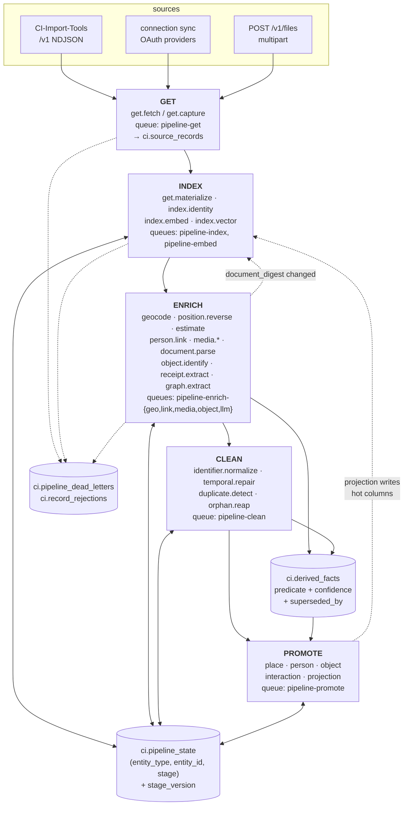
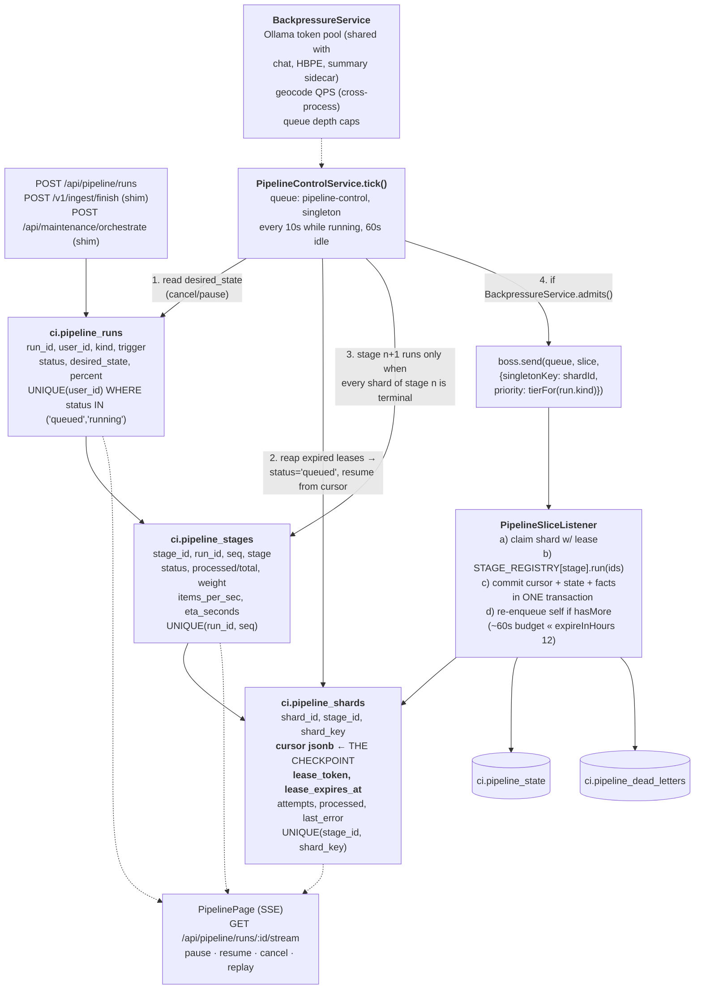

# Jobs / Data-Processing System Rebuild

> **Private & Confidential — Property of Lifescope Inc. Do not distribute.**

Working document. Every claim about the current system below was read out of this worktree
(`claude/ci-jobs-system-rebuild-0b9904`) at the time of writing and carries a `path:line` reference.
Where a prior survey or design asserted something the code does not support, the claim was dropped.

---

## 1. Summary

CI-Server has no pipeline. It has a fan-out event bus on pg-boss, nine hand-written maintenance legs,
and one write-only raw log. The defect that makes all of it unfixable is singular: **every stage
encodes "has this run?" as a nullability predicate on the column it writes.** `location_coordinates
IS NULL`, `width IS NULL`, `LEFT JOIN ci_search.embeddings ... WHERE e.entity_id IS NULL`,
`cardinality(to_entity_ids) = 0`. The predicate that finds work is the predicate that declares it
done, so the first — worst — answer any enricher ever produced is permanent. Improving a geocoder,
an embedder or a person matcher cannot repair history.

The rebuild introduces one durable, versioned ledger — `ci.pipeline_state`, keyed
`(entity_type, entity_id, stage)` with a `stage_version` column — and converts each maintenance leg
onto it one at a time. Candidate selection everywhere becomes `stage_version < $current`. Bumping an
integer becomes the re-enrichment trigger, and it is the only one needed. A second table,
`ci.derived_facts`, records enricher output with confidence and supersession so a worse new answer
never destroys a better old one. `ci.capture_events` is extended into `ci.source_records` and given a
reader, so a mapper fix is a re-materialize rather than a provider re-crawl.

GET → INDEX → ENRICH → CLEAN → PROMOTE are not five new subsystems; they are five namespaces of
stage ids over that ledger, executed by one generic worker with durable runs, shard leases, cursors,
dead-letter replay, and admission control in front of the single shared Ollama host process.

Ten phases. Each ships alone, deletes a named bug, and leaves the system working.

---

## 2. Where we are today

### 2.1 The event bus is not a job system

`EventsModule` binds `EventService → PGBossEventService` unconditionally
(`backend/apps/api/src/domains/events/index.ts`). Queues are not declared — they are *discovered* at
boot from `@OnEvent(event, { queue })` decorator side effects collected in a static
`EventListenerRegistry`, then created in `onModuleInit`
(`backend/apps/api/src/domains/events/services/PGBossEventService.ts:120-160`).

`EventService.getRegisteredQueues()` unions every registered listener's queue with a hardcoded
`default` (`backend/apps/api/src/domains/events/services/EventService.ts:46-59`,
`backend/apps/api/src/domains/events/constants.ts:1`).

**`send()` with no `{queue}` option enqueues one pg-boss job onto EVERY registered queue.**

```
backend/apps/api/src/domains/events/services/PGBossEventService.ts:236-256
    for (const queue of allQueues) {
      if (this.suppressedQueues.has(queue)) { continue; }
      const jobId = await this.boss.send(queue, resolvedData, sendOptions);
```

Each worker then re-checks `eventEmitter.hasListeners('<event>:<queue>')` and no-ops if it has none
(`PGBossEventService.ts:441-447`). So one `communication.created` mints 14 rows in `pgboss.job`, 13
of which are fetched, dispatched to nothing, and completed. The workaround is an env var read
straight from `process.env`, documented in-code as a bulk-import escape hatch:

```
backend/apps/api/src/domains/events/services/PGBossEventService.ts:50-61
  // Bulk-import escape hatch: send() fans an event out to EVERY registered queue
  // ... During a bulk load, set CI_QUEUE_SUPPRESS to a comma-separated list of
  // queues to skip enqueuing entirely
```

`CI_QUEUE_SUPPRESS` appears in no config file and no `.env.example`.

**Confirmed at runtime.** On a freshly migrated stack that had done nothing but boot and seed, every
work queue held an *identical* job count:

```
select name, count(*) from pgboss.job group by name order by 2 desc;
-> media-dimensions 90 | telemetry 90 | people-linking 90 | inventory 90 | etl 90 | default 90
   search-index 90 | image-description 90 | document-parsing 90 | cv-detections 90 | geocode 90
   feed-queue 90 | ...
```

Identical counts across unrelated queues is the fan-out's signature: ~90 events became ~1,260 job
rows, and ~1,170 of them were fetched, dispatched to no listener, and completed. This is the
headline defect measured rather than inferred — a **~93 % waste rate** before a single row of
personal data has been imported.

### 2.2 Queue inventory

Queue names come from three places: `@OnEvent` literals, exported constants, and the injected
`default`. The complete set:

| Queue | Listener count | Declared at | Worked? |
|---|---|---|---|
| `search-index` | 44 | `@OnEvent` literals across `domains/search-ingress/listeners/` | yes |
| `default` | ~15 (no `queue` option) | `domains/events/constants.ts:1` | yes |
| `etl` | 2 | `domains/etl/listeners/SyncOrchestrator.ts` | yes |
| `telemetry` | 2 | `domains/tools/` | yes |
| `geocode` | 2 | `domains/geocode/listeners/GeocodeBatchListener.ts:21` | yes |
| `people-linking` | 1 | `domains/maintenance/listeners/CommunicationParticipantLinkListener.ts` | yes |
| `inventory` | 1 | `domains/llm/listeners/InventoryListener.ts` | yes |
| `image-description` | 1 | `domains/llm/listeners/ImageDescriptionListener.ts` | yes |
| `file-preview-generation` | 1 | `domains/files/listeners/FilePreviewGenerationListener.ts` | yes |
| `document-parsing` | 1 | `domains/parsing/listeners/FileDocumentParseListener.ts` | yes |
| `cv-detections` | 1 | `domains/llm/listeners/CvDetectionsListener.ts` | yes (no in-repo emitter) |
| `media-dimensions` | 1 | `domains/files/listeners/MediaDimensionsBackfillListener.ts:17` | yes |
| `estimate-location` | 1 | `domains/maintenance/listeners/EstimateLocationBatchListener.ts:17` | yes |
| `feed-queue` | 2 | `domains/intelligence/listeners/FeedQueuePopulationListener.ts:12` | yes |
| `dead-letter` | 0 | `PGBossEventService.ts:48` | **never worked** |

The dead-letter queue is created with `retentionDays: 30` and its own comment states the situation:

```
backend/apps/api/src/domains/events/services/PGBossEventService.ts:44-48
  // Shared dead-letter queue. Jobs that exhaust their retries are moved here
  // ... Nothing works this queue, so entries accumulate; it carries a long retention.
```

There is no list endpoint, no UI, and no replay path. Exhausted jobs are deleted after 30 days.

### 2.3 Retry, expiry and priority are global-only

All set once, on the pg-boss client constructor:

```
backend/apps/api/src/domains/events/services/PGBossEventService.ts:71-84
    retryLimit: 3, retryDelay: 10, retryBackoff: true,
    expireInHours: 12, deleteAfterHours: 24, max: 10,
```

Every discovered queue is then created and updated with **only** `{ name, deadLetter }`
(`PGBossEventService.ts:140-148`). No per-queue `retryLimit`, `expireInSeconds`, `retentionMinutes`,
or `policy`. A 3-hour geocode batch and a 20 ms feed-queue insert share one policy.

**Measured against a live stack** (pg-boss 10.3.2, this worktree, 2026-08-08). Every row in
`pgboss.queue` has `policy = 'standard'` and `retry_limit`, `retry_delay`, `retry_backoff`,
`expire_seconds`, `retention_minutes` all **NULL** — the constructor writes nothing to the queue
table. It applies at *send* time instead, stamping each job row:

```
select name, min(retry_limit), min(retry_delay), bool_and(retry_backoff),
       min(expire_in), min(keep_until - created_on) from pgboss.job group by name;
-> retry_limit 3 | retry_delay 10 | retry_backoff t | expire_in 12:00:00 | keep_until-created_on 14 days
```

So `retryLimit`/`retryDelay`/`retryBackoff`/`expireInHours` are live, but **`deleteAfterHours: 24`
is inert** — it is a v9 option name, and retention falls back to pg-boss v10's 14-day default. Job
history therefore survives 14 days, not 24 hours. That is more forgiving than assumed, but it is
accidental, not chosen, and it is still far short of a durable run history (§9.1).

`priority` is plumbed end to end (`PGBossEventService.ts:216-219`) and documented
(`domains/events/constants.ts:1-10`), but **no production call site passes a non-zero value**. The
mechanism is dead weight.

Effective concurrency is **not** the zod defaults in `configuration.ts` — `config/default.json`
always supplies the keys, so those defaults never apply:

```
backend/apps/api/config/default.json:137-141
  "queues": { "concurrency": 10, "fetchBatchSize": 10, "perQueueConcurrency": 6 }
```

Ten in-flight jobs, appliance-wide, shared across 15 queues. Likewise
`config/default.json:130-136` sets `embedding.concurrency: 4`.

### 2.4 The worker runs inside the API process

`Procfile` is two lines:

```
api: yarn workspace @ci/be-api dev
web: yarn workspace @ci/fe-web dev --clearScreen false
```

`docker-compose.production.yml` declares `api`, `database`, `gateway`, `hbpe-service`,
`object-store`, `orchestrator`, `summary-service`, plus the one-shot `generate-secrets`,
`migrate-database`, `setup-database`, `setup-orchestrator`. **There is no worker service and no
replica count.** `PGBossEventService.onModuleInit` starts a poll loop per queue inside the same
process that serves HTTP.

The damage is recorded in the code that works around it:

- `backend/apps/api/src/domains/etl/services/SyncNowService.ts:92-94` refuses to enqueue while work
  is in flight because it "stacks heavy calendar transforms in the API process".
- `backend/apps/api/src/domains/etl/listeners/SyncOrchestrator.ts:458` marks a *failed* transform as
  transformed "so a failed/heavy job does not re-queue forever after API OOM restarts".

### 2.5 Ollama is a shared host process, unthrottled

Ollama is **not** a compose service. The API reaches it through
`extra_hosts: host.docker.internal:host-gateway` and `OLLAMA_HOST` / `OLLAMA_EMBED_HOST`. That single
host process is contended by interactive chat, embeddings, `llava:7b` (image description),
`llama3.2-vision:11b` (inventory), `MemoryCompactionService`, `GraphEnrichmentService`, the
`summary-service` sidecar, and HBPE's Qwen. Nothing admits or prioritises against it.

### 2.6 The one-way ratchets

Every stage's candidate query bakes "done" into the write target.

**Search index** — anti-join on *existence*, no model, no version, no staleness:

```
backend/apps/api/src/domains/maintenance/services/SearchIndexBackfillService.ts:389-398
         LEFT JOIN ci_search.embeddings e
           ON e.entity_type = $1 AND e.entity_id = s."${source.idColumn}"
         LEFT JOIN ci_search.index_skips k ...
        WHERE e.entity_id IS NULL AND k.entity_id IS NULL
```

`ci_search.embeddings` (`db/postgres/migrations/20251210022334_create_embeddings_table.sql`) has no
`model`, no dimension and no version column. Changing `config.embedding.model` silently strands the
whole corpus on old vectors in the same 768-dim cosine space, with no detector. The only remedy is
`POST /api/maintenance/search-index/truncate` — an all-or-nothing wipe.

Coverage is also partial: `BACKFILLABLE_ENTITIES` is 7 types
(`SearchIndexBackfillService.ts:35-43`) while `INDEXABLE_ENTITIES` is 14
(`domains/search-next/types.ts:1-19`). `place`, `concept`, `file-chunk`, `note`, `thread`, `message`
and `answer` are unrecoverable if they miss the live path — and `place`/`concept` are precisely the
types created by `GraphIngestService` raw upserts, which emit nothing.

**Geocode** — states the ratchet in a comment:

```
backend/apps/api/src/domains/geocode/listeners/GeocodeBatchListener.ts:400-403
      // Auto-selection always requires NULL coordinates — a resolved coordinate
      // is never re-billed.
      query.andWhere('event.location_coordinates IS NULL');
```

So the coarse city-centroid hits tagged at confidence ≤ 0.4 are frozen forever. Ordering is
`start_time DESC` with a hard `limit` (`GeocodeBatchListener.ts:412`), and a permanently
unresolvable `ZERO_RESULTS` row is never marked — it re-qualifies on every run and occupies a slot in
the budget indefinitely.

`GEOCODE_PROVIDER` is a DI token bound `useExisting` to the single Google implementation
(`domains/geocode/index.ts:40-44`). The abstraction exists; there is no alternative behind it.

**Re-ingest** — four of five kinds cannot be repaired at all:

```
backend/apps/api/src/common/persistence/ingestRefreshColumns.ts:31-40
  communication: ['direction', 'participants_metadata', 'content', 'preview', 'subject'],
  event: [], item: [], content: [], browser_activity: [],
```

An empty list takes the `DO NOTHING` find-or-return path in `bulkInsertIdempotent`. Fixing a
transform bug and re-running the import changes nothing for any already-ingested event, item, content
or browser-activity row.

### 2.7 The raw log is write-only

`ci.capture_events` is keyed `(user_id, destination, source_type, source_system, source_id)`
(`db/postgres/migrations/20260716131500_capture_events_capture_key.sql:33-34`). A repo-wide grep
returns an `INSERT` (`BulkIngestController.ts:319`), an `UPDATE` (`:384`), a compensating `DELETE`
(`:402`), and their tests. **There is no SELECT anywhere in `backend/apps/api/src`.**

Worse, what it stores is mostly useless for replay. The five bulk lanes pass `payloadOf: (r) => r`
(`BulkIngestController.ts:533, 567, 597, 620, 640`) — i.e. the already-stripped wire record. Only the
`/v1/events` lane retains a real sub-object (`payloadOf: (e) => e.payload`, `:205`).

**A live demolition hazard.** `IngestResetService.INGEST_TABLES` lists exactly five tables and does
not include `capture_events` (or `ci.position`):

```
backend/apps/api/src/domains/maintenance/services/IngestResetService.ts:11-18
const INGEST_TABLES = [
  { schema: 'ci', table: 'events' }, { schema: 'ci', table: 'communications' },
  { schema: 'ci', table: 'content' }, { schema: 'ci', table: 'inventory' },
  { schema: 'ci', table: 'browser_activity' },
] as const;
```

The capture log is cleared **only** because the original migration left a vestigial FK that
`TRUNCATE ci.events CASCADE` reaches:

```
db/postgres/migrations/20260621021634_create_capture_events.sql:15
  event_id uuid REFERENCES ci.events (event_id) ON DELETE SET NULL,
```

The column the current pipeline writes is `materialized_id`, added as a plain column with no FK
(`20260716131500:28`). The day someone drops `event_id`, every post-reset re-import becomes a
permanent silent no-op returning `ingested=0, duplicate=N` — which reads exactly like correct
idempotency.

### 2.8 Orchestration is faked in-process

`ORCHESTRATE_STAGES` declares a canonical order and a dependency guarantee:

```
backend/apps/api/src/domains/maintenance/services/MaintenanceOrchestratorService.ts:32-50
 * ... geocoding should land before the estimator so it only fills what nothing
 * else could; search_index runs last so the embeds cover the enriched rows).
export const ORCHESTRATE_STAGES = [
  'extract_people', 'link_communications', 'link_events', 'extract_graph',
  'geocode', 'reverse_geocode', 'estimate_locations', 'media_dimensions', 'search_index',
] as const;
```

**The guarantee is false.** Three legs only enqueue and return:
`status: jobIds.length > 0 ? 'enqueued' : 'noop'` at `MaintenanceOrchestratorService.ts:404` (geocode
/ reverse-geocode), `:443` (estimate_locations), `:485` (media_dimensions). `search_index` therefore
embeds rows whose enrichment has not run, and — because `missingIds` anti-joins on existence — those
rows are then permanently excluded from re-indexing.

Progress exists only as an NDJSON HTTP stream. Overlap guards are in-process fields:
`MaintenanceOrchestratorService.ts:162` (`runningUsers: Set<string>`),
`SearchIndexBackfillService.ts:160` (`private running = false`). Both evaporate on restart and are
no-ops under any second process.

### 2.9 The legacy ETL lane

`SyncOrchestrator` runs three unguarded crons and carries four verified defects:

| Defect | Location |
|---|---|
| `if (stalledInProgress)` tests an array — always true | `domains/etl/listeners/SyncOrchestrator.ts:90` |
| `pendingOrInProgress` inverted: an in-progress job *younger* than 1 h evaluates false, so a second sync is minted while one runs | `SyncOrchestrator.ts:77-82` |
| Transform drain is newest-first, 2/tick — oldest payloads starve forever | `SyncOrchestrator.ts:381-392` |
| A failed transform stamps `lastTransformed`, permanently retiring the raw payload with no dead-letter | `SyncOrchestrator.ts:452-465` |

Both `send()` calls (`:258`, `:395`) are untargeted, so each fans out to all 15 queues even though
the only listeners are on `etl`.

An entire provider page is stuffed into one `ci_etl.connection_sync_jobs.data` jsonb column; ~30
hand-written `Transform*` services read it and write final tables directly, each with per-record
`catch { log; continue }`.

### 2.10 Rich schema columns nothing writes

Verified by grepping `backend/apps/api/src` excluding `/entities/` and `__tests__`:

| Table | Columns | Writers found |
|---|---|---|
| `ci.product_models` | *entire table* | only `domains/memory/index.ts` (TypeOrmModule registration) |
| `ci.receipts` | *entire table* | only `domains/memory/index.ts` |
| `ci.receipt_line_items` | *entire table* | only `domains/memory/index.ts` |
| `ci.object_observations` | *entire table* (incl. `vector(768)` + HNSW) | only `domains/memory/index.ts` |
| `ci.object_identifiers` | *entire table* | `ObjectIdentifierService` exists; **zero callers** — only `domains/graph/index.ts:37,68,78,91` module wiring |
| `ci.inventory` | `product_id`, `acquisition_receipt_id`, `acquisition_line_item_id`, `lifecycle_state`, `quantity`, `identity_confidence`, `identity_method`, `last_seen_at`, `last_seen_place_entity_id`, `merged_into_object_id`, `object_entity_id` | none |
| `ci.events` | `salience`, `access_count`, `last_accessed`, `tags`, `energy_level`, `productivity_impact` | none |
| `ci.entities` | `dossier` (read by `domains/memory/services/UserContextService.ts`, never written), `outgoing_relationships` (trigger function defined, `CREATE TRIGGER` never written), `location_boundary` (DTO passthrough only, `domains/memory/types.ts`) | none |
| `ci.summaries` | all eight `related_*_ids` arrays | none |
| `ci.position` | `address`, `city`, `region`, `country`, `postal_code`, `name`, `description` | DTO passthrough only — `GeocodeBatchListener` queries `EventEntity` exclusively |
| `ci.entity_identifiers` | `is_primary` | never set true |

`domains/identity/` — the identity ladder with `IDENTITY_SPEC_VERSION`, three spec files and a
fixtures directory — has **zero importers** anywhere in the backend.

### 2.11 Downstream consumers nobody has accounted for

- **`domains/audit`** — `DeltaEntitySubscriber` is a **TypeORM entity subscriber** on
  `NodeEntity`/`RelationshipEntity` writing `ci.graph_deltas`
  (`domains/audit/entities/DeltaEntity.ts:11`). `GraphIngestService` writes via
  `createQueryBuilder().insert()` (`domains/graph/services/GraphIngestService.ts:381-382, 587-588`),
  which does **not** fire subscribers. `backend/apps/summary/src/ci/summary/insight_aggregator.py:97,
  143, 237` reads `ci.graph_deltas` to build the "what changed in your graph" insight section.
- **`domains/powersync`** — logical replication ships `ci.notes`, `ci.files`, `ci_search.tags` to
  on-device SQLite (`infrastructure/setup-database/entrypoint.sh:65,221,223`). Any new table must be
  added to `POWERSYNC_TABLES` *and* the sync rules or replication fails with `permission denied`
  (`infrastructure/powersync/README.md:113-117`).
- **HBPE** — `hbpe.l1_event_cluster` FKs `ci.events(event_id)`; `content_context` and
  `l2_content_cluster` FK `ci.content(id)`; `hbpe.token_stream` FKs only `ci.users`
  (`db/postgres/migrations/20260227000001_hbpe_all_tables.sql`). A `TRUNCATE ... CASCADE` destroys
  the labels and leaves the token stream, after which HBPE keeps forecasting from deleted data.

### 2.12 Testing

`.github/workflows/e2e.yml` is `workflow_dispatch` only — its nightly cron is commented out by a
`ci-local:gated` block — and non-blocking. It boots `database` + `api` + `web`; no worker, no Ollama,
no Minio, no parser sidecar. `PGBossEventService.spec.ts` covers `sendMany` only; the
fetch/complete/fail loop is untested. There is no spec for `JobMonitorService`, `IngestResetService`,
`SyncOrchestrator` or `MaintenanceOrchestratorService`.

### 2.13 Migration mechanics

191 SQL migrations in `backend/apps/api/db/postgres/migrations/`. `yarn migrate` is
`yarn check:migrations && yarn dbmate up` (`backend/apps/api/package.json:19`), run by the one-shot
`migrate-database` container that gates `api` startup. Critically, this is documented in-repo:

```
db/postgres/migrations/20260704030000_add_vectors_gin_index.sql:8-10
--   CREATE INDEX CONCURRENTLY IF NOT EXISTS vectors_vector_gin_idx
-- (CONCURRENTLY cannot run inside dbmate's migration transaction).
```

**Every index added inside a migration is a blocking build with the appliance down.**

---

## 3. What CI-Import-Tools already gives us

The bridge is a client-side ETL: `items` row → one in-memory `CanonicalRecord`
(`CI-Import-Tools/backend/src/ci-server/mapping.ts:24-111`) → 1..3 destinations via `destinationsFor`
→ per-destination wire DTO. 80 datasource modules exist in
`CI-Import-Tools/backend/src/datasources/`; 71 are registered in `index.ts` (the rest are shared
helpers: `_exif.ts`, `_ai_media.ts`, `email_mime.ts`, …).

### 3.1 What survives, and what is dropped at the bridge

| Field / capability | Where it exists in the tools | Destination lane | Survives? | Why it is dropped |
|---|---|---|---|---|
| Provenance triple | `mapping.ts` `sourceTriple(rec)` | all | **yes** | — |
| `startTime` | `CanonicalRecord.startTime` | events, comms, position, browser | **yes** | — |
| `dated` (true source time vs import-time fallback) | `CanonicalRecord` field, `mapping.ts:~33-40` | — | **no** | Computed, never placed on any wire DTO. `startTime` falls back to `items.created_at` unconditionally, so undated rows pin to import time with no marker. |
| Whole `metadata` bag on communications | `CanonicalRecord.metadata` | communications | **no** | `toCommunicationInput` (`mapping.ts:1324-1389`) emits only `communicationType, time, content, sourceTriple, durationSeconds, preview, subject, direction, threadId, participantsMetadata{from,to}, attachments`. `bulkCommunicationRecordSchema` (`CI-Server .../domains/ingest/types.ts:83-110`) has **no** metadata/source_data/properties field — contents get `source_data`, inventory gets `metadata`, browser-activity gets `properties`, events get `payload`. Highest-volume destination, total loss. |
| Mail headers (Message-ID, In-Reply-To, References, Reply-To) | `datasources/gmail.ts` | communications | **no** | Same as above. `MessageID` is consumed only as a `threadId` fallback. |
| Occurrence time for content-only records | `CanonicalRecord.startTime` | content | **no** | `ci.content` has **no** time column (`domains/memory/entities/ContentEntity.ts:83-86` — only `created_at`/`updated_at`) and `BulkIngestController` sets `occurredAtOf: () => null` for contents. Affects bookmarks, notes, highlights, saved media, digital purchases, undated captures. |
| `items.content_sha256`, `items.size_bytes` | `timeline/schema.sql` (migration 7) | — | **no** | Not in the push `SELECT`; the media leg recomputes sha256 per upload. |
| `ItemData.data()` (full email/message body bytes) | `timeline.ts` | — | **no** | Never invoked by the persist path. Importers duplicate a truncated copy into `metadata.Text` (Gmail caps at 4000 chars) or lose it. |
| Item↔entity graph with relation labels (`from`/`to`/`cc`/`attachment`) | `relationships` table | graph-sync | **partial** | `graph-sync.ts` collapses every edge to a single `self → ent:<id>` `KNOWS`/`MENTIONS`. The per-item relation and the item endpoint are discarded by design. |
| `entities.identity_key` (normalized dedup handle) | `timeline/schema.sql` (migration 11) | — | **no** | Not selected; the sync re-derives handles by regex over name + metadata. |
| Attachment file↔content pairing | `graphql.ts` index-aligned `AttachmentFileIds`/`AttachmentContentIds` | communications | **no** | Pairing lives in `rec.metadata`, which communications drop. Flattened to an unordered `{type,id}` list. |
| EXIF camera bag, GPS, accuracy | `datasources/_exif.ts` | events `metadata` | **yes** | — |
| Rich `kind` taxonomy (`KIND_BY_CLASSIFICATION`) | `mapping.ts:143-219` | — | **partial** | `kind` rides in `metadata.kind` and is first-class only on `/v1/events`. `ci.events.event_type` ends up holding three incompatible vocabularies. |
| Subscription purchases | `destinationsFor` returns `[]` | — | **no** | Pushed nowhere, still counted in the job total, no counter. |
| `subscription` / `collection` classifications | `youtube.ts`, `google_photos.ts` (albums) | — | **no** | No `KIND_BY_CLASSIFICATION` entry; fall through to `import.archive_item`. |
| Original raw source record | — | — | **never existed** | No importer retains it; `items` has no raw column. |
| Calendar `TZID` | `datasources/calendar.ts` | — | **no** | Parsed into `paramsMap`, read only for `VALUE=DATE`, then discarded. Floating date-times construct host-local. |
| vCard property parameters (`TYPE=CELL`, `PREF`) | `datasources/vcard.ts` | — | **no** | Regex drops the `;…` parameter segment. |

### 3.2 Record kinds and where they land

`communication.message/.email/.call` → communications (+position when geotagged);
`media.play/.watch/.listen/.read` → events + content; `media.saved` → content;
`web.page_view/.search` → browser_activity; `web.bookmark` → content;
`commerce.purchase` → inventory (physical) or content (digital), other `commerce.*` → events;
`travel.trip` → events; `social.*` → events + content; `location.fix` → position;
`calendar.event` → events; `wearable.observation/.sleep`, `fitness.workout` → events;
`capture.photo/.video/.audio` → events + position, or content when undated;
`note`, `reading.annotation` → content.

---

## 4. Target architecture

### 4.1 The one rule

A stage never asks the target column whether it has run. It asks the ledger:

```sql
SELECT s."<idCol>" AS id
  FROM "<schema>"."<table>" s
  LEFT JOIN ci.pipeline_state p
    ON  p.entity_type = $1 AND p.entity_id = s."<idCol>" AND p.stage = $2
 WHERE s."<userCol>" = $3
   AND (<stage applicability predicate>)
   AND ( p.entity_id IS NULL                                   -- never processed
      OR p.stage_version < $4                                  -- enricher improved
      OR (p.status = 'failed' AND p.next_attempt_at <= now())) -- retryable
   AND ($5::uuid IS NULL OR s."<idCol>" > $5::uuid)
 ORDER BY s."<idCol>"
 LIMIT $6;
```

This single form replaces `SearchIndexBackfillService.missingIds`,
`GeocodeBatchListener.selectCandidates`, `MediaDimensionsBackfillListener`'s `width IS NULL`,
`CommunicationLinkBackfillService`'s fill-only-NULL guard,
`EventParticipantBackfillService`'s equivalent, and `LocationEstimateService.candidatePredicate` —
plus the `retryNull` and `forced` escape hatches those needed.

### 4.2 New domain

```
backend/apps/api/src/domains/pipeline/
  index.ts                        PipelineModule
  constants.ts                    queue names, priority tiers, STAGE ids
  versions.ts                     STAGE_VERSIONS — the re-run watermark
  events.ts                       defineEvent x3
  types.ts                        zod schemas for the control plane
  entities/
    PipelineStateEntity.ts        ci.pipeline_state
    PipelineRunEntity.ts          ci.pipeline_runs
    PipelineStageEntity.ts        ci.pipeline_stages
    PipelineShardEntity.ts        ci.pipeline_shards
    PipelineDeadLetterEntity.ts   ci.pipeline_dead_letters
    RecordRejectionEntity.ts      ci.record_rejections
    DerivedFactEntity.ts          ci.derived_facts
  services/
    StageRegistry.ts              stage id -> Stage impl, boot-time completeness guard
    PipelineStateService.ts       claim / complete / skip / fail / quarantine / selectStale
    PipelineRunService.ts         run lifecycle, durable per-user lock, desired_state
    PipelineControlService.ts     the tick: plan shards, reap leases, advance stages
    PipelineDispatchService.ts    keyset sweep -> sendMany, self-requeuing
    BackpressureService.ts        queue depth + Ollama/geocode admission tokens
    DeadLetterService.ts          reap, list, replay
  listeners/
    PipelineSliceListener.ts      ONE generic worker per queue
    DeadLetterReaperListener.ts   finally consumes the dead-letter queue
  stages/
    get/{CaptureStage,MaterializeStage}.ts
    index/{EmbedStage,VectorStage,IdentityRegisterStage}.ts
    enrich/{GeocodeStage,PositionReverseStage,EstimateLocationStage,
            MediaDimensionsStage,DocumentParseStage,MediaDescribeStage,
            PersonLinkStage,GraphExtractStage}.ts
    clean/{IdentifierNormalizeStage,TemporalRepairStage,
           DuplicateDetectStage,OrphanReapStage,ObjectReapStage}.ts
    promote/{PlacePromoteStage,PersonPromoteStage,ObjectPromoteStage,
             InteractionPromoteStage,ProjectionStage}.ts
  controllers/
    PipelineController.ts         /api/pipeline/*
```

`PipelineModule` is imported by `application.ts`. `MaintenanceModule` imports `PipelineModule`
(one-directional; pipeline never imports maintenance) so converted legs delegate without a cycle.

### 4.3 The stage contract

```ts
export interface StageResult {
  outcome: 'done' | 'skipped' | 'failed';
  /** REQUIRED for skipped/failed. Not optional — this is the fix for the
      ~30 ETL `catch { log; continue }` blocks and for CI-Import-Tools'
      drop ledger being optional and used by only 16 of 71 importers. */
  reason?: string;
  confidence?: number;              // (0,1]; omitted when not meaningfully derivable
  facts?: DerivedFactDraft[];       // written to ci.derived_facts
  detail?: Record<string, unknown>;
}

export interface Stage {
  readonly id: string;              // 'enrich.geocode'
  readonly version: number;         // from STAGE_VERSIONS
  readonly queue: string;
  readonly entityTypes: readonly string[];
  readonly source: StageSource;     // schema/table/idColumn/predicate
  run(ctx: UserServiceContext, ids: string[]): Promise<Map<string, StageResult>>;
}
```

Stages never touch pg-boss. `StageRegistry` is an explicit static map in `constants.ts` — reviewable
in a diff, unlike `EventListenerRegistry`, which is populated by decorator side effects at
module-import time. A boot-time guard asserts registry ↔ `STAGE_VERSIONS` completeness, mirroring the
existing completeness guard in `domains/search-ingress/entitySourceMap.ts`.

### 4.4 Flow diagram



### 4.5 Control plane diagram



### 4.6 Queue topology

Queues are declared explicitly in `domains/pipeline/constants.ts` with a snapshot test, not
discovered from decorators. Effective global concurrency is **10**
(`config/default.json:137-141`), so the topology is deliberately small — one queue per *resource
class*, not per stage:

| Queue | Bound by | Priority | Stages |
|---|---|---|---|
| `pipeline-control` | Postgres, cheap | `+5` | control tick (pg-boss `policy: 'singleton'` if available, else advisory lock) |
| `pipeline-get` | provider HTTP | `-5` | `get.fetch`, `get.capture` |
| `pipeline-index` | Postgres | `-5` | `get.materialize`, `index.identity`, `index.vector` |
| `pipeline-embed` | **Ollama** | `-10` | `index.embed` |
| `pipeline-enrich-geo` | geocode provider QPS | `-10` | `enrich.geocode`, `enrich.position_reverse`, `enrich.estimate_location` |
| `pipeline-enrich-link` | Postgres | `-10` | `enrich.person_link` |
| `pipeline-enrich-media` | sharp/ffprobe CPU + Minio | `-10` | `enrich.media_dimensions`, `enrich.document_parse` |
| `pipeline-enrich-llm` | **Ollama** | `-15` | `enrich.media_describe`, `enrich.graph_extract`, `enrich.receipt_extract` |
| `pipeline-enrich-object` | Postgres | `-10` | `enrich.object_identify`, `enrich.observation_vision` |
| `pipeline-clean` | Postgres | `-10` | all `clean.*` |
| `pipeline-promote` | Postgres | `-10` | all `promote.*` |
| `dead-letter` | — | — | now **worked** by `DeadLetterReaperListener` |

Interactive `*CreatedEvent` traffic is stamped `+10`. pg-boss fetches `ORDER BY priority DESC`, so a
live upload jumps a million-row sweep.

### 4.7 The five stages

---

#### GET — `get.fetch`, `get.capture`

**Responsibility.** Land every source record as one addressable, replayable row **before** anything
interprets it. Unifies the two lanes: the `/v1` bulk plane (already one row per record) and the ETL
lane (currently a whole provider page in one jsonb column).

**Input.** Provider HTTP responses via `domains/connections` OAuth clients; NDJSON and
`{records:[]}` bodies on `POST /v1/{events,communications,contents,inventory,browser-activity,positions}`;
multipart on `POST /v1/files`. Cursor from `ci.pipeline_shards.cursor`.

**Output.** `ci.source_records` rows carrying `payload jsonb` **verbatim** (the full importer
metadata bag, not the stripped wire record), `source_kind` verbatim, `occurred_at` nullable,
`mapper_version`. Attachment bytes to Minio; keys in `attachment_keys text[]`. Unroutable records to
`ci.record_rejections`. **No typed `ci.*` row is written by GET.**

**Reads / writes.** Writes `ci.source_records`, `ci.record_rejections`. Reads
`ci.connections`, `ci_etl.connection_sync_jobs` (cursor/status only).

**Queue.** `pipeline-get`.

**Idempotency key.** The existing `capture_events_capture_key_uniq`:
`(user_id, destination, source_type, source_system, source_id)`, `ON CONFLICT DO NOTHING`. The
semantics change: `stage_state` records whether the record materialized, so an already-captured key
is re-drivable through INDEX. Today `BulkIngestController.ts:344-345` filters it out as `duplicate`
forever, which is why a crash between capture and materialize strands a record permanently.

**Versioning.** `mapper_version`. A mapper fix (e.g. `TransformGmail.ts:125-132` computing bcc
entity ids from the *cc* list, or `:87` hardcoding `direction = INBOUND` even for `labelIds=SENT`
pages) is shipped by bumping the version; `get.materialize` re-materializes from the retained
payload **with zero provider API calls**.

**Failure.** Per-record → `ci.record_rejections` with reason + payload, plus a dead-letter row
carrying `record_id`. Per-slice → lease expires, control tick requeues from cursor. HTTP 401 → mark
`ci.connections.needs_reauth` and fail the shard with a typed reason (`BaseOAuth2Client` does none of
this today). HTTP 429 → set `next_attempt_at`, yield.

**Concurrency.** One shard per (connection, endpoint) or per NDJSON stream. Provider QPS enforced by
`BackpressureService`, cross-process.

---

#### INDEX — `get.materialize`, `index.identity`, `index.embed`, `index.vector`

**Responsibility.** Make a record addressable and findable. Materialize raw → typed row; register
identity claims; build the keyword and vector search representations.

**Input.** `ci.source_records` with `stage_state='captured'`; for re-index, the ledger sweep over
all 14 `INDEXABLE_ENTITIES` via `domains/search-ingress/entitySourceMap.ts`.

**Output.** Typed rows via the existing `bulkInsertIdempotent`, with `materialized_id` linked;
`ci.entity_identifiers` and `ci.identifier_claims`; `ci_search.embeddings` (now carrying `model`,
`spec_version`, `document_digest`) and `ci_search.vectors`; ledger rows.

**Reads / writes.** Reads `ci.source_records`. Writes `ci.events`, `ci.communications`,
`ci.content`, `ci.inventory`, `ci.browser_activity`, `ci.position`, `ci.entity_identifiers`,
`ci.identifier_claims`, `ci_search.embeddings`, `ci_search.vectors`, `ci.pipeline_state`.

**Queues.** `pipeline-index`, `pipeline-embed`.

**Idempotency key.** Materialize: the per-table provenance-triple partial unique indexes as
`ON CONFLICT` arbiters. Search: `ON CONFLICT (entity_type, entity_id) DO UPDATE` — already correct,
simply never driven by a staleness query.

**Versioning.** `STAGE_VERSIONS['index.embed']` is derived from
`(config.embedding.model, dimension, searchDocumentBuilderVersion)`. The candidate predicate also
fires on `e.model <> $currentModel`, so changing `CI_EMBED_MODEL` becomes an incremental, resumable,
backpressured re-embed instead of a silent mixed vector space.

**Failure.** Ollama unreachable → `status='failed'` + `next_attempt_at` backoff, so a dead Ollama
shows as a rising failure count rather than a flat counter. Deliberate low-value skips
(`empty`/`too-short`/`trivial`/`url-only`, from `common/embeddings/embeddable.ts`) →
`status='skipped'` with reason, folding in `ci_search.index_skips`. Closes
`FileChunkSearchIndexListener`'s silent-loss path (no skip marker, `file-chunk` not backfillable, so
today the only recovery is re-uploading the file).

**Concurrency.** `pipeline-embed` shards by entity type; the Ollama admission pool caps in-flight
calls below `config.embedding.concurrency` (currently 4).

---

#### ENRICH

**Responsibility.** Derive facts the source did not supply. Stages:
`enrich.geocode`, `enrich.position_reverse`, `enrich.estimate_location`, `enrich.person_link`,
`enrich.media_dimensions`, `enrich.media_describe`, `enrich.document_parse`,
`enrich.object_identify`, `enrich.receipt_extract`, `enrich.observation_vision`,
`enrich.graph_extract`.

**Input.** Ledger sweep over the typed tables, plus `ci.source_records.payload` — so an enricher can
mine fields the wire schema had no room for (this is the only path to recovering communications
metadata).

**Output.** `ci.derived_facts` rows (`predicate`, `object_value`, `confidence`, `method`,
`stage_id`, `record_id`), and direct writes to the target rich tables.

**Queues.** `pipeline-enrich-geo`, `-link`, `-media`, `-object`, `-llm`.

**Idempotency key.** The ledger cell `(entity_type, entity_id, stage)`, claimed with
`UPDATE ... WHERE status <> 'running'` so two workers cannot both run it. Target writes are
`ON CONFLICT` upserts or targeted `UPDATE`s. Metadata tagging moves from `GeocodeBatchListener`'s
read-modify-write of the whole jsonb blob (`:456-469`, under `p-limit(10)`, so concurrent writers
clobber each other) to the set-based `metadata = COALESCE(metadata,'{}') || jsonb_build_object(...)`
form `LocationEstimateService` already uses correctly.

**Versioning.** `STAGE_VERSIONS`. Bumping `enrich.geocode` re-geocodes rows whose coordinates came
from the old rule — impossible today.

**Failure.** Retryable provider statuses keep the existing `BACKOFF_MS = [500, 1500, 4000]` inside
the slice, then `next_attempt_at`. Non-retryable (`ZERO_RESULTS`, `INVALID_REQUEST`) →
`status='skipped'` with reason, so they stop re-qualifying every run and head-of-line-blocking the
`start_time DESC` batch. **Enrichers may not swallow exceptions**: the `catch { log }` pattern that
marks failed work complete is banned by the `StageResult` contract.

**Concurrency.** Shards partition by entity type and, for large corpora, by time window so a 10-year
archive parallelises. `enrich.geocode` and `enrich.position_reverse` share one QPS budget.

**Enrichment must not re-trigger indexing.** `EventService.update` emits `EventUpdatedEvent` with no
`{queue}`, so a 200-row geocode batch produces up to 400 full fan-outs, each re-embedding a row whose
text did not change. Enrichers write via targeted `UPDATE` and re-index only when `document_digest`
changes — the pattern `CommunicationParticipantLinkListener` already uses deliberately.

---

#### CLEAN

**Responsibility.** Reconcile competing assertions and repair normalization. Stages:
`clean.identifier_normalize`, `clean.temporal_repair`, `clean.duplicate_detect`,
`clean.tombstone_repair`, `clean.orphan_reap`, `clean.object_reap` (Minio), `clean.quarantine`.

**Input.** `ci.identifier_claims` groups with more than one subject; ledger cells whose normalizer
version is stale; `ci.entities` with `merged_into_entity_id`; `ci_search.*` vs their
`ENTITY_SOURCE_MAP` sources; `ci.source_records.payload` (repairing a timestamp needs the original
header, which is why CLEAN follows GET consolidation for ETL rows).

**Output.** `ci.merge_candidates`, repaired `value_normalized`, `ci.entity_provenance`,
`timestamp.inferred` derived facts, deleted orphan index rows and orphan Minio objects.

**Queue.** `pipeline-clean`.

**Idempotency key.** `ci.merge_candidates` is `UNIQUE (owner_user_id, entity_type, entity_id_a,
entity_id_b)` with `CHECK (a < b)`. Repairs are pure functions of the current normalizer version.

**Versioning.** Each routine is a versioned stage. `clean.identifier_normalize.version` tracks
`IDENTITY_SPEC_VERSION`. This is what migration `20260803223016` demands: the identifier backfill
must run the real normalizer, never SQL, because GTIN mod-10 / ISBN-10→13 / IMEI Luhn cannot be kept
byte-identical between the two.

**Failure.** CLEAN never auto-merges above the confidence floor without a decision, and **never
hard-deletes a source row** (HBPE FKs — see §2.11). `clean.duplicate_detect` runs with a singleton
policy so two workers cannot merge overlapping groups.

---

#### PROMOTE

**Responsibility.** Project winning facts into the rich graph and object model, and denormalize onto
the hot read columns. Stages: `promote.place`, `promote.person`, `promote.object`,
`promote.interaction`, `promote.projection`, `promote.graph_delta`.

**Input.** `ci.derived_facts WHERE superseded_by IS NULL`, ranked by confidence;
`ci.source_record_links` for multi-subject records; merged `ci.merge_candidates`.

**Output.** `ci.entities` (Place with real `place_kind` hierarchy and `location_boundary`; canonical
Person), `ci.relationships` with the per-item edge label, `ci.item_relationships`,
`ci.product_models`, `ci.receipts`, `ci.receipt_line_items`, `ci.object_observations`,
`ci.object_identifiers`, the 11 `ci.inventory` identity columns, `ci.entity_provenance`, and
`ci.graph_deltas` (explicitly — see below).

**Queue.** `pipeline-promote`.

**Idempotency key.** `ci.entity_provenance (owner_user_id, source_system, natural_key)` — a stable
natural key resolves to the same canonical entity across runs. Merge-tombstone-aware: resolution
follows `merged_into_entity_id`.

**`promote.graph_delta` is mandatory, not optional.** `DeltaEntitySubscriber` is a TypeORM *entity
subscriber*; `GraphIngestService` writes via `createQueryBuilder().insert()`
(`domains/graph/services/GraphIngestService.ts:381-382, 587-588`), which does not fire subscribers.
`backend/apps/summary/src/ci/summary/insight_aggregator.py:97,143,237` reads `ci.graph_deltas` to
build "what changed in your graph". Without an explicit set-based delta write in the same transaction
as the entity upsert, bulk promotion makes the graph visible in the UI and simultaneously reports
zero graph activity in every insight summary.

**Failure.** Per-entity transactional (entity upsert + provenance + identifiers + edges + delta);
a failure rolls back to `status='failed'`. Promotion never mutates or deletes source rows, so a full
re-promote after a bad version bump is always safe.

---

## 5. Data model changes

All migrations are hand-written SQL and **must** be created with:

```bash
yarn workspace @ci/be-api migrate:make <name>
```

Never hand-write the timestamp prefix — `bin/check-migration-versions.js` enforces uniqueness in
lint-staged and before `yarn migrate`, because hand-picked round timestamps have already collided
across parallel branches. TypeORM entities are then updated to match; SQL is the source of truth.

**Two-phase index rule (mandatory).** `CREATE INDEX CONCURRENTLY` cannot run inside dbmate's
transaction — stated in-repo at
`db/postgres/migrations/20260704030000_add_vectors_gin_index.sql:8-10` — and `migrate-database` is a
one-shot container that gates `api` startup. Therefore: **migrations add columns and tables only.**
Every index below is created out-of-band by an idempotent
`CREATE INDEX CONCURRENTLY IF NOT EXISTS` maintenance step that the pipeline runs on first boot and
refuses to sweep without. Fresh installs may build inline (empty tables); upgrades must not.

### 5.1 `ci.pipeline_state` — the ledger

```sql
CREATE TABLE IF NOT EXISTS ci.pipeline_state (
  entity_type    text        NOT NULL,
  entity_id      uuid        NOT NULL,
  stage          text        NOT NULL,
  user_id        uuid        NOT NULL REFERENCES ci.users (id) ON DELETE CASCADE,
  stage_version  integer     NOT NULL,
  status         text        NOT NULL
                 CHECK (status IN ('pending','running','done','skipped','failed','quarantined')),
  reason         text,
  confidence     real        CHECK (confidence > 0 AND confidence <= 1),
  attempts       smallint    NOT NULL DEFAULT 0,
  next_attempt_at timestamptz,
  claimed_at     timestamptz,
  processed_at   timestamptz,
  last_error     text,
  detail         jsonb       NOT NULL DEFAULT '{}',
  updated_at     timestamptz NOT NULL DEFAULT now(),
  PRIMARY KEY (entity_type, entity_id, stage)
);
-- out-of-band, CONCURRENTLY:
--   pipeline_state_sweep_idx      (stage, stage_version, status, entity_id)
--   pipeline_state_user_idx       (user_id, stage, status)
--   pipeline_state_attention_idx  (stage, processed_at) WHERE status IN ('failed','quarantined')
```

Plain table, not a hypertable: ADR-0002 gate 1 (natural uniqueness required) disqualifies it.
`confidence` is a nullable column here from day one so PROMOTE has something to source
`ci.inventory.identity_confidence` from — which currently defaults to `1.0`, making every importer
guess read as user-verified ground truth to HBPE and RAG.

**Entity:** new `PipelineStateEntity` with `@PrimaryColumn` on the three key columns.

### 5.2 `ci.derived_facts` — non-destructive enrichment

```sql
CREATE TABLE IF NOT EXISTS ci.derived_facts (
  fact_id       uuid        PRIMARY KEY DEFAULT ci.gen_uuid_v7(),
  user_id       uuid        NOT NULL REFERENCES ci.users (id) ON DELETE CASCADE,
  subject_type  text        NOT NULL,
  subject_id    uuid        NOT NULL,
  predicate     text        NOT NULL,   -- 'location.coordinates' | 'location.place_entity'
                                        -- | 'participant.person' | 'object.product_model'
                                        -- | 'object.identifier'  | 'timestamp.inferred'
                                        -- | 'direction' | 'thread' | 'merchant'
  object_value  jsonb       NOT NULL,
  confidence    real        NOT NULL CHECK (confidence > 0 AND confidence <= 1),
  method        text        NOT NULL,   -- 'exact_match'|'provider_rooftop'|'provider_centroid'
                                        -- |'temporal_nn'|'llm'|'user_asserted'|'heuristic'
  stage         text        NOT NULL,
  stage_version integer     NOT NULL,
  record_id     uuid        REFERENCES ci.source_records (record_id) ON DELETE SET NULL,
  superseded_by uuid        REFERENCES ci.derived_facts (fact_id) ON DELETE SET NULL,
  asserted_at   timestamptz NOT NULL DEFAULT now()
);
-- out-of-band: derived_facts_live_idx (subject_type, subject_id, predicate)
--                WHERE superseded_by IS NULL
```

**Why supersession.** Without it, bumping a stage version and getting a *worse* answer destroys the
better one with no rollback. With it, PROMOTE picks the highest-confidence live fact and a bad
version is corrected by shipping v+1, never by rolling back.

**Retention (required, or this table is unbounded).** A `clean.fact_reap` stage deletes superseded
facts older than 90 days, keeping at most 3 generations per `(subject, predicate)`. This must ship
with the table, not after.

### 5.3 `ci.source_records` — the readable raw layer

Implemented as an `ALTER` of `ci.capture_events` plus a rename, not a new table: the existing table
is already one row per record with the right key, and renaming avoids a data migration.

```sql
ALTER TABLE ci.capture_events RENAME TO source_records;
ALTER TABLE ci.source_records RENAME COLUMN capture_event_id TO record_id;

ALTER TABLE ci.source_records
  ADD COLUMN IF NOT EXISTS stage_state     text NOT NULL DEFAULT 'materialized'
    CHECK (stage_state IN ('captured','materialized','rejected','superseded')),
  ADD COLUMN IF NOT EXISTS mapper_version  integer NOT NULL DEFAULT 1,
  ADD COLUMN IF NOT EXISTS source_kind     text,
  ADD COLUMN IF NOT EXISTS payload_digest  bytea,
  ADD COLUMN IF NOT EXISTS attachment_keys text[],
  ADD COLUMN IF NOT EXISTS run_id          uuid,
  ADD COLUMN IF NOT EXISTS rejected_reason text,
  ADD COLUMN IF NOT EXISTS attempts        smallint NOT NULL DEFAULT 0;
-- out-of-band, CONCURRENTLY:
--   source_records_pending_idx (user_id, destination, stage_state, mapper_version)
--     WHERE stage_state <> 'materialized'
```

**`DEFAULT 'materialized'` is the day-one seeding trick.** Existing rows *were* materialized, so the
first sweep after deploy processes nothing.

**Ordering constraint — do not violate.** `ci.source_records` must be added to
`IngestResetService.INGEST_TABLES` **before** `event_id` is dropped. Today the log is cleared only
via `TRUNCATE ci.events CASCADE` reaching the vestigial FK
(`db/postgres/migrations/20260621021634_create_capture_events.sql:15`). Drop the column first and
every post-reset re-import silently becomes `ingested=0, duplicate=N` forever.

Also add `ci.position` to `INGEST_TABLES` — it is a `/v1` destination, is counted by
`IngestStatusService`, and is currently not cleared by the reset.

`ON DELETE CASCADE` on `user_id` is required (GDPR-style erasure — see §14).

### 5.4 `ci.source_record_links`

```sql
CREATE TABLE IF NOT EXISTS ci.source_record_links (
  link_id       uuid        PRIMARY KEY DEFAULT ci.gen_uuid_v7(),
  record_id     uuid        NOT NULL REFERENCES ci.source_records (record_id) ON DELETE CASCADE,
  subject_type  text        NOT NULL,
  subject_id    uuid        NOT NULL,
  role          text        NOT NULL,   -- 'primary'|'attachment'|'participant'|'derived'
  index_version integer     NOT NULL,
  created_at    timestamptz NOT NULL DEFAULT now(),
  UNIQUE (record_id, subject_type, subject_id, role)
);
-- out-of-band: source_record_links_subject_idx (subject_type, subject_id)
```

Answers "which raw record produced this row, and what else did it produce?" — needed for the fan-out
case (one record → event + content) and for `ci.item_relationships`.

### 5.5 Control-plane tables

```sql
CREATE TABLE IF NOT EXISTS ci.pipeline_runs (
  run_id        uuid PRIMARY KEY DEFAULT ci.gen_uuid_v7(),
  user_id       uuid NOT NULL REFERENCES ci.users (id) ON DELETE CASCADE,
  kind          text NOT NULL,          -- 'import'|'continuous'|'operator'|'reprocess'
  trigger       text NOT NULL,          -- 'v1_finish'|'maintenance_api'|'schedule'|'ui'
  stages        text[] NOT NULL,
  options       jsonb NOT NULL DEFAULT '{}',
  status        text NOT NULL DEFAULT 'queued',
  desired_state text NOT NULL DEFAULT 'running'
                CHECK (desired_state IN ('running','paused','cancelled')),
  percent       integer NOT NULL DEFAULT 0,
  error         jsonb,
  created_at, updated_at, started_at, finished_at timestamptz
);
-- IN-MIGRATION (empty table, safe):
CREATE UNIQUE INDEX pipeline_runs_active_uniq
  ON ci.pipeline_runs (user_id) WHERE status IN ('queued','running');

CREATE TABLE IF NOT EXISTS ci.pipeline_stages (
  stage_id   uuid PRIMARY KEY DEFAULT ci.gen_uuid_v7(),
  run_id     uuid NOT NULL REFERENCES ci.pipeline_runs (run_id) ON DELETE CASCADE,
  seq        integer NOT NULL,
  stage      text NOT NULL,
  status     text NOT NULL DEFAULT 'queued',
  phase      text,
  processed  bigint NOT NULL DEFAULT 0,
  total      bigint,
  weight     integer NOT NULL DEFAULT 1,
  items_per_sec double precision,
  eta_seconds  integer,
  duration_ms  bigint,
  detail jsonb, error jsonb,
  started_at, finished_at, updated_at timestamptz,
  UNIQUE (run_id, seq)
);

CREATE TABLE IF NOT EXISTS ci.pipeline_shards (
  shard_id   uuid PRIMARY KEY DEFAULT ci.gen_uuid_v7(),
  stage_id   uuid NOT NULL REFERENCES ci.pipeline_stages (stage_id) ON DELETE CASCADE,
  shard_key  text NOT NULL,
  status     text NOT NULL DEFAULT 'queued',
  cursor     jsonb,                       -- THE CHECKPOINT
  processed  bigint NOT NULL DEFAULT 0,
  total      bigint,
  slice_count integer NOT NULL DEFAULT 0,
  attempts    integer NOT NULL DEFAULT 0,
  lease_token uuid,
  lease_expires_at timestamptz,
  last_error jsonb,
  updated_at timestamptz NOT NULL DEFAULT now(),
  UNIQUE (stage_id, shard_key)
);

CREATE TABLE IF NOT EXISTS ci.pipeline_cursors (      -- run-independent watermarks
  user_id  uuid NOT NULL REFERENCES ci.users (id) ON DELETE CASCADE,
  stage    text NOT NULL,
  shard_key text NOT NULL,
  cursor   jsonb,
  stage_version integer NOT NULL DEFAULT 0,
  last_run_id uuid,
  last_advanced_at timestamptz,
  PRIMARY KEY (user_id, stage, shard_key)
);

CREATE TABLE IF NOT EXISTS ci.pipeline_dead_letters (
  dead_letter_id uuid PRIMARY KEY DEFAULT ci.gen_uuid_v7(),
  user_id  uuid REFERENCES ci.users (id) ON DELETE CASCADE,
  queue    text NOT NULL,
  event_name text NOT NULL,
  payload  jsonb NOT NULL,
  error    jsonb NOT NULL,
  attempts integer NOT NULL,
  stage    text, entity_type text, entity_id uuid,
  run_id uuid, stage_id uuid, shard_id uuid,
  record_id uuid REFERENCES ci.source_records (record_id) ON DELETE SET NULL,
  first_failed_at timestamptz, created_at timestamptz NOT NULL DEFAULT now(),
  replayed_at timestamptz, replay_run_id uuid,
  expires_at timestamptz NOT NULL DEFAULT (now() + interval '30 days')   -- retention TTL
);

CREATE TABLE IF NOT EXISTS ci.record_rejections (     -- the DATA dead-letter
  rejection_id uuid PRIMARY KEY DEFAULT ci.gen_uuid_v7(),
  user_id uuid REFERENCES ci.users (id) ON DELETE CASCADE,
  run_id uuid, stage text NOT NULL,
  source_type text, source_system text, source_id text,
  reason text NOT NULL, detail jsonb, payload jsonb,
  created_at timestamptz NOT NULL DEFAULT now(),
  expires_at timestamptz NOT NULL DEFAULT (now() + interval '30 days')
);
```

`pipeline_runs`/`pipeline_stages` deliberately mirror CI-Import-Tools' proven
`import_runs`/`import_stages` shape (`CI-Import-Tools/backend/timeline/schema.sql`), which its
progress UI already renders from.

The partial unique index on `pipeline_runs (user_id)` is the durable replacement for
`MaintenanceOrchestratorService.ts:162` and `SearchIndexBackfillService.ts:160`.

### 5.6 Identity and merge tables

```sql
CREATE TABLE IF NOT EXISTS ci.identifier_claims (
  claim_id        uuid PRIMARY KEY DEFAULT ci.gen_uuid_v7(),
  owner_user_id   uuid NOT NULL REFERENCES ci.users (id) ON DELETE CASCADE,
  kind            text NOT NULL,   -- 'email'|'phone'|'name'|'gtin'|'isbn'|'serial'|...
  value_normalized text NOT NULL,
  subject_type    text NOT NULL,
  subject_id      uuid NOT NULL,
  confidence      real,
  source          text,
  spec_version    integer NOT NULL DEFAULT 1,
  stage           text,
  created_at      timestamptz NOT NULL DEFAULT now(),
  UNIQUE (owner_user_id, kind, value_normalized, subject_type, subject_id)
);
-- out-of-band: identifier_claims_lookup_idx (owner_user_id, kind, value_normalized)
--   >1 row for a (owner, kind, value) IS a merge candidate — one GROUP BY.

CREATE TABLE IF NOT EXISTS ci.merge_candidates (
  candidate_id  uuid PRIMARY KEY DEFAULT ci.gen_uuid_v7(),
  owner_user_id uuid NOT NULL REFERENCES ci.users (id) ON DELETE CASCADE,
  entity_type   text NOT NULL,
  entity_id_a   uuid NOT NULL,
  entity_id_b   uuid NOT NULL,
  score         real NOT NULL,
  reason        text NOT NULL,
  evidence      jsonb NOT NULL DEFAULT '{}',
  state         text NOT NULL DEFAULT 'open'
                CHECK (state IN ('open','merged','blocked','stale')),
  detector_version integer NOT NULL,
  created_at    timestamptz NOT NULL DEFAULT now(),
  CHECK (entity_id_a < entity_id_b),
  UNIQUE (owner_user_id, entity_type, entity_id_a, entity_id_b)
);

CREATE TABLE IF NOT EXISTS ci.entity_provenance (
  owner_user_id uuid NOT NULL REFERENCES ci.users (id) ON DELETE CASCADE,
  source_system text NOT NULL,
  natural_key   text NOT NULL,
  entity_id     uuid NOT NULL,
  spec_version  integer NOT NULL DEFAULT 1,
  first_seen_at timestamptz NOT NULL DEFAULT now(),
  PRIMARY KEY (owner_user_id, source_system, natural_key)
);
```

`ci.identifier_claims` records **losing** claims, which `ci.entity_identifiers`
(`ON CONFLICT DO NOTHING`, first-writer-wins) discards. That discard is exactly why
`PersonDuplicateService` has to `unnest` `properties->'emails'` JSONB arrays instead of grouping the
index. `ci.entity_merge_blocks` already exists and filters candidates.

`ci.entity_provenance` is many-to-one so a merge repoints keys without touching the canonical node —
the fix for merges being silently undone by the next sync, because neither
`GraphIngestService.findExistingNodes` nor `PersonService.create`'s linked-key lookup filters
`merged_into_entity_id`.

### 5.7 Column changes to existing tables

| Change | Reasoning |
|---|---|
| `ALTER TABLE ci_search.embeddings ADD model text, ADD spec_version integer, ADD document_digest bytea` | The DDL (`20251210022334`) has none of these, so a `CI_EMBED_MODEL` change silently mixes two models in one cosine space with no detector. Backfill to the current config value so the first sweep enqueues 0. |
| `ALTER TABLE ci.communications ADD source_data jsonb NOT NULL DEFAULT '{}'` + add to the wire schema and `INGEST_REFRESH_COLUMNS.communication`; bump `INGEST_SCHEMA_VERSION` | The largest data-loss hole. `bulkCommunicationRecordSchema` (`domains/ingest/types.ts:83-110`) has no metadata sink at all, while contents/inventory/browser-activity/events all do. Fixes new rows; historical recovery comes from `source_records.payload` once GET consolidation lands. |
| `ALTER TABLE ci.content ADD occurred_at timestamptz` | `ContentEntity.ts:83-86` has only `created_at`/`updated_at`, and `BulkIngestController` passes `occurredAtOf: () => null`. Records routed to content **alone** lose their time entirely. |
| `ALTER TABLE ci.events ADD time_precision text, ADD time_source text` (`'source'\|'derived'\|'ingest'`) | `CanonicalRecord.dated` is computed by the importer and never transmitted, while `startTime` falls back to import time unconditionally. Corrupts the estimator's donor window, geocode ordering, and HBPE bucketing. |
| `ALTER TABLE ci.events ADD kind text` + backfill from `source_records.source_kind`, then `CHECK` | `event_type` is nullable free text holding three incompatible vocabularies (`capture.photo` from `/v1`, `photo` from GraphQL, `calendar_event` from ETL). No routing rule has a column to key off. |
| `ALTER TABLE ci.geocode_cache ADD provider text, ADD rule_version integer` + include in the key | The PK is `sha256(canonicalize(raw))`; improving `canonicalize()` or switching providers *forks* the keyspace into unreachable garbage and re-bills everything, with no way to tell "stale rule" from "never seen". |
| `ALTER TABLE ci.entity_identifiers ADD confidence real, ADD spec_version integer NOT NULL DEFAULT 1` | `spec_version` is what `domains/identity`'s `IDENTITY_SPEC_VERSION` was designed around and never got. `confidence` makes person matching thresholdable rather than binary string equality. |
| Rebuild `events_source_triple_uniq` to lead with `user_id` (**Phase 9, out-of-band, CONCURRENTLY**) | It is the only provenance unique index that is not user-scoped (`20260620213807:7-9`), while `bulkUpsert`'s pre-check and hydration *are* scoped — so user B's identical event is absorbed as `DO NOTHING`, hydration misses, and `bulkUpsert.ts:483` returns a phantom entity. |
| `DROP TABLE ci_search.index_skips` (Phase 2, after backfilling into `ci.pipeline_state`) | A single-producer special case of the ledger. |
| `ALTER TABLE ci_etl.connection_sync_jobs DROP COLUMN data` (Phase 6, last provider) | Unindexed, never pruned, scanned by three crons every 30–60 s, and unqueryable. |

**Do not add** `ci.pipeline_state`, `ci.source_records`, `ci.derived_facts` or any other new table to
`POWERSYNC_TABLES` (`infrastructure/setup-database/entrypoint.sh:65`). None of them is device-facing.

### 5.8 TypeORM entity updates required

New: `PipelineStateEntity`, `PipelineRunEntity`, `PipelineStageEntity`, `PipelineShardEntity`,
`PipelineCursorEntity`, `PipelineDeadLetterEntity`, `RecordRejectionEntity`, `DerivedFactEntity`,
`SourceRecordLinkEntity`, `IdentifierClaimEntity`, `MergeCandidateEntity`, `EntityProvenanceEntity`.

Changed: `CaptureEventEntity` → `SourceRecordEntity` (rename + new columns); `EmbeddingEntity`
(+ `model`, `spec_version`, `documentDigest`); `CommunicationEntity` (+ `sourceData`);
`ContentEntity` (+ `occurredAt`); `EventEntity` (+ `kind`, `timePrecision`, `timeSource`);
`GeocodeCacheEntity` (+ `provider`, `ruleVersion`); `EntityIdentifierEntity` (+ `confidence`,
`specVersion`).

`domains/memory/index.ts` already registers `ProductModelEntity`, `ReceiptEntity`,
`ReceiptLineItemEntity` and `ObjectObservationEntity` in `TypeOrmModule.forFeature` — no entity work
is needed for those; only writers.

---

## 6. The enrichers

Every stage below declares an integer in `domains/pipeline/versions.ts`:

```ts
export const STAGE_VERSIONS = {
  'get.capture': 1,          'get.materialize': 1,
  'index.identity': 1,       'index.embed': 1,        'index.vector': 1,
  'enrich.geocode': 1,       'enrich.position_reverse': 1, 'enrich.estimate_location': 1,
  'enrich.person_link': 1,   'enrich.media_dimensions': 1, 'enrich.media_describe': 1,
  'enrich.document_parse': 1,'enrich.object_identify': 1,  'enrich.receipt_extract': 1,
  'enrich.observation_vision': 1, 'enrich.graph_extract': 1,
  'clean.identifier_normalize': 1, 'clean.temporal_repair': 1, 'clean.duplicate_detect': 1,
  'promote.place': 1, 'promote.person': 1, 'promote.object': 1,
  'promote.interaction': 1, 'promote.projection': 1,
} as const;
```

A snapshot test hashes each stage's declared inputs (model name, prompt text, rule constants)
alongside its version and fails CI when they diverge — the same pattern
`ingestRefreshColumns.test.ts` already uses for `INGEST_SCHEMA_VERSION`.

**Dry-run before any bump is mandatory.** `POST /api/pipeline/runs { dryRun: true }` returns candidate
count and estimated wall-clock per stage. On a single appliance sharing one Ollama host process, a
careless bump on `index.embed` is hours of GPU time; without the guard rail the first bump will be the
last one anyone dares.

---

### 6.1 Geolookup / place resolution — `enrich.geocode`, `enrich.position_reverse`, `enrich.estimate_location`

**Input.** `ci.events.location_name` (forward), `ci.events.location_coordinates` (reverse),
`ci.position.location` (reverse — **new**), `ci.inventory.current_location_coordinates` (**new**),
`ci.object_observations.location_coordinates` (**new**), plus
`ci.source_records.payload` for `Pickup Address`/`Dropoff Address` on `travel.trip` records, which
today sit in metadata where the candidate predicate never sees them.

**Algorithm.** Unchanged in its good parts. Virtual-location denylist first
(`domains/geocode/util/virtualLocations.ts` — 26 exact tokens, 10 link/dial-in patterns, 4
conservative casual-label patterns gated on `hasAddressSignal`), so non-geocodable venues are never
sent to a provider. Then cache lookup by `sha256(canonicalize(raw))`, now including `provider` and
`rule_version`. Then the provider. Confidence maps from `location_type`: `ROOFTOP`/
`RANGE_INTERPOLATED` → 0.95, `GEOMETRIC_CENTER` → 0.8, `APPROXIMATE` → 0.4. `PlaceService`'s
`COMPONENT_HIERARCHY` is **extended** past its three entries (`locality`,
`administrative_area_level_1`, `country`) to consume `neighborhood`, `sublocality`, `postal_code`,
`route`, `street_number` — all already sitting unparsed in `ci.geocode_cache.components`, so the
extension costs **zero** additional provider calls.

**Dependencies.** `GEOCODE_PROVIDER` is bound `useExisting` to `GoogleGeocodeProvider`
(`domains/geocode/index.ts:40-44`) with no alternative. A `NominatimGeocodeProvider` (self-hosted, on
appliance) goes behind the same token, selected by `config.geocoding.provider`. **This must land in
the same release that makes geocoding run reliably** — otherwise the rebuild's most visible effect is
more user-derived location text leaving the box automatically instead of on a manual operator
trigger.

**Cost per record.** One provider call on a cache miss, zero on a hit. Cache hit rate on a personal
corpus is high (repeated home/office/venue strings).

**Batch strategy.** Shards by entity type; slices of ~200 ids inside a ~60 s budget. Forward and
reverse share one `BackpressureService` QPS token bucket, cross-process (today's `RateLimiter` lives
inside `GeocodeBatchListener` and is per-worker). Ordering moves from `start_time DESC` to keyset on
the id, so a permanently unresolvable row cannot head-of-line-block.

**Confidence.** Written to `ci.derived_facts` as `location.coordinates` /
`location.place_entity` with `method = provider_rooftop | provider_centroid | temporal_nn`.
`enrich.estimate_location` writes at 0.4 with `method='temporal_nn'` and the existing rich
`inference_sources` detail (donor, donor_id, delta_seconds, accuracy_meters, max_gap_hours).

**Backfill.** Bump `STAGE_VERSIONS['enrich.geocode']`. Rows whose coordinates came from the old
provider or rule re-qualify. `retryNull` and `forced` are deleted.

---

### 6.2 Person resolution / identity — `enrich.person_link`, `index.identity`

**Input.** `ci.communications.participants_metadata` `{from, to, cc, bcc}`,
`ci.events.metadata` (`organizerEmail`/`participants`/`attendees`/`from` and PascalCase variants),
`ci.entity_identifiers`, and `ci.source_records.payload` for the headers the communications wire
schema drops.

**Algorithm.** One implementation of `collect`/`classifyParticipant`/`readString`/`readStringArray`,
sourced from `domains/graph/utils/normalizeIdentifier.ts`. This collapses three copies that a
code comment says "must agree byte-for-byte" —
`domains/maintenance/listeners/CommunicationParticipantLinkListener.ts`,
`domains/maintenance/services/CommunicationLinkBackfillService.ts`, and
`domains/maintenance/services/PersonStubBackfillService.ts`. Normalization: email = extract `<addr>`
then trim + lowercase; phone = last 10 digits (**widened** — that is not an international identity
and collides); name = NFKD + strip diacritics + collapse whitespace.

Every claim — winning and losing — is written to `ci.identifier_claims`. The winner also goes to
`ci.entity_identifiers` (first-writer-wins, unchanged). `is_primary` is finally set from the
highest-confidence claim per `(entity_id, kind)`.

**Dependencies.** Postgres only. No LLM, no network.

**Cost per record.** One batched `(kind, value) IN (...)` lookup per slice.

**Batch strategy.** Keyset paging by `(time, id)` for communications (matching the plain-table PK
order after the de-hypertabling), plain uuid PK elsewhere. Slices of ~500.

**Confidence.** `participant.person` facts: exact identifier match = 1.0 with
`method='exact_match'`; name-only match = 0.6 with `method='heuristic'`. **No fabricated numbers** —
a stage that cannot honestly derive a confidence omits it and PROMOTE treats the fact as
method-ranked rather than score-ranked.

**Backfill.** Bump the version. This is the fix for fill-only-NULL: a message to 5 recipients where
only 1 resolved today gets `to_entity_ids=[one]`, and that non-empty array disqualifies the row
forever (`CommunicationLinkBackfillService.ts:259`).

**Social handles.** `classifyParticipant` routes `@handles` to `kind='name'`, so Instagram/X/Reddit
identities never join the index. `enrich.person_link` gains a `kind='handle'` classification with the
platform as a qualifier, so `ci.identifier_claims (owner, 'handle', 'x:@alice', ...)` becomes
matchable.

---

### 6.3 Embeddings + search indexing — `index.embed`, `index.vector`

**Input.** All 14 `INDEXABLE_ENTITIES` via `domains/search-ingress/entitySourceMap.ts` (today's
backfill covers 7), plus `position` once it is added to `INDEXABLE_ENTITIES` and
`ENTITY_SOURCE_MAP`. The 14 existing `*SearchIndexListener` document builders are reused verbatim —
only the *scheduling* moves.

**Algorithm.** `getSearchDocument(entity)` → `embedSkipReason` gate (`empty` / `too-short` /
`trivial` / `url-only`, from `common/embeddings/embeddable.ts`) → `EmbeddingGenerationService`
coalescing buffer → Ollama `/api/embed` (`nomic-embed-text`, 768-d) →
`ON CONFLICT (entity_type, entity_id) DO UPDATE`. `index.vector` builds the weighted tsvector
(`setweight` A/B/C/D by scalar ≥8/≥4/≥2/else) and is **not** embeddability-gated.

**Dependencies.** Ollama — the single shared host process. Admission is mandatory: the
`pipeline-embed` queue takes tokens from `BackpressureService`'s Ollama pool at priority −10, so
interactive chat at +10 always wins.

**Cost per record.** One `/api/embed` call amortised across a batch of
`config.embedding.batchSize` (32), with `config.embedding.concurrency` (**4**, per
`config/default.json:132`) in flight.

**Batch strategy.** Slices of 1000 ids; the coalescing buffer flushes at 32 or after
`coalesceWindowMs` (15 ms).

**Confidence.** Not applicable — an embedding is not an assertion. `index.embed` writes no
`derived_facts`.

**Versioning.** `STAGE_VERSIONS['index.embed']` = f(model, dimension, builder version), plus a
predicate on `e.model <> $currentModel` and `e.document_digest <> $newDigest`. This is the single
most valuable version stamp in the design.

**Backfill.** Bump the version, or change `CI_EMBED_MODEL`. Either produces an incremental,
resumable, observable, backpressured re-embed. `POST /api/maintenance/search-index/truncate` — today
the only lever — is retired.

**Serving during a re-embed.** Old and new vectors coexist in one cosine space and ranking shifts
between queries. `SearchService` reads `spec_version` and, while a re-embed run is active, filters
semantic results to the *previous* version until coverage crosses 95 %, then flips. Without this the
user experiences hours of erratic search.

---

### 6.4 Media / EXIF — `enrich.media_dimensions`, `enrich.media_describe`, `enrich.document_parse`

**Input.** `ci.files` where `variant='ORIGINAL'`, `key IS NOT NULL`,
`content_type LIKE 'image/%' OR 'video/%'`; parsed documents for chunking.

**Algorithm.** `sharp.metadata()` with the EXIF-orientation swap for values ≥ 5; `ffprobe` with
rotation normalized from `stream.rotation` (negated) or `tags.rotate`, swapped on 90/270. Both return
null rather than throwing. `enrich.media_describe` runs `llava:7b` on the 300 px preview with a
zod-validated `{title, description}`. `enrich.document_parse` POSTs to the parser sidecar and chunks
via `DocumentChunkerService` (section → paragraph → sentence → token cascade,
`CHUNK_TARGET_CHARS 4000`, `CHUNK_OVERLAP_CHARS 600`).

**Dependencies.** sharp/ffprobe (local CPU), Minio (object reads), Ollama (`media_describe`), the
parser sidecar (`document_parse`).

**Cost per record.** `media_dimensions`: one Minio read + one header decode. `media_describe`: one
Ollama vision call — expensive; `pipeline-enrich-llm` at priority −15.

**Batch strategy.** Keyset on id, slices of 100, `p-limit(4)` inside the slice.

**Confidence.** `media_describe` writes `derived_facts` at 0.5 with `method='llm'` and records the
model, so a model upgrade supersedes rather than overwrites — today `ImageDescriptionListener`
unconditionally clobbers `title`/`description` with no version stamp and there is no backfill path
at all.

**Versioning.** `document.parse` is the **template**: it already stamps `parser_name`,
`parser_version`, `chunker_version` on every chunk and on `ci.files`. It is the one enrichment in the
repo that got versioning right; the rest are being brought up to it.

**Backfill.** Bump. Crucially, `media_dimensions` finally gets a skip path: a null probe becomes
`status='skipped', reason='probe_failed'`. Today it counts as `skipped` and writes nothing, so the
same unreadable HEIC is re-fetched from Minio and re-decoded on every single run forever.

---

### 6.5 Object & product identity — `enrich.object_identify`, `enrich.receipt_extract`, `enrich.observation_vision`

**Input.** `ci.inventory.identifier_codes` (the unindexed JSONB bag ASINs have landed in since
2025-09), `ci.source_records.payload` (Amazon `ASIN`/`Order ID`, Audible `Payment`, Steam app ids),
receipt line items, and CV detections.

**Algorithm.**
1. `enrich.object_identify` runs `normalizeObjectIdentifier` (GTIN-14 mod-10, ISBN-10 → 13, IMEI
   Luhn, VIN I/O/Q exclusion) and calls `ObjectIdentifierService.upsertForSubjects` — a complete
   service with **zero callers** today (only module wiring at `domains/graph/index.ts:37,68,78,91`).
   Claim arbiter: `UNIQUE (owner_user_id, namespace, value_normalized, qualifier)`, first-writer-wins,
   with losers to `ci.identifier_claims`.
2. Mints `ci.product_models` from the claim + title/brand/model, sets `ci.inventory.product_id`.
3. `enrich.receipt_extract` parses order/receipt source records (Amazon order-line grouping, PayPal,
   Venmo, Uber) into `ci.receipts` + `ci.receipt_line_items`, setting `extraction_confidence` and
   `extraction_model`. CSV/JSON exports parse deterministically; only the unstructured tail goes to
   local Ollama.
4. `enrich.observation_vision` fills `ci.object_observations` (including its `vector(768)` + HNSW
   index) from CV detections. `domains/llm/listeners/CvDetectionsListener.ts` currently logs
   "CV detection kind not yet materialized, deferring" for exactly the `Thing`/`Concept` branch this
   implements.

**Dependencies.** Postgres for 1–2; local Ollama for the receipt tail and for observation embedding.
Media resolution for **canonical works** (books, films, tracks) uses the same identifier ladder —
ISBN normalization already exists — so `media.read` records with an ISBN resolve to a
`ci.product_models` row rather than a bare title string.

**Cost per record.** Pure-normalizer path: microseconds. Receipt LLM path: one Ollama call per
unstructured receipt.

**Batch strategy.** Slices of 500 on `pipeline-enrich-object`; the LLM tail on `pipeline-enrich-llm`.

**Confidence.** `object.identifier` facts at 1.0 for a checksum-valid GTIN/ISBN/IMEI, 0.7 for a
bare `sku`/`custom` namespace. `ci.inventory.identity_confidence` is projected from the winning fact
— it currently **defaults to 1.0 with no writer**, so every importer guess reads as user-verified
ground truth to HBPE and RAG.

**Backfill.** Bump the version. Migration `20260803223016`'s header requires precisely this: "the
backfill is a maintenance job running the real normalizer, not an UPDATE. Do not 'optimize' it into
SQL."

---

### 6.6 Temporal normalization — `clean.temporal_repair`

**Input.** `ci.events`, `ci.communications` plus the retained `ci.source_records.payload` — repairing
a timestamp requires the original header, which is why this stage can only run over ETL-sourced rows
after GET consolidation (Phase 6).

**Algorithm.** Three known classes:
1. **Gmail `Date` headers.** `domains/etl/util.ts` uses a hand-rolled ~50-entry timezone-abbreviation
   table, silently defaulting unknown abbreviations to `+00:00`, and mapping ambiguous ones to one
   arbitrary offset (`CST` → US Central, not China; `AST` → Arabia, not Atlantic; `IST` → India, not
   Israel/Ireland). Replace with a real tz database lookup plus explicit ambiguity handling: when an
   abbreviation is ambiguous, resolve against the sender's other messages, else mark
   `time_precision='ambiguous'`.
2. **Calendar all-day events.** `TransformGoogleCalendar` parses `2020-06-15` as UTC midnight and
   discards `event.start.timeZone`, so a US-Pacific user sees June 14, 17:00. Reparse from the
   retained payload with the TZID.
3. **WhatsApp.** Host-local `new Date(...)` plus an unvalidated DD/MM assumption. Reparse with an
   explicit locale hint.

**Dependencies.** None external.

**Cost per record.** Pure CPU.

**Batch strategy.** Slices of 1000 keyed on the source record.

**Confidence.** Writes `timestamp.inferred` facts with `method='heuristic'` and sets
`ci.events.time_precision` / `time_source`. Rows the stage cannot resolve stay `time_source='ingest'`
so the UI can say "date unknown" rather than lying.

**Backfill.** Bump. **User-visible consequence** — items move on the timeline by hours or days. The
UI must show a "corrected" affordance and the run summary must report how many rows moved and by how
much (see §14).

---

### 6.7 LLM extraction — `enrich.graph_extract`

**Input.** `ci.communications` and `ci.events` — but **cursor-driven over the whole corpus**.
`GraphEnrichmentService` today samples the newest 200 communications + 100 events with
`ORDER BY ... DESC LIMIT` and no offset or marker, so on an 881 k-row corpus it sees ~0.02 % and will
see the same 0.02 % on every subsequent run, despite its docstring claiming it is "re-runnable"
(true for the write side, false for the read side).

**Algorithm.** 25-record chunks → `ollamaService.chat(..., { format: 'json', enableTools: false })`
→ fence-strip + outermost-brace slice + zod against
`{preferences: [{concept, type, sentiment}], familyRelations: [{person, relatedPerson, relationship}]}`.
Values outside the 17 `PREFERENCE_CONCEPT_TYPES` / 7 `FAMILY_RELATIONSHIP_TYPES` allowlists are
dropped.

**Dependencies.** Local Ollama, `config.llm.chatModel` (default `gemma3:1b`).

**Cost per record.** One chat call per 25 records. This is the most expensive stage per corpus and
sits at priority −15.

**Batch strategy.** Sequential chunks inside a slice; one slice per ~60 s; keyset cursor advances so
the extractor finally walks history.

**Confidence.** `derived_facts` at 0.5 with `method='llm'`, stamping `model` and a prompt hash.
Promoted Concept nodes carry `extracted_by`, `model` and `stage_version` in `properties` — today they
carry only `extracted_by: 'graph_llm'`, so a regression is unattributable and unrevocable.

**Backfill.** Bump on a prompt or model change. Because facts supersede, a worse extractor generation
does not destroy the previous one.

---

## 7. Cleaning

### 7.1 Deduplication

Candidates come from one `GROUP BY` over `ci.identifier_claims`:

```sql
SELECT owner_user_id, kind, value_normalized, array_agg(DISTINCT subject_id)
  FROM ci.identifier_claims
 WHERE owner_user_id = $1 AND subject_type = 'person'
 GROUP BY 1,2,3 HAVING count(DISTINCT subject_id) > 1;
```

This replaces `PersonDuplicateService`'s CTE unnesting `properties->'emails'` / `properties->'phones'`
JSONB arrays — a workaround that exists only because the losing claim was discarded at ingest by
`ON CONFLICT DO NOTHING`, and that breaks silently for any writer that populates
`entity_identifiers` without also writing the redundant JSONB copy.

Scoring: email match = 0.95, phone match = 0.85, exact normalized name = 0.5 (capped at 6 members per
group, as today). Ordered `email < phone < name`. Filtered against the existing
`ci.entity_merge_blocks` ordered-pair negative assertions.

The same machinery runs for `product_model` and `object_instance` subjects, which have no equivalent
today at all.

### 7.2 Conflict resolution

Two enrichers disagreeing produce two `ci.derived_facts` rows for the same
`(subject, predicate)`. Resolution order:

1. `method='user_asserted'` always wins and supersedes everything else.
2. Otherwise highest `confidence`.
3. Ties broken by newest `asserted_at`.
4. The loser is marked `superseded_by` — **not deleted** — so the decision is auditable and
   reversible.

`promote.projection` writes only the winner onto the hot column.

### 7.3 Canonicalization

`clean.identifier_normalize` recomputes `value_normalized` on `ci.entity_identifiers`,
`ci.object_identifiers` and `ci.identifier_claims` at the current `IDENTITY_SPEC_VERSION`. It also
runs `canonicalizeUrl` from `domains/identity/` (currently zero importers) over web records, applying
the tracking-parameter tables that already exist and are unused.

`clean.quarantine` kills junk identities at the source: the literal string `'unknown'`, which
`TransformGoogleCalendar` and the Outlook transforms mint from `attendee.email || 'unknown'`, and
which `PromoteService` then turns into a permanent Person node accumulating `MET_WITH` edges from
every event with a missing address.

### 7.4 Timezone / date repair

See §6.6. The rule: CLEAN repairs from the retained raw payload, records
`time_precision`/`time_source`, and never silently overwrites a time the source actually supplied.

### 7.5 Merge and unmerge

**Merge** stays the existing `PersonMergeService` transaction, invoked from the `mergePeople` GraphQL
mutation or by an auto-merge above the confidence floor. It already repoints `entity_identifiers`,
`communications.from_entity_id`/`to_entity_ids[]`,
`events.organizer_entity_id`/`participant_entity_ids[]`, and relationships; folds properties;
tombstones sources with `merged_into_entity_id` + `is_active=false`; compresses tombstone chains to
one hop; deletes embeddings; and writes a `ci.entity_merges` audit row.

**Three additions, all required:**

1. **Repoint the ledger in the same transaction.** `ci.pipeline_state` and `ci.derived_facts` rows
   keyed on the tombstone must move to the canonical id, or the canonical entity looks unenriched and
   gets re-run while the tombstone's facts resurface.
2. **Write `ci.entity_provenance`** for every natural key the source entity owned, so the merge
   survives the next sync.
3. **Filter tombstones on lookup.** `GraphIngestService.findExistingNodes` and `PersonService.create`'s
   linked-key lookup must add `AND merged_into_entity_id IS NULL`. Without this, re-ingesting the
   source's own natural key after a merge resolves to the tombstone and the merge is silently undone.

**Unmerge** writes a `ci.entity_merge_blocks` row with `reason='unmerged'` and replays the
`ci.entity_merges.details` fold in reverse. Because `derived_facts` are supersession-linked rather
than overwritten, and because provenance is a separate many-to-one table, unmerge restores the
pre-merge state rather than approximating it.

**CLEAN never hard-deletes a source row.** `hbpe.l1_event_cluster` FKs `ci.events(event_id)` and
`content_context`/`l2_content_cluster` FK `ci.content(id)`; a delete destroys HBPE's labels while
`hbpe.token_stream` (which FKs only `ci.users`) survives, leaving HBPE forecasting from deleted data
with its validator still passing.

---

## 8. Promotion

### 8.1 What "promoted" means

A record is **promoted** when the facts derived from it have been projected into the graph
(`ci.entities` + `ci.relationships`) and the rich object model, under a canonical identity resolved
through `ci.entity_provenance`. Promotion is a **projection**, not a mutation of source data: it
reads `ci.derived_facts` and writes derived tables, and it never modifies `ci.source_records` or the
typed capture rows except through `promote.projection`'s explicit denormalization list.

### 8.2 Gating rules

A subject is eligible for `promote.*` only when **all** hold:

1. Every ENRICH stage in its applicability set has a `ci.pipeline_state` row with
   `status IN ('done','skipped')` at the current version. A `failed` or `pending` cell blocks
   promotion — this is the real fix for the enqueue-and-return bug, where `search_index` runs while
   `geocode` is still queued.
2. No CLEAN stage has quarantined it (`status='quarantined'`).
3. It is not a merge tombstone (`merged_into_entity_id IS NULL`).
4. For `promote.object`: `identity_confidence` ≥ 0.5, or a user assertion exists. Below that the
   object stays an un-promoted inventory row rather than minting a `ci.product_models` entry.

### 8.3 Conflict semantics

- **Entity upsert** arbitrates on `entities_linked_uniq (owner_user_id, entity_type, linked_table,
  linked_id)`.
- **Relationship upsert** arbitrates on `UNIQUE (from_entity_id, to_entity_id, relationship_type)
  WHERE is_active`.
- **Property fold**: user-edited fields on the canonical node always win; promotion fills only
  columns that are null or that it previously wrote (tracked via `derived_facts.stage`).
- **Two facts for one predicate**: resolved by §7.2 before promotion sees them.
- **Projection**: `promote.projection` writes the winning fact onto the hot column with a targeted
  `UPDATE` and re-indexes **only** when `document_digest` changes, so promotion does not trigger the
  fan-out storm a geocode batch causes today.

### 8.4 Reversibility

Promotion is reversible because it is derived:

1. Every promoted row carries `stage` + `stage_version` in `properties` (entities) or a dedicated
   column (`ci.entity_provenance.spec_version`).
2. Re-running a *previous* promoter version over the same unsuperseded fact set reproduces the
   previous state exactly — no source data was consumed or destroyed.
3. A bad promotion generation is revoked by `DELETE FROM ci.relationships WHERE
   properties->>'promoted_by_version' = '<bad>'` followed by a re-promote at the corrected version;
   user-created edges are untouched because they carry no `promoted_by_version`.
4. `ci.graph_deltas` records both the bad promotion and its revocation, so the insight summaries
   remain coherent.

**Versions are monotonic.** A bad version is superseded by v+1; it is never rolled back in
`STAGE_VERSIONS`. Rolling a version *down* would leave already-processed rows looking
stale-forward and re-run the entire corpus.

---

## 9. Control plane & operations

### 9.1 Run / stage / shard / slice model

- **Run** (`ci.pipeline_runs`) — one per user per orchestration. Carries `desired_state`
  (`running` / `paused` / `cancelled`), the operator's intent, which outlives any job row. Guarded by
  a partial unique index so a second concurrent run is a database error, not a lost race.
- **Stage** (`ci.pipeline_stages`) — one per stage per run, ordered by `seq`. **A stage is complete
  when its shards are terminal, not when its jobs are enqueued.**
- **Shard** (`ci.pipeline_shards`) — the unit of resumability. One per entity type, or per
  (entity type × time window) for large corpora. Carries the keyset `cursor` and a lease.
- **Slice** — one pg-boss job, ~60 s of work, ending in a self-requeue with the advanced cursor.
  Well inside `expireInHours: 12`.

### 9.2 Resumability

`PipelineSliceListener` claims a shard with

```sql
UPDATE ci.pipeline_shards
   SET lease_token = $1, lease_expires_at = now() + interval '10 minutes', status = 'running'
 WHERE shard_id = $2 AND (lease_token IS NULL OR lease_expires_at < now())
RETURNING cursor;
```

A lost race returns zero rows and is a clean no-op. The control tick reaps expired leases:

```sql
UPDATE ci.pipeline_shards SET status = 'queued', lease_token = NULL
 WHERE status = 'running' AND lease_expires_at < now();
```

**A killed worker resumes from its persisted cursor, losing at most one slice.** Today a crash 90 %
through a 200-row geocode batch loses the entire batch, because a pg-boss job is atomic and the
counters are local variables.

### 9.3 Cancel and pause

Both write `desired_state` on the run. The control tick reads it first: `cancelled` marks shards
cancelled, deletes in-flight slice jobs, and finishes the run; `paused` stops planning new slices
while in-flight ones drain. Effect is visible within one slice (~60 s). There is **no cancel of any
kind in the system today** — grep for `boss.cancel` / `boss.resume` / `boss.deleteJob` /
`retryJob` across `backend/apps/api/src` returns nothing, and `JobsController` exposes a single
`GET /jobs/dashboard`.

### 9.4 Dead-letter replay

`DeadLetterReaperListener` finally consumes the `dead-letter` queue and writes
`ci.pipeline_dead_letters` with payload, error, attempts, and the run/stage/shard/record that produced
it. `ci.record_rejections` is its data-level sibling, fed by the NDJSON parser (which today caps at
`NDJSON_MAX_REJECTED_DETAILS = 1000` with only a boolean overflow flag and persists nothing —
`domains/ingest/ndjson.ts:47,109-114`) and by every stage's per-row failure path.

```
GET  /api/pipeline/dead-letters?stage=&reason=&limit=
POST /api/pipeline/dead-letters/replay { ids[] | { stage, reason } }  -> { runId }
GET  /api/pipeline/rejections?sourceSystem=&reason=
```

Both tables carry an `expires_at` TTL (30 days) reaped by `clean.orphan_reap`.

### 9.5 Metrics and definition of done

```
GET /api/pipeline/state
```

returns, per stage: `total`, `done`, `skipped`, `failed`, `quarantined`, `stale` (below the current
version), and a derived `coverage` ratio. This is the answer to "is my import finished?", which has
none today — `IngestStatusService` counts only the `search-index` queue depth, and
`JobMonitorService` reads `pgboss.archive`.

Per-stage coverage targets are declared in `STAGE_REGISTRY`; a coverage regression or a growing
`failed`/`skipped` bucket raises an alarm. This is the mechanism that would have caught `content`
sitting at 0 embedded rows.

`GET /api/pipeline/runs/:id/stream` (SSE) tails `ci.pipeline_stages`, so **closing the tab loses
nothing and reconnect resumes** — unlike the current NDJSON stream, which dies with the connection
while the nine-leg chain keeps running server-side with no way to reattach.

### 9.6 Operator UI

`frontend/apps/web/src/pages/PipelinePage/` replaces `JobsPage`:

- **Runs list** — status, kind, weighted percent, rate, ETA, elapsed.
- **Run detail** — one row per stage with phase / processed / total / rate / ETA, expandable to
  shards showing cursor position. **Pause / Resume / Cancel** buttons write `desired_state`.
- **Coverage tiles** — per-stage, from `GET /api/pipeline/state`.
- **Queue strip** — depth and oldest-job age per queue.
- **Dead-letter drawer** with one-click replay.

Modelled on `ForecastStrip`'s step-name rendering — the one genuinely good progress UI in the product
— rather than on the current read-only pg-boss dashboard.

Every endpoint is user-scoped (`WHERE user_id = context.userId`), fixing the cross-tenant read where
`JobMonitorService` asserts `context.userId` and then queries pg-boss globally, returning every
user's `job.data` verbatim.

**Flip `"jobs.page": false` → `true` in `backend/apps/api/config/default.json:155` in Phase 5.**
Without it a multi-hour import runs with no UI whatsoever unless someone sets `ENABLE_JOBS_PAGE`.

### 9.7 Worker process model — recommendation

**Recommendation: split, with `CI_PROCESS_ROLE` defaulting to `all`.**

- New `backend/apps/api/src/worker.ts` — `NestFactory.createApplicationContext(App)`, no HTTP
  listener, no CORS, no body parsers. ~25 lines mirroring `main.ts`.
- `PGBossEventService.onModuleInit` starts poll loops only when the role includes `worker`; the API
  role still constructs the boss client for `send`/`sendMany`/admin calls.
- `@nestjs/schedule` crons run only when the role includes `worker`.
- `Procfile` gains `worker: CI_PROCESS_ROLE=worker yarn workspace @ci/be-api dev`.
- `docker-compose.production.yml` gains a `worker` service reusing the api image with
  `command: ["node","dist/src/worker.js"]`, `CI_PROCESS_ROLE=worker`, and — unlike every current
  service — an explicit `mem_limit` and `cpus`.

**Hard ordering constraint.** The durable `pipeline_runs_active_uniq` lock and a `ClusteredCron`
wrapper (`pg_try_advisory_lock(hashtext(cronName))` around the existing trace wrapper in
`common/schedule/decorators/Cron.ts`) **must ship before** the Procfile/compose change. Splitting
first silently disables `MaintenanceOrchestratorService.runningUsers`,
`SearchIndexBackfillService.running` and `ActivityRollupCron.running`, and double-fires every cron
including `SyncOrchestrator`'s three.

Default `all` keeps dev and small installs single-process, so the split is opt-in.

### 9.8 Backpressure

`BackpressureService.admits(queue)` is true iff queue depth is below the topology cap **and** the
queue's external-resource token is available. Two pools:

- **Ollama** — one shared pool sized from `config.embedding.concurrency` (4), covering
  `pipeline-embed` and `pipeline-enrich-llm`. Interactive chat takes tokens at priority +10.
- **Geocode provider** — the `RateLimiter` currently inside `GeocodeBatchListener` moves here so
  forward and reverse share one QPS budget across *all* processes.

This replaces the `pendingThreshold: 5000` heuristic in `SearchIndexBackfillService`, which silently
returns `{enqueued: 0, skipped: 'queue_backlog'}` and whose own docstring says callers treat that as
success.

### 9.9 Entry points, unified

`POST /v1/ingest/finish` and `POST /api/maintenance/orchestrate` become thin wrappers that create a
run and return `202 { runId }`. `?stream=1` NDJSON is preserved byte-compatibly by tailing
`ci.pipeline_stages` and re-emitting the legacy `leg-start` / `leg-progress` / `leg-result` /
`leg-error` / `tick` / `done` frames, because `CI-Import-Tools/backend/src/ci-server/maintenance-runner.ts`
parses exactly those.

The 18 individual `POST /api/maintenance/*` endpoints stay as single-stage run creators.

**Continuous mode** is the new default: the control tick opens a low-priority `kind='continuous'` run
for any user with a stale `ci.pipeline_cursors` row. Today **no** enrichment leg has a cron, so a row
created through the interactive GraphQL/REST path is never geocoded, never linked, and never gets
media dimensions until someone manually POSTs.

---

## 10. Changes needed in CI-Import-Tools

### 10.1 Stop doing

| Stop | Why |
|---|---|
| Dropping `rec.metadata` for communications | `toCommunicationInput` (`backend/src/ci-server/mapping.ts:1324-1389`) keeps ~11 named fields and discards the rest. Nothing downstream can recover it — the capture log stores the already-stripped wire record. |
| Sending `startTime = row.timestamp \|\| row.created_at` without a marker | `CanonicalRecord.dated` is computed and never transmitted, so undated rows arrive pinned to import time. |
| Recomputing sha256 on every media upload | `items.content_sha256` and `size_bytes` are computed at persist time and never selected by the push. |
| Building `ItemData.data()` closures that nothing reads | The persist path never invokes them, so full email bodies are dropped before the wire. |
| Fabricating URLs for search rows | `v1.ts` rewrites non-URL identities to `https://www.google.com/search?q=...` to satisfy a constraint CI-Server removed; identity-less rows are silently counted as accepted and never sent. |
| Maintaining `objectIdentifiers.ts` | A 402-line duplicate of the server's `normalizeObjectIdentifier.ts` with a "MUST stay byte-identical" invariant, imported only by its own test. A server-side normalizer version bump breaks that invariant by definition. |
| Reimplementing the maintenance orchestrator | `maintenance-runner.ts` drives nine legs with its own NDJSON parser, fallback chain and drain poller, while `POST /v1/ingest/finish` exists and is never called. |
| Collapsing the entity graph to `self → entity` | `graph-sync.ts` discards the relation label (`from`/`to`/`cc`/`attachment`) and the item endpoint that the parsers already produced. |

### 10.2 Start doing

| Start | Contract |
|---|---|
| Send the full metadata bag | `metadata: Record<string, unknown>` on every destination, verbatim. Server stores it in `ci.source_records.payload` and, for communications, in the new `ci.communications.source_data`. |
| Send `dated` | `time_source: 'source' \| 'ingest'` on every record with a time. |
| Send `content_sha256` and `size_bytes` | Lets the server dedup bytes and skip a redundant upload. |
| Send `occurred_at` for content-only records | Populates the new `ci.content.occurred_at`. |
| Send the item↔entity edge with its relation | `relationships: [{ relation, entityRef, direction }]` alongside `participantsMetadata`. |
| Send `entities.identity_key` | The tools' authoritative normalized handle, instead of the server re-deriving by regex. |
| Send `kind` on every destination | Not just `/v1/events`. Populates `ci.events.kind` from `KIND_BY_CLASSIFICATION`. |
| Add kinds for `subscription` and `collection` | Currently fall through `kindFor` to `import.archive_item`. |
| Report unrouted records | `destinationsFor` returning `[]` must emit a drop-ledger entry with a reason, not silently count toward the total. |
| Call `POST /v1/ingest/finish` | Replaces the whole client-side maintenance orchestration. Gated on `capabilities.pipelineRuns` from `GET /v1/ingest/status`. |

### 10.3 The new wire contract

One envelope field added to every `/v1` record schema, versioned:

```jsonc
{
  "source_type": "ci-import-tools", "source_system": "gmail", "source_id": "<items.id>",
  "kind": "communication.email",
  "occurred_at": "2019-04-02T11:03:00Z",
  "time_source": "source",              // NEW: 'source' | 'ingest'
  "content_sha256": "…", "size_bytes": 84213,   // NEW, media records only
  "wire_version": 2,                    // NEW: mirrors INGEST_SCHEMA_VERSION
  "metadata": { /* NEW: the full CanonicalRecord.metadata bag, verbatim */ },
  "relationships": [                    // NEW: replaces the graph-sync collapse
    { "relation": "to", "entityRef": { "kind": "email", "value": "a@b.com" } }
  ],
  /* …plus the existing per-destination typed fields, unchanged… */
}
```

`wire_version` is compared against `INGEST_SCHEMA_VERSION` and surfaced on
`GET /v1/ingest/status`, so the two repos can detect disagreement about the refresh contract — which
`common/persistence/ingestRefreshColumns.ts:6-12` already anticipates ("a future importer header
handshake will compare its compiled-in version against this one").

Old-shaped records (no `wire_version`) keep working: the server treats the absence as v1 and stores an
empty metadata bag.

### 10.4 Migration path for the 71 registered datasource modules

**No datasource module changes are required for the wire contract.** The datasources already produce
the full `metadata` bag; the loss happens in one file, `ci-server/mapping.ts`. The migration is:

1. **Phase A (one PR).** `toCanonical` already carries `metadata`; add it to every per-destination
   encoder's output and add `time_source` from the existing `dated` field. This alone closes the
   largest hole and touches ~6 encoder functions, not 71 datasources.
2. **Phase B.** Add `content_sha256`/`size_bytes` to the push `SELECT` and the media encoder.
3. **Phase C.** Emit `relationships` from the local `relationships` table instead of collapsing in
   `graph-sync.ts`.
4. **Phase D.** Delete `objectIdentifiers.ts` and `maintenance-runner.ts`'s per-leg chain; call
   `POST /v1/ingest/finish`.

Datasource-level work is **separate and out of scope for this rebuild** — the parsers are the
fidelity ceiling (calendar `TZID` discarded, WhatsApp host-local timestamps, Gmail's bulk filter
dropping ~90 % of a Takeout mbox behind `CI_GMAIL_INCLUDE_BULK`, vCard parameters dropped,
`ItemData.data()` never persisted). The one change that makes them fixable later is **retaining the
raw payload server-side**, so a parser fix becomes a re-materialize rather than a re-crawl of an
archive the user may have deleted.

The 9 unregistered files under `backend/src/datasources/` (80 files, 71 imports in `index.ts`) are
shared helpers — `_exif.ts`, `_ai_media.ts`, `_ai_memory.ts`, `email_mime.ts`, `email_direction.ts`,
`email_date.ts`, `attachment_extract.ts`, `csv.ts` and similar — not importers.

---

## 11. Migration plan

Ten phases. Each is PR-sized-to-sprint-sized, ships alone, and leaves the system working.

---

### Phase 0 — Routing table + priority tiers

**Scope.** Add `EventListenerRegistry.getQueuesFor(eventName)` in
`domains/events/event-registration.ts`; `PGBossEventService.send()` uses it instead of
`getRegisteredQueues()`. Stamp priorities: interactive `*CreatedEvent` `+10`, backfills `−10`. Add a
boot-time assertion that every `defineEvent` name resolves to ≥ 1 queue, logged once, listing
orphans.

**Why it is safe.** Semantically identical: the consumer already calls `skip()` when
`hasListeners('<event>:<queue>')` is false (`PGBossEventService.ts:441-447`). The queues being
dropped are exactly the ones that would have skipped.

**Caveat.** `EventListenerRegistry` is populated by decorator side effects at module-import time, so
today's fan-out is *accidentally* robust to import-order gaps and a routing table is not. The
boot-time assertion is the mitigation, and `cv.detections.captured` (worked queue, handler present,
no in-repo emitter — possibly fed externally) must be explicitly declared rather than pruned.

**Exit criteria.** `pgboss.job` inserts for one `communication.created` drop from 14 to 1. A 100 k-row
import completes with `CI_QUEUE_SUPPRESS` unset.

**Rollback.** Revert one commit; no schema.

**Size.** ~1 day. **Deletes.** `CI_QUEUE_SUPPRESS` and its documenting comment.

---

### Phase 1 — Ledger + shards + `domains/pipeline` skeleton; convert `enrich.media_dimensions`

**Scope.** Migrations for `ci.pipeline_state`, `ci.pipeline_runs`, `ci.pipeline_stages`,
`ci.pipeline_shards`, `ci.pipeline_cursors`, `ci.pipeline_dead_letters`, `ci.record_rejections`.
`PipelineControlService`, `PipelineSliceListener`, `StageRegistry`, `PipelineStateService`,
lease reaping. Convert `enrich.media_dimensions`. **Seeding migration** (§12). **Integration test
harness** (§13). **Out-of-band index builder.**

**Why media_dimensions first.** Smallest leg, no external dependency, and the ledger fixes a bug for
free: a null probe becomes `status='skipped', reason='probe_failed'` instead of being re-fetched from
Minio and re-decoded on every run forever.

`MaintenanceOrchestratorService.runMediaDimensionsLeg` keeps its signature and its
`{ jobId, status: 'enqueued' }` return, delegating internally. `MediaDimensionsBackfillListener` and
the `media-dimensions` queue stay registered for one release, drained but not enqueued to.

**Exit criteria.** `GET /api/pipeline/state?stage=enrich.media_dimensions` shows
done+skipped+failed = eligible file count. **A second run enqueues 0.** Bumping the version
re-enqueues all. Killing the worker mid-slice resumes from cursor with no duplicates.

**Rollback.** Feature-flag the pipeline path; the old listener still works.

**Size.** ~2 weeks. **Deletes.** Nothing yet (deleted at the end of Phase 1's release cycle:
`MediaDimensionsBackfillListener.ts`, `MediaDimensionsBackfillRequestEvent`, the `media-dimensions`
queue).

---

### Phase 2 — `index.embed` + `index.vector`; runs, dead-letters, backpressure, control plane

**Scope.** Convert the search-index sweep. Add `ci_search.embeddings.model` / `spec_version` /
`document_digest`. Migrate `ci_search.index_skips` into `ci.pipeline_state` as
`status='skipped'` + reason; drop the table. Widen from 7 `BACKFILLABLE_ENTITIES` to all 14
`INDEXABLE_ENTITIES` (see caveat). Land `BackpressureService`, `DeadLetterReaperListener`, the
`pipeline_runs_active_uniq` lock, and `GET /api/pipeline/state` + `/dead-letters`.

**Why the control plane moves here** (earlier than a pure strangler order would suggest): this is the
first phase where a version bump can trigger a full-corpus re-embed. Shipping that capability without
runs, dead-letters or admission control gives an operator a mechanism they cannot watch, pause or
stop, on a box whose Ollama is shared with interactive chat, HBPE and the summary sidecar.

**Caveat on widening.** Four of the seven newly-covered types (`thread`, `message`, `note`,
`answer`) belong to the agent-chat and intelligence domains. Widening means the first sweep embeds
the user's entire agent chat history. Either accept and state it, or scope the widening to
`place`/`concept`/`file-chunk` — the types genuinely unrecoverable today because their creators emit
nothing.

`SearchIndexBackfillService.backfill()` keeps its signature and `{ enqueued, skipped }` return
(`IngestLifecycleController` and CI-Import-Tools both call it); the body becomes ~15 lines delegating
to `PipelineDispatchService`. `IndexSkipService` keeps `recordSkip`/`clearSkip`, writing the ledger.

**Exit criteria.** `GET /api/maintenance/search/coverage` ≥ 0.99 for every covered type. Bumping
`index.embed` produces a full, resumable, observable, backpressured re-embed with **no truncate**.
Chat p95 latency unchanged while it runs.

**Rollback.** The old sweep path stays behind a flag for one release.

**Size.** ~3 weeks. **Deletes.** `SearchIndexBackfillService.missingIds`, `TIME_PAGED_TYPES`,
`pendingThreshold`, `private running`, `ci_search.index_skips`,
`POST /api/maintenance/search-index/truncate`.

---

### Phase 3 — `enrich.geocode` + `enrich.position_reverse` + `enrich.estimate_location`; local provider

**Scope.** Convert all three geo legs. Add `ci.geocode_cache.provider` / `rule_version`. Extend
`PlaceService.COMPONENT_HIERARCHY`. Add `NominatimGeocodeProvider` behind the existing
`GEOCODE_PROVIDER` token, selected by `config.geocoding.provider`, **defaulting to local**. Extend
geocoding to `ci.position` (seven address columns no code fills today), `ci.inventory` and
`ci.object_observations`. Add `ci.derived_facts` + its retention reaper.

**Why the provider ships here.** Making the geo legs run automatically in continuous mode turns a
currently key-gated, human-triggered egress into an unattended one. The local provider must land in
the same release, not after.

**Exit criteria.** Switching `config.geocoding.provider` re-geocodes the corpus as an observable run.
`ci.position` rows have city/region/country. `GET /api/pipeline/state?stage=enrich.geocode` shows a
`skipped(zero_results)` bucket that stays flat across runs.

**Rollback.** Provider selection is config; the Google path is unchanged behind it.

**Size.** ~2 weeks. **Deletes.** `retryNull`, `forced`, `GeocodeBatchListener.selectCandidates`,
`LocationEstimateService.candidatePredicate`.

---

### Phase 4 — `enrich.person_link` + `ci.identifier_claims`

**Scope.** One `PersonLinkStage` replacing three byte-duplicated implementations. Add
`ci.identifier_claims`, `ci.entity_identifiers.confidence` / `spec_version`. Widen phone
normalization. Add `kind='handle'` for social identities.

**Exit criteria.**
`SELECT count(*) FROM ci.communications WHERE cardinality(to_entity_ids) < jsonb_array_length(participants_metadata->'to')`
trends to 0 across two runs at successive versions.

**Rollback.** The inline listener stays for one release.

**Size.** ~2 weeks. **Deletes.** The duplicate `collect`/`classifyParticipant`/`readString`/
`readStringArray` implementations in `CommunicationLinkBackfillService` and
`PersonStubBackfillService`; the fill-only-NULL guards.

---

### Phase 5 — Operator UI + worker process split

**Scope.** `PipelinePage` with SSE, pause/resume/cancel, coverage tiles, queue strip, dead-letter
drawer. Flip `"jobs.page": true`. `ClusteredCron`. **Then** `worker.ts`, the Procfile line, the
compose service with `mem_limit`/`cpus`, and `CI_PROCESS_ROLE`.

**Hard ordering.** The durable lock (Phase 2) and `ClusteredCron` must both be in place before the
split. Splitting first disables three in-memory guards and double-fires all crons.

**Exit criteria.** An operator completes a full import with zero `psql`. Killing the worker and
restarting resumes with no duplicate work. Two concurrent orchestrate requests produce one run and
one honest 409.

**Rollback.** `CI_PROCESS_ROLE=all` restores single-process.

**Size.** ~2 weeks. **Deletes.** `JobsPage`, `JobMonitorService`, `JobsController`.

---

### Phase 6 — GET consolidation: ETL stops writing final tables

**Scope.** Rename `ci.capture_events` → `ci.source_records` with the new columns
(`stage_state DEFAULT 'materialized'`). Add `ci.source_records` **and** `ci.position` to
`IngestResetService.INGEST_TABLES` — **then** drop `event_id`. Add `ci.source_record_links`. Convert
providers one at a time: declarative `mappers/<Provider>/<endpoint>.ts` explodes a page into
per-record `source_records`; `get.materialize` runs the same path `/v1` uses; `Transform<Provider>`
is deleted. Replace `SyncOrchestrator`'s three crons with `get.fetch` shards using a real claim
(`UPDATE ... WHERE status='pending' RETURNING`).

**Per-provider tactic.** Shadow mode: old path writes, new mapper writes to a scratch schema, diff,
cut over on a clean diff. **Convert a small provider first (Steam or Signal). Convert Gmail last** —
largest corpus and three known mapper defects.

**Exit criteria, per provider.** Re-running `get.materialize` at `mapper_version + 1` over an
untouched corpus produces corrected rows with **zero provider calls**. Global: drop
`ci_etl.connection_sync_jobs.data`.

**Rollback.** Per-provider config flag; the `Transform*` service stays until its provider is green.

**Size.** ~4 weeks. **Deletes.** ~30 `Transform*` services, `EndpointServiceMap.transform`,
`executeTransformJobs`, `connection_sync_jobs.data`, and the four `SyncOrchestrator` defects.

---

### Phase 7 — CLEAN

**Scope.** `clean.identifier_normalize`, `clean.temporal_repair`, `clean.duplicate_detect`,
`clean.tombstone_repair` (+ `ci.entity_provenance`, + the `merged_into_entity_id` filters),
`clean.orphan_reap`, `clean.object_reap` (Minio), `clean.quarantine`, `clean.fact_reap`. Populate
`INGEST_REFRESH_COLUMNS` for event/item/content/browser_activity; bump `INGEST_SCHEMA_VERSION`, with
a test asserting the lists are disjoint from user-editable columns.

**Exit criteria.** `ci.merge_candidates` is non-empty and reviewable. A merge survives a re-sync.
Re-pushing a corrected content row from CI-Import-Tools actually changes the stored row. Orphaned
Minio objects are reclaimed.

**Rollback.** CLEAN proposes rather than merges; auto-merge is a config floor set to 1.1 (off).

**Size.** ~3 weeks. **Deletes.** `PersonDuplicateService`'s JSONB unnest CTE.

---

### Phase 8 — PROMOTE

**Scope.** `promote.place`, `promote.person`, `promote.object`, `promote.interaction`,
`promote.projection`, `promote.graph_delta`. Writers for `ci.product_models`, `ci.receipts`,
`ci.receipt_line_items`, `ci.object_observations`, `ci.object_identifiers`, the 11 `ci.inventory`
identity columns, `ci.item_relationships`, `ci.entities.location_boundary`.

**Gate — non-negotiable.** Every table gets a **read path in the same PR**. Two prior attempts at
this class of table shipped write-only: `ci.item_relationships` (one mutation, zero resolvers) and
`ci.capture_events` (zero SELECTs). A third is not acceptable.

**Exit criteria.** `SELECT kind, count(*) FROM ci.events GROUP BY 1` returns real kinds, not NULL.
Imported memory is visible in the graph overview. `SELECT count(*) FROM ci.product_models > 0`.
Insight summaries report non-zero graph activity (`ci.graph_deltas` populated by
`promote.graph_delta`).

**Rollback.** Promotion is a projection; revoke by `promoted_by_version` and re-promote.

**Size.** ~4 weeks. **Deletes.** `domains/etl/services/PromoteService.ts` and its two defects (the
memo cache keyed lowercase-on-read/raw-on-write, and the non-awaited `relationshipService.create`
inside `Promise.all`).

---

### Phase 9 — Demolition and index hygiene

**Scope.** Delete `MaintenanceOrchestratorService`, the nine leg routes (keep `orchestrate` as a
compat shim one more release), `SearchIndexBackfillService`, `PersonStubBackfillService`,
`CommunicationLinkBackfillService`, `EventParticipantBackfillService`, `LocalEventService` (used only
by two CLI scripts — replace with a test module). Rebuild `events_source_triple_uniq` with `user_id`
leading, out-of-band `CONCURRENTLY`. Fix `bulkUpsert.ts:237`'s space-delimited `tripleKey` (use `\0`,
as `BulkIngestController.ts:59` already does) and turn `:483`'s silent phantom-hydration fallback into
a throw. Add every new table to `db/postgres/scripts/drop_all_pg_data.sql` and
`drop_all_pg_tables.sql`.

**Exit criteria.** No dual scheduling path remains. Drop scripts and reset cover every new table.

**Size.** ~1 week.

---

## 12. Backfill plan

### 12.1 Ledger seeding — the single most important migration detail

Every stage's candidate query is "no ledger row **or** version below current". With an empty ledger,
day one qualifies **every** existing row for **every** stage — a full re-embed through the shared
Ollama and a full re-geocode against a billed provider, unannounced.

**Every stage conversion PR ships a seeding migration that INSERTs `ci.pipeline_state` rows at the
CURRENT version, derived from the existing done-signal, in batches with a progress log.**

| Stage | Seed source | Seeded status |
|---|---|---|
| `index.embed` | `ci_search.embeddings` row exists | `done`, `stage_version = current`, `model = config.embedding.model` |
| `index.embed` | `ci_search.index_skips` row exists | `skipped`, `reason` from the skip row |
| `index.vector` | `ci_search.vectors` row exists | `done` |
| `enrich.geocode` | `ci.events.location_coordinates IS NOT NULL` | `done`, `confidence` from `confidence_score` |
| `enrich.geocode` | `metadata->>'location_source' = 'virtual'` | `skipped`, `reason='virtual'` |
| `enrich.estimate_location` | `metadata->>'location_source' = 'estimated'` | `done`, `confidence = 0.4` |
| `enrich.media_dimensions` | `ci.files.width IS NOT NULL` | `done` |
| `enrich.document_parse` | `ci.files.parse_status = 'completed'` | `done`, version from `parser_version`/`chunker_version` |
| `enrich.person_link` | `from_entity_id IS NOT NULL OR cardinality(to_entity_ids) > 0` | `done` (deliberately conservative — a v+1 bump revisits partials) |
| `get.materialize` | `ci.source_records.stage_state` default `'materialized'` | handled by the column DEFAULT, no INSERT needed |

**Acceptance test on every conversion PR: the first sweep after deploy enqueues ~0.** If it does not,
the seed is wrong and the PR does not merge.

### 12.2 Existing data has no raw record

Everything already in `ci.events`/`ci.communications`/`ci.content` was ingested through a lane that
discarded the source payload (`payloadOf: (r) => r`). Those rows can be re-enriched from their typed
columns but never re-projected from source. **The lossless guarantee starts at cutover** and the plan
does not pretend otherwise.

One exception worth salvaging: `ci_etl.connection_sync_jobs.data` still holds raw provider pages.
Phase 6 should shred those retroactively into `ci.source_records` **before** the column is dropped —
a one-time salvage of the entire ETL corpus's raw layer.

### 12.3 Re-enrichment order after cutover

Once the ledger is seeded and all stages are converted, a corpus-wide improvement pass is:

1. `POST /api/pipeline/runs { dryRun: true }` → review candidate counts and estimated wall clock.
2. Bump the target version(s) in `versions.ts`; deploy.
3. `POST /api/pipeline/runs { stages: [...], kind: 'reprocess' }` → returns `{ runId }`.
4. Watch on `PipelinePage`; pause/cancel freely.
5. Coverage tiles return to their targets; `superseded_by` chains record what changed.

Re-enrichment is `kind='reprocess'` at priority −10, so it always yields to interactive work and to
`kind='import'` runs.

### 12.4 Dead-letter drain

Existing entries in the pg-boss `dead-letter` queue (accumulated with 30-day retention and never
read) are drained into `ci.pipeline_dead_letters` by the reaper on first boot after Phase 2, so
whatever is still within retention becomes inspectable and replayable rather than expiring silently.

---

## 13. Testing & verification

### 13.1 The current baseline

`.github/workflows/e2e.yml` is `workflow_dispatch` only — its nightly cron is commented out by a
`ci-local:gated` block — is `continue-on-error: true`, and boots `database` + `api` + `web` only.
`PGBossEventService.spec.ts` covers `sendMany`; the fetch/complete/fail loop is untested. There is no
spec for `JobMonitorService`, `IngestResetService`, `SyncOrchestrator`, or
`MaintenanceOrchestratorService`. **Every property this rebuild depends on is currently
unverifiable.**

### 13.2 Integration harness — ships with Phase 1, not after

Testcontainers-backed: real Postgres (with pgvector/TimescaleDB/PostGIS), real pg-boss, a stubbed
Ollama and a stubbed geocode provider. Assertions:

| Property | Test |
|---|---|
| Idempotent re-run | Run a stage twice at the same version → second run enqueues 0, no writes. |
| Full re-run on bump | Bump the version → every eligible row re-enqueues, exactly once. |
| Crash resumption | `SIGKILL` the worker mid-slice → control tick reaps the lease → run completes with each row processed exactly once. |
| Lease exclusivity | Two workers race for one shard → exactly one claims. |
| Dead-letter routing | A stage that always throws → after `maxAttempts`, one `ci.pipeline_dead_letters` row with the subject id. |
| Replay | `POST /dead-letters/replay` → creates a `reprocess` run → the row succeeds. |
| Cancel | Set `desired_state='cancelled'` mid-run → no new slices, shards marked cancelled within one tick. |
| Seeding | Seed migration → first sweep enqueues 0. |
| Supersession | Two facts for one predicate → the loser is `superseded_by`, the projection carries the winner. |
| Backpressure | Saturate the Ollama pool → `pipeline-embed` slices stop being planned; a priority `+10` job still runs. |
| Reset/re-import | Reset → re-push the same corpus → row counts match the pre-reset counts. |
| Tenancy | Two users push the same provenance triple → both get their own row (post-Phase 9). |

### 13.3 Golden-corpus fixtures

Borrow CI-Import-Tools' proven approach (`backend/src/datasources/__tests__/golden.test.ts` snapshots
a coarse per-importer summary), but fix its weakness — coarse counts cannot detect field-level loss.
A CI-Server golden corpus of ~500 `ci.source_records` across 12 source systems, with a snapshot of:

- per-stage `ci.pipeline_state` outcome counts by `(status, reason)`,
- per-predicate `ci.derived_facts` counts and confidence histogram,
- the set of non-null columns per destination table.

A stage version bump then produces a **reviewable diff** rather than a trusted assertion.

### 13.4 Continuous data-quality assertions

Run on every `pipeline.tick` and surfaced on `GET /api/pipeline/state`:

| Assertion | Threshold |
|---|---|
| Per-stage coverage (`done + skipped) / total`) | ≥ declared target, alarm below |
| `failed` bucket growth rate | alarm on any increase over a 15-minute window |
| `quarantined` count | alarm on any non-zero for `promote.*` |
| Embeddings with `model <> config.embedding.model` | 0 outside an active reprocess run |
| `ci.source_records` with `stage_state='captured'` older than 1 h | 0 |
| `ci.pipeline_shards` with an expired lease | 0 after one tick |
| `ci.events` with `event_type IS NULL` | 0 after Phase 8 |
| `ci.derived_facts` live rows per `(subject, predicate)` | exactly 1 |
| Orphan `ci_search` rows | 0 |
| `ci.entity_identifiers` where `spec_version < IDENTITY_SPEC_VERSION` | 0 after a CLEAN run |

### 13.5 E2E

Promote `e2e.yml` from `workflow_dispatch` to a path-filtered `pull_request` trigger and drop
`continue-on-error`, adding `worker`, `object-store` and a stub Ollama to the boot set. One scenario:
push a 5 k-row fixture corpus to `/v1`, call `/v1/ingest/finish`, poll `GET /api/pipeline/state`
until every stage reaches its coverage target, assert the graph, place hierarchy and product rows
exist.

---

## 14. Risks & open questions

### 14.1 Needs a decision before work starts

1. **`ci.graph_deltas`: write or retire?** `DeltaEntitySubscriber` is a TypeORM entity subscriber;
   `GraphIngestService` writes via `createQueryBuilder().insert()` (`:381-382, 587-588`), which does
   not fire subscribers, and `backend/apps/summary/src/ci/summary/insight_aggregator.py:97,143,237`
   reads the table. Either `promote.graph_delta` writes deltas explicitly (set-based, same
   transaction) or `domains/audit` is retired and the Python consumer updated in lockstep. Leaving it
   undecided means bulk promotion makes the graph visible in the UI while reporting zero graph
   activity in every insight summary.
2. **Backfill widening scope.** Widening `index.embed` to all 14 `INDEXABLE_ENTITIES` embeds the
   user's entire agent chat history (`thread`, `message`) and their notes. Intended, or scope to
   `place`/`concept`/`file-chunk`?
3. **Geocode provider default.** The plan defaults `config.geocoding.provider` to a self-hosted
   Nominatim. That requires shipping a Nominatim container (or accepting degraded quality). If the
   answer is "keep Google", then continuous mode must ship with an explicit consent gate on the geo
   stages, because it converts a manual, key-gated egress into an unattended one.
4. **Auto-merge floor.** CLEAN proposes; does it ever merge without review? Recommended default: no
   (floor set above 1.0), with email-identifier matches at 0.95 as the first candidate for
   auto-merge once the candidate table has been observed in production.
5. **Fact retention.** `clean.fact_reap` keeps 3 generations / 90 days of superseded facts. Confirm,
   or the table is unbounded.
6. **Erasure.** There is currently **no** erasure/`deleteUser`/GDPR path anywhere in
   `backend/apps/api/src` — the schema relies on `ON DELETE CASCADE`. Every new table in §5 declares
   a cascade, but `ci.source_records.payload` holds verbatim PII and the dead-letter/rejection tables
   hold failed payloads. Decision needed: are raw payloads redacted or purged on erasure, and does
   erasure also sweep Minio (which has **no** deletion path today — zero `removeObject` calls in
   `common/` or `domains/files`)?

### 14.2 Must be verified before Phase 1 merges

7. ~~**pg-boss v10 API surface.**~~ **RESOLVED 2026-08-08 against a live stack.** pg-boss **10.3.2**
   is installed and resolves fine (`yarn node -e "require('pg-boss/package.json').version"`); the
   earlier "not installed" reading was an artifact of calling plain `require` under this repo's Yarn
   PnP, not a real absence. Measured behaviour: `pgboss.queue` carries `policy = 'standard'` and
   NULL for every retry/expiry/retention column, while `pgboss.job` rows carry `retry_limit 3`,
   `retry_delay 10`, `retry_backoff true`, `expire_in 12:00:00`. So constructor options are applied
   per-job at send time and **do not** reach the queue table — meaning per-queue policy must be set
   explicitly via `createQueue`/`updateQueue` options, exactly as §4.6 assumes. One correction falls
   out: `deleteAfterHours: 24` is inert (v9 name) and retention is v10's 14-day default (§2.3).
   Still to confirm before Phase 1: whether `policy: 'singleton'` and `getQueueSize` behave as the
   design assumes; if not, substitute `pg_try_advisory_lock(hashtext(shardId))`.
8. **Ledger sweep plan.** The `LEFT JOIN ci.pipeline_state` from each source table must stay
   index-only on the largest tables. `EXPLAIN` it on real data during Phase 2 before porting more
   stages; the fallback is a per-stage covering index.
9. **Live row counts.** The ledger is O(subjects × stages). Derive the real number from
   `SELECT count(*)` on each source table before committing to a storage budget — the prior estimates
   in circulation are unsourced.

### 14.3 Ongoing risks

10. **Migration-outage window.** Every index inside a dbmate migration is a blocking build with the
    appliance down (§5). The two-phase index rule is the mitigation and must be enforced in review,
    not just documented.
11. **PowerSync replication load.** `media.probe` and `media.describe` mass-UPDATE `ci.files`, which
    is in the `powersync` publication (`infrastructure/setup-database/entrypoint.sh:65`). Every write
    replicates to every paired device, and an unconsumed replication slot pins WAL. Rate-limit file
    rewrites and budget WAL for a full media backfill.
12. **HBPE coupling.** `hbpe.l1_event_cluster` FKs `ci.events`; `content_context` and
    `l2_content_cluster` FK `ci.content`; `token_stream` FKs only `ci.users`. CLEAN must tombstone
    rather than delete, and the ingest reset must explicitly invalidate HBPE's checkpoint — otherwise
    the labels are destroyed, the token stream survives, `validator.py` still passes
    (`days_loaded > 0`), and HBPE keeps forecasting from deleted data.
13. **Activity rollups go stale on import.** `ActivityRollupService` aggregates hourly UTC buckets on
    a 15-minute cron and does not retro-fill. A 10-year backfill shows an empty decade on the activity
    chart. PROMOTE should emit a rollup-invalidation range and the cron should accept a backfill
    window — small, but visible.
14. **Ollama saturation.** Making re-enrichment a one-integer change on a box whose Ollama is shared
    with chat, HBPE and the summary sidecar is a loaded gun. `BackpressureService` plus the mandatory
    dry-run are the guard rails; if either slips, the first version bump will be the last one anyone
    dares.
15. **Search is erratic during a re-embed** unless `SearchService` filters by `spec_version` (§6.3).
16. **Timeline dates move** after `clean.temporal_repair` (§6.6). Contacts reorganize after merges.
    Place names change and map pins move after a geocode version bump; saved searches silently return
    different results. None of this is wrong, but all of it is surprising. The run summary must report
    counts, and the UI needs a "corrected" affordance.
17. **Two orchestrators until Phase D of §10.4.** CI-Import-Tools drives the maintenance surface as a
    client with its own `import_runs`/`import_stages` model. The server rebuild does not remove that;
    the importer must opt into `POST /v1/ingest/finish` in its own repo.
18. **Onboarding's "Run my first sync" is fire-and-forget** (`void fetchJson(...).catch(() => undefined)`)
    and `SyncNowService` refuses to enqueue while any untransformed job exists. During Phase 6's
    per-provider conversion a user's connection can read "synced" while producing zero rows. Fix the
    fire-and-forget before Phase 6, not after.
19. **Resource limits.** `docker-compose.production.yml` declares no `mem_limit`, `cpus` or `deploy:`
    block on any service. Unbounded ledger growth plus raw retention runs against an unbounded
    container. Add limits in the same PR as raw retention (Phase 6).
20. **Scope.** Ten phases across two-plus quarters on a codebase with no end-to-end pipeline test.
    The mitigation is that Phases 0–2 are a strict improvement and independently shippable: if the
    project stops after Phase 2, re-embedding is possible for the first time, job volume is down
    ~93 %, and the operator has runs, dead-letters and coverage. That is already the largest win on
    the table.
