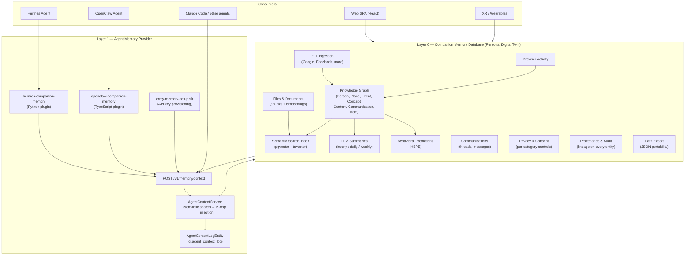
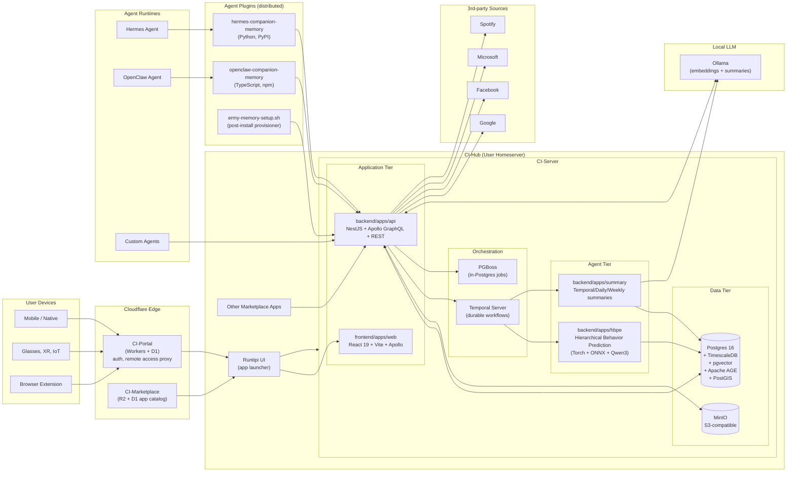
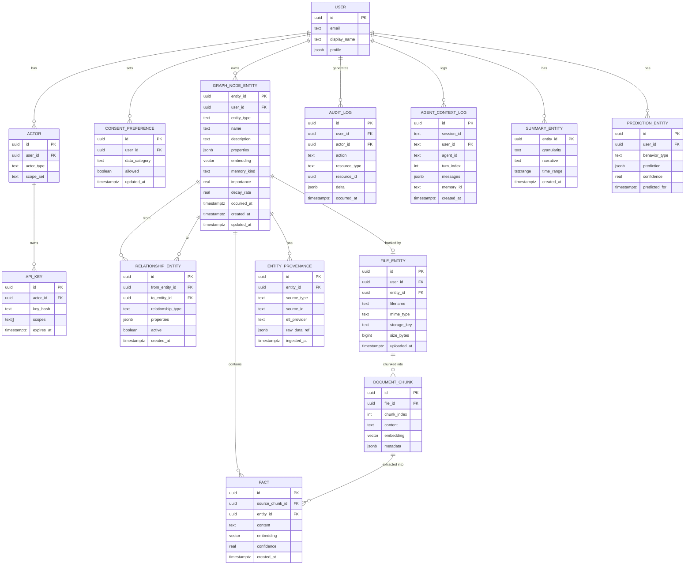
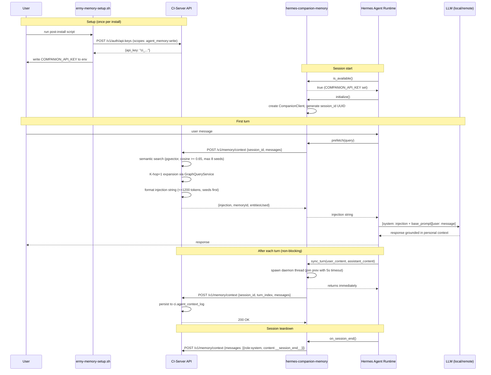
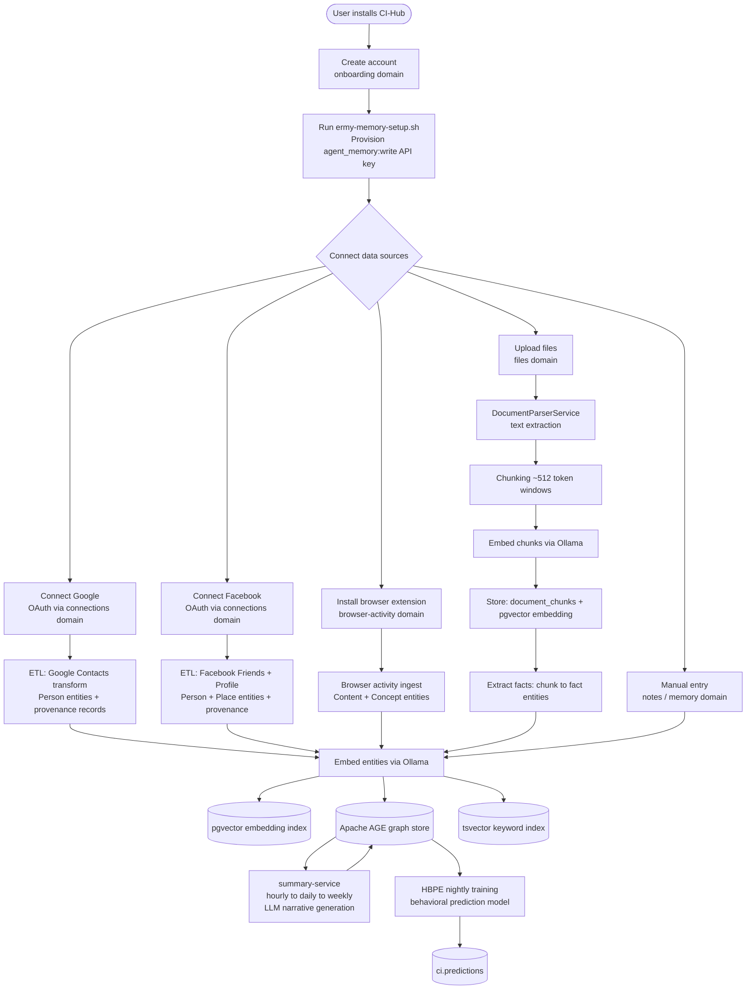
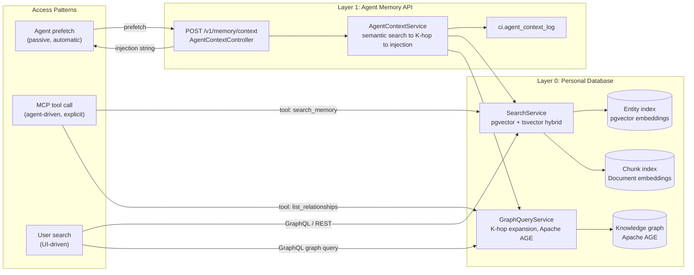
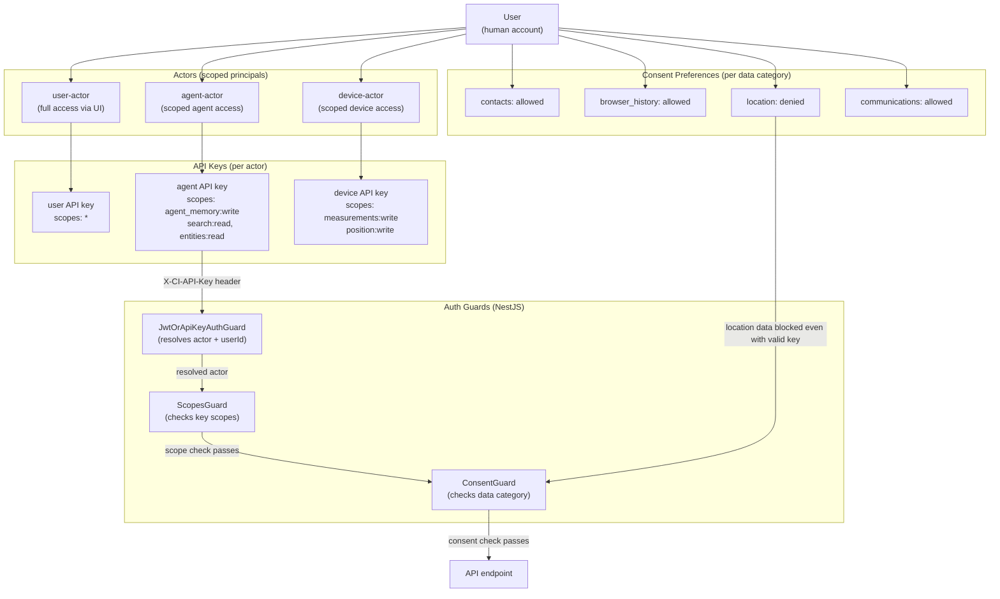
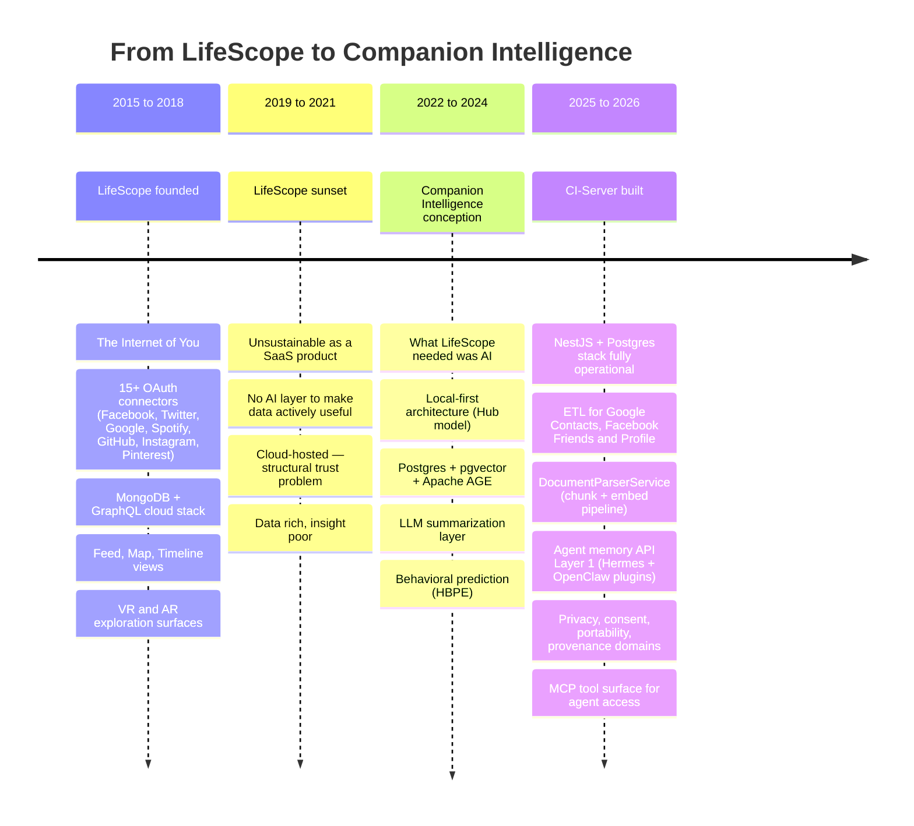

# Companion Memory Architecture

> **Status:** Living document &nbsp;•&nbsp; **Last updated:** 2026-05-22
>
> Technical architecture reference for CI's two-layer memory system: the Companion Memory Database (personal digital twin) and the Agent Memory Provider (adapter layer). See [ci-memory-plan.md](ci-memory-plan.md) for strategy and roadmap.

---

## Section 1: The Two-Layer Model

CI's memory architecture separates two distinct concerns that most competitors conflate:

- **Layer 0** is a full personal data operating system — a user-owned knowledge graph that stores everything the user has ever connected, uploaded, or captured.
- **Layer 1** is an adapter that makes Layer 0 available to AI agents as their persistent memory. It is powered by real personal data, not a shadow copy.



The key structural fact: **Layer 1 calls into Layer 0** — it does not replicate data. The injection string that Hermes receives is built directly from the user's real entity graph.

---

## Section 2: Full System Architecture

The complete CI stack, extended to show the agent memory layer and plugin distribution alongside the LifeScope lineage.



---

## Section 3: Data Model

The entity-relationship diagram covering the knowledge graph, file pipeline, agent context log, and ETL source mapping.



### ETL Source to Entity Type Mapping

| ETL Source | Entity Types Created | Relationship Types |
|---|---|---|
| Google Contacts | `Person` | `KNOWS`, `HAS_EMAIL`, `HAS_PHONE` |
| Facebook Friends | `Person` | `KNOWS`, `FACEBOOK_FRIEND` |
| Facebook Profile | `Person` (self), `Place` | `LIVES_IN`, `WORKED_AT`, `STUDIED_AT` |
| Browser Activity | `Content` (URL), `Concept` (topic) | `VISITED`, `INTERESTED_IN` |
| File Upload | `Content`, `Concept` | `CONTAINS`, `ABOUT` |
| Calendar (future) | `Event`, `Person` | `ATTENDED`, `ORGANIZED_BY` |
| Spotify (future) | `Concept` (artist/genre) | `LISTENS_TO`, `LIKES` |

---

## Section 4: Agent Integration Flow

End-to-end sequence from user setup through a live agent session with personal context injection.



---

## Section 5: User Flow — Setup and Data Ingestion

How a new user builds their personal memory database from scratch.



---

## Section 6: User Flow — Query and Retrieval

How queries travel through both layers across three access patterns.



---

## Section 7: Permissioning and Identity Model

CI's multi-actor identity model controls what each caller can read and write.



### Scope Reference

| Scope | Who holds it | What it grants |
|---|---|---|
| `agent_memory:write` | Agent actor API keys | POST /v1/memory/context |
| `search:read` | Agent actor API keys (v2) | GET /v1/search endpoints |
| `entities:read` | Agent actor API keys (v2) | GET /v1/entities/* |
| `measurements:write` | Device actor API keys | POST measurements |
| `position:write` | Device actor API keys | POST position updates |
| `*` | User actor API keys | All endpoints |
| `export:read` | User actor, explicit | GET /v1/export |
| `erasure:write` | User actor, explicit | POST /v1/privacy/erasure |

---

## Section 8: Comparison Matrix — Personal Memory Database

How CI's Layer 0 compares to the personal data and digital twin landscape.

| Dimension | CI | LifeScope | Solid/Pods | Apple Intelligence | Olares | Rewind/Limitless |
|---|---|---|---|---|---|---|
| Local-first | ✅ self-hosted Hub | ❌ cloud (AWS) | ✅ pod-hosted | ✅ on-device | ✅ local appliance | ❌ cloud |
| User-owned data | ✅ | ✅ | ✅ | ⚠️ Apple ecosystem | ✅ | ❌ now Meta |
| Primary data atom | Entity (typed, tiered) | Event (datetime, type, context) | RDF triple | Unspecified | Unspecified | Capture frame |
| Database | Postgres + AGE + pgvector | MongoDB (UUID arrays as edges) | RDF store | On-device index | Kubernetes PVC | Proprietary |
| Relationship model | Graph edges (traversable) | UUID arrays (resolved via hydration) | RDF predicates | None | None | None |
| Identity resolution | Multi-actor + ML dedup planned | Manual Contact→People grouping | Manual | Apple ID only | Manual | None |
| Tag / classification | memory_kind + properties | tagMasks (source/added/removed) | RDF types | Unspecified | None | Timeline labels |
| Knowledge graph | ✅ Apache AGE | ❌ MongoDB doc store | ⚠️ RDF triples | ❌ flat index | ❌ | ❌ timeline only |
| AI/LLM built-in | ✅ Ollama + summaries | ❌ | ❌ | ✅ Apple only | ⚠️ 3rd-party | ❌ |
| Summarization | ✅ hourly/daily/weekly | ❌ | ❌ | ⚠️ limited | ❌ | ❌ |
| Multi-source ETL | ✅ Google, Facebook, more | ✅ 15+ connectors | ❌ manual | ❌ | ❌ | ❌ capture only |
| ETL deduplication | Upsert by hash + provenance | Upsert by hash only | N/A | N/A | N/A | N/A |
| Agent API / MCP | ✅ Layer 1 + MCP server | ❌ | ❌ | ❌ | ❌ | ❌ |
| Vector search | ✅ pgvector (HNSW, 1536-dim) | ❌ | ❌ | ✅ private | ❌ | ❌ |
| Graph traversal | ✅ K-hop via AGE Cypher | ❌ | ⚠️ SPARQL | ❌ | ❌ | ❌ |
| Sensor hypertables | ✅ TimescaleDB | ❌ | ❌ | ⚠️ HealthKit | ❌ | ❌ |
| Provenance tracking | ✅ entity_provenance + ingest_runs | ❌ | ❌ | ❌ | ❌ | ❌ |
| Portability | ✅ streaming JSONL (.cta) | ✅ (basic) | ✅ | ⚠️ limited | ⚠️ | ❌ |
| Privacy controls | ✅ per-category + per-agent | ❌ | ✅ | ⚠️ Apple-controlled | ⚠️ | ❌ |
| Predictive layer | ✅ HBPE (Torch + ONNX) | ❌ | ❌ | ⚠️ limited | ❌ | ❌ |
| Skills / automation | ✅ deterministic + LLM skills | ❌ | ❌ | ⚠️ Shortcuts | ❌ | ❌ |
| VR / AR views | ✅ CI-Spatial-Companion | ✅ LifeScope-XR (A-Frame) | ❌ | ❌ | ❌ | ❌ |
| Browser extension | ✅ CI-Browser-Extension | ✅ LifeScope-Browser-Extension | ❌ | ❌ | ❌ | ❌ |
| Open source | ✅ | ✅ | ✅ | ❌ | ⚠️ partial | ❌ |
| Open protocol | ✅ GraphQL + REST + MCP | ❌ | ✅ Solid spec | ❌ | ❌ | ❌ |

---

## Section 9: Comparison Matrix — Agent Memory Provider

How CI's Layer 1 compares to the agent memory market.

| Dimension | CI (Layer 1) | Mem0 | Honcho | Letta/MemGPT | Zep/Graphiti | Supermemory | Cognee |
|---|---|---|---|---|---|---|---|
| Hermes plugin | ✅ | ❌ | ❌ | ❌ | ❌ | ❌ | ❌ |
| OpenClaw plugin | ✅ | ❌ | ❌ | ❌ | ❌ | ❌ | ❌ |
| Local-first | ✅ | ❌ | ❌ | ❌ | ❌ | ❌ | ❌ |
| Cloud-first option | ⚠️ via Portal | ✅ | ✅ | ✅ | ✅ | ✅ | ✅ |
| Graph-based | ✅ Apache AGE | ❌ | ❌ | ❌ | ✅ | ❌ | ✅ |
| Bi-temporal | ❌ planned | ❌ | ❌ | ❌ | ✅ | ❌ | ❌ |
| K-hop traversal | ✅ K=1 live | ❌ | ❌ | ❌ | ✅ | ❌ | ⚠️ |
| Predictive injection | ⚠️ HBPE v3 | ❌ | ⚠️ user model | ❌ | ❌ | ❌ | ❌ |
| Backs real personal DB | ✅ | ❌ | ❌ | ❌ | ❌ | ❌ | ❌ |
| Open source | ✅ | ✅ 41K stars | ✅ | ✅ | ✅ | ✅ | ✅ |
| Funding | — | $24M / ~$150M val | $5.35M | $10M | — | $3M | $7.5M |
| Active development | ✅ | ✅ | ✅ | ✅ | ✅ | ✅ | ✅ |

**Key differentiator:** every competitor stores agent conversation summaries and extractions. CI's agent memory is backed by the user's actual contacts, documents, browser history, and relationship graph. The injection for a question about a person draws from a real contact record with typed relationship edges — not from a prior conversation where that person happened to be mentioned.

---

## Section 10: LifeScope to CI Evolution

CI is the AI-native successor to LifeScope Labs. The core thesis is identical; the implementation is rebuilt from the ground up for local-first, AI-native operation.

### 10.1 LifeScope's Data Model

LifeScope organized personal data around six core object types:

| Object | Description |
|---|---|
| **Events** | The primary atom. Every user action (sent message, listened to song, visited webpage, made purchase) becomes an Event with `datetime`, `type`, and `context` fields. All activity normalized into this single type. |
| **Content** | Digital objects attached to events: images, videos, files, web pages, emails — each with `mimetype`, `text`, `title`, `url`. |
| **Contacts** | Per-handle objects: each social-media handle or email address is a *separate* Contact record. A **People** layer let users manually group handles belonging to the same real person. |
| **Locations** | Four subtypes: (1) provider-recorded (GPS from fitness app), (2) app-tracked (in-session coords), (3) uploaded GeoJSON, (4) **estimated** — a background worker backfilling location onto events with no native geotag by nearest timestamp match. |
| **Connections** | OAuth credentials for a specific provider — one row per provider per user. |
| **Saved Searches** | Persistent, named search queries as first-class persistent objects. |

**tagMasks** were a three-way tagging model applied to Events and Content: `source` (tags the platform assigned), `added` (tags the user added), `removed` (tags the user explicitly stripped). The effective tag set was `(source ∪ added) \ removed`.

### 10.2 LifeScope's Technical Stack

| Component | Technology | Notes |
|---|---|---|
| **Backend API** | Node.js + `graphql-compose-mongoose` | Auto-generated GraphQL from Mongoose schema definitions |
| **Database** | **MongoDB** | Relationships modeled as UUID arrays inside documents, resolved via GraphQL hydration at query time — **not** traversable graph edges |
| **Frontend** | Vue.js / Nuxt.js SPA | Views: Feed, List, Map, Gallery, Timeline, VR (A-Frame / WebXR), AR |
| **ETL** | Separate Node.js service | Per-provider scripts; upsert-by-hash deduplication |
| **Hosting** | AWS (cloud) | Not local-first; user data on LifeScope's servers |
| **LifeScope-XR** | A-Frame / WebXR | VR/AR memory palace for spatial browsing of personal history |
| **LifeScope-Voice** | Conversational interface | Natural-language querying of the archive |
| **LifeScope-Browser-Extension** | Browser extension | Passive capture of visited pages and interactions |

### 10.3 The Ten LifeScope Limitations CI Addresses

| # | LifeScope Limitation | CI Response |
|---|---|---|
| 1 | **No intelligence layer** — retrieval-only; never reasoned over data | LLM summarization pipeline (hourly/daily/weekly via Ollama) |
| 2 | **Manual identity resolution** — Contact→People grouping was manual, no ML deduplication | Multi-actor model; ML cross-handle dedup planned |
| 3 | **MongoDB, not a graph DB** — relationships were UUID arrays, not traversable edges | Postgres + Apache AGE (native Cypher graph traversal) |
| 4 | **No AI / LLM integration anywhere** | Ollama local LLM; multi-provider routing (OpenAI, Anthropic) planned |
| 5 | **No agent / MCP surface** — data was for the user's eyes via SPA only | MCP server (stdio + streamable HTTP), GraphQL subscriptions, SSE |
| 6 | **No vector search / semantic embeddings** | pgvector HNSW (1536-dim nomic-embed-text); hybrid keyword + semantic retrieval |
| 7 | **No predictive layer** | HBPE (PyTorch + ONNX + Qwen3); nightly train + INT8 inference; Prediction entities |
| 8 | **No privacy / consent API** | agent_access_policies + consent receipts + PII redaction at egress (plan 09) |
| 9 | **No provenance tracking** | entity_provenance + ingest_runs + DERIVED_FROM edges (plan 08) |
| 10 | **Cloud-hosted on AWS, not local-first** | Docker Compose on CI-Hub; user owns hardware; data never leaves without consent |

### 10.4 Timeline



### Feature-by-Feature Evolution

| LifeScope capability | CI equivalent | What CI adds |
|---|---|---|
| **Event** as primary atom (datetime, type, context) | Entity graph with `memory_kind=episodic` | Episodic/semantic/procedural/reflective tiers; importance + decay scoring |
| **Content** (mimetype, text, title, url) | `Content` entity + `files` domain | DocumentParserService: text extraction → chunking → embedding → fact pipeline |
| **Contacts** (per-handle) + People (manual grouping) | `Person` entity + multi-actor model | ML cross-handle dedup planned; actors model every principal (user/agent/device) |
| **Locations** 4 subtypes incl. estimated backfill | `position` TimescaleDB hypertable | Sub-second hypertable writes; XR relative coords + headpose; estimated backfill via ETL promote |
| **Connections** (OAuth credentials per provider) | `connections` domain + OAuth clients | Provenance-recording promote pipeline; `ingest_runs` with rollback |
| **Saved Searches** (first-class persistent objects) | Skill kind: deterministic query (planned) | Versioned, user-installable, invoked via MCP or GraphQL |
| **tagMasks** (source / added / removed) | Entity `properties` JSONB + memory kind | Formal memory tiering replaces manual tag bookkeeping |
| OAuth ETL connectors (15+ providers) | `domains/etl` (Google, Facebook; expanding) | Provenance recording on every transform; entity graph vs. document store |
| MongoDB document store (UUID arrays as edges) | Postgres + Apache AGE + pgvector | Real graph traversal (Cypher) + vector search in one database |
| `graphql-compose-mongoose` auto-generated GraphQL | NestJS Apollo GraphQL + REST | Scoped API keys, multi-actor system, MCP tool surface, GraphQL subscriptions |
| Feed / Map / Timeline / Gallery views | Web SPA (React 19 + 3D force-graph + Leaflet) | Graph visualization, semantic search, document search, entity timeline |
| VR / AR views (LifeScope-XR, A-Frame / WebXR) | CI-Spatial-Companion, CI-XR-Scan | `position` hypertable with relative coords and headpose for AR; PostGIS |
| LifeScope-Voice (conversational interface) | `domains/intelligence` Q&A surface | Full LLM-backed conversation with tool dispatch (voice mode in plan 16) |
| LifeScope-Browser-Extension | CI-Browser-Extension (`browser-activity` domain) | Captures to entity graph with provenance; feeds semantic search index |
| No AI | Ollama LLM integration | Hourly/daily/weekly summaries, entity embeddings (nomic-embed-text 1536-dim) |
| No predictions | HBPE (Torch + ONNX + Qwen3) | Nightly train + INT8 inference; `Prediction` entities in graph |
| No agent surface | MCP server + Layer 1 agent memory API | Hermes + OpenClaw plugins; `ci.memory.*` MCP tools; K-hop injection |
| No privacy controls | `domains/privacy`, `domains/consent` | Per-category consent, right-to-erasure, agent_access_policies, consent receipts |
| No provenance | `entity_provenance` + `ingest_runs` | Full lineage on every entity; `DERIVED_FROM` edges; rollback via `rollback_at` |
| No portability | `domains/export` (plan 11) | Streaming JSONL + Parquet CI Twin Archive (.cta) with age encryption |
| Cloud-hosted on AWS | CI-Hub (Runtipi-based homeserver) | User owns hardware; data never leaves without explicit consent; Docker Compose |

---

## Section 11: CI Differentiation Summary

```mermaid
quadrantChart
    title Personal Memory and Agent Memory Positioning
    x-axis Cloud-first --> Local-first
    y-axis Agent-specialized --> Full personal database
    quadrant-1 Local + Full DB (CI target quadrant)
    quadrant-2 Local + Agent-only
    quadrant-3 Cloud + Agent-only
    quadrant-4 Cloud + Full DB
    CI: [0.85, 0.85]
    LifeScope: [0.15, 0.70]
    Solid/Pods: [0.75, 0.65]
    Apple Intelligence: [0.65, 0.55]
    Olares: [0.80, 0.35]
    Mem0: [0.10, 0.10]
    Honcho: [0.10, 0.20]
    Letta: [0.15, 0.15]
    Zep: [0.05, 0.25]
    Supermemory: [0.08, 0.10]
    Cognee: [0.12, 0.20]
```

### The Unique Quadrant

CI occupies the **upper-right quadrant** — local-first, full personal database — which is currently empty of well-funded, AI-native competitors.

- **Cloud + agent-only** (Mem0, Honcho, Letta, Zep): large funding, fast traction, but no personal data moat; vulnerable to consolidation by foundation model providers who can add memory natively
- **Local + agent-only**: no significant player
- **Cloud + full DB** (LifeScope's original position): shuttered; the cloud trust problem is structural and worsens as privacy regulation expands
- **Local + full DB** (CI): defensible data flywheel + structural privacy advantage + agent API as a natural output of owning the data

The long-term winner in personal AI is whoever owns the personal data layer — not whoever builds the best memory summarizer on top of someone else's conversation history. The agent memory layer is table stakes for owning the personal data layer; it is not the moat itself.
