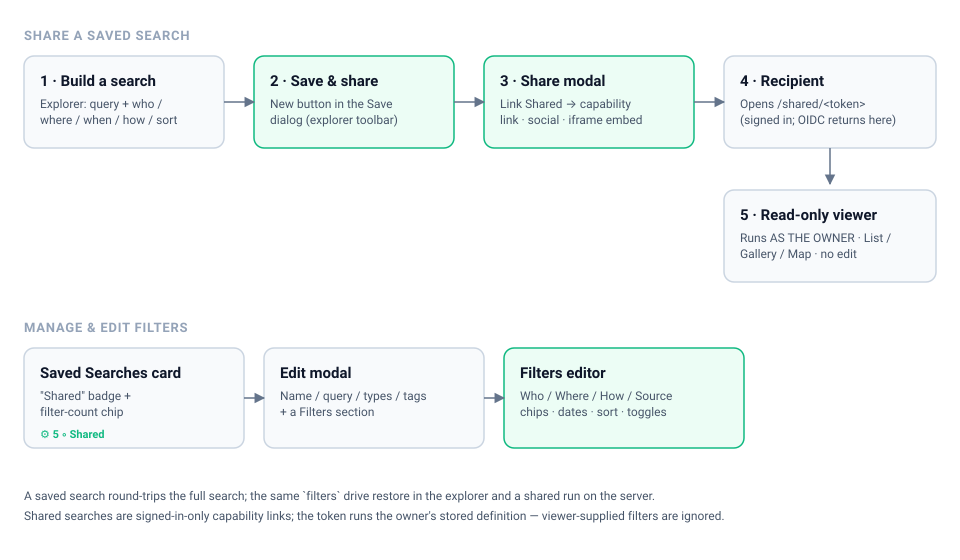
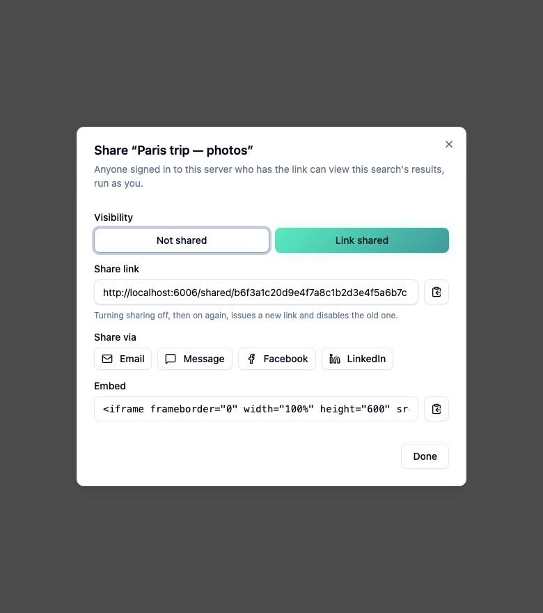
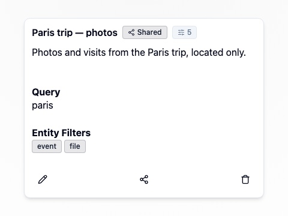
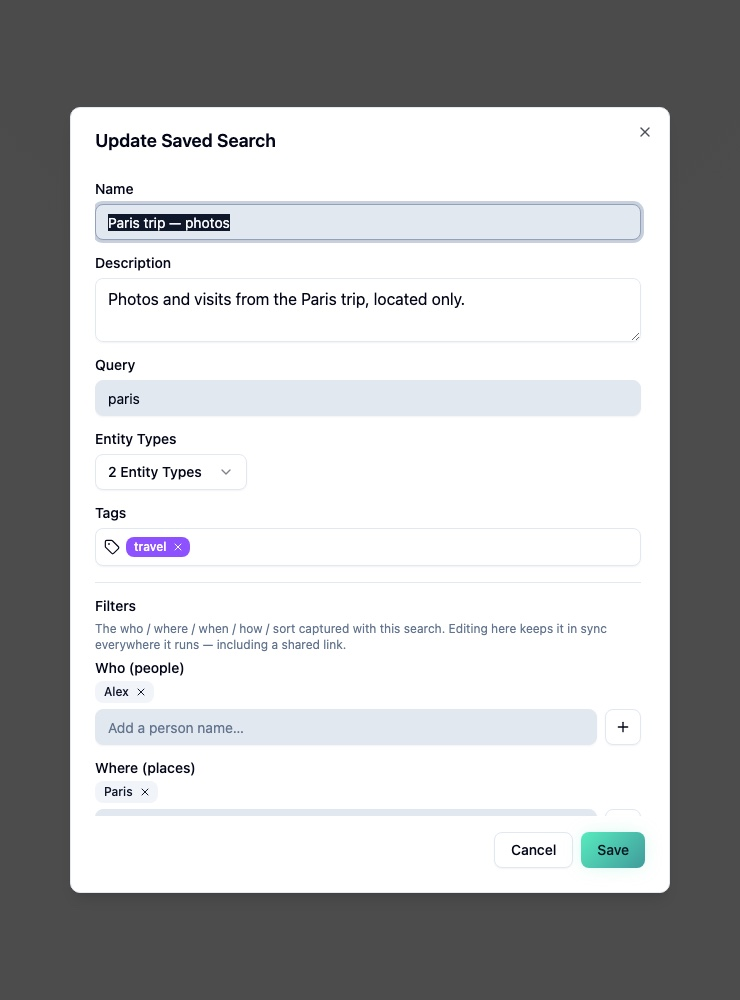
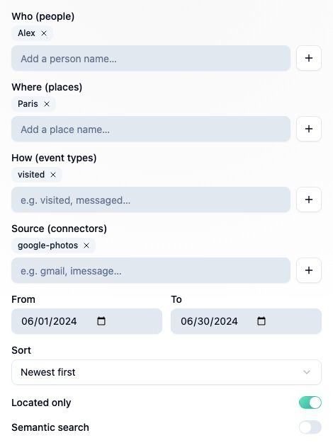

# Saved searches: sharing & full-filter capture

> Personal database feature in CI-Server's web app. A saved search now (a) captures the
> **full** explorer state — not just query/types/tags — and (b) can be **shared** via a
> signed-in capability link that runs the search *as the owner*.



> User-facing docs (with this same set of screenshots): see the **Companion Memory** page
> at [docs.ci.computer](https://docs.ci.computer/docs/first-party-apps/digital-memory-server)
> (`src/content/docs/first-party-apps/digital-memory-server.mdx` in the CI-Docs repo). The
> screenshots below are captured from the CI-Server Storybook stories via
> `CI-Docs/scripts/capture-component-screenshots.sh` and committed to both repos so they
> stay in sync.

## Screenshots / live UI

All the rendered UI lives as **Storybook** stories under `frontend/apps/web/src/pages/SavedSearchesPage/*.stories.tsx`
(the reproducible source). To view them live or re-capture screenshots:

```bash
yarn workspace @ci/fe-web storybook   # http://localhost:6006
# Then either browse the "Saved Search" group, or:
bash ../CI-Docs/scripts/capture-component-screenshots.sh
```

---

## Flow A — share a saved search

### 1. Build a search

In **Memory → Explorer**, type a query and add any filters (Advanced panel): who (people),
where (places / located-only), when (date range), how (event types), source (connectors),
sort, semantic. All of it is now captured by a save — not just the query.

### 2. Save & share  ·  _toolbar_

Click **Save search** in the explorer toolbar. The dialog has three actions:
**Cancel**, **Save**, and **Save & share**. **Save & share** creates the saved search and
immediately opens the share modal on it — no trip to the Saved Searches page.

### 3. Share modal  ·  story `saved-search-share-modal--link-shared`



- **Visibility** toggle: _Not shared_ / _Link shared_.
- Turning on **Link shared** mints an unguessable token and shows the **capability link**
  (`/shared/<token>`), **social** buttons (Email / Message / Facebook / LinkedIn), and an
  **iframe embed** snippet — each copyable.
- Turning sharing off, then on again, **rotates** the token (old links die).

### 4–5. Recipient opens the link → read-only viewer  ·  route `/shared/:token`

A **signed-in** recipient opens the link and sees a read-only explorer (List / Gallery /
Map; responsive). The search runs **as the owner** — the token authorises the owner's
stored definition only; the viewer cannot widen it. Media (photo/video thumbnails) resolves
under the owner so shared galleries actually render. If the recipient isn't signed in,
login (incl. CI-Portal **OIDC**) returns them to the shared link afterward.

---

## Flow B — manage & edit a saved search

### Saved Searches card  ·  story `saved-search-card--shared-and-filtered`



Each card shows a **“Shared”** badge when public and a **filter-count chip**
(`⚙ N`, hover for the active dimensions) so the captured filters are visible at a glance.
Buttons: **Edit · Share · Delete**.

### Edit modal + Filters editor  ·  stories `saved-search-edit-modal--with-filters`, `saved-search-filters-editor--populated`





The Edit modal now has a **Filters** section (below Tags) with a full editor:

| Dimension            | Control                                   |
| -------------------- | ----------------------------------------- |
| Who / Where / How / Source | removable chips + free-text add     |
| When                 | From / To date pickers                    |
| Sort                 | preset dropdown (Newest, Name A–Z, …)     |
| Located only / Semantic | toggles                                |

Editing here keeps the saved search in sync everywhere it runs — the explorer restore
**and** a shared link.

---

## How it works

### Capture & restore (the explorer ↔ a saved search)

- **Capture:** the toolbar's `buildSavedSearchFilters(URLSearchParams)` reads the explorer's
  `?from/?to`, `?eventTypes`, `?connectors`, `?people`, `?places`, `?hasLocation`,
  `?semantic`, `?sortBy/?sortOrder` into a `filters` object. The Edit modal edits the same
  shape via `SavedSearchFiltersEditor`.
- **Storage:** a `filters JSONB` column on `ci.saved_searches`
  (migration `20260628130000_add_saved_search_filters.sql`).
- **Restore:** `DesktopMemoryPage` writes those `filters` back into the explorer URL params
  when a saved search is opened (`/memory?saved_search=<id>`).

### Sharing (signed-in capability links)

- `ci.saved_searches` carries `is_public` + `share_token`
  (migration `20260628120000`, with a `CHECK` constraint binding the two).
- `setSavedSearchSharing` mints / rotates / clears the token (owner-scoped);
  `sharedSavedSearch(token)` returns the definition for the viewer **without** echoing the
  token back.
- A shared run goes through `SearchInput.shareToken` →
  `SearchResolver.runSharedSearch`, which loads the saved search, builds the **owner's**
  service context, and applies **only the owner's stored filters** (the viewer controls
  paging/sort only). `entityOwnerScope` makes a result node's media/relations/tags resolve
  under the node's owner so shared galleries render.
- Access is **signed-in users only** — the resolvers stay behind the auth guard; the token
  is not an anonymous surface. See the tenancy note in
  [`architecture.md`](architecture/architecture.md) §8.

### Where the code lives

| Area | Path |
| ---- | ---- |
| Filter capture (pure) | `frontend/.../pages/MemoryPage/savedSearchFilters.ts` |
| Filter edit helpers (pure) | `frontend/.../pages/SavedSearchesPage/savedSearchFiltersEdit.ts` |
| Filter editor UI | `frontend/.../pages/SavedSearchesPage/SavedSearchFiltersEditor.tsx` |
| Share modal | `frontend/.../pages/SavedSearchesPage/ShareSavedSearchModal.tsx` |
| Read-only viewer | `frontend/.../pages/SharedSearchPage/SharedSearchPage.tsx` |
| Sharing + filters backend | `backend/.../files/services/SavedSearchService.ts`, `backend/.../graphql/resolvers/{SavedSearchResolver,SearchResolver}.ts` |

### Tests

- Backend (jest): `SavedSearchService` (mint/rotate/clear, owner scoping, token lookup,
  create/update **filters**), `SavedSearchResolver`, `SearchResolver.runSharedSearch`
  (filter-stripping / run-as-owner / **filters applied** / bad-token), and the OIDC
  open-redirect guard.
- Frontend (vitest): the pure builders — `shareLink`, `savedSearchFilters` (capture),
  `savedSearchFiltersEdit` (edit transforms).
- Stories double as render smoke-tests for the new UI.
