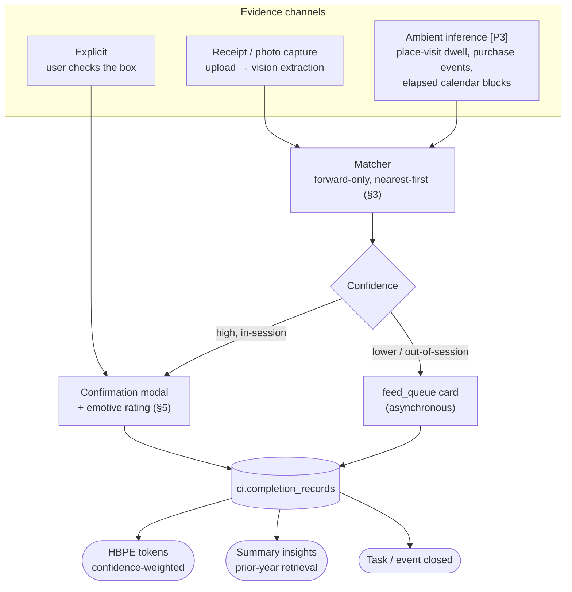

# Completion Detection & Capture

> **Status:** Proposal — for team review &nbsp;•&nbsp; **Authored:** 2026-08-09 &nbsp;•&nbsp; **Implementation state re-checked:** 2026-08-19
>
> The system that decides whether a planned task or event actually happened, confirms it with the user, and records *when* it happened and *how it felt*. Receipt capture is the first evidence channel.
>
> **Companion designs:** [HBPE redesign](hbpe-data-rich-redesign.md) · [Tasks & Scheduling](tasks-and-scheduling.md) · [System map](ci-prediction-doc-map.md)

> **Still unbuilt, but two of its premises have moved (verified 2026-08-19).** There is no
> `ci.completion_records` table anywhere in the migrations and no matcher, so the design
> below is still entirely a proposal. Two things it asserts about the surrounding code are
> now out of date:
>
> - **The object/receipt family is no longer "schema present, product surface not shipped".**
>   PR #2176 landed `ReceiptService`, `ObjectResolutionService`, `ObjectObservationService`,
>   `ObjectMintService`, `ObjectMergeService`, `ObjectDuplicateService` and
>   `ProductModelService`, a `/memory/receipts` page with a `/receipts/:id` detail route, a
>   `ReceiptType` GraphQL surface, and `/v1/receipts`, `/v1/product-models` and
>   `/v1/observations` bulk-ingest lanes. §4.2's "`ObjectResolutionService` /
>   `ObjectObservationService` — named in migration headers, do not exist" is no longer
>   true, and `Database.md`'s "pre-implementation" note (still cited in §4.1) has not caught
>   up. What is still missing is exactly the piece this document proposes: nothing extracts
>   a receipt from an uploaded image — there is no `ReceiptExtractionListener` and no
>   `receiptCapture` flag, and `extraction_state`/`raw_text` are only ever written by the
>   ingest lane from a client that already did the extraction.
> - **`ci.tasks.actual_minutes` now has a write path**, though still no timer:
>   `completeTask(id, actualMinutes)` and `updateTask` both accept it
>   (`TaskResolver.ts:142-152`, `TaskService.complete` at `TaskService.ts:245-258`). The web
>   Plan page does not pass one, so in practice the column is still 0.
> - **`ci.events.status = 'completed'` is no longer unwritten.** §1's first table row is out
>   of date: `VerifyDoneService.runForUser`
>   (`domains/planning/services/TodoProcessService.ts:304-380`, on the `verifyDone` cron
>   leg) takes planned blocks whose `task_id` is set and whose end time passed within 36
>   hours, searches memory for completion phrasing, and on a positive signal with
>   `PersonalizationService.decideAction` returning `auto` completes the task and saves the
>   event as `'completed'`; otherwise it files a `ci.task_pending_changes` row for the user
>   to confirm. That is a narrow first cut of exactly this design's principle — but it only
>   reaches events minted from a planned block, records no `completed_at` from evidence and
>   no emotional outcome, and has no receipt or ambient channel. The matcher, the
>   confirmation modal and `ci.completion_records` are all still to build.
>
> Line citations below predate the planning/receipts work and have drifted — see the inline
> corrections in §3.2 and §4.3.

---

## 1. Why This System Exists

CI-Server records intentions in detail and outcomes not at all.

| Signal that should exist | Actual state |
|---|---|
| `ci.events.status = 'completed'` | Supported by the CHECK (`20250925145800_replace_events_table.sql:73-75`); **no code path ever writes it**. The only reference is a read filter (`EventService.ts:320`). Every event is `'confirmed'` forever |
| `ci.tasks.actual_minutes` | `NOT NULL DEFAULT 0`; no timer exists, nothing writes a real value |
| Emotional outcome | No sentiment analysis exists anywhere. All four `sentiment_score` columns are importer pass-through only; if an importer omits one it stays NULL |
| `ci.answers.emotional_state` | `TEXT`, documented as "user's emotional state if detectable" — nothing writes it, nothing reads it |
| `hbpe.occurrence_log.actual` | Real, but scores *L1 clusters* for prediction accuracy — no task or event FK |
| Inference of completion from other data | None. No location-dwell → attended, no purchase → errand-done, nothing |

The only completion signal in the product is a checkbox on `/plan` (`PlanPage.tsx:83-85` → `TaskService.complete`), which is feature-flagged off by default and records nothing beyond a timestamp.

**Consequences.** HBPE trains on what was *scheduled*, not what *occurred* — it cannot distinguish a gym block you attended from one you skipped. The planner never revisits an accepted candidate. And the "last December was stressful, start earlier this year" scenario has no factual basis: the nearest thing is `mood_indicators`, an LLM guess about a whole day, which never propagates above the daily summary tier.

This system creates the missing signal.

---

## 2. Architecture

Three evidence channels feed one verification pipeline, which produces one record type.



**Principle: the system proposes, the user confirms.** No detector or LLM ever marks something complete on its own. This follows the precedent already written into `ci.object_observations`, whose `confirmed_by_user BOOLEAN` is documented as "TRUE only when a human confirmed it. Never set by a detector or an LLM" (`20260803223022:70`). A wrong auto-completion is worse than a missed one: it silently poisons training data with behavior that never happened.

---

## 3. The Matching Rule: Forward Only

When evidence arrives, candidate matches are drawn from the user's open items under three rules:

1. **Never look into the past.** Only items dated today or later are eligible.
2. **Prefer the nearest.** Rank by proximity — today beats tomorrow beats next week. A grocery receipt matches today's "get groceries", not the one pencilled in for next month.
3. **Open only.** `status IN ('open','in_progress')`; already-done, skipped, and archived items are excluded.

### 3.1 Why forward-only is correct

This rule is only sound because of **roll-forward** ([Tasks & Scheduling](tasks-and-scheduling.md) §4): incomplete tasks advance their `scheduled_for` to today rather than stranding in the past. Every actionable item is therefore dated today or later, so a forward-only search covers the entire open list. The two designs are load-bearing for each other — implementing forward-only matching *without* roll-forward would silently fail to match anything overdue.

### 3.2 Implementation note

`TaskService.findAll` sorts `due_at ASC NULLS LAST` (`TaskService.ts:176`, was `:123-126` when this was written) but has no `WHERE due_at >= now()` predicate — the forward-only filter is new. Matching should query on the *effective* date (`COALESCE(defer_until, scheduled_for, due_at::date)`) so a deferred task is scored at its deferred date, matching the client-side precedence already in `taskSections.ts:80-82`.

---

## 4. Receipt Capture

### 4.1 What already exists

The upload and vision infrastructure is shipping — this channel is a listener and a prompt, not new plumbing.

- **Upload → MinIO → dedup → presign:** `FileService.uploadWithDedupInfo` (`FileService.ts:375-418`), `POST /api/files/upload` (`FilesController.ts:29`).
- **Event fan-out:** `FileUploadedEvent` → `FilePreviewGenerationListener` → `PreviewGeneratedEvent` (`files/events.ts:8-12`).
- **Vision LLM, twice over:** `ImageDescriptionListener` (`llava:7b`) and `ThingVisionListener` (`llama3.2-vision:11b`). Both do base64 → `OllamaService.chat(..., {images, format:'json'})` → fence-stripping → brace-slice → zod `safeParse`. That JSON-repair pattern is hand-rolled identically in both — copy it, do not reinvent it.
- **Receipt schema, migrated and empty:** `ci.receipts` (`20260803223019:23-84`) with `merchant_name`, `purchased_at`, integer-minor-unit money columns, `extraction_state ∈ pending|extracted|failed|manual|not_applicable`, `extraction_confidence`, `raw_text`, `event_id`, and a drain-queue index. Plus `ci.receipt_line_items` and `ci.object_observations`. `Database.md:103-105` marks the whole family pre-implementation: "schema present, product surface not shipped."

### 4.2 What is new

- A **`ReceiptExtractionListener`** on `FileUploadedEvent`, gated on a new `receiptCapture` payload flag, modeled directly on `ThingVisionListener`.
- A receipt-extraction prompt + zod schema → writes `ci.receipts` + `ci.receipt_line_items`.
- The matcher (§3) and the confirmation surface (§5).
- `ObjectResolutionService` / `ObjectObservationService` — named in migration headers, do not exist. Only needed if line-item → inventory resolution is in scope; **out of scope for completion detection**, which only needs merchant, timestamp, and line-item descriptions.

### 4.3 Two traps to avoid

1. **Do not use the preview.** `ImageDescriptionListener` runs on `PreviewGeneratedEvent`, whose image is capped at 300px (`PREVIEW_MAX_DIMENSION`). That is unusable for receipt text. Follow `ThingVisionListener`, which listens to `FileUploadedEvent` and fetches the **original** bytes.
2. **`pinned.demo.models` silently swaps the model.** `OllamaService.resolveModel` (now at `OllamaService.ts:732-751`, was `:482-484`) overrides any requested model with `gemma3:27b` whenever visual content is present — and with `qwen3:14b` when there is none. The flag ships `false`; with it off, `resolveServedChatModel` picks a model that is actually loaded on the active backend, preferring a vision-capable one for image turns. Verify the target environment's flag before benchmarking a chosen model — otherwise you are measuring a different one.

### 4.4 Honest risk

Small vision models are weak at dense receipt text. There is **no OCR in the stack** — zero hits for tesseract/paddle across all three apps; `ci.receipts.raw_text` exists and is described as "OCR/text layer" but nothing writes it. A vision-LLM read is the path of least resistance and is likely adequate for the *matching* task (merchant name + rough item list is enough to match "get groceries"), even where it would be inadequate for line-item accounting. **Design accordingly: match on merchant and coarse category first, treat line items as best-effort.** If per-item accuracy becomes a requirement, real OCR is a new dependency and a new container, and should be scoped separately.

### 4.5 Flow

```
upload (receiptCapture: true)
  → FileUploadedEvent
  → ReceiptExtractionListener: original bytes → vision model → {merchant, purchased_at, total, line_items[]}
  → ci.receipts (extraction_state='extracted', extraction_confidence)
  → matcher: merchant/category → open items, today-or-later, nearest first
  → 0 matches: receipt is stored on the timeline, no prompt
    1 strong match: confirmation modal, pre-selected
    n matches: modal with a short ranked list
```

**Worked example.** A task "get groceries" sits on today's list. The user uploads a supermarket receipt. Extraction returns merchant "Safeway", `purchased_at` 18:42, category grocery. The matcher finds "get groceries" dated today — nearest, open, forward. The modal opens: *"Did this complete **get groceries**?"* The user confirms; the task is crossed off, `completed_at` is set from the receipt's `purchased_at` rather than the upload time, and the emotive rating is captured.

---

## 5. The Confirmation Modal

### 5.1 Surface choice

Two surfaces, chosen by context:

| Context | Surface | Rationale |
|---|---|---|
| Immediately after an in-session upload | **Modal** (`AlertDialog` from `@ci/shadcn` — the semantically correct confirmation primitive) | The user just acted; a modal is expected and the context is fresh |
| Ambient inference, background extraction, anything out-of-session | **`feed_queue` card** modeled on `PromotionReviewCard.tsx` | Interrupting with a modal for something the user did not just do fights the established async, dismissible grain |

Adding a `feed_queue` item type requires a constraint-swap migration — `promotion_review` (`20260808150200:24-44`) is the precedent for a type that sets none of the FK id columns and rides on `metadata JSONB`.

### 5.2 Content

```
┌─────────────────────────────────────────────┐
│  Did this complete "get groceries"?          │
│  Safeway · today, 6:42 PM                    │
│  [thumbnail]                                 │
│                                              │
│  ○ get groceries          — today            │
│  ○ pick up prescription   — tomorrow         │
│  ○ Something else / not a task               │
│                                              │
│  How did it go?                              │
│    [emotive scale — see §5.3]                │
│                                              │
│  Add a note (optional)                       │
│  [                                        ]  │
│                                              │
│         [ Not now ]      [ Confirm ]         │
└─────────────────────────────────────────────┘
```

Rules:
- **Completion time comes from the evidence, not the confirmation.** `completed_at` = the receipt's `purchased_at` where available; the upload timestamp is a fallback. A receipt confirmed the next morning still records last night.
- The emotive rating is **optional but pre-focused** — one tap, never a blocker. "Not now" records nothing and re-queues once.
- "Something else / not a task" is a first-class option and is recorded as negative feedback for the matcher.

### 5.3 The emotive scale

Granularity follows a new user setting, **Emotion Complexity**. The goal is a one-tap capture of how the task felt, not a mood survey.

| Level | Options | Intent |
|---|---|---|
| **1** | 👍 &nbsp; 👎 | Minimum friction. Binary valence |
| **2** | 😞 unhappy &nbsp; 😐 content &nbsp; 😊 happy | Adds a genuine neutral |
| **3** | 😠 angry &nbsp; 😰 stressed &nbsp; 😢 sad &nbsp; 😐 content &nbsp; 😊 happy &nbsp; 🤩 excited | Distinguishes *kinds* of negative — anger, stress, and sadness are different affects, and stress is the one that matters most for scheduling advice |

Level 3 is the level that makes the "last December was stressful" case work. Collapsing it to a single number would lose exactly the distinction being acted on, so storage keeps both the label and a two-dimensional projection:

| Label | Valence | Arousal |
|---|---|---|
| angry | −0.8 | 0.9 |
| stressed | −0.5 | 0.8 |
| sad | −0.6 | 0.3 |
| content | 0.0 | 0.2 |
| happy | +0.6 | 0.6 |
| excited | +0.9 | 1.0 |
| 👍 / 👎 (level 1) | +1.0 / −1.0 | — |

Levels are **display granularity over one underlying model** — a level-1 👎 and a level-3 😠 are both negative valence, comparable across time even if the user changes the setting. Store `scale`, `label`, `valence`, and `arousal` together so nothing is reconstructed later from a lossy float.

### 5.4 The setting

"Emotion Complexity" (1/2/3, default 2) follows the established preference pattern: per-user values live on the self Person entity's `properties` JSONB via `PersonalizationService` (`getProfile` reads `self.properties.planner`; `updateTrustMode` is the write template, `PersonalizationService.ts:29-83`). **No migration required.**

Add: `EMOTION_COMPLEXITY_LEVELS` to `personalization/types.ts`, the key to `PersonalizationProfile`, a `@Post('emotion-complexity')` route on `PersonalizationController`, and an `EmotionSection.tsx` copying `AutonomySection.tsx` verbatim (plain `fetchJson`, local state, explicit Save). Known downside of the pattern: untyped JSONB storage means a bad value silently falls back to the default.

---

## 6. Storage

### 6.1 A dedicated table

New `ci.completion_records`:

| Column | Type | Notes |
|---|---|---|
| `completion_id` | `uuid` PK (uuidv7) | |
| `user_id` | `uuid` → `ci.users` ON DELETE CASCADE | |
| `subject_type` | `text` CHECK `IN ('task','event')` | One record type spans both |
| `subject_id` | `uuid` | No FK — subjects live in different tables |
| `completed_at` | `timestamptz` NOT NULL | From evidence, not confirmation (§5.2) |
| `duration_minutes` | `int` NULL | Backfills `ci.tasks.actual_minutes`, currently never written |
| `sentiment_scale` | `smallint` CHECK `IN (1,2,3)` | Which scale was shown |
| `sentiment_label` | `text` NULL | The raw choice — `'stressed'`, `'happy'` |
| `sentiment_valence` | `real` CHECK `BETWEEN -1 AND 1` NULL | Normalized, comparable across scales |
| `sentiment_arousal` | `real` CHECK `BETWEEN 0 AND 1` NULL | Level 3 only |
| `note` | `text` NULL | |
| `source` | `text` CHECK `IN ('manual','receipt','inferred')` | |
| `evidence_ref` | `uuid` NULL | e.g. the `ci.receipts` row |
| `confidence` | `real` NULL | Matcher confidence at proposal time |
| `l0_class`, `l1_cluster_id` | `text`, `uuid` NULL | Denormalized from the subject so HBPE tokenizes without a cross-schema join |
| `created_at` | `timestamptz` DEFAULT now() | |

Indexes: `(user_id, completed_at DESC)` for HBPE's per-day reads; `(user_id, subject_type, subject_id)` unique to keep confirmation idempotent; `(user_id, l1_cluster_id, completed_at DESC)` for prior-year retrieval.

### 6.2 Why a separate table, not columns

1. **It spans tasks and events.** Both need completion; neither table should own the other's records.
2. **`sentiment_score` is a trap, not a fit.** `EventService.ts:538` and `CommunicationService.ts:287` guard with `if (data.sentiment_score)`, so an exactly-neutral `0` is **silently dropped** — precisely the value "content" maps to. `AnswerService.ts:240` gets it right with `!== undefined`; the event path does not. Routing emotive ratings through that column would lose every neutral rating.
3. **It is a first-class signal**, read by HBPE, the summary insight pipeline, and the planner. Burying it in a subject table would make all three do conditional joins.

---

## 7. What Completion Records Unlock

| Consumer | Use |
|---|---|
| **HBPE tokenization** | Completed tasks become anchor-tier tokens at `completed_at` with `duration_minutes`; a bucket backed by a confirmed completion gets `soft_prob = 1.0` rather than a labeler similarity score ([HBPE §2.3, §3.2](hbpe-data-rich-redesign.md)) |
| **HBPE recurrence** | Confirmed occurrences are ground truth for inter-arrival gaps, replacing "an event existed on the calendar" as the occurrence definition |
| **Seasonal insights** | The prior-year retrieval in [HBPE §8](hbpe-data-rich-redesign.md) reads completion records alongside summaries — structured, user-supplied valence with timestamps and notes rather than an LLM's guess about a day. This is what makes "last December's wrapping was stressful — start by the 13th" a fact rather than an inference |
| **Planner** | `fit_score` can penalize slots and clusters that historically produced negative valence; repeated `stressed` on a cluster is a scheduling signal, not just a diary entry |
| **Task hygiene** | `actual_minutes` finally gets real values, making `estimated_minutes` calibratable |

---

## 8. Phasing

| Phase | Contents |
|---|---|
| **P1** | `ci.completion_records` migration; Emotion Complexity setting + `EmotionSection`; modal on the existing `/plan` checkbox (explicit channel only — no vision yet); HBPE consumes completion records for confidence weighting |
| **P2** | `ReceiptExtractionListener` + prompt + zod schema; `ci.receipts` writes; matcher (§3); post-upload modal; `feed_queue` item type + card |
| **P3** | Ambient inference channels (place-visit dwell vs scheduled block, purchase events, elapsed-calendar prompts); negative-feedback loop into matcher ranking |
| **P4** | Line-item → `ci.objects` resolution via `ObjectResolutionService` (only if inventory is a product goal — not required for completion) |

**Dependencies:** P1 of this doc gates [HBPE](hbpe-data-rich-redesign.md) P2 (confidence weighting) and P3 (seasonal insight retrieval). P2 depends on roll-forward from [Tasks & Scheduling](tasks-and-scheduling.md) P1 for the forward-only rule to be sound.

**Migrations:** `ci.completion_records` (P1); `feed_queue` item-type constraint swap (P2). Emotion Complexity needs none.

---

## 9. Open Questions

1. **Re-prompt policy.** How many times may a "Not now" completion return before the system drops it? Once seems right; escalating nags are the fastest way to make people ignore the feed.
2. **Emotive rating on ambient/inferred completions.** If the system infers a completion the user never confirms, is there a rating at all — or does inferred completion stay valence-free until touched?
3. **Level-3 label set.** Is `sad` the right sixth? For task completion specifically, "tedious" or "drained" may be more actionable than sadness, which is rarely task-caused.
4. **Retroactive editing.** Can a user change a rating later (mood recall shifts), and if so does the original survive for research?
5. **Receipt privacy.** `ci.receipts` carries merchant, totals, and `payment_last4`. Completion matching only needs merchant + timestamp + coarse category — should the matcher read a reduced projection so completion never widens the blast radius of financial data?
6. **Vision model choice** — benchmark `llava:7b` vs `llama3.2-vision:11b` vs `gemma3:27b` on real receipts before committing, with `pinned.demo.models` explicitly accounted for (§4.3).
