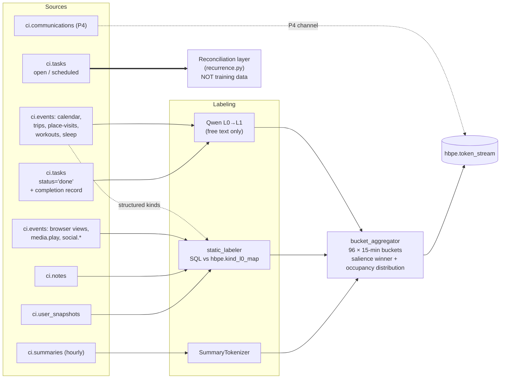
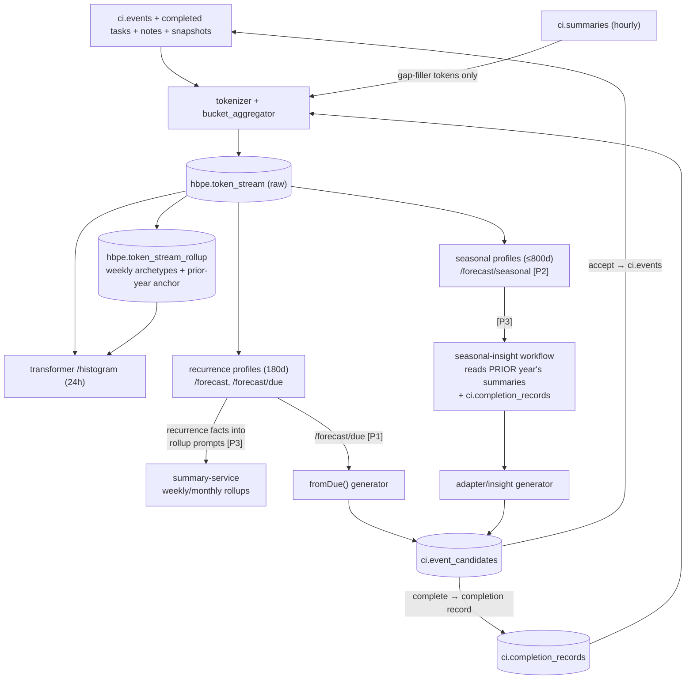

# HBPE Data-Rich Prediction Redesign

> **Status:** Proposal v2 — for team review &nbsp;•&nbsp; **Updated:** 2026-08-09
>
> Redesign of the HBPE input layer, capacity model, training corpus, time hierarchy, and planner integration so the engine scales from ~10 calendar events/day to hundreds of mixed-source events/day, detects annual patterns, and delivers predictions users actually want in the planner.
>
> **Companion designs:** [Tasks & Scheduling](tasks-and-scheduling.md) · [Completion Detection](completion-detection.md) · [System map](ci-prediction-doc-map.md)
> **Platform context:** [CI-Server architecture](../architecture/architecture.md) · [Database architecture](../architecture/Database.md)
>
> **v2 changes from v1:** 15-minute buckets (96/day) instead of 10-minute, which keeps `ONNX_SEQ_LEN` at 256 unchanged · tasks map to L0 and only *completed* tasks become training tokens · flat 180-day corpus replaced by a 90-day multi-resolution corpus with weekly rollups and a previous-year anchor · completion records become a first-class model input.

> ### ⚠️ §2 was implemented and then reverted (checked 2026-08-19)
>
> **The 15-minute / 96-bucket decision is not in force.** It shipped
> (`20260809160500_hbpe_15_minute_buckets.sql`) and was rolled back two days later
> (`20260811174700_hbpe_30_minute_buckets.sql`, which also DELETEs `hbpe.prediction_log`
> and `hbpe.token_stream` because 15-minute indices are not semantically compatible with
> 30-minute ones). `backend/apps/hbpe/src/ci/hbpe/buckets.py` today declares
> `BUCKET_MINUTES = 30`, `BUCKETS_PER_DAY = 48`, and
> `docs/architecture/hbpe-landing.md` puts the 15-minute redesign explicitly out of scope.
> Read §2, §2.4, §5.2 and the P1 row of §10 as the rejected branch, not the plan of record.
>
> Other §9 items **did** land, in the reverted-bucket world: `pipeline/baselines.py` has
> B0/B1/B2, `pipeline/serve.py` is the D3 serve gate (transformer served only when it beats
> B1 on top-1 by a margin, or beats B1 on Brier *and* B2 on ECE), `pipeline/scoring.py`
> writes `hbpe.prediction_score`, and `pipeline/actuals_backfill.py` fills
> `prediction_log.actual_*`. §9.4(a)'s temporal smoothing landed as the daypart HMM in
> `pipeline/hmm.py`; the separate `l0_temporal_smooth.py` experiment was added and reverted
> and is not in the tree.
>
> Two more things this document assumes that are no longer true: **Temporal is gone** (the
> "seasonal-insight Temporal workflow" in §8 would now be a pg-boss job dispatched through
> `domains/python-functions`), and every HBPE module moved from `src/ci/<module>` to
> `src/ci/hbpe/<module>`, so the `*.py` paths and line citations below are one level shallow
> and drifted.

---

## 1. Problem Statement

HBPE was built against a seed corpus of ~10 calendar events/day. The platform now ingests far more, and the flood is **already wired to hit the current pipeline**: browser views dual-write into `ci.events` as `event_type='view'` (`BrowserActivityService.ts:109-113`), and the import domain's `destinationsFor` routes media plays, social activity, workouts, sleep, trips, and place-visits into `ci.events` with `event_type` set to the importer kind verbatim (`backend/apps/api/src/domains/import/push/canonical.ts`, ported from the now-retired CI-Import-Tools' `mapping.ts`). Nothing shields HBPE from this volume today.

| # | Failure | Evidence |
|---|---|---|
| 1 | **Per-day token cap.** Each labeled event emits up to 3 tokens; ONNX export is fixed at 256 tokens. Export **raises `ValueError`** on a >256-token day; inference **silently truncates** oldest tokens. Ceiling ≈ 85 events/day. | `onnx_export.py:45,149-153`, `inference_engine.py:259-276` |
| 2 | **Labeling throughput.** Nightly Qwen labeling fetches at most 1,000 events + 1,000 content items and never loops. A 500k-row bulk import drains in ~16 months. | `nightly_runner.py:148,170`, `data_client.py:84` |
| 3 | **Unbounded training corpus.** Full retrains load every day since account creation. Retrains are routine — any L1 vocab drift triggers one. | `dataset.py:121-132`, `nightly_runner.py:290-333` |
| 4 | **Vocab cap is dead code.** The 50-per-L0-class cap lives only in a validator invoked by an offline script; `get_or_create_l1` inserts unconditionally. | `validator.py:36,167-188`, `vocab_registry.py:68-132` |
| 5 | **Annual patterns structurally invisible.** The profiler reads only the trailing 180 days, so two Decembers can never co-occur in one window. `FREQ=YEARLY` is rejected outright. | `recurrence.py:65,103-118,442` |
| 6 | **Planner hooks unwired.** `ci.event_candidates` carries `l0_class`/`l1_cluster_id`, a `rationale_sources` union reserving `'due'`/`'summary'`, a `time_flex` enum, and `fit_score`/`fit_curve` — none written by an HBPE-driven generator. `/forecast/due` has no live consumer. | migration `20260808150000:95-154`, `SuggestionSyncService.ts`, `EventCandidateEntity.ts:85-91` |
| 7 | **No outcome signal exists.** `ci.events.status` supports `'completed'` but no code writes it; `ci.tasks.actual_minutes` is never set; there is no sentiment analysis anywhere (all `sentiment_score` columns are importer pass-through). The model can see that something was *scheduled*, never that it *happened* or *how it went*. | see [Completion Detection](completion-detection.md) §1 |

---

## 2. Capacity: 15-Minute Buckets + Per-Bucket Salience Aggregation

### 2.1 The key architectural fact

The model's only positional signal is `bucket_idx` (`pos_emb(bucket_idxs)`, `transformer.py:51,107`). Multiple tokens inside one bucket are **order-invariant to the encoder** — per-raw-event tokens within a bucket are a bag. Raising sequence length alone buys quadratic attention cost for information the architecture cannot exploit. The correct fix is to bound tokens per bucket and carry residual detail as a distribution.

### 2.2 Decision

- **Bucket resolution: 30 min → 15 min.** `BUCKETS_PER_DAY` and `MAX_BUCKETS` 48 → **96** (1440 ÷ 15).
- **Per-bucket aggregation:** each bucket collapses to **at most one L0 token + one L1 token**. Day ceiling = 96 × 2 + SOD/EOD = **194 tokens, invariant to raw event volume**.
- **`ONNX_SEQ_LEN` stays 256 — unchanged.** 194 < 256, so there is no export-width change, no ~16× attention-cost increase, and a materially smaller P1 blast radius than v1's 1024 proposal. Widening to 512 is deferred until a per-bucket channel is actually added (§3, P4).

Why 15 rather than 10 or 30: 15 divides the hour cleanly (4 slots, so hourly summary gap-fill and daypart math stay integral), it is the granularity real calendar UIs slot at — enough precision to propose "start at 6:15" — and it absorbs ordinary human timing jitter that would fragment a routine across three adjacent 10-minute positions. Sizes that divide both 60 and 1440 are 5, 10, 12, 15, 20, 30; stay in that set (8 divides the day but not the hour, so bucket boundaries drift out of phase with hourly summaries).

**Calibration gate:** validate L0 top-1 against the existing ≥75% target (`evaluator.py:41-43`) on the seed corpus before committing. The aggregator is bucket-size-agnostic; only constants change if the gate fails.

### 2.3 Salience rule (what wins a bucket)

1. Slice each event's `[start_time, end_time]` span across buckets → per-(event, bucket) overlap minutes. Defaults when `end_time` is NULL: browser views use `duration_seconds`; point events get 5 minutes; completed tasks use `actual_minutes`, falling back to `estimated_minutes`, else 15.
2. **Tier dominates duration.** Anchor-tier events (§3) always beat ambient-tier regardless of minutes — a 30-second "Dentist" entry beats 14 minutes of browsing.
3. Within a tier: winner = L1 cluster with max summed overlap minutes; ties broken by `ci.events.priority`, then latest `start_time`.
4. **Nothing is discarded.** The L0 token's existing `soft_prob FLOAT4[]` carries an 8-class **occupancy distribution** — normalized overlap minutes of *all* events in the bucket, anchor and ambient. This realizes the schema's deferred "full distribution" Phase 2 comment (`serializer.py:12-14`). Verified backward-compatible: `_build_full_batch` currently ignores `soft_prob` entirely (`calibration.py:288-294`), so the richer write is inert until P4 consumes it as soft targets.
5. Empty buckets: hourly-summary tokens at `soft_prob=0.7`, unchanged (`serializer.py:156-167`).
6. **Confirmed completions raise confidence.** A bucket whose winning activity has a `ci.completion_records` row (see [Completion Detection](completion-detection.md)) is a verified observation, not an inferred one — its L1 `soft_prob` is written at 1.0 rather than the labeler's similarity score. This is the first place user-confirmed ground truth outranks inference.

Placement: a new `tokenizer/bucket_aggregator.py` (pure Python, unit-testable — span slicing and tie-breaking do not belong in SQL). `data_client.get_token_events_for_day` returns per-event spans + tier instead of pre-flattened token rows; the day query stays one indexed scan.

### 2.4 Blast radius (everything that assumes 48)

`serializer.BUCKETS_PER_DAY` · recurrence `BUCKETS_PER_PART` (12 → 24 per daypart, `recurrence.py:81-83`) · `inference_engine.N_BUCKETS` · `/histogram` response shape · `hbpe.prediction_log.bucket_index` CHECK (migration `20260227000001`) · `data_client` bucket arithmetic (`/1800` → `/900`) · frontend `ForecastStrip` (48-cell strip) and `HorizonGrid` daypart lanes · seed data (`seed-database/data/hbpe.ts`). Full re-serialization + per-user retrain on rollout; the existing `needs_bootstrap` vocab-fingerprint path can carry the trigger.

---

## 3. Tiered Ingest: What Feeds HBPE, and How

The load-bearing fact: **the high-volume streams are already structured.** Browser rows carry `category` and `productivity_score`; import kinds arrive as structured `event_type` strings. Only free-text calendar titles and task titles genuinely need an LLM. Everything else is labeled by a static mapping in set-based SQL.

| Tier | Sources | Granularity | Labeling |
|---|---|---|---|
| **Anchor** | Calendar events, `travel.trip`, place-visits, `fitness.workout`, `wearable.sleep`; **completed `ci.tasks`** (occurrence at `completed_at`, duration from `actual_minutes`) | Individual events; always salience-eligible | Qwen L0→L1 for free-text titles (calendar and task). Static L0 + fixed L1 for structured kinds |
| **Ambient** | Browser `view` rows in `ci.events` (existing `category` + `productivity_score` decide WORK vs LEISURE — **no LLM**); `media.play` → LEISURE; `social.*` → SOCIAL; note create/update events; desktop focus (`ci.user_snapshots` `focus_app` via a static app-category map, P2) | Contribute occupancy minutes; win a bucket only when no anchor is present | **Never LLM.** Static `hbpe.kind_l0_map` (`kind_pattern, l0_class, l1_label, tier, default_duration_min`) |
| **Reconciliation only — never tokenized** | Open/scheduled `ci.tasks`, `ci.event_candidates`, future `ci.events` | Suppress "overdue", pin occurrence probability (§5) | n/a |
| **Deferred (P4)** | `ci.communications` (per-bucket counts + direction mix channel), raw `ci.position`, `ci.activity_rollup` | Future per-bucket channel tokens (needs `ONNX_SEQ_LEN` 512) | — |

### 3.1 Tasks map to L0

`ci.event_candidates` carries an `l0_class` column and `TaskBreakdownService` already emits values from HBPE's L0 vocabulary (`TaskBreakdownService.ts:46-55,241-245`), but **`ci.tasks` has no `l0_class` column** (confirmed absent — migration `20260808150000:43-80`). A brain-dumped item therefore carries an HBPE class as a *candidate* and loses it the moment it becomes a task.

Required: add `l0_class TEXT` and `l1_cluster_id UUID` to `ci.tasks`, populated by inheritance from the originating candidate where one exists, otherwise by the same two-stage Qwen labeler used for calendar titles. Ownership of this column and its lifecycle belongs to [Tasks & Scheduling](tasks-and-scheduling.md) §3; HBPE only consumes it.

### 3.2 Scheduled tasks are not training data

Only tasks with `status='done'` **and** a corresponding `ci.completion_records` row become tokens. An open or merely scheduled task is forward-looking intent, not observed behavior — it joins the reconciliation layer alongside booked calendar events (§5.2). This is the same principle that keeps `ci.event_candidates` out of `ci.events` until accepted (`EventCandidateEntity.ts:25-31`): **the model must never train on hypotheticals, including its own suggestions.**

The completion record is what supplies the detail the raw task row lacks — actual time, actual duration, and how it went. See [Completion Detection](completion-detection.md).

### 3.3 Notes

- Build on the `ci.events` `view` rows, **not** `ci.browser_activity` — that table is deprecated (`Database.md:58`).
- Camera has no ingest path (`ci.screen_captures` dropped in `20260213131500`; `ci.object_observations` migrated but unshipped) — out of scope for tokenization, though receipt images become a *completion evidence* channel in the companion doc.
- Throughput: ~300 views + 50 media plays + 20 social/day ≈ 370 ambient vs ~15 anchor events. Static mapping labels a 500k-row bulk import in one SQL pass; residual Qwen load falls to ~10-20 items/day, two orders of magnitude under the nightly budget.

---

## 4. Labeling Throughput and the Multi-Resolution Training Corpus

### 4.1 Static-first labeling + drain loop

1. **Static pass** — new `tokenizer/static_labeler.py`: one set-based `INSERT … SELECT … FROM ci.events e JOIN hbpe.kind_l0_map m ON e.event_type LIKE m.kind_pattern … ON CONFLICT DO NOTHING`, using per-user static L1 clusters minted via `get_or_create_l1(naming_method='STATIC')`. Runs at the top of `label_unlabeled`, before Qwen.
2. **Qwen drain loop** — replace the single 1,000-row call (`nightly_runner.py:148,170`) with: fetch batch → label → repeat until empty or `HBPE_LABEL_BUDGET_SECONDS` (default 4h) expires, checking `should_stop` between batches. Heartbeat plumbing already supports long runs (`nightly_runner.py:79-121`). Add keyset pagination to `get_unlabeled_events` and exclude kinds present in `kind_l0_map` so Qwen never sees ambient rows.

### 4.2 The 90-day multi-resolution corpus

v1's flat 180-day window bounded retrain cost but weighted a stale Tuesday from five months ago exactly like yesterday, and carried no seasonal signal at all. v2 replaces it with three tiers of decreasing resolution:

| Tier | Span | Representation | Sequences | Weight |
|---|---|---|---|---|
| **A — raw** | Days 1-30 | One sequence per day, full 96-bucket resolution | ~30 | 1.0 |
| **B — weekly rollup** | Days 31-90 | Per ISO week, **2 archetype sequences**: weekday-typical and weekend-typical | ~18 | 0.6 |
| **C — previous-year anchor** | Same ISO week ±1, 52 weeks prior | Same 2 archetype sequences | ~2-6 | 0.4 |

**Archetype construction.** For each week and day-class, every bucket takes the argmax L0/L1 across that week's constituent days as its token, and the `soft_prob` distribution carries the *frequency* across those days. This is a genuine rolled-up weekly summary expressed in the token vocabulary — and it reuses the occupancy-distribution machinery from §2.3 rather than inventing a second representation.

**Why this shape.** ~52 training sequences replace 90, so retrain cost falls while the recent past keeps full fidelity and the older past keeps its structure. Tier C is the payoff: it puts *last year's version of this week* directly into the training set, so the transformer gets a seasonal echo **without** adding a month or day-of-year embedding — complementing, not duplicating, the statistical seasonal pass in §5.3. When no prior-year data exists, Tier C is simply empty and the corpus degrades gracefully; a user who bulk-imports years of history via the archive importer gets Tier C from day one.

**Storage — a separate table, deliberately.** Archetype sequences are synthetic. `hbpe.token_stream` is read directly by the recurrence profiler (occurrence counting and inter-arrival gaps) and the occurrence-actuals backfill; synthetic days would double-count occurrences and corrupt gap statistics. Rather than adding a `kind` column and filtering it correctly in four readers, rollups live in **`hbpe.token_stream_rollup`** (same shape plus `tier`, `period_start`, `weight`). Existing readers are untouched by construction; only `dataset.py` opts in.

**Trainer changes.** `make_splits` draws test/val from Tier A only (held-out days must be real). Per-sample loss weighting is a scalar multiplier — trivial at the current batch size of 1. `TEST_DAYS=14` and `VAL_FRACTION=0.15` unchanged.

**Known interaction to verify:** the 90-day L1 staleness sweep and the 90-day corpus now coincide, but `build_l1_vocab` (`vocab.py:67-86`) must still be built from distinct token_ids present in the windowed streams (raw + rollup), not from currently-active clusters, or masked targets can reference missing vocab entries.

### 4.3 Vocab control

- **Enforce the 50/class cap in `get_or_create_l1`**: at cap, do not insert — return the nearest existing label (pg_trgm `similarity()` best match) with `is_new=False`. Belt-and-braces: at cap the labeler prompt switches to "choose exactly one from this list". Rejected: silent merge of least-used clusters (rewrites token_stream history, forces retrains) and hard error (a labeling pipeline should degrade, not stop).
- **Ambient sources never mint L1.** Fixed static sub-vocab (~15 labels, identical across users) from `kind_l0_map.l1_label`. Bounds the embedding table at 8 × 50 = 400 worst case, and — because ambient volume is the bulk of data and can never grow the vocab — makes vocab-drift retrains rare after warm-up.

---

## 5. Time Hierarchy: Short- and Long-Term Awareness

### 5.1 The transformer stays calendar-blind

No day-of-week/month/season embeddings. Day-of-week already enters via inference-time same-DoW 2× weighting (`inference_engine.py:62,448`), and seasonality now enters through **training data** (Tier C, §4.2) rather than through architecture. Calendar embeddings would mean retrain and re-export churn for the horizon that needs them least. Revisit only if Brier scoring over `hbpe.prediction_log` shows DoW-correlated residual error.

### 5.2 The horizon ladder

| Horizon | Object predicted | Mechanism | Status |
|---|---|---|---|
| 24h | Occupancy (bucket × class) | Transformer `/histogram` + DoW weighting | Unchanged (48 → 96 buckets) |
| 7d | Occurrence (Bernoulli/day per cluster) | Renewal DP + DoW lift (`week_forecast`) | Unchanged |
| ~45d | Renewal ("due") | Gap distribution + RRULE + **booked-event and scheduled-task reconciliation** | + `FREQ=YEARLY`, + `ci.tasks` recon |
| 90-400d | Seasonal/annual window | **NEW seasonal pass** → `hbpe.seasonal_profiles`, `GET /forecast/seasonal` | New |

**Reconciliation contract.** `_load_upcoming_events` (`recurrence.py:551-579`) currently reconciles only `ci.events`. It extends to open `ci.tasks` carrying `l1_cluster_id` with `scheduled_for`/`due_at` inside the window: a scheduled task pins its cluster's occurrence probability and suppresses the overdue flag, exactly as a booked event does. This is the *only* path by which an uncompleted task influences prediction — it never becomes a token.

### 5.3 The seasonal pass

Alongside the existing 180-day profile build (which keeps its window — gap statistics degrade when diluted with stale years):

- **Adaptive long window:** `min(800 days, actual token_stream span)`, keyed on `MIN(ts.date)`. `hbpe.token_stream` is never pruned (the only DELETE is the per-day replace, `serializer.py:77`), and bulk-imported history counts.
- Per-cluster **12-bin month-of-year histogram** (`_moy_lift`, same Dirichlet-shrinkage shape as the proven `_dow_lift`, `recurrence.py:328-346`), `distinct_years`, `typical_day_of_year`, `annual_confidence`.
- **Cross-year gate:** ≥2 occurrences in the same month-of-year across ≥2 distinct calendar years — evidence-keyed, not account-age-keyed.
- Writes **`hbpe.seasonal_profiles`**; served via **`GET /forecast/seasonal`**. Weekly rebuild cadence suffices.
- **`FREQ=YEARLY`** in `parse_recurrence` / `expand_occurrences` / `_rrule_cadence_days` (`365.25 × interval`): calendar-declared annuals trusted with one occurrence. Cheapest annual fix; ships first.

---

## 6. Summary Rollups ↔ HBPE: Direction of Data Flow

**Principle: prose never enters the model.** `hbpe.token_stream` is already the exact per-bucket numeric record — daily and weekly per-class occupancy is a SQL rollup of it (§4.2 uses precisely this). Parsing `recurring_patterns` or `habit_changes` English sentences back into signal would lossily reconstruct data HBPE owns. Every summary tier above hourly is lists of English sentences; the only numeric field is `activity_counts`.

- **HBPE → summaries:** recurrence facts injected as structured context into weekly/monthly rollup prompts (P3 polish).
- **Summaries → HBPE:** stays hourly gap-filler tokens only.
- **Completion records → HBPE:** confidence weighting (§2.3) and the qualitative channel (§8).

---

## 7. Planner Integration

Owned in detail by [Tasks & Scheduling](tasks-and-scheduling.md) §5. From HBPE's side:

- **P1 — due → candidate bridge.** A `fromDue()` generator in `SuggestionSyncService` (NestJS) consuming `HbpeService.getDueList()`. Python must not write `ci.event_candidates` — the lifecycle contract lives in `CandidateService.ts`. Selection: `overdue` OR `due_in_days ≤ 3`, `confidence ≥ 0.6`, unscheduled. `dedupe_key = due:{cluster_id}:{last_seen}` (per due *episode*, so one accept doesn't suppress a recurring activity forever). `time_flex` derived from the due window's spread — its first meaningful values. Needs no migration.
- **P2 — fit solver.** `FitSolverService` writes the never-written `fit_score`/`fit_curve` = occurrence probability × daypart alignment × `ci.rhythms` (its first reader) × per-day capacity budget.
- **The feedback loop closes twice:** accepted candidates mint `ci.events` (`CandidateService.ts:239-258`) → tokenized nightly; and completed items write `ci.completion_records` → confidence-weighted tokens plus outcome data.

---

## 8. Long-Term Qualitative Memory

The "wrap gifts earlier — last December was stressful" scenario needs three things: annual detection, prior-year retrieval, and a record of *how it went*. v1 had the first two and leaned on daily-summary `mood_indicators` for the third, which is LLM-inferred free text that never propagates past the daily tier. v2 replaces that with real data.

1. **P2:** seasonal pass + `GET /forecast/seasonal` supply the *when*.
2. **P3:** a monthly **seasonal-insight Temporal workflow** in the summary app calls `/forecast/seasonal`; for each item it fetches the matching prior period's daily/weekly summaries via the existing `(user_id, period_type, period_start DESC)` index **and the matching `ci.completion_records`** — structured, user-supplied valence with timestamps and notes, not inferred mood. The LLM writes a `period_type='insight'` row whose `key_actions` carry temporal advice; the existing `adapter/insight` generator turns those into candidates. Enhancement: object-form key_actions carrying `cluster_id`/`window` so candidates get `l1_cluster_id`, a seasonal window, and `time_flex:'month'`.

This is the concrete payoff of the completion system: without it, "stressful" is an LLM guess about a day; with it, it is a record the user made about a specific task.

---

## 9. Baselines, Validation and Model Selection

### 9.1 The gate that measures nothing

`evaluator.py:41-43` targets L0 top-1 ≥75% and L1 top-3 ≥65%. Neither is compared against any baseline, and the class distribution makes that dangerous: SLEEP occupies roughly a third of every day's buckets and WORK another third, so **two classes cover about two-thirds of all buckets**. A predictor that answers only "what usually happens at 14:15" would plausibly land in the high 60s or low 70s.

It is therefore possible that the transformer currently beats a one-line SQL query by a couple of points, and nobody would know. That question governs bucket size, corpus shape, tier weights, and whether the transformer survives at all — so it should be answered **before P1**, not after.

### 9.2 The baselines

Three, in increasing sophistication. All train in SQL against `hbpe.token_stream`; no GPU, no ONNX, no calibration step.

| | Model | Parameters | Definition |
|---|---|---|---|
| **B0** | Per-bucket mode | 96 | argmax class per bucket-of-day |
| **B1** | Per-bucket × day-of-week mode | 672 | argmax class per (bucket, DoW) |
| **B2** | Time-inhomogeneous Markov chain | ~256 pooled by daypart | `P(class_{t+1} | class_t, daypart)`, Laplace-smoothed; 8×8 transition matrix per daypart |

Evaluate all three on the **same held-out Tier A test split** as the transformer, reporting L0 top-1, L1 top-3, ECE, and a per-class breakdown so SLEEP/WORK dominance is visible rather than hidden in an average. The report must state the trivial-predictor floor explicitly — an accuracy number without it is not interpretable.

### 9.3 The decision rule

The transformer must beat **B2** by a stated margin on **both** top-1 and ECE. It carries real infrastructure — ONNX export, INT8 quantization with an accuracy-delta gate, per-user LoRA adapters, temperature calibration, vocab-drift retrains — and a two-point edge does not pay for that.

- **Margin holds** → proceed as designed; B2 remains as the smoother and cold-start path (§9.4).
- **Margin is thin** → seriously evaluate replacement, and the right replacement is **gradient-boosted trees over per-bucket features** (bucket index, day-of-week, month, previous bucket's class, days-since-last per cluster, recent-window frequencies), not another neural variant. Trees handle cyclical calendar features natively, which would let month and day-of-year enter the 24h model at negligible cost — precisely what §6.1 excludes from the transformer because embeddings there mean retrain-and-re-export churn. Constraint: L1's up-to-400 classes make multiclass boosting expensive, so GBDT would own L0 and a frequency or Markov model would own L1.

Do not pre-commit to the fork. Build B0-B2 first and let the margin decide.

### 9.4 Markov as a production layer, not only a baseline

Two uses that are worth shipping regardless of how §9.3 resolves.

**(a) Temporal smoothing at inference.** `predict()` computes every bucket independently — it accumulates weighted softmaxes per bucket and normalizes per bucket, with no cross-bucket term anywhere (`inference_engine.py:451-466`). Nothing enforces that activity is contiguous, so the histogram can flicker WORK → LEISURE → WORK across adjacent buckets in ways real behavior does not. **Moving from 48 to 96 buckets doubles that flicker surface**, which is a direct cost of the §2 decision.

Fix: an HMM-style forward-backward pass over the day, using B2's transition matrix as the prior and the model's per-bucket distributions as emissions. Inference-time only — no retrain, no export change. This matters most for the product goal: a planner needs contiguous free blocks, not confetti.

**(b) Cold start.** `make_splits` raises below `TEST_DAYS + 2` = 16 days (`dataset.py:48-52`), so a new user without bulk-imported history gets **no predictions at all** until bootstrap can run. B2 produces useful output from roughly day three and improves smoothly. Serve B2 until a transformer checkpoint exists, flagged in the response so the UI can say "still learning" rather than showing a uniform prior.

### 9.5 Where this sits architecturally

The recurrence layer is already a renewal process for *across-day* occurrence. A Markov chain is its *within-day* analog. Together they cover the structural regularity of behavior cheaply, leaving the transformer responsible only for context-dependence neither captures — which is the right division of labor for a model trained on tens of sequences, and the honest test of whether it belongs.

### 9.6 Cost and sequencing

| Work | When | Effort |
|---|---|---|
| B0-B2 + comparison report | **Before P1** | ~1 day |
| Markov smoothing at inference | P1, alongside 15-min buckets | small |
| B2 cold-start fallback | P2 | small |
| GBDT evaluation | Only if §9.3's margin is thin | large |

---

## 10. Phasing

| Phase | Contents | Depends on |
|---|---|---|
| **P0** | B0-B2 baselines + comparison report against the current model (§9) | — |
| **P1** | `bucket_aggregator` + 15-min buckets (`ONNX_SEQ_LEN` unchanged); Markov smoothing at inference; `hbpe.kind_l0_map` + `static_labeler` + drain loop; 90-day multi-resolution corpus + `hbpe.token_stream_rollup`; L1 cap + static ambient sub-vocab; `FREQ=YEARLY`; `fromDue()` bridge; `ci.tasks.l0_class` consumption | P0 (model choice confirmed); `ci.tasks.l0_class` column ([Tasks & Scheduling](tasks-and-scheduling.md) P1) |
| **P2** | Seasonal pass + `hbpe.seasonal_profiles` + `/forecast/seasonal`; B2 cold-start fallback; `FitSolverService`; scheduled-task reconciliation; desktop-watcher + notes ingest tiers; completion-record confidence weighting | P1; [Completion Detection](completion-detection.md) P1 |
| **P3** | Seasonal-insight workflow reading completion records; recurrence facts into rollup prompts; month/season planner lanes | P2 |
| **P4** | Communications per-bucket channel (needs `ONNX_SEQ_LEN` 512); occupancy-distribution soft targets in the trainer | P1 |

**Migration inventory:** `hbpe.kind_l0_map`, `hbpe.token_stream_rollup` (P1); `hbpe.seasonal_profiles` (P2). `hbpe.token_stream` schema unchanged — `soft_prob FLOAT4[]` already fits distributions.

---

## 11. Open Questions

1. **What margin over B2 justifies the transformer?** §9.3 requires one and deliberately does not name it. Two points of top-1 almost certainly does not pay for ONNX + LoRA + calibration + drift retrains; ten clearly does. The team should fix the number before P0 runs, so the result cannot be rationalized after the fact.
2. **Archetype granularity** — 2 sequences/week (weekday, weekend) or 3 (weekday, Saturday, Sunday)? Saturdays and Sundays often differ more than weekdays do from each other.
3. **Tier weights** (1.0 / 0.6 / 0.4) are a starting guess. Note the validation set is thin — after the 14-day test split and a 15% DoW-stratified sample, roughly 2-3 days remain, which is not enough to tune three hyperparameters without fitting noise. Prefer deriving them from a recency decay (mirroring the inference-side λ=7) over "tuning" them.
4. **`ci.tasks` L0 assignment timing** — at creation (latency in the mutation path) or nightly batch (list shows unclassified tasks for up to a day)?
5. **Browser `category` → L0 thresholds** — where does `productivity_score` split WORK from LEISURE (fixed threshold vs per-user calibration)?
6. **`hbpe.prediction_log.bucket_index` CHECK** — widen in place or version the table (`model_version` already distinguishes eras)?
