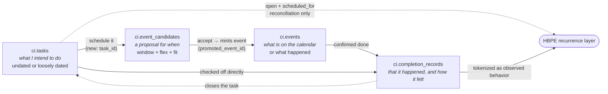

# Tasks & Scheduling

> **Status:** Proposal — for team review &nbsp;•&nbsp; **Authored:** 2026-08-09 &nbsp;•&nbsp; **§1 re-checked:** 2026-08-19
>
> The to-do layer (`ci.tasks`) and the scheduler (`ci.event_candidates`): what they are today, why they are disconnected, and how they become one coherent planning surface grounded in HBPE's behavioral vocabulary.
>
> **Companion designs:** [HBPE redesign](hbpe-data-rich-redesign.md) · [Completion Detection](completion-detection.md) · [System map](ci-prediction-doc-map.md)

> **§1 "Current State" has moved on — re-verified 2026-08-19.** The proposal (§3-§7) is
> still unbuilt, but several of the "collected but never read" findings have since gained a
> consumer, and one flag flipped:
>
> - **`/plan` is no longer flag-gated off.** `planning.page` ships `true` in
>   `backend/apps/api/config/default.json`.
> - **`PlanningTimeService` has its first consumer** — `PlannedBlockService` injects it. Note
>   also that the shared zoned-time helpers moved from `domains/planning/time/zoned.ts` to
>   `@ci/common/time/zoned`; planning re-exports them.
> - **`source_kind` / `source_ref` are reachable** — not through `CreateTaskInput` (still
>   absent there, so §8 Q5 stands for the API), but `InboxScanService` writes
>   `sourceKind: 'inbox'` and `TodoScanService` writes `'memory_scan'`, both deduping through
>   `TaskService.findBySourceRef`, so `ux_tasks_source` is live.
> - **`actual_minutes` has a write path** — `completeTask(id, actualMinutes)` and
>   `updateTask` both accept it (`TaskResolver.ts:142-152`, `:111`). Still no timer, so in
>   practice it stays 0.
> - **There is now a planning cron** — `PlanningJobsCron` fans out five per-user jobs
>   (`todoScan` 06:00 daily, `todoProcess` every 6h, `inboxScan` every 30m, `eventNow`
>   hourly at :15, `verifyDone` hourly at :45). **None of them is roll-forward**: §4's
>   `TaskRollForwardCron` is still unbuilt and "overdue" is still a client-side bucket.
> - **A trust-dial triage inbox landed** that this document does not describe: `proposed`
>   tasks plus `ci.task_pending_changes` (`20260818185920`, `20260819010000`), with
>   `acceptProposedTask` / `declineProposedTask` on the Plan page.
> - **`ci.events` gained a `task_id`** (`20260818185920:38-46`) — the planned-block → event
>   link. This is *not* §5.2's `ci.event_candidates.task_id`, which still does not exist,
>   and `ci.actions.task_id` still has no reader.
> - **`ci.events.status = 'completed'` now has exactly one writer**, contradicting §1.3 and
>   the "nothing revisits an accepted candidate" claim. `VerifyDoneService.runForUser`
>   (`TodoProcessService.ts:304-380`, driven by the `verifyDone` cron leg) picks up planned
>   blocks whose `task_id` is set and whose end time has passed within 36 hours, searches
>   memory for completion evidence, and — when `PersonalizationService.decideAction`
>   returns `auto` on a positive signal — calls `TaskService.complete` and saves the event
>   with `status = 'completed'`. Anything short of that becomes a `task_pending_change` for
>   the user to confirm, which is the same "system proposes, user confirms" principle
>   [Completion Detection](completion-detection.md) §2 argues for. It is narrower than that
>   design: it only reaches events that came from a planned block, and it records no time or
>   emotional outcome.
>
> Unchanged and still true: `ci.tasks` has no `l0_class` / `l1_cluster_id`; `task_time`,
> `defer_count`, `ci.task_dependencies`, `ci.rhythms`, `fit_score` and `fit_curve` have no
> readers; and `time_flex` is only ever written `'week'`.

---

## 1. Current State

Both halves exist. Neither knows the other exists.

### 1.1 Tasks are an isolated island

`ci.tasks` landed in migration `20260808150000_schedule_planning_and_hbpe.sql:43-93`. `TaskService` is its **only** writer and `TaskResolver` its only caller — GraphQL only, no REST (`planning/index.ts:11-12`). There is a real to-do UI at `/plan` (`PlanPage.tsx`), feature-flagged off by default.

What is collected but never read:

| Column / structure | State |
|---|---|
| `task_time` | Written by create/update; **nothing reads it** — not in `findAll` ordering, not in the frontend fragment (`Task.tsx:13-26`) |
| `defer_count` | Written only by `defer()` (`TaskService.ts:220`); no consumer. Excluded from `UpdateTaskDto`, so it cannot be reset except by SQL |
| `actual_minutes` | `NOT NULL DEFAULT 0`; no timer exists, nothing writes a real value |
| `source_kind` / `source_ref` | In `CreateTaskDto` but **not** on `CreateTaskInput`, so every API-created task is `'manual'`/NULL and the `ux_tasks_source` unique index is unreachable |
| `ci.task_dependencies` | Table + entity + module registration exist; **no service reads or writes it** |
| `ci.actions.task_id` | Column added by the same migration; grep across `src/` finds it only inside `domains/planning`. Dead |
| `task.created` / `task.updated` / `task.deleted` | Defined, registered in `EventRegistry` (`events.ts:23-28`), fired — **no listeners anywhere** |
| `PlanningTimeService` | 220 lines of DST-correct zoned time; provided and exported by `PlanningModule`, injected by nobody. The frontend does date math in the browser zone instead (`PlanPage.tsx:78-81`) |

**There is no roll-forward.** No cron re-dates anything (the 7 crons in `src/` are all elsewhere). "Overdue" is purely a client-side render bucket (`taskSections.ts:70-102`) — an overdue task shows under that heading forever while its `scheduled_for` never moves.

### 1.2 The scheduler is a separate pipeline

`ci.event_candidates` (same migration, `:95-138`) is the scheduler's unit of work: a *proposal* with `rationale` + `rationale_sources`, a `window_start`/`window_end`, `time_flex`, `l0_class` + `l1_cluster_id`, `energy_cost`, `fit_score`/`fit_curve`, and a lifecycle `open → accepted | snoozed | declined | never`. Accepting mints a `ci.events` row and backlinks `promoted_event_id` (`CandidateService.ts:215-285`).

Three generators write candidates today — `adapter/action` (from `ci.actions`), `adapter/insight` (from `period_type='insight'` summaries), and `braindump/llm` (`TaskBreakdownService`). None consume HBPE; `HbpeService` is not injected in the schedule domain.

Unwritten by anything: `fit_score`, `fit_curve`, `ci.rhythms` (whole table — `RhythmEntity.ts:16-21` says plainly it "has no reader or writer in this release"). `time_flex` is always written `'week'` and read by nothing, so `'month'` and `'season'` are unreachable.

### 1.3 The gap that matters

`TaskBreakdownService` — despite the name, in `domains/schedule`, writing candidates not tasks (`TaskBreakdownService.ts:248`) — emits an `l0_class` drawn from HBPE's vocabulary (`:46-55, :241-245`). **`ci.tasks` has no `l0_class` column.** So a brain-dumped item carries HBPE grounding as a candidate and loses it the instant it becomes a task. Any candidate → task direction is lossy today.

And nothing revisits an accepted candidate to ask whether the thing actually happened. `ci.events.status` supports `'completed'`; no code path writes it.

---

## 2. Object Model

The four objects are genuinely distinct and should stay distinct. What is missing is the edges between them.



| Object | Answers | Owner |
|---|---|---|
| **Task** | *What* I intend to do | this doc |
| **Candidate** | *When* it might go, and how well it fits | this doc |
| **Event** | What is on the calendar / what occurred | memory domain |
| **Completion record** | That it happened, when, and how it felt | [Completion Detection](completion-detection.md) |

**Rule: a task is never a hypothesis about the past.** Open and scheduled tasks are intent. Only a completion record converts intent into observed behavior — which is precisely why HBPE tokenizes completions and not schedules (see [HBPE §3.2](hbpe-data-rich-redesign.md)).

---

## 3. Grounding Tasks in L0

### 3.1 The change

Add to `ci.tasks`:

| Column | Type | Purpose |
|---|---|---|
| `l0_class` | `TEXT` | One of HBPE's 8 behavioral classes — the shared vocabulary across tasks, candidates, and predictions |
| `l1_cluster_id` | `UUID` (bare, matching `event_candidates:109` — no FK across the `ci`/`hbpe` schema boundary) | The user's specific routine, when known |

### 3.2 How they get populated

1. **Inheritance (preferred).** A task created from a candidate copies the candidate's `l0_class`/`l1_cluster_id` directly. This closes the lossy path in §1.3 and costs nothing.
2. **Classification (fallback).** A manually typed task title is free text — the same input the calendar-title labeler already handles. Route it through the existing two-stage Qwen L0 → L1 labeler rather than building a second classifier.
3. **Correction.** The user can change the class from the task row; a user-set value is authoritative and never overwritten by the labeler (mirroring `object_observations.confirmed_by_user`, which is documented as "never set by a detector or an LLM").

### 3.3 Why it matters

L0 on a task is what lets the scheduler ask HBPE a meaningful question. "When should I do *this task*?" is unanswerable; "when does this user usually do ERRAND-class activities, and is the 'Grocery Run' cluster due?" is exactly what `/histogram` and `/forecast/due` answer. Without `l0_class`, tasks and predictions have no shared language.

---

## 4. Roll-Forward: The To-Do List Only Moves Forward

### 4.1 Behavior

A nightly `TaskRollForwardCron` advances every incomplete, non-archived task whose effective date has passed:

- `scheduled_for` → today
- `defer_count` += 1 (finally giving that column a consumer)
- **`due_at` is never mutated** — it stays as the original commitment, so "17 days overdue" and "deferred 12 times" both remain answerable
- `defer_until` is respected: a task deferred to a future date is skipped until then
- `status='archived'` and `'skipped'` are exempt

### 4.2 Why this is load-bearing

Roll-forward is not a cosmetic nicety. It is what makes the **forward-only matching rule** in [Completion Detection](completion-detection.md) §3 correct: if every actionable item is dated today or later, then "match evidence against the nearest upcoming items, never look into the past" covers the whole open list without exception. Without roll-forward, the two rules contradict — receipts would fail to match items stranded in the past.

### 4.3 Guardrails

- Escalating `defer_count` is a signal, not a punishment. A task deferred past a threshold should surface a "still want this?" prompt through the existing `feed_queue`, not be silently archived.
- The cron must resolve "today" per user via `PlanningTimeService` (`ci.users.timezone`) — the service already exists and is currently uninjected; this is its first consumer. Doing this date math server-side also fixes the browser-timezone inconsistency in `taskSections.ts`.
- Idempotent per day: re-running must not double-increment `defer_count`.

---

## 5. Scheduling: From Prediction to Proposal

### 5.1 P1 — the HBPE bridge

A `fromDue()` generator in `SuggestionSyncService`, alongside `fromActions`/`fromInsights`, consuming `HbpeService.getDueList()`. `ScheduleModule` imports the predictions module. **No migration required** — every column already exists.

- **Selection:** `overdue === true` OR `due_in_days ≤ 3`; `confidence ≥ 0.6`; `scheduled_date == null`. The HTTP call is wrapped — HBPE downtime must not break slate sync (`HbpeService` throws `ServiceUnavailableException`).
- **`dedupe_key = due:{cluster_id}:{last_seen}`** — one candidate per due *episode*. When the activity happens, `last_seen` advances and the next episode gets a fresh card. A bare `due:{cluster_id}` would let a single accept suppress a recurring activity forever.
- **`time_flex` from the due window's spread** relative to its median: tight → `'day'`, moderate → `'week'`, loose → `'month'`/`'season'`. This is the column's first meaningful writer.
- **Suppression:** clusters with any `adapter/due` candidate at `status='never'` are skipped. User intent stays in one system — no new HBPE-side suppression state.
- **Auto-resolve:** open `adapter/due` candidates whose key leaves the due list are retired (`declined`, `feedback_reason:'resolved'`), mirroring the existing `retireStale` pattern.

### 5.2 P1 — task ↔ candidate linkage

Add `task_id UUID NULL REFERENCES ci.tasks(id) ON DELETE SET NULL` to `ci.event_candidates`, and use the already-dead `ci.actions.task_id` for the action side. Then:

- **Task → candidate:** "Schedule this" on a task row creates a candidate carrying the task's `l0_class`/`l1_cluster_id` and `task_id`.
- **Candidate → task:** `TaskBreakdownService` writes real `ci.tasks` rows *and* candidates, linked — resolving the naming confusion where the "task breakdown" service produces no tasks.
- **Accept → schedule:** accepting a candidate sets the linked task's `scheduled_for` (and `task_time`, giving that column a reader).
- **Complete → close:** a completion record against the promoted event closes the linked task, and vice versa. This is the edge that currently does not exist in either direction.

### 5.3 P2 — the fit solver

`FitSolverService` computes what `fit_score`/`fit_curve` were reserved for:

```
fit_curve[day] = p_occur (from /forecast)
               × daypart alignment (daypart_probs vs the proposed slot)
               × rhythm multiplier (ci.rhythms window / cadence / avoid — first reader)
               × capacity headroom (per-day occupancy budget from HBPE §2)
fit_score      = max(fit_curve)
```

`ci.rhythms` (`label`, `kind ∈ window|cadence|avoid`, `spec jsonb`, `strength ∈ soft|hard`) finally gets a consumer: `hard` strength is a filter, `soft` is a multiplier. The frontend renders `fit_curve` as a smear across the `HorizonGrid` week so the user sees *why* a day is proposed.

### 5.4 Contract with HBPE

| Direction | What crosses | Constraint |
|---|---|---|
| HBPE → scheduler | `/forecast/due`, `/forecast`, `/forecast/seasonal` (read-only HTTP) | Python never writes `ci.event_candidates`; the lifecycle contract lives in `CandidateService` |
| Scheduler → HBPE | Open scheduled tasks and accepted events enter the **reconciliation layer** | Reconciliation only — never training data ([HBPE §5.2](hbpe-data-rich-redesign.md)) |
| Completion → HBPE | `ci.completion_records` become confidence-weighted tokens | Only completed items are observed behavior |

---

## 6. What This Fixes

| Today | After |
|---|---|
| Tasks lose HBPE grounding when created from candidates | `l0_class` inherited or classified (§3) |
| Overdue tasks pile up in the past forever | Roll-forward with preserved `due_at` (§4) |
| `/forecast/due` has no consumer | `fromDue()` bridge (§5.1) |
| `time_flex`, `fit_score`, `fit_curve`, `ci.rhythms`, `ci.actions.task_id`, `defer_count`, `task_time`, `PlanningTimeService`, `ci.task_dependencies` all unread | Each gains a consumer across §4-5 |
| Nothing knows whether a scheduled thing happened | Completion records ([Completion Detection](completion-detection.md)) |

---

## 7. Phasing

| Phase | Contents |
|---|---|
| **P1** | `ci.tasks.l0_class` + `l1_cluster_id` migration; inheritance + labeler classification; `ci.event_candidates.task_id`; `TaskRollForwardCron` with `PlanningTimeService`; `fromDue()` bridge; task ↔ candidate linkage |
| **P2** | `FitSolverService` (`fit_score`/`fit_curve`, `ci.rhythms` reader); scheduled-task reconciliation in HBPE; `HorizonGrid` fit smear |
| **P3** | `ci.task_dependencies` service (blocked-task filtering in the solver); seasonal `time_flex` lanes; `defer_count` escalation prompts via `feed_queue` |

**Migrations:** `ci.tasks` add `l0_class`, `l1_cluster_id`; `ci.event_candidates` add `task_id` (P1).

---

## 8. Open Questions

1. **Do tasks and candidates eventually merge?** They are separate tables with overlapping intent. This doc keeps them distinct (a task can exist unscheduled forever; a candidate is inherently a time proposal) — but the linkage in §5.2 may reveal that one is redundant.
2. **Roll-forward and `due_at`:** should a badly overdue task's `due_at` ever be renegotiated, or is an immutable original commitment always right?
3. **L0 classification timing:** at task creation (latency in the mutation) or nightly batch (tasks display unclassified for up to a day)?
4. **`ci.tasks` recurrence:** the table has no recurrence field while `ci.events` does. Do recurring chores live as recurring tasks, or as an HBPE-detected cluster that generates due-candidates? The latter is cheaper and already half-built.
5. **`source_kind`/`source_ref` exposure:** currently unreachable through the API. Worth wiring for ingest-created tasks (email → task), or leave until that path exists?
