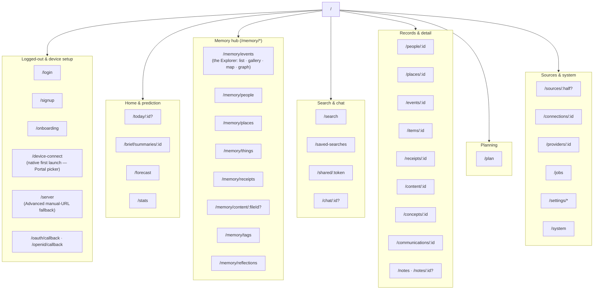

# Companion Intelligence — Dashboard Frontend

This frontend application serves as the SPA webpage view of the Digital Memory backend.

## Getting started

See the [parent README](../../../README.md) for instructions on how to get all the prerequisites installed.

You can boot the frontend development server with:

```
yarn dev
```

> In normal local development you don't run this directly — `make dev` from the
> repo root starts `web` (and `api`) via overmind behind Caddy. Run `yarn dev`
> on its own only when you want the Vite server in isolation.

## Pages & routes

The SPA is a React + Vite + Apollo app; routes are declared in `src/App.tsx` and
each maps to a page under `src/pages/`.



The 2026-08 IA restructure turned a set of top-level pages into one `/memory`
hub plus a `/today` home, and kept every old address alive as a redirect. Those
redirects are the *old* names — do not document them as pages:

| Old | Now |
| --- | --- |
| `/memory` | `/memory/events` (query string preserved) |
| `/people`, `/places`, `/tags` | `/memory/people`, `/memory/places`, `/memory/tags` |
| `/inventory`, `/receipts` | `/memory/things`, `/memory/receipts` |
| `/files` | `/memory/content` |
| `/prompts`, `/memory/questions` | `/memory/reflections` |
| `/memory/knowledge` | `/memory/events?view=graph` |
| `/feed/:id?`, `/brief/:id?`, `/schedule`, `/insights` | `/today` |
| `/feed/summaries/:id`, `/insights/:id` | `/brief/summaries/:id` |
| `/connect`, `/connections` | `/sources/connect` |
| `/import` | `/sources/import` |

`/tags/:id` was removed outright rather than redirected — a tag now opens the
Explorer filtered by it.

> The route list moves fast — `src/App.tsx` is the source of truth; this diagram
> is a map of the shape, not a guaranteed-complete index. Verified against
> `src/App.tsx` on 2026-08-19.

## Screenshots

UI screenshots for the docs are captured against a running, seeded stack and
committed under `docs/images/`. See the
[screenshot capture guide](../../../docs/screenshots.md) for the screen list,
viewport, and naming conventions.

## Storybook

You can run a Storybook server and view components in isolation provided that you've composed stories for them.

```
yarn storybook
```

Aggregate stories can be composed [here](./stories/). You should prefer to co-locate component stories with their associated component file.
The naming convention is `MyComponent.stories.tsx` for a component named `MyComponent.tsx`.
