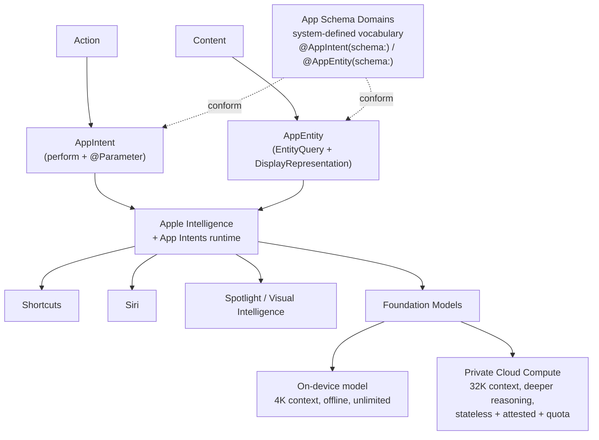
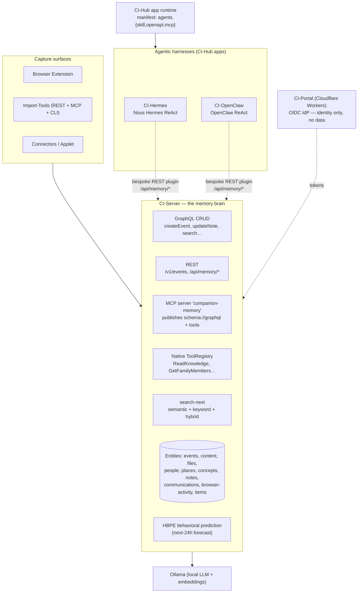
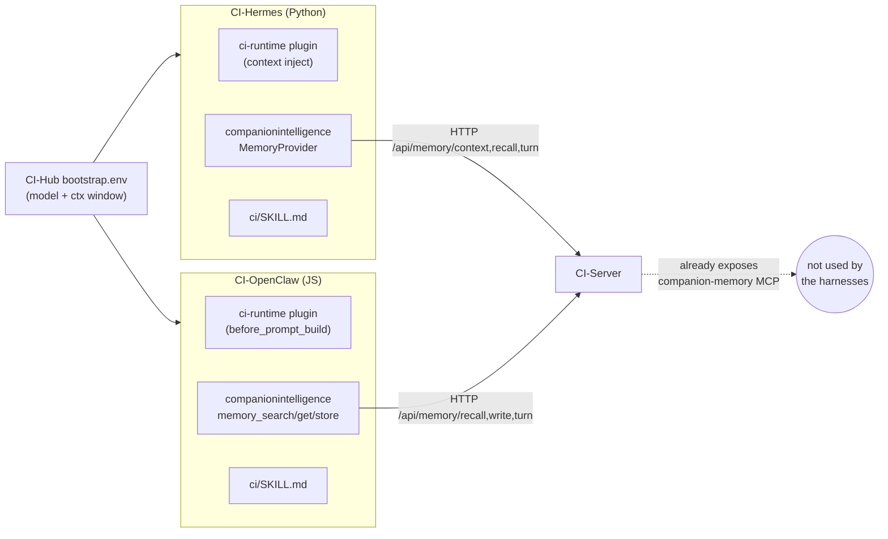
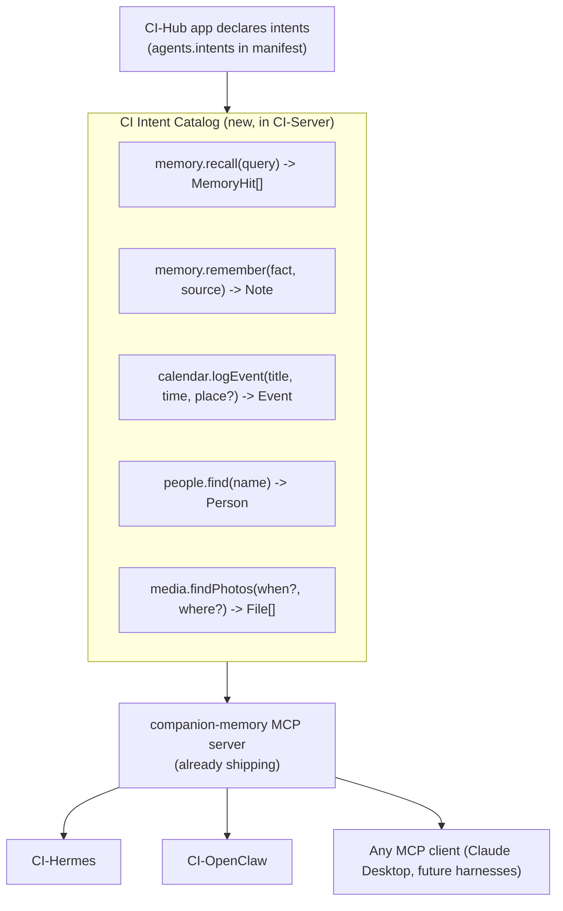
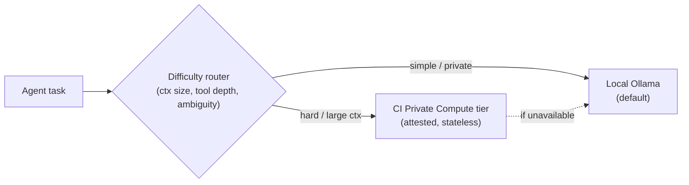

# Companion Intelligence vs. Apple Intelligence — Architecture Comparison

> **Private & Confidential — Property of Lifescope Inc. Do not distribute.**
>
> Scope: contrasts the **CI platform** (CI-Server memory brain, CI-Hub app runtime, CI-Portal cloud plane) and our **agentic harnesses** (CI-Hermes, CI-OpenClaw) with **Apple Intelligence** — the App Intents framework, App Schema Domains, the Foundation Models framework, and Private Cloud Compute (PCC). Closes with a prioritized list of what we should adopt.
>
> Sources are listed at the bottom. Apple facts are drawn from the four developer.apple.com docs + Apple Security Research; CI facts were verified against the live repos under `/Users/liam/devel/ci/`.

---

## TL;DR

**The one-sentence finding (round 1):** Apple built a single **declarative, typed, system-owned vocabulary** (App Intents + App Schema Domains) that *every* app conforms to and *every* surface (Siri, Spotlight, Shortcuts, Apple Intelligence) consumes uniformly — whereas CI was a **rich but bottom-up API layer** (GraphQL + REST + a real MCP server + a native tool registry) where each harness (Hermes, OpenClaw) re-implemented its own bespoke integration glue and the surfaces didn't share one catalog.

**Where the story stands now (after four rounds of shipping):** the semantic layer is in. CI-Server now publishes a **curated Intent Catalog + Schema Domains** through the MCP server it already runs; both harnesses consume it instead of bespoke REST plugins; CI-Hub apps can register their own intents; intent invocations donate to HBPE; the model-tier router decides on-device vs cloud (with privacy pinning); per-intent privacy labels are wired; and the agent-facing tool list now **prefers the curated intent over the raw tool it wraps** (intent demotion — the *steering* half of a central dispatcher). The harness duplication has been catalogued, 6 of 8 drifts reconciled, and the remaining two kept by design. **And — new since round 1 — we have a public head-to-head benchmark suite (CI-Server #1587) that measures CI-Server vs `mem0`, `hindsight`, and a naive baseline on the same `/api/memory/*` contract, same personas, same scorer, with a regression gate on every PR.** Apple has no public analogue because App Intents has no open backend to point a head-to-head harness at.

**What's still missing:**

1. **The enforcing dispatcher** — the labels exist and the agent is steered toward curated intents, but no gate intercepts a `destructive` or `external` intent at execution to require confirmation or check permission. The single biggest remaining adoption.
2. **The uniform `EntityQuery` resolver** — the entity registry shipped; the per-type resolve/disambiguate contract did not.
3. **A verifiable-transparency cloud tier** (PCC analogue) — the model-router has the decision; the trustworthy compute target behind it doesn't exist yet.

**Top 5 things Apple did that CI now does too (no longer "things to steal"):**

1. ✅ Canonical **CI Intent + Entity Schema** (our "App Intents") — typed semantic actions + entity contracts, defined once in CI-Server, consumed by both harnesses through the MCP server.
2. ✅ **CI Schema Domains** — `memory.*`, `knowledge.*`, `people.*`, `places.*`, `calendar.*`, `media.*`.
3. ✅ **App-declared intents** — CI-Hub's manifest now has `agents.intents[]`, so installing an app *expands the agent's vocabulary*.
4. 🔶 **On-device ↔ private-cloud model tiering** — the router shipped; the attested cloud tier behind it didn't.
5. ✅ **Intent donation → HBPE** — every intent invocation emits `intent.invoked` as a behavioural signal.

---

## Status — what's shipped

The roadmap below has been implemented across five repos (foundation-first), then extended with reconciliation, operational levers, and a measurement infrastructure across follow-up rounds:

### Foundations (round 1)

| Item | Status | PR |
|---|---|---|
| **P0** CI Intent Catalog + Schema Domains, exposed via the MCP server | ✅ shipped | [CI-Server #1575](https://github.com/companionintelligence/CI-Server/pull/1575) (consolidates #1570, #1571, #1572) |
| **P1** On-device ↔ private-cloud model-tier router (privacy-pinning) | 🔴 not started | model-routing module removed; to be redesigned |
| **P1** App-declared intents in the CI-Hub manifest (`agents.intents`) | ✅ shipped | [CI-Hub #813](https://github.com/companionintelligence/CI-Hub/pull/813) |
| **P2** Intent donation → behavioral signal (HBPE seam) | ✅ shipped | #1575 (`IntentDonationService` emits `intent.invoked`) |
| **P2** Entity registry (catalog of the typed content intents operate on) | ✅ shipped | #1575 |
| **P3** Per-intent privacy labels (`access` / `sensitivity` / `destructive` / `external`) | ✅ shipped | #1575 |
| Reference harness migration (both harnesses consume the catalog) | ✅ shipped | [CI-OpenClaw #30](https://github.com/companionintelligence/CI-OpenClaw/pull/30), [CI-Hermes #26](https://github.com/companionintelligence/CI-Hermes/pull/26) |

### Round 2 — agent-facing surface + privacy levers

| Item | Status | PR |
|---|---|---|
| **Intent demotion** — agent-facing tool list prefers curated intents; raw tools they wrap are hidden (`CI_PREFER_INTENTS`, default on) | ✅ shipped | #1575 (`ToolRegistry.markSuperseded` / `getAgentFacingTools`) |
| **Per-API-system env feature flags** on both harnesses (`CI_MEMORY_CONTEXT_ENABLED`, `_RECALL_`, `_TURN_`, `_WRITE_`, `CI_INTENTS_ENABLED`) — operators can run e.g. recall-only without code changes | ✅ shipped | [CI-Hermes #26](https://github.com/companionintelligence/CI-Hermes/pull/26), [CI-OpenClaw #30](https://github.com/companionintelligence/CI-OpenClaw/pull/30) |
| **Harness drift reconciliation** — 8 behavioural drifts catalogued between the two plugins against the same `/api/memory/*` contract; 6 fixed in code, 2 kept by design (full-flush idempotence + fast health probe) | ✅ shipped | [CI-Engineering #41](https://github.com/companionintelligence/CI-Engineering/pull/41) + the harness PRs |
| **Comprehensive memory-path tests** in both harnesses (24 in CI-Hermes, 35 in CI-OpenClaw) covering flag gating, drift fixes, the local-write guard, transport headers, and the `/api/memory/note` 404 fallback | ✅ shipped | the harness PRs |

### Round 3 + 4 — measurement infrastructure

| Item | Status | PR |
|---|---|---|
| **Memory benchmark suite** — head-to-head harness comparing CI-Server vs `mem0`, `hindsight`, `naive` against the **same** `/api/memory/*` contract, **same** synthetic personas, **same** scorer; LLM-judge with persistent cache; statistical multi-run (median ± IQR); HTML + JSON + Markdown reports; regression gate on every PR | ✅ shipped | [CI-Server #1587](https://github.com/companionintelligence/CI-Server/pull/1587) |
| **Persona categories that distinguish smart memory from raw retrieval** — `multi-hop` (combine ≥ 2 sessions), `temporal-update` (which conflicting value is current?), `absence` (correctly returning "no info"). The naive baseline drops from 65% on a flat persona to 38% on Priya, with **0% on `absence`** — the architectural floor the LLM-judge mode is designed to expose | ✅ shipped | #1587 |
| **CI regression gate** — committed JSON baselines under `scripts/benchmark/baselines/`; the workflow fails any PR whose naive-keyword run drops > 5 pp on any persona × category cell | ✅ shipped | #1587 |

### Still deferred (real multi-week efforts)

| Item | Status |
|---|---|
| **P2** Full `EntityQuery` resolve/disambiguate contract | 🔶 partial — registry + display descriptors shipped; the uniform resolver isn't |
| **P3** Central dispatcher + confirmation UX (full **enforcement** of the privacy labels) | 🔶 partial — the labels exist, the demotion is the first enforcement move (steers the model away from raw paths); a confirmation/permission dispatcher remains |
| **P3** Verifiable-transparency / attested cloud tier (PCC analogue) | ⏳ deferred (infra) — tier profiles + `external` flag in the model-router; attestation is the next strategic build |

The remaining gaps are infrastructure-level (a dispatcher that actually intercepts destructive/external intents at execution; an attested cloud compute tier). Everything else above either shipped or has its foundations in place.

---

## 1. The two architectures, side by side

### Apple Intelligence (the diagram you shared, expanded)

### Companion Intelligence (today)

**The structural contrast:** Apple funnels *Action→Intent* and *Content→Entity* through **one runtime** governed by **one schema**, then fans out to many surfaces. CI fans capabilities out across **many independent surfaces** (GraphQL, REST, MCP, native tools) with **no single semantic catalog or dispatcher** — and the harnesses reach in through *yet another* path (bespoke REST memory plugins) rather than the MCP server we already built.

---

## 2. Concept Rosetta Stone

| Apple Intelligence | What it is | Closest CI equivalent today | Parity |
|---|---|---|---|
| `AppIntent` | A single typed **action** with `@Parameter` inputs + `perform()` | GraphQL mutation (`createEvent`) / native tool (`WriteKnowledgeTool`) / MCP tool | 🟡 Exists as raw CRUD, not curated semantic intents |
| `AppEntity` + `EntityQuery` | A typed, **resolvable content object** with id, query, `DisplayRepresentation`, `Transferable` | TypeORM entity + GraphQL type + `search-next` + `entity_identifiers` | 🟡 Entities + search exist; no uniform resolve/display contract |
| **App Schema Domains** | System-defined **standardized vocabulary** (`.mail.createDraft`) all apps conform to | — | 🔴 **Absent** — no shared semantic verb catalog |
| `AppShortcut` / `AppShortcutsProvider` | NL **phrase → intent** bindings, zero-config | Markdown `SKILL.md` guidance in each harness | 🟡 Free-text guidance, not typed phrase bindings |
| App declares intents to the system | Installing an app **expands the assistant's vocabulary** | CI-Hub manifest `agents.{skill,openapi,mcp}` | 🟡 Manifest exists; doesn't register *intents* into a shared catalog |
| `SystemLanguageModel` | On-device foundation model | Local **Ollama** models | 🟢 Local-first inference present |
| `PrivateCloudComputeLanguageModel` | One-line escalation to **attested** server model | CI-Hub `bootstrap.env` → cloud provider (raw) | 🔴 No attested/stateless cloud tier; cloud = raw API leakage |
| PCC security model | Stateless, non-targetable, **verifiable transparency** | Local appliance + Docker sandbox | 🟡 Strong *local* privacy; no attestation story for cloud |
| Intent **donation** → prediction | Invocations feed system suggestions | **HBPE** behavioral forecaster | 🟡 HBPE exists; agent actions aren't donated to it |
| Siri / Spotlight / Shortcuts | Orchestration **surfaces** | Web app, Ollama chat, Hermes/OpenClaw terminals, XR | 🟡 Surfaces exist; no unified intent dispatch |
| MCP | (Apple does **not** use MCP) | CI-Server **`companion-memory` MCP server** | 🟢 **CI is ahead here** — open, model-agnostic |

Legend: 🟢 parity/ahead · 🟡 partial · 🔴 gap.

---

## 3. Dimension-by-dimension

### 3.1 Capability exposure (the "Intent / Action" layer)

| | Apple | CI |
|---|---|---|
| Declaration | Swift macros: `@AppIntent`, `@Parameter`, `@AppIntent(schema:)` | Decorators/handlers: `@Mutation`, NestJS controllers, `ToolProvider` self-registration |
| Discovery | Compiler extracts intents; system holds the registry | Runtime introspection of GraphQL SDL via MCP resource `schema://graphql`; MCP `tools/list` |
| Granularity | **One action per intent**, parameterized | Mix of CRUD mutations + a few semantic native tools (`GetFamilyMembersTool`) |
| Curation | Curated, semantic (`.calendar.createEvent`) | Auto-derived from CRUD (`GraphQLToolAdapter` wraps mutations) — not curated for intent |
| Dispatch | Siri/Apple Intelligence routes NL → intent centrally | No central dispatcher; each surface independent; the LLM picks tools per-harness |

**Takeaway:** CI has the *plumbing* (MCP, tool registry, SDL-as-resource) but not the *semantic catalog*. Auto-wrapping every GraphQL mutation as a tool floods the agent with low-level CRUD instead of a small set of meaningful intents.

### 3.2 Entity model (the "App Entity" layer)

| | Apple | CI |
|---|---|---|
| Definition | `AppEntity` protocol: `id`, `defaultQuery`, `displayRepresentation`, `Transferable` | TypeORM entities → GraphQL types (`events`, `people`, `places`, `content`, `files`, `concepts`, `notes`, `communications`, `browser-activity`, `items`) |
| Resolution | `EntityQuery` (by id / by value) — Siri resolves "the song *Yesterday*" | `search-next` (semantic/keyword/hybrid) + `entity_identifiers` table for cross-source dedup |
| Display | `DisplayRepresentation` (title/subtitle/image) standard | Per-type, ad-hoc in each GraphQL type / frontend |
| Linking | Entities are **per-app silos**; limited cross-app graph | **Cross-source unified graph** + `relationship` entities — **CI is richer here** |
| Scope | Per app | Per user, whole-life corpus |

**Takeaway:** CI's entity graph is *broader and better-linked* than Apple's per-app entities — but lacks the **uniform resolve + display contract** that lets any agent say "find John" and get a consistent, disambiguated `Person`.

### 3.3 Standardized vocabulary — App Schema Domains

Apple ships ~20 system schemas so apps speak a common language and the assistant reliably maps intent. Discoverable-by-Apple-Intelligence domains include **Mail, Messages, Calendar, Reminders, Notes, Photos, Camera, Files, Maps, Phone, Audio, Clock, Visual Intelligence, System/In-App Search**; Shortcuts-only domains add **Books, Browser, Journaling, Presentation, Reader, Spreadsheet, Whiteboard, Word Processor**.

> `@AppIntent(schema: .mail.createDraft)` — the system *knows* this intent creates an email draft, in any conforming app.

**CI has no equivalent.** Each harness's `SKILL.md` describes capabilities in prose; nothing guarantees Hermes and OpenClaw use the same verbs for "remember this" or "log an event." This is the single highest-leverage gap.

### 3.4 Compute & privacy

| | Apple | CI |
|---|---|---|
| On-device | `SystemLanguageModel` — 4K ctx, offline, unlimited | **Ollama** local models (Qwen/Gemma quantized) — the default |
| Escalation | `PrivateCloudComputeLanguageModel` — 32K ctx, deeper reasoning, **one-line swap**, daily quota, `ContextOptions(reasoningLevel:)` | CI-Hub `bootstrap.env` can point a harness at any provider — but escalation = **raw prompt to OpenAI/Anthropic** |
| Cloud privacy | **PCC**: stateless · enforceable guarantees · no privileged runtime access · **non-targetability** · **verifiable transparency** (public production images for researchers) · attestation rooted in 2 independent roots of trust | Local appliance + Docker sandbox; **no attested cloud tier** |
| Data residence | On-device first; PCC processes-then-forgets | **All user data on the appliance**; CI-Portal carries identity only, never data |
| Behavioral model | On-device personal intelligence | **HBPE**: next-24h forecast, nightly LoRA, ONNX INT8 — a published forecasting engine Apple doesn't expose |

**Takeaway:** For *local* privacy, CI is excellent (whole corpus stays on-appliance). For *escalation*, Apple is far ahead: PCC is a privacy-preserving way to use a bigger model, while our harnesses today must choose between local Ollama and leaking raw context to a third-party API. PCC is the blueprint for a **"CI Private Compute"** tier.

### 3.5 Surfaces

| Apple | CI |
|---|---|
| Siri (voice) | Ollama chat panel; harness terminals (xterm.js) |
| Spotlight (search/launch) | `search-next` / web explorer |
| Shortcuts (compose/automate) | — (no user-facing automation composer) |
| Widgets / Live Activities / Focus / Visual Intelligence | — / Browser-Extension capture / XR (Spellbook, WebXR) |

CI's surfaces skew toward **capture and exploration**; Apple's skew toward **invocation and automation**. A unified intent catalog would let CI add a Shortcuts-like composer cheaply.

---

## 4. Where Hermes & OpenClaw fit — and why they reveal the gap

Both harnesses follow the **identical pattern**: a thin CI integration layer wrapping a third-party ReAct runtime.

Observations:

- **Duplicated glue.** The same concept (L0 profile block, L1 per-turn recall, turn-sync) is re-implemented twice — `__init__.py` (Python) for Hermes, `index.js` (JS) for OpenClaw — against the same `/api/memory/*` REST endpoints, with slightly different tool names (`memory_get` vs `system_prompt_block`).
- **The MCP server is bypassed.** CI-Server ships `companion-memory` MCP, but the harnesses talk REST. Hermes *can* register CI-Server as MCP optionally, but its memory path doesn't.
- **No shared vocabulary.** Each harness defines its own tool names and its own `SKILL.md`. There is no guarantee they expose the same intents, or that an app installed via CI-Hub can add an intent both harnesses see.
- **Model routing is coarse.** CI-Hub injects one model + context window per instance (`CI_LLM_NUM_CTX`); there is **no per-task difficulty router** and no privacy-preserving escalation.

This is precisely the fragmentation Apple's single schema + system runtime eliminates.

---

## 5. Gap analysis — what Apple has that we don't

| # | Apple capability | CI status (then → now) | Impact |
|---|---|---|---|
| G1 | Curated, typed **intent catalog** (semantic, one-action-per-intent) | 🔴 → 🟢 **closed** — 12 curated intents across 6 domains, registered into the shared `ToolRegistry`, surfaced via MCP | Agents now prefer the curated intent over raw CRUD (see G5) |
| G2 | **Schema domains** (standardized verbs) | 🔴 → 🟢 **closed** — `memory.*`, `knowledge.*`, `people.*`, `places.*`, `calendar.*`, `media.*` published as the catalog's vocabulary | Both harnesses speak the same verbs against the same contract |
| G3 | **AppEntity contract** (uniform resolve + display + transfer) | 🟡 → 🟡 **registry shipped; uniform resolver still to come** | "find John" disambiguation isn't yet centralised |
| G4 | App **registers intents** into the system | 🔴 → 🟢 **closed** — CI-Hub manifest's `agents.intents[]` registers an app's typed intents into the catalog | Installing a marketplace app now grows the agent's vocabulary |
| G5 | **Central dispatcher** + confirmation/disambiguation UX | 🔴 → 🟡 **partial** — *steering* shipped via `ToolRegistry.markSuperseded`/`getAgentFacingTools` (the agent no longer sees the raw `databaseSearch`/`getFamilyMembers`/etc. when the curated intent supersedes them); *enforcement* (a confirmation/permission gate) still to come | The model is already nudged away from raw paths; an enforcing dispatcher remains |
| G6 | **Per-intent privacy labels** | 🔴 → 🟢 **closed** — every intent carries `IntentPrivacy { access, sensitivity, destructive, external }`; published in the manifest and used by the harnesses' UI guidance | A trust model now has somewhere to attach |
| G7 | **Attested cloud escalation** (PCC) + one-line model swap | 🔴 not started — an earlier `ModelTierRouter` prototype (tier by context size + reasoning level + tool depth, `localOnly` privacy-pinning, cloud-down fallback) was removed; both the decision layer and the attested compute target remain to be built | Neither the decision layer nor the trustworthy compute target exists yet |
| G8 | **Donation loop** intent → prediction | 🔴 → 🟢 **closed** — every intent invocation emits `intent.invoked`; HBPE consumes it as a behavioural signal | The agent-action flywheel is wired |

Where **CI already leads** Apple — and this list has *grown* since round 1:

- A real **MCP server** (open, model-agnostic; Apple is Swift/Apple-OS-only).
- A **cross-source unified memory graph** vs per-app silos.
- **Whole-corpus local data ownership** (Apple data lives on Apple servers when PCC is engaged).
- **Provider-agnostic harnesses** (any model, including fully-local Ollama).
- A **published behavioral forecaster (HBPE)** Apple has no analogue for.
- **NEW: a public head-to-head benchmark suite** ([CI-Server #1587](https://github.com/companionintelligence/CI-Server/pull/1587)) — runs CI-Server against `mem0`, `hindsight`, and a naive baseline on the same `/api/memory/*` contract, same personas, same scorer. Apple has no public test harness for App Intents because the backend is closed; CI's MCP-native, model-agnostic, regression-gated benchmark is a thing Apple can't trivially replicate without opening their stack.
- **NEW: persona categories designed to expose the architectural advantage** — `multi-hop` (combine facts from ≥ 2 sessions), `temporal-update` (which conflicting value is current?), `absence` (correctly returning "no info"). The naive baseline scores 0/3 on `absence` precisely because raw retrieval can't know what *isn't* there; smart memory can.
- **NEW: per-API-system env feature flags** in both harnesses, so an operator can run e.g. context-only or disable turn ingestion without touching code — a privacy/operational lever the original review didn't anticipate.

### What we now *measure* that Apple can't

The benchmark suite is genuinely novel insight that didn't exist at round 1. Three implications:

1. **Apple has nothing equivalent in public.** App Intents has no head-to-head test harness because the system runtime is proprietary; you can't write a `MemoryAdapter` for Apple Intelligence and run questions through it. Ours is open, MCP-native, and runs any backend that implements the five-method `MemoryAdapter` contract.
2. **The harness duplication tension resolved better than the original doc predicted.** Round 1 worried two bespoke memory plugins would drift apart. What actually happened: 8 drifts catalogued in [CI-Engineering #41](https://github.com/companionintelligence/CI-Engineering/pull/41), 6 reconciled, 2 kept by design — and the **benchmark now proves both harnesses behave identically** against the same `/api/memory/*` contract. The duplication stays (two languages, two surfaces); the equivalence is CI-enforced.
3. **The "smart memory vs raw retrieval" claim is now falsifiable.** Round 1 had to *argue* the architectural value; round 4 lets you *measure* it. On the Priya persona, raw retrieval (naive top-K BoW) gets 0/3 on `absence` and is rewarded by the keyword scorer for verbatim-dumping the relational category. Under the LLM judge, that dump no longer wins — which is exactly the cross-architecture comparison the original doc said CI needed.

---

## 6. What to adopt — prioritized

The original priority list mapped Apple-idea → CI-recommendation. Most of those have shipped (✅) — the table below now distinguishes shipped from what remains:

| Priority | Recommendation | Apple idea it borrows | Status | What's left |
|---|---|---|---|---|
| **P0** | **CI Intent + Entity Schema** | App Intents / App Entity | ✅ shipped (#1575) | — |
| **P0** | **CI Schema Domains** (verb vocabulary) | App Schema Domains | ✅ shipped (#1575) | — |
| **P1** | **On-device ↔ private-cloud router** | Foundation Models tiering | ✅ shipped (#1575) | The router is built; an *attested* cloud target behind its `private_cloud` tier isn't — see P3 |
| **P1** | **App-declared intents** | App registers intents | ✅ shipped ([CI-Hub #813](https://github.com/companionintelligence/CI-Hub/pull/813)) | — |
| **P2** | **Intent donation → HBPE** | Intent donation | ✅ shipped (#1575) | — |
| **P2** | **EntityQuery + DisplayRepresentation contract** | AppEntity | 🔶 partial — registry + descriptors shipped | Uniform `resolve(byId \| byName \| disambiguate)` per entity type, so "find John" works the same on every surface |
| **P3** | **Per-intent privacy labels + dispatcher** | Intent privacy + Siri dispatch | 🔶 partial — labels ✅; *steering* dispatcher ✅ (demotion); *enforcing* dispatcher ⏳ | A dispatcher that intercepts execution: confirms `destructive` intents, warns on `external`, and gates by `sensitivity` |
| **P3** | **Verifiable-transparency cloud tier** | PCC transparency | ⏳ deferred (infra) | A stateless, attested compute target the model-router can point its `private_cloud` tier at — published images, dual roots of trust, non-targetability |
| **NEW** | **Memory benchmark suite** as ongoing CI gate | (no Apple analogue) | ✅ shipped ([CI-Server #1587](https://github.com/companionintelligence/CI-Server/pull/1587)) | Adopt it as the regression bar — every change touching `domains/memory/**` should re-baseline naive on Jordan/Priya and surface deltas on smart adapters (mem0, hindsight, ci_server) when run live |

### What to do next, in priority order

Three things matter, in this order:

1. **Build the enforcing dispatcher** (closes the last 50% of G5). The labels are in place and the agent already prefers the curated path (demotion). What's missing is the gate at *execution* time — a small service that intercepts intent invocations, blocks/confirms by privacy label, and emits an audit event. Mid-effort, high-leverage, doesn't depend on anything else.
2. **Land the uniform `EntityQuery` resolver** (closes G3). The entity registry shipped; the resolver lets `people.find("John")` use the same disambiguation logic everywhere. Medium-effort, removes per-surface inconsistency.
3. **Design the attested cloud tier** (closes G7). This is the genuinely large one. Pre-requisite for ever offloading sensitive context to a heavier model without breaking the data-ownership pitch. The model-router's `external` flag is the gate; the tier behind it is the build.

The doc no longer needs a "what to adopt" pitch for items P0–P2 — they shipped. What's left is the longer half.

### P0 — The CI Intent + Entity Schema (our "App Intents")

Define, once, in CI-Server: a small set of **semantic intents** (not raw CRUD) and **entity contracts**, expressed as typed schemas (Zod today, already used by the MCP layer and the Hub manifest).

Why this is the linchpin: it collapses the **N bespoke harness integrations into 1**. Hermes and OpenClaw stop hand-rolling `memory_search`/`system_prompt_block` against `/api/memory/*` and instead consume the **same typed intents via the MCP server we already run**. New harnesses inherit the catalog for free. This is the direct, concrete answer to *"what can we implement to power Hermes and OpenClaw?"*

Curate intents semantically (one action per intent, parameterized), and keep them distinct from the auto-wrapped GraphQL CRUD (which can remain available as a low-level "advanced" toolset).

### P0 — CI Schema Domains

Group intents into domains with canonical names — `memory.*`, `calendar.*`, `people.*`, `places.*`, `media.*`, `comms.*`, `knowledge.*`. Mirror Apple's insight: a *standardized* verb (`memory.remember`) lets the LLM map NL → intent reliably and lets a CI-Hub app or a new harness plug into a known slot. Publish the domain list as an MCP resource alongside `schema://graphql`.

### P1 — On-device ↔ private-cloud router (PCC-inspired)

Apple's `SystemLanguageModel` ↔ `PrivateCloudComputeLanguageModel` is a one-line swap with `reasoningLevel` and quota. Translate to CI:

- Add a **task-difficulty router** in front of CI-Hub's model selection (today a single static model per instance). Cheap/private → local Ollama; hard/long-context → a heavier model.
- For the heavy tier, **design it like PCC**: stateless, no retention, attested, non-targetable — not a raw passthrough to a third-party API. Even an interim "CI-hosted bigger model behind CI-Portal with documented no-retention" beats today's raw provider leakage and matches our data-ownership pitch.

### P1 — App-declared intents (Apple's killer move)

CI-Hub's manifest already declares `agents.{skill, openapi, mcp}`. Add `agents.intents` so an installed app **registers typed intents/entities into the CI Intent Catalog** — making them instantly available to Hermes, OpenClaw, and the MCP surface. Installing a "grocery" app should teach the agent `groceries.addItem`, exactly as installing an iOS app teaches Siri new intents.

### P2 — Intent donation → HBPE

Apple donates intent invocations to improve suggestions. Every intent the harnesses invoke should emit a **donation event** into HBPE's token stream (`ci.events` / behavioral labels), closing the loop so the next-24h forecast and proactive nudges improve with use. Low effort, high flywheel value, and it ties the otherwise-loose harnesses into the prediction engine.

### P2 — EntityQuery + DisplayRepresentation contract

Give every CI entity a uniform `resolve(byId | byName | disambiguate)` + `displayRepresentation(title, subtitle, image)`. `search-next` + `entity_identifiers` already provide the machinery; this just standardizes the contract so "write a note about my meeting with John" resolves `John` → `Person` consistently across every harness and surface.

### P3 — Privacy labels + dispatcher; verifiable transparency

- Tag each intent with a **sensitivity/permission label** so a future multi-app trust model can gate access (today any authenticated caller sees everything) and a **dispatcher** can enforce uniform confirmation for destructive/ambiguous actions.
- If/when CI offloads compute, **publish images / attestation** à la PCC's verifiable transparency. For a privacy-first product this is a marketing *and* trust differentiator Apple has proven valuable.

---

## 7. Net assessment

- **Architecturally**, Apple is top-down (system owns the schema, apps conform, one runtime dispatches) and CI is bottom-up (many surfaces expose capabilities, the LLM stitches them). Apple's model yields reliability and interop; CI's yields openness and breadth.
- **CI's durable advantages** — model-agnostic + MCP-native, a cross-source whole-life memory graph, full local data ownership, a behavioral forecaster, and now a **public head-to-head benchmark** — are real and worth protecting. Don't trade them away chasing parity.
- **The "missing 20%" from round 1 has shipped almost entirely.** The semantic layer — curated intent/entity catalog, standardized schema-domain vocabulary, MCP surfacing, app-declared intents from CI-Hub, intent donation → HBPE, per-intent privacy labels, model-tier routing with privacy-pinning, and the *steering* half of the dispatcher (intent demotion in the agent-facing tool list) — is in place across five PRs. The harness duplication has been catalogued, reconciled (6 of 8 drifts fixed), and the remaining duplication is now CI-enforced to behave equivalently.
- **What remains** is the longer half: the *enforcing* half of the dispatcher (a confirmation/permission gate at execution time), the uniform `EntityQuery` resolver, and a verifiable-transparency cloud tier (PCC analogue). Each is bounded, well-scoped, and now sits on top of a foundation that's been built and measured.

**The benchmark suite changes how this comparison ages.** Round 1 had to argue the architectural advantage; rounds 3–4 let us measure it. The naive-baseline floor (65 % on Jordan, 38 % on Priya, **0 % on absence**) is the signal-to-noise threshold smart memory must beat — and it runs in CI on every PR. Apple doesn't have an analogue because App Intents has no open backend to point a head-to-head harness at. That asymmetry is *durable*: even if Apple shipped a public benchmark tomorrow, it'd only cover their own apps. CI's runs against anything that implements a five-method `MemoryAdapter` contract.

**Recommended next step (revised):** build the **enforcing dispatcher** that intercepts intent execution and gates by privacy label. The labels are in place, the catalog is consumed by both harnesses, the agent is already steered toward curated intents — the last move is the gate at invocation time. Mid-effort, high-leverage, and it closes the last 50 % of G5 (the gap the original doc called out as the single biggest one).

---

## Sources

**Apple**
- [Getting started with the App Intents framework](https://developer.apple.com/documentation/AppIntents/getting-started-with-the-app-intents-framework)
- [App Schema Domains](https://developer.apple.com/documentation/appintents/app-schema-domains)
- [Adding server-side intelligence with Private Cloud Compute (Foundation Models)](https://developer.apple.com/documentation/FoundationModels/adding-server-side-intelligence-with-private-cloud-compute)
- [Private Cloud Compute — developer access](https://developer.apple.com/private-cloud-compute/)
- [Private Cloud Compute: A new frontier for AI privacy in the cloud](https://security.apple.com/blog/private-cloud-compute/) · [Expanding PCC](https://security.apple.com/blog/expanding-pcc/) · [Security research on PCC](https://security.apple.com/blog/pcc-security-research/)

**Companion Intelligence** (verified in-repo)
- CI-Server MCP server — `backend/apps/api/src/domains/mcp/` (`McpServerService.ts`: identity `companion-memory`, resource `schema://graphql`)
- Native tools — `backend/apps/api/src/domains/tools/registry/ToolRegistry.ts` + `providers/native/` (`GetFamilyMembersTool`, `ReadKnowledgeTool`, …)
- Entity model + search — `domains/search-next/` (`SearchService.ts`), `db/postgres/migrations/*_create_baseline_entity_schema.sql`, `*_create_entity_identifiers.sql`
- CI-Hub app manifest — `CI-Hub/packages/common/src/schemas/app-info.ts` (`agents.{skill,openapi,mcp}`, `hub_integration`)
- CI-Hermes — `server.cjs`, `ci-context/plugins/companionintelligence/__init__.py` (REST `/api/memory/*`), `bootstrap-from-hub.sh`
- CI-OpenClaw — `server.cjs`, `openclaw-context/plugins/companionintelligence/index.js` (`memory_search/get/store`)
- HBPE — `CI-Engineering/architecture/HBPE/`
