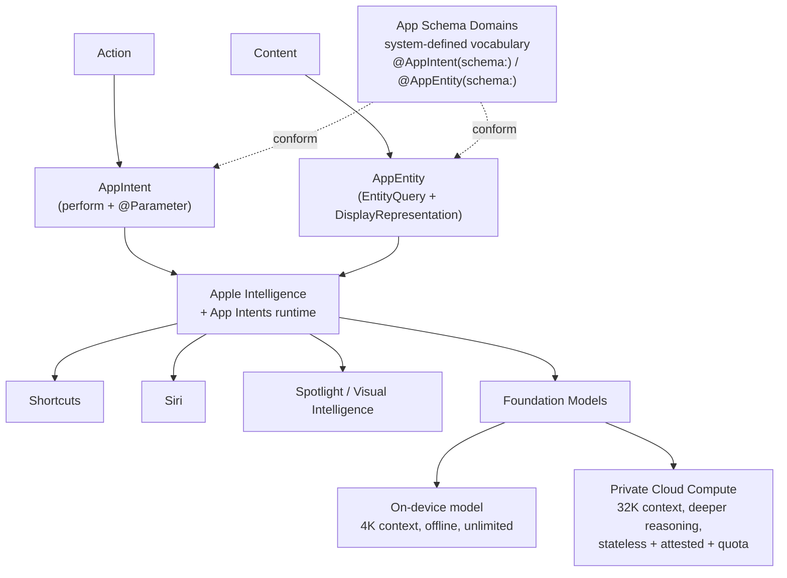
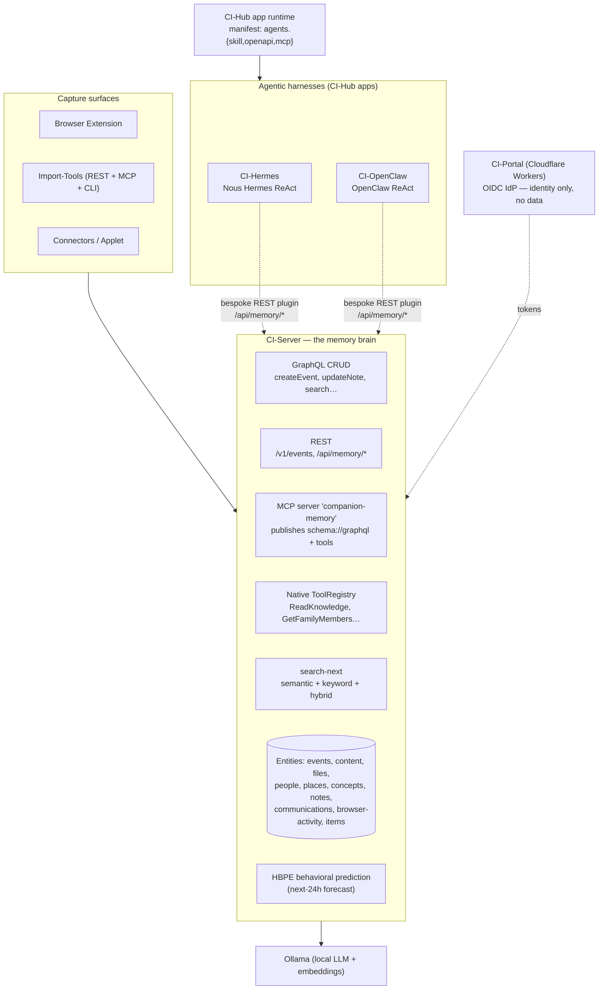
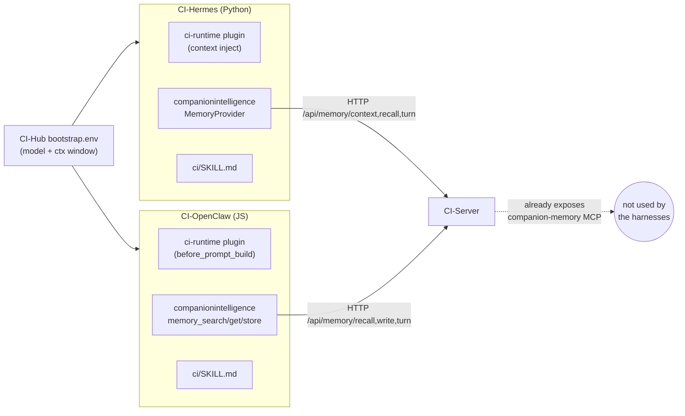
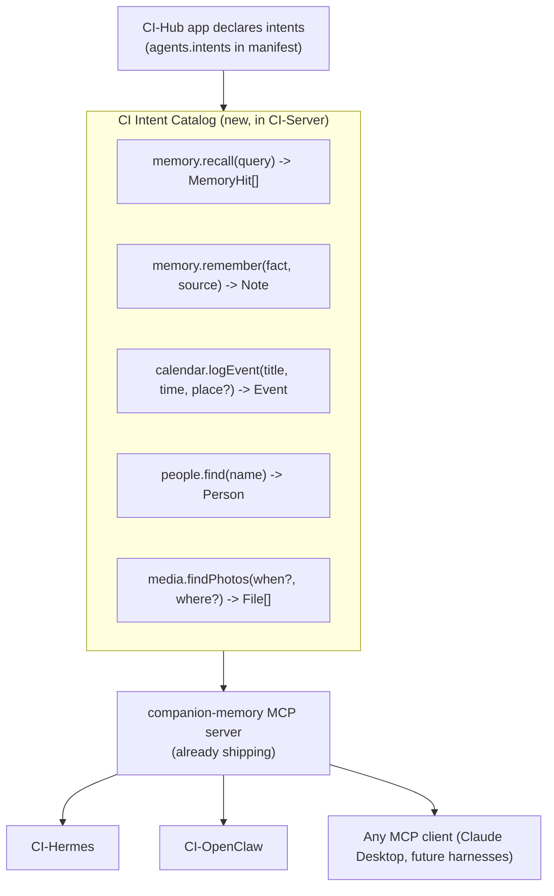
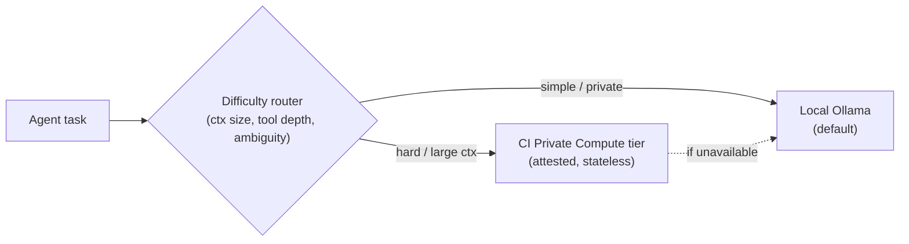

# Companion Intelligence vs. Apple Intelligence — Architecture Comparison

> **Private & Confidential — Property of Lifescope Inc. Do not distribute.**
>
> Scope: contrasts the **CI platform** (CI-Server memory brain, CI-Hub app runtime, CI-Portal cloud plane) and our **agentic harnesses** (CI-Hermes, CI-OpenClaw) with **Apple Intelligence** — the App Intents framework, App Schema Domains, the Foundation Models framework, and Private Cloud Compute (PCC). Closes with a prioritized list of what we should adopt.
>
> Sources are listed at the bottom. Apple facts are drawn from the four developer.apple.com docs + Apple Security Research; CI facts were verified against the live repos under `/Users/liam/devel/ci/`.

---

## TL;DR

**The one-sentence finding:** Apple built a single **declarative, typed, system-owned vocabulary** (App Intents + App Schema Domains) that *every* app conforms to and *every* surface (Siri, Spotlight, Shortcuts, Apple Intelligence) consumes uniformly — whereas CI is a **rich but bottom-up API layer** (GraphQL + REST + a real MCP server + a native tool registry) where each harness (Hermes, OpenClaw) re-implements its own bespoke integration glue and the surfaces don't share one catalog.

We are **closer than it looks** — CI-Server *already* exposes an MCP server (`companion-memory`) that publishes the GraphQL SDL and tool schemas, and CI-Hub *already* has a declarative app manifest with `agents.{skill, openapi, mcp}`. What we lack is the **semantic layer on top**: a curated catalog of typed *intents* and *entities* (not raw CRUD), a standardized *domain vocabulary*, an *entity-resolution contract*, a *privacy/permission label per action*, and a *privacy-preserving compute-escalation tier*.

**Top 5 things to steal from Apple:**

1. A canonical **CI Intent + Entity Schema** (our "App Intents") — typed semantic actions + entity contracts, defined once in CI-Server and consumed by *all* harnesses through the MCP server we already ship, replacing the per-harness REST plugins.
2. **CI Schema Domains** — a standardized verb vocabulary (`memory.recall`, `calendar.logEvent`, `people.find`…) so the LLM maps natural language → intent reliably and apps/harnesses interoperate.
3. **App-declared intents** — extend the CI-Hub manifest so installing an app *expands the agent's vocabulary* (Apple's killer move), registering the app's intents/entities into the shared catalog.
4. **On-device ↔ private-cloud model tiering** — Apple's one-line `SystemLanguageModel` → `PrivateCloudComputeLanguageModel` swap with reasoning levels. We have local Ollama; add a difficulty-aware router that escalates to a **PCC-style attested cloud tier** instead of leaking raw prompts to OpenAI/Anthropic.
5. **Intent donation → HBPE** — Apple donates intent invocations to improve prediction. Every agent action in Hermes/OpenClaw should become a donation that feeds HBPE's behavioral forecast and proactive suggestions.

---

## Status — what's shipped

The roadmap below has been implemented across three repos (foundation-first):

| Item | Status | PR |
|---|---|---|
| **P0** CI Intent Catalog + Schema Domains, exposed via the MCP server | ✅ shipped | [CI-Server #1570](https://github.com/companionintelligence/CI-Server/pull/1570) |
| **P1** On-device ↔ private-cloud model-tier router (privacy-pinning) | ✅ shipped | [CI-Server #1571](https://github.com/companionintelligence/CI-Server/pull/1571) |
| **P1** App-declared intents in the CI-Hub manifest (`agents.intents`) | ✅ shipped | [CI-Hub #813](https://github.com/companionintelligence/CI-Hub/pull/813) |
| **P2** Intent donation → behavioral signal (HBPE seam) | ✅ shipped | [CI-Server #1572](https://github.com/companionintelligence/CI-Server/pull/1572) |
| Reference harness migration (OpenClaw consumes the catalog) | ✅ shipped | [CI-OpenClaw #30](https://github.com/companionintelligence/CI-OpenClaw/pull/30) |
| **P2** Entity registry (App-Entity catalog) | ✅ shipped (in #1570) | — |
| **P2** Full `EntityQuery` resolve/disambiguate contract | 🔶 partial — registry shipped; resolver deferred | — |
| **P3** Per-intent privacy labels | ✅ shipped (in #1570) | — |
| **P3** Central dispatcher + confirmation UX (enforcement) | ⏳ deferred (design-heavy) | — |
| **P3** Verifiable-transparency / attested cloud tier | ⏳ deferred (infra) — tier profiles + `external` flag in #1571 | — |

The two deferred P3 items are genuine multi-week efforts (a dispatcher with confirmation/permission enforcement; a PCC-style attested compute tier); their foundations (privacy labels, tier profiles, the `external`/`destructive` flags) are in place.

---

## 1. The two architectures, side by side

### Apple Intelligence (the diagram you shared, expanded)

### Companion Intelligence (today)

**The structural contrast:** Apple funnels *Action→Intent* and *Content→Entity* through **one runtime** governed by **one schema**, then fans out to many surfaces. CI fans capabilities out across **many independent surfaces** (GraphQL, REST, MCP, native tools) with **no single semantic catalog or dispatcher** — and the harnesses reach in through *yet another* path (bespoke REST memory plugins) rather than the MCP server we already built.

---

## 2. Concept Rosetta Stone

| Apple Intelligence | What it is | Closest CI equivalent today | Parity |
|---|---|---|---|
| `AppIntent` | A single typed **action** with `@Parameter` inputs + `perform()` | GraphQL mutation (`createEvent`) / native tool (`WriteKnowledgeTool`) / MCP tool | 🟡 Exists as raw CRUD, not curated semantic intents |
| `AppEntity` + `EntityQuery` | A typed, **resolvable content object** with id, query, `DisplayRepresentation`, `Transferable` | TypeORM entity + GraphQL type + `search-next` + `entity_identifiers` | 🟡 Entities + search exist; no uniform resolve/display contract |
| **App Schema Domains** | System-defined **standardized vocabulary** (`.mail.createDraft`) all apps conform to | — | 🔴 **Absent** — no shared semantic verb catalog |
| `AppShortcut` / `AppShortcutsProvider` | NL **phrase → intent** bindings, zero-config | Markdown `SKILL.md` guidance in each harness | 🟡 Free-text guidance, not typed phrase bindings |
| App declares intents to the system | Installing an app **expands the assistant's vocabulary** | CI-Hub manifest `agents.{skill,openapi,mcp}` | 🟡 Manifest exists; doesn't register *intents* into a shared catalog |
| `SystemLanguageModel` | On-device foundation model | Local **Ollama** models | 🟢 Local-first inference present |
| `PrivateCloudComputeLanguageModel` | One-line escalation to **attested** server model | CI-Hub `bootstrap.env` → cloud provider (raw) | 🔴 No attested/stateless cloud tier; cloud = raw API leakage |
| PCC security model | Stateless, non-targetable, **verifiable transparency** | Local appliance + Docker sandbox | 🟡 Strong *local* privacy; no attestation story for cloud |
| Intent **donation** → prediction | Invocations feed system suggestions | **HBPE** behavioral forecaster | 🟡 HBPE exists; agent actions aren't donated to it |
| Siri / Spotlight / Shortcuts | Orchestration **surfaces** | Web app, Ollama chat, Hermes/OpenClaw terminals, XR | 🟡 Surfaces exist; no unified intent dispatch |
| MCP | (Apple does **not** use MCP) | CI-Server **`companion-memory` MCP server** | 🟢 **CI is ahead here** — open, model-agnostic |

Legend: 🟢 parity/ahead · 🟡 partial · 🔴 gap.

---

## 3. Dimension-by-dimension

### 3.1 Capability exposure (the "Intent / Action" layer)

| | Apple | CI |
|---|---|---|
| Declaration | Swift macros: `@AppIntent`, `@Parameter`, `@AppIntent(schema:)` | Decorators/handlers: `@Mutation`, NestJS controllers, `ToolProvider` self-registration |
| Discovery | Compiler extracts intents; system holds the registry | Runtime introspection of GraphQL SDL via MCP resource `schema://graphql`; MCP `tools/list` |
| Granularity | **One action per intent**, parameterized | Mix of CRUD mutations + a few semantic native tools (`GetFamilyMembersTool`) |
| Curation | Curated, semantic (`.calendar.createEvent`) | Auto-derived from CRUD (`GraphQLToolAdapter` wraps mutations) — not curated for intent |
| Dispatch | Siri/Apple Intelligence routes NL → intent centrally | No central dispatcher; each surface independent; the LLM picks tools per-harness |

**Takeaway:** CI has the *plumbing* (MCP, tool registry, SDL-as-resource) but not the *semantic catalog*. Auto-wrapping every GraphQL mutation as a tool floods the agent with low-level CRUD instead of a small set of meaningful intents.

### 3.2 Entity model (the "App Entity" layer)

| | Apple | CI |
|---|---|---|
| Definition | `AppEntity` protocol: `id`, `defaultQuery`, `displayRepresentation`, `Transferable` | TypeORM entities → GraphQL types (`events`, `people`, `places`, `content`, `files`, `concepts`, `notes`, `communications`, `browser-activity`, `items`) |
| Resolution | `EntityQuery` (by id / by value) — Siri resolves "the song *Yesterday*" | `search-next` (semantic/keyword/hybrid) + `entity_identifiers` table for cross-source dedup |
| Display | `DisplayRepresentation` (title/subtitle/image) standard | Per-type, ad-hoc in each GraphQL type / frontend |
| Linking | Entities are **per-app silos**; limited cross-app graph | **Cross-source unified graph** + `relationship` entities — **CI is richer here** |
| Scope | Per app | Per user, whole-life corpus |

**Takeaway:** CI's entity graph is *broader and better-linked* than Apple's per-app entities — but lacks the **uniform resolve + display contract** that lets any agent say "find John" and get a consistent, disambiguated `Person`.

### 3.3 Standardized vocabulary — App Schema Domains

Apple ships ~20 system schemas so apps speak a common language and the assistant reliably maps intent. Discoverable-by-Apple-Intelligence domains include **Mail, Messages, Calendar, Reminders, Notes, Photos, Camera, Files, Maps, Phone, Audio, Clock, Visual Intelligence, System/In-App Search**; Shortcuts-only domains add **Books, Browser, Journaling, Presentation, Reader, Spreadsheet, Whiteboard, Word Processor**.

> `@AppIntent(schema: .mail.createDraft)` — the system *knows* this intent creates an email draft, in any conforming app.

**CI has no equivalent.** Each harness's `SKILL.md` describes capabilities in prose; nothing guarantees Hermes and OpenClaw use the same verbs for "remember this" or "log an event." This is the single highest-leverage gap.

### 3.4 Compute & privacy

| | Apple | CI |
|---|---|---|
| On-device | `SystemLanguageModel` — 4K ctx, offline, unlimited | **Ollama** local models (Qwen/Gemma quantized) — the default |
| Escalation | `PrivateCloudComputeLanguageModel` — 32K ctx, deeper reasoning, **one-line swap**, daily quota, `ContextOptions(reasoningLevel:)` | CI-Hub `bootstrap.env` can point a harness at any provider — but escalation = **raw prompt to OpenAI/Anthropic** |
| Cloud privacy | **PCC**: stateless · enforceable guarantees · no privileged runtime access · **non-targetability** · **verifiable transparency** (public production images for researchers) · attestation rooted in 2 independent roots of trust | Local appliance + Docker sandbox; **no attested cloud tier** |
| Data residence | On-device first; PCC processes-then-forgets | **All user data on the appliance**; CI-Portal carries identity only, never data |
| Behavioral model | On-device personal intelligence | **HBPE**: next-24h forecast, nightly LoRA, ONNX INT8 — a published forecasting engine Apple doesn't expose |

**Takeaway:** For *local* privacy, CI is excellent (whole corpus stays on-appliance). For *escalation*, Apple is far ahead: PCC is a privacy-preserving way to use a bigger model, while our harnesses today must choose between local Ollama and leaking raw context to a third-party API. PCC is the blueprint for a **"CI Private Compute"** tier.

### 3.5 Surfaces

| Apple | CI |
|---|---|
| Siri (voice) | Ollama chat panel; harness terminals (xterm.js) |
| Spotlight (search/launch) | `search-next` / web explorer |
| Shortcuts (compose/automate) | — (no user-facing automation composer) |
| Widgets / Live Activities / Focus / Visual Intelligence | — / Browser-Extension capture / XR (Spellbook, WebXR) |

CI's surfaces skew toward **capture and exploration**; Apple's skew toward **invocation and automation**. A unified intent catalog would let CI add a Shortcuts-like composer cheaply.

---

## 4. Where Hermes & OpenClaw fit — and why they reveal the gap

Both harnesses follow the **identical pattern**: a thin CI integration layer wrapping a third-party ReAct runtime.

Observations:

- **Duplicated glue.** The same concept (L0 profile block, L1 per-turn recall, turn-sync) is re-implemented twice — `__init__.py` (Python) for Hermes, `index.js` (JS) for OpenClaw — against the same `/api/memory/*` REST endpoints, with slightly different tool names (`memory_get` vs `system_prompt_block`).
- **The MCP server is bypassed.** CI-Server ships `companion-memory` MCP, but the harnesses talk REST. Hermes *can* register CI-Server as MCP optionally, but its memory path doesn't.
- **No shared vocabulary.** Each harness defines its own tool names and its own `SKILL.md`. There is no guarantee they expose the same intents, or that an app installed via CI-Hub can add an intent both harnesses see.
- **Model routing is coarse.** CI-Hub injects one model + context window per instance (`CI_LLM_NUM_CTX`); there is **no per-task difficulty router** and no privacy-preserving escalation.

This is precisely the fragmentation Apple's single schema + system runtime eliminates.

---

## 5. Gap analysis — what Apple has that we don't

| # | Apple capability | CI status | Impact |
|---|---|---|---|
| G1 | Curated, typed **intent catalog** (semantic, one-action-per-intent) | Raw CRUD auto-wrapped as tools | Agents see noise, not meaning |
| G2 | **Schema domains** (standardized verbs) | None | Harnesses/apps can't interoperate semantically |
| G3 | **AppEntity contract** (uniform resolve + display + transfer) | Per-type ad-hoc | "find John" behaves differently per surface |
| G4 | App **registers intents** into the system | Manifest exists, no intent registration | Installing an app doesn't grow the agent's skills |
| G5 | **Central dispatcher** + confirmation/disambiguation UX | Per-surface, ad-hoc | No consistent guardrails for destructive actions |
| G6 | **Per-intent privacy labels** | Auth guard only (all-or-nothing) | No fine-grained trust model for multi-app |
| G7 | **Attested cloud escalation** (PCC) + one-line model swap | Raw provider call, no attestation | Escalation leaks data; privacy story breaks at the cloud edge |
| G8 | **Donation loop** intent → prediction | HBPE exists, not fed by agent actions | Missed proactive-suggestion flywheel |

Where **CI already leads**: a real **MCP server** (open, model-agnostic — Apple is Swift/Apple-OS-only); a **cross-source unified memory graph** vs per-app silos; **whole-corpus local data ownership**; **provider-agnostic harnesses** (any model, including fully-local Ollama); and a **published behavioral forecaster (HBPE)** with no Apple analogue.

---

## 6. What to adopt — prioritized

| Priority | Recommendation | Apple idea it borrows | Lands in | Effort | Powers Hermes/OpenClaw by… |
|---|---|---|---|---|---|
| **P0** | **CI Intent + Entity Schema** | App Intents / App Entity | CI-Server (`domains/intents`) + MCP | M | Replacing both bespoke memory plugins with one typed catalog consumed via MCP |
| **P0** | **CI Schema Domains** (verb vocabulary) | App Schema Domains | CI-Server schema | S–M | Guaranteeing both harnesses speak the same intents |
| **P1** | **On-device ↔ private-cloud router** | Foundation Models tiering | CI-Hub + CI-Server | M | Auto-escalating hard tasks without leaking raw context |
| **P1** | **App-declared intents** | App registers intents | CI-Hub manifest → catalog | M | Letting marketplace apps grow the agent's skill set |
| **P2** | **Intent donation → HBPE** | Intent donation | CI-Server + HBPE | S | Turning every agent action into a prediction signal |
| **P2** | **EntityQuery + DisplayRepresentation contract** | AppEntity | CI-Server entities | M | Consistent "resolve John / show this Place" everywhere |
| **P3** | **Per-intent privacy labels + dispatcher** | Intent privacy + Siri dispatch | CI-Server | M–L | Uniform confirmation/guardrails for destructive intents |
| **P3** | **Verifiable-transparency cloud tier** | PCC transparency | CI-Portal/cloud | L | A defensible privacy claim if we ever offload compute |

### P0 — The CI Intent + Entity Schema (our "App Intents")

Define, once, in CI-Server: a small set of **semantic intents** (not raw CRUD) and **entity contracts**, expressed as typed schemas (Zod today, already used by the MCP layer and the Hub manifest).

Why this is the linchpin: it collapses the **N bespoke harness integrations into 1**. Hermes and OpenClaw stop hand-rolling `memory_search`/`system_prompt_block` against `/api/memory/*` and instead consume the **same typed intents via the MCP server we already run**. New harnesses inherit the catalog for free. This is the direct, concrete answer to *"what can we implement to power Hermes and OpenClaw?"*

Curate intents semantically (one action per intent, parameterized), and keep them distinct from the auto-wrapped GraphQL CRUD (which can remain available as a low-level "advanced" toolset).

### P0 — CI Schema Domains

Group intents into domains with canonical names — `memory.*`, `calendar.*`, `people.*`, `places.*`, `media.*`, `comms.*`, `knowledge.*`. Mirror Apple's insight: a *standardized* verb (`memory.remember`) lets the LLM map NL → intent reliably and lets a CI-Hub app or a new harness plug into a known slot. Publish the domain list as an MCP resource alongside `schema://graphql`.

### P1 — On-device ↔ private-cloud router (PCC-inspired)

Apple's `SystemLanguageModel` ↔ `PrivateCloudComputeLanguageModel` is a one-line swap with `reasoningLevel` and quota. Translate to CI:

- Add a **task-difficulty router** in front of CI-Hub's model selection (today a single static model per instance). Cheap/private → local Ollama; hard/long-context → a heavier model.
- For the heavy tier, **design it like PCC**: stateless, no retention, attested, non-targetable — not a raw passthrough to a third-party API. Even an interim "CI-hosted bigger model behind CI-Portal with documented no-retention" beats today's raw provider leakage and matches our data-ownership pitch.

### P1 — App-declared intents (Apple's killer move)

CI-Hub's manifest already declares `agents.{skill, openapi, mcp}`. Add `agents.intents` so an installed app **registers typed intents/entities into the CI Intent Catalog** — making them instantly available to Hermes, OpenClaw, and the MCP surface. Installing a "grocery" app should teach the agent `groceries.addItem`, exactly as installing an iOS app teaches Siri new intents.

### P2 — Intent donation → HBPE

Apple donates intent invocations to improve suggestions. Every intent the harnesses invoke should emit a **donation event** into HBPE's token stream (`ci.events` / behavioral labels), closing the loop so the next-24h forecast and proactive nudges improve with use. Low effort, high flywheel value, and it ties the otherwise-loose harnesses into the prediction engine.

### P2 — EntityQuery + DisplayRepresentation contract

Give every CI entity a uniform `resolve(byId | byName | disambiguate)` + `displayRepresentation(title, subtitle, image)`. `search-next` + `entity_identifiers` already provide the machinery; this just standardizes the contract so "write a note about my meeting with John" resolves `John` → `Person` consistently across every harness and surface.

### P3 — Privacy labels + dispatcher; verifiable transparency

- Tag each intent with a **sensitivity/permission label** so a future multi-app trust model can gate access (today any authenticated caller sees everything) and a **dispatcher** can enforce uniform confirmation for destructive/ambiguous actions.
- If/when CI offloads compute, **publish images / attestation** à la PCC's verifiable transparency. For a privacy-first product this is a marketing *and* trust differentiator Apple has proven valuable.

---

## 7. Net assessment

- **Architecturally**, Apple is top-down (system owns the schema, apps conform, one runtime dispatches) and CI is bottom-up (many surfaces expose capabilities, the LLM stitches them). Apple's model yields reliability and interop; CI's yields openness and breadth.
- **CI's durable advantages** — model-agnostic + MCP-native, a cross-source whole-life memory graph, full local data ownership, and a behavioral forecaster — are real and worth protecting. Don't trade them away chasing parity.
- **The missing 20%** that would make CI feel like a coherent agent platform is almost entirely the **semantic layer**: a curated intent/entity catalog with a standardized vocabulary, surfaced through the MCP server we already run, fed by app-declared intents, escalated through a PCC-style compute tier, and looped back into HBPE. Most of it is *consolidation and curation* of plumbing we already have — not green-field building.

**Recommended first step:** stand up the **CI Intent Catalog + Schema Domains (P0)** in CI-Server, expose it through the existing `companion-memory` MCP server, and migrate **one** harness (OpenClaw — its tools are already JSON-schema'd) off its bespoke REST plugin onto the catalog as a reference implementation. That single move proves the consolidation and de-duplicates the harness integrations.

---

## Sources

**Apple**
- [Getting started with the App Intents framework](https://developer.apple.com/documentation/AppIntents/getting-started-with-the-app-intents-framework)
- [App Schema Domains](https://developer.apple.com/documentation/appintents/app-schema-domains)
- [Adding server-side intelligence with Private Cloud Compute (Foundation Models)](https://developer.apple.com/documentation/FoundationModels/adding-server-side-intelligence-with-private-cloud-compute)
- [Private Cloud Compute — developer access](https://developer.apple.com/private-cloud-compute/)
- [Private Cloud Compute: A new frontier for AI privacy in the cloud](https://security.apple.com/blog/private-cloud-compute/) · [Expanding PCC](https://security.apple.com/blog/expanding-pcc/) · [Security research on PCC](https://security.apple.com/blog/pcc-security-research/)

**Companion Intelligence** (verified in-repo)
- CI-Server MCP server — `backend/apps/api/src/domains/mcp/` (`McpServerService.ts`: identity `companion-memory`, resource `schema://graphql`)
- Native tools — `backend/apps/api/src/domains/tools/registry/ToolRegistry.ts` + `providers/native/` (`GetFamilyMembersTool`, `ReadKnowledgeTool`, …)
- Entity model + search — `domains/search-next/` (`SearchService.ts`), `db/postgres/migrations/*_create_baseline_entity_schema.sql`, `*_create_entity_identifiers.sql`
- CI-Hub app manifest — `CI-Hub/packages/common/src/schemas/app-info.ts` (`agents.{skill,openapi,mcp}`, `hub_integration`)
- CI-Hermes — `server.cjs`, `ci-context/plugins/companionintelligence/__init__.py` (REST `/api/memory/*`), `bootstrap-from-hub.sh`
- CI-OpenClaw — `server.cjs`, `openclaw-context/plugins/companionintelligence/index.js` (`memory_search/get/store`)
- HBPE — `CI-Engineering/architecture/HBPE/`
